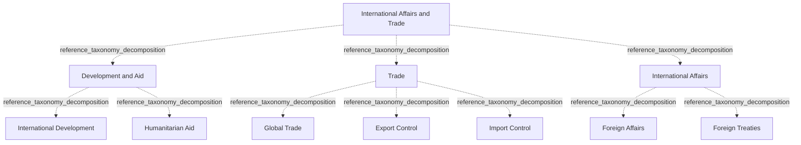

# G21D/fig2-1 · 拟议的国际事务与贸易部门 L1–L3 要素的结构与内容概览

类型：`decomposition-or-organization-model`。第 2 章开篇用这张图概览“国际事务与贸易”部门（L1）下的功能（L2）与服务（L3），随后的表 2-1 逐项给出说明。它是 11 个部门图中的第一张，也是图 1-1 三层结构的第一个具体展开；附录 A 第 48 页把它与图 3-1、图 4-1 汇总在同一页。

英文 PDF 物理页：[25]。本页为架构语义分析，原文与原图分别保留。

## 原图与可编辑图


[完整 JSON](fig2-1.json) · [可编辑 Mermaid](fig2-1.mmd) · [仅关系图](fig2-1.relations.mmd) · [层级分解图](fig2-1.hierarchy.mmd)

图形重建表达语义，不复制源图布局。虚线表示解释、矩阵映射或分组关系，不自动表示不确定性的概率。



## 架构分析

最外层浅蓝色大框是 L1 部门，顶部白色粗体字是部门名称。框内三个等宽的白色圆角框是 L2 功能，从左到右依次为发展与援助、贸易、国际事务。每个功能框里自上而下排列的胶囊形小框是 L3 服务。图中没有连线或箭头，上下级关系完全由框的嵌套表达，同一功能内的服务是并列的。

- 本图有 11 个具名或隐含元素、0 条关系和 10 条包含/分组记录。
- 包含/分组树最大深度为 2；根节点为 国际事务与贸易。
- 本图没有可直接确认为人员直属汇报的关系；视觉上下位置、能力分解和治理职责分别读取。
- 原图靠嵌套表达结构，没有连线；新语义图将包含单独显式化，不补造流程、数据流或依赖。
- 1个Sector、3个Function、7个Service的11个标签和所有边框逐项核对。
- Development and Aid两项、Trade三项、International Affairs两项；没有任何连接线或箭头。

### 如何用于项目

- 按父项展开所有直接子项，检查同层粒度、重叠和缺项。
- 保留组成、分类、能力分解与组织汇报的区别；将示例名称替换为已确认的项目对象。

### 结构所表达的逻辑

- 发展与援助含International Development、Humanitarian Aid；贸易含Global Trade、Export Control、Import Control；国际事务含Foreign Affairs、Foreign Treaties。
- 表2-1区分发展援助、人道恢复、贸易与进口出口管制、外交贡献与条约/伙伴关系。
- 服务框的上下排列无优先级或执行先后；本模型的分类不替代特定政府机构的职责授权。

## 上下级与包含

本图1→3→7的三层参考分类树，真实框包含各自子项；不扩大为现实服务唯一归属的普遍规则。

|父项|子项|层级类型|依据与解释|
|---|---|---|---|
|国际事务与贸易|发展与援助|reference_taxonomy_decomposition|图1-1定义的Sector/Function/Service参考分类由真实嵌套框表达，不是人员汇报。|
|国际事务与贸易|贸易|reference_taxonomy_decomposition|图1-1定义的Sector/Function/Service参考分类由真实嵌套框表达，不是人员汇报。|
|国际事务与贸易|国际事务|reference_taxonomy_decomposition|图1-1定义的Sector/Function/Service参考分类由真实嵌套框表达，不是人员汇报。|
|发展与援助|国际发展|reference_taxonomy_decomposition|图1-1定义的Sector/Function/Service参考分类由真实嵌套框表达，不是人员汇报。|
|发展与援助|人道主义援助|reference_taxonomy_decomposition|图1-1定义的Sector/Function/Service参考分类由真实嵌套框表达，不是人员汇报。|
|贸易|全球贸易|reference_taxonomy_decomposition|图1-1定义的Sector/Function/Service参考分类由真实嵌套框表达，不是人员汇报。|
|贸易|出口管制|reference_taxonomy_decomposition|图1-1定义的Sector/Function/Service参考分类由真实嵌套框表达，不是人员汇报。|
|贸易|进口管制|reference_taxonomy_decomposition|图1-1定义的Sector/Function/Service参考分类由真实嵌套框表达，不是人员汇报。|
|国际事务|外交事务|reference_taxonomy_decomposition|图1-1定义的Sector/Function/Service参考分类由真实嵌套框表达，不是人员汇报。|
|国际事务|外交条约|reference_taxonomy_decomposition|图1-1定义的Sector/Function/Service参考分类由真实嵌套框表达，不是人员汇报。|

## 全部元素与角色

|元素ID|原文名称|类型|含义|直接父项|深度|
|---|---|---|---|---|---|
|l1_international_affairs_trade|International Affairs and Trade|other|GRM 第 1 层“部门”，即政府的一个业务领域；词表没有对应类型，故用 other。|—||
|l2_development_aid|Development and Aid|function|为欠发达经济体提供发展援助与人道主义援助（表 2-1）。|国际事务与贸易|1|
|l2_trade|Trade|function|通过促进海外贸易增加繁荣（表 2-1）。|国际事务与贸易|1|
|l2_international_affairs|International Affairs|function|通过提供海外外交建议、谈判伙伴关系与协议来维护国际关系（表 2-1）。|国际事务与贸易|1|
|l3_international_development|International Development|service|通过货物与服务的自愿转移援助发展中经济体。|发展与援助|2|
|l3_humanitarian_aid|Humanitarian Aid|service|支持欠发达经济体实现增长并从冲突中恢复。|发展与援助|2|
|l3_global_trade|Global Trade|service|通过促进海外贸易、便利货物与服务流动来增加经济财富。|贸易|2|
|l3_export_control|Export Control|service|监管货物出口的国际销售与流动，确保遵守国内外协议与准则。|贸易|2|
|l3_import_control|Import Control|service|监管货物进入本国的国际采购与流动，确保遵守国内外协议与准则。|贸易|2|
|l3_foreign_affairs|Foreign Affairs|service|通过外交协助、与国际政府磋商作出国际贡献。|国际事务|2|
|l3_foreign_treaties|Foreign Treaties|service|监督现有条约，谈判伙伴关系与正式协议。|国际事务|2|

## 全部关系

图中没有任何连线或箭头。服务框位于功能框内，表示该服务属于该功能；功能框位于部门框内，表示该功能属于本部门（图 1-1 用菱形组合线表示同样的组成关系）。元素清单用 parent/level 记录这种嵌套，因此关系清单为空。

|主体|语义关系|客体|显式线/隐式|原文标签|依据|
|---|---|---|---|---|---|

## 误读检查

- 部门名“International Affairs and Trade”包含两个功能的名称“International Affairs”“Trade”，但功能只是部门的组成部分，与部门不是同一个框。
- 同一功能内服务的上下次序不表示优先级或流程先后。
- 中文稿引用的中文化 PNG 字号不统一（“发展与援助”比另两个功能标题大），不能用字号判断层级，应以框的嵌套为准。
- 图框下方的浅灰色线条是 PDF 评估版水印的残影，不属于图的内容。

## 原文证据

### [PDF 第 24 页](../../../documents/G21D.md#page-24)

> The intent of the GRM is that this will sit in Phase B: Business Architecture of the TOGAF Architecture Development Method (ADM) cycle. This will provide a reference for individuals in the public sector and a pattern for accelerating the development of a reference model within the Business Architecture space.
### [PDF 第 25 页](../../../documents/G21D.md#page-25)

> As shown in Figure 2-1, International Affairs and Trade consists of activities undertaken by the government to facilitate financial support and trade with international economies and related to the conduct and implementation of policies, aid programs, treaties, and diplomatic relations.
> Figure 2-1: Structure and Content Overview of the L1-L3 Elements of the Proposed International Affairs and
### [PDF 第 26 页](../../../documents/G21D.md#page-26)

> The future of international affairs and trade will be impacted by the trends captured below.
> Current demographics have led to a tacit assumption among rich and economically powerful nations that a mix of representative government, free market economies, and reformed state structures should represent future norms. However, the increased role of governance has led to growing tendencies to impose normative and administrative frameworks on aid organizations in order to regulate, register, and control their activities.
### [PDF 第 44 页](../../../documents/G21D.md#page-44)


## 来源与分析状态

所有元素/关系均有来源定位；未把历史解释重命名为本轮逐线视觉确认。源图与语义图是两种视图，布局不证明汇报或因果。

源 PDF SHA-256：`220ead5fef846c52417b9b7a915ff4a64f327680b384c369840926b85958786a`。

源图记录：[原始解释与转录](../../../figures/G21D/fig2-1.json)。

```json
{
  "quality": {
    "graph_integrity": "checked",
    "semantic_analysis": "typed-graph-and-context-analysis",
    "visual_review": "source-content-audited",
    "notice_zh": "所有元素/关系均有来源定位；未把历史解释重命名为本轮逐线视觉确认。源图与语义图是两种视图，布局不证明汇报或因果。"
  },
  "source_uncertainty": {
    "confidence": "high",
    "uncertainties_zh": [],
    "analyzed_from": [
      "英文 PDF 第 25 页原图截图",
      "英文 PDF 第 25–26 页正文（第 2 章开篇、表 2-1）",
      "英文 PDF 第 68 页附录 A 图示（同内容面板，用于复核标签）",
      "中文稿 G21De_政府参考模型.md 第 209–248 行",
      "figs/zh/g21de_fig2-1_zh.png（逐项对照）"
    ],
    "date": "2026-10-31"
  },
  "source_conflicts": []
}
```
