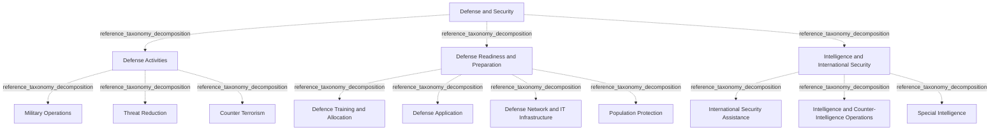

# G21D/fig3-1 · 拟议的国防与安全部门 L1–L3 要素的结构与内容概览

类型：`decomposition-or-organization-model`。第 3 章开篇用这张图概览“国防与安全”部门（L1）下的功能（L2）与服务（L3），随后的表 3-1 逐项给出说明。它是图 1-1 三层结构在本部门的具体展开，与其余 10 个部门图采用同一模板，附录 A 第 48 页把它与图 2-1、图 4-1 汇总在同一页。

英文 PDF 物理页：[28]。本页为架构语义分析，原文与原图分别保留。

## 原图与可编辑图


[完整 JSON](fig3-1.json) · [可编辑 Mermaid](fig3-1.mmd) · [仅关系图](fig3-1.relations.mmd) · [层级分解图](fig3-1.hierarchy.mmd)

图形重建表达语义，不复制源图布局。虚线表示解释、矩阵映射或分组关系，不自动表示不确定性的概率。



## 架构分析

最外层浅蓝色大框是 L1 部门，顶部白色粗体字是部门名称。框内三个等宽的白色圆角框是 L2 功能，从左到右依次为国防活动、国防准备与战备、情报与国际安全。每个功能框里自上而下排列的胶囊形小框是 L3 服务。图中没有连线或箭头，上下级关系完全由框的嵌套表达，同一功能内的服务是并列的。

- 本图有 14 个具名或隐含元素、0 条关系和 13 条包含/分组记录。
- 包含/分组树最大深度为 2；根节点为 国防与安全。
- 本图没有可直接确认为人员直属汇报的关系；视觉上下位置、能力分解和治理职责分别读取。
- 原图靠嵌套表达结构，没有连线；新语义图将包含单独显式化，不补造流程、数据流或依赖。
- 1个Sector、3个Function、10个Service的14个标签及全部嵌套核对，无箭头。
- 三功能下服务数量3/4/3；Defence Training拼写与表3-1的Defense不同，Counter Terrorism在表中有连字符。

### 如何用于项目

- 按父项展开所有直接子项，检查同层粒度、重叠和缺项。
- 保留组成、分类、能力分解与组织汇报的区别；将示例名称替换为已确认的项目对象。

### 结构所表达的逻辑

- 国防活动含Military Operations、Threat Reduction、Counter Terrorism。
- 国防准备含Defence Training and Allocation、Defense Application、Defense Network and IT Infrastructure、Population Protection。
- 情报与国际安全含International Security Assistance、Intelligence and Counter-Intelligence Operations、Special Intelligence。
- 表3-1对Military Operations给出杂项国防活动/采购费用例子，对International Security Assistance给出跨政府IT基础设施/网络/信息范围；服务范围不能只凭名称猜测。
- 所有子项是模型分类，未规定真实机构、人头、岗位技能或执行时序。

## 上下级与包含

本图1→3→10三层分类树，以真实嵌套表达；三列功能并列。

|父项|子项|层级类型|依据与解释|
|---|---|---|---|
|国防与安全|国防活动|reference_taxonomy_decomposition|Sector/Function/Service参考分类的框嵌套，不是具体编制或人员汇报。|
|国防与安全|国防准备与战备|reference_taxonomy_decomposition|Sector/Function/Service参考分类的框嵌套，不是具体编制或人员汇报。|
|国防与安全|情报与国际安全|reference_taxonomy_decomposition|Sector/Function/Service参考分类的框嵌套，不是具体编制或人员汇报。|
|国防活动|军事行动|reference_taxonomy_decomposition|Sector/Function/Service参考分类的框嵌套，不是具体编制或人员汇报。|
|国防活动|威胁削减|reference_taxonomy_decomposition|Sector/Function/Service参考分类的框嵌套，不是具体编制或人员汇报。|
|国防活动|反恐|reference_taxonomy_decomposition|Sector/Function/Service参考分类的框嵌套，不是具体编制或人员汇报。|
|国防准备与战备|国防训练与分配|reference_taxonomy_decomposition|Sector/Function/Service参考分类的框嵌套，不是具体编制或人员汇报。|
|国防准备与战备|国防应用|reference_taxonomy_decomposition|Sector/Function/Service参考分类的框嵌套，不是具体编制或人员汇报。|
|国防准备与战备|国防网络与 IT 基础设施|reference_taxonomy_decomposition|Sector/Function/Service参考分类的框嵌套，不是具体编制或人员汇报。|
|国防准备与战备|民众保护|reference_taxonomy_decomposition|Sector/Function/Service参考分类的框嵌套，不是具体编制或人员汇报。|
|情报与国际安全|国际安全援助|reference_taxonomy_decomposition|Sector/Function/Service参考分类的框嵌套，不是具体编制或人员汇报。|
|情报与国际安全|情报与反情报行动|reference_taxonomy_decomposition|Sector/Function/Service参考分类的框嵌套，不是具体编制或人员汇报。|
|情报与国际安全|特殊情报|reference_taxonomy_decomposition|Sector/Function/Service参考分类的框嵌套，不是具体编制或人员汇报。|

## 全部元素与角色

|元素ID|原文名称|类型|含义|直接父项|深度|
|---|---|---|---|---|---|
|l1_defense_security|Defense and Security|other|GRM 第 1 层“部门”，即政府的一个业务领域；词表没有对应类型，故用 other。|—||
|l2_defense_activities|Defense Activities|function|国家防务所利用的项目，包括国防相关活动、威胁削减与反恐（表 3-1）。|国防与安全|1|
|l2_defense_readiness_preparation|Defense Readiness and Preparation|function|部队与基础设施的维护、装备、采购与开发，以及向人员支付的薪酬与福利（表 3-1）。|国防与安全|1|
|l2_intelligence_international_security|Intelligence and International Security|function|保护、分析并理解政府与盟友需求与利益的活动（表 3-1）。|国防与安全|1|
|l3_military_operations|Military Operations|service|表 3-1 说明为所有杂项国防相关活动（如国家防务之外的采购费用）。|国防活动|2|
|l3_threat_reduction|Threat Reduction|service|减少与防止与威胁相关的货物或机密数据扩散，包括数据利用、信息机动与网络安全作战。|国防活动|2|
|l3_counter_terrorism|Counter Terrorism|service|消除与威慑恐怖主义行为的国内与国际响应；表 3-1 写作 Counter-Terrorism。|国防活动|2|
|l3_defence_training_allocation|Defence Training and Allocation|service|通过真实任务与模拟训练环境提升国防领域个人与集体绩效；图中用英式拼写 Defence，表 3-1 写作 Defense。|国防准备与战备|2|
|l3_defense_application|Defense Application|service|综合运用交战与机动，在所有环境中达成国防目标。|国防准备与战备|2|
|l3_defense_network_it|Defense Network and IT Infrastructure|service|为满足国防连接性与互操作需求的信息流动。|国防准备与战备|2|
|l3_population_protection|Population Protection|service|确保民众、政府与领导人安全并受保护。|国防准备与战备|2|
|l3_international_security_assistance|International Security Assistance|service|表 3-1 说明为利用跨政府 IT 基础设施、网络与信息保护政府利益并应对潜在威胁。|情报与国际安全|2|
|l3_intelligence_counter_intelligence|Intelligence and Counter-Intelligence Operations|service|服务：情报与反情报行动|情报与国际安全|2|
|l3_special_intelligence|Special Intelligence|service|为支持国家利益而处理、分析、收集信息的先进服务。|情报与国际安全|2|

### 反恐：属性

```json
{
  "table_label_en": "Counter-Terrorism"
}
```

### 国防训练与分配：属性

```json
{
  "table_label_en": "Defense Training and Allocation"
}
```

## 全部关系

图中没有任何连线或箭头。服务框位于功能框内，表示该服务属于该功能；功能框位于部门框内，表示该功能属于本部门（图 1-1 用菱形组合线表示同样的组成关系）。元素清单用 parent/level 记录这种嵌套，因此关系清单为空。

|主体|语义关系|客体|显式线/隐式|原文标签|依据|
|---|---|---|---|---|---|

## 误读检查

- 部分服务的名称与表 3-1 的说明并不对应：“Military Operations（军事行动）”的说明是所有杂项国防相关活动（如国家防务之外的采购费用）；“International Security Assistance（国际安全援助）”的说明是利用跨政府 IT 基础设施、网络与信息保护政府利益并应对潜在威胁。判断服务范围时以表 3-1 的说明为准，不要只凭名称。
- 图中拼写不统一：“Defence Training and Allocation”用英式拼写，其余为“Defense”；“Counter Terrorism”在表 3-1 中写作“Counter-Terrorism”。元素按图记录。
- 同一功能内服务的上下次序不表示优先级或流程先后。
- 中文稿引用的中文化 PNG 字号混乱（“国防活动”比另两个功能标题小得多），不能用字号判断层级，应以框的嵌套为准。
- 图框下方的浅灰色线条是 PDF 评估版水印的残影，不属于图的内容。

## 原文证据

### [PDF 第 24 页](../../../documents/G21D.md#page-24)

> The intent of the GRM is that this will sit in Phase B: Business Architecture of the TOGAF Architecture Development Method (ADM) cycle. This will provide a reference for individuals in the public sector and a pattern for accelerating the development of a reference model within the Business Architecture space.
### [PDF 第 28 页](../../../documents/G21D.md#page-28)

> As shown in Figure 3-1, Defense and Security corresponds to the research, maintenance, equipment, procurement, operations, and development of forces, weapons, and related entities. This also comprises remuneration and benefits paid to all active and non-active civilians and personnel.
> Figure 3-1: Structure and Content Overview of the L1-L3 Elements of the Proposed Defense and Security Sector
### [PDF 第 29 页](../../../documents/G21D.md#page-29)

### [PDF 第 62 页](../../../documents/G21D.md#page-62)

> Shared Services will also change influenced by common drivers that the government will need to consider.
> To meet new demands and public sector needs, there is a requirement for changes in the composition of the workforce through modernizing people acquisition, training, and retention. Intellectual property is also the differentiating and competitive factor in the public sector. With shortages in younger, tech-savvy staff, training is therefore key, including in the public sector.

## 来源与分析状态

所有元素/关系均有来源定位；未把历史解释重命名为本轮逐线视觉确认。源图与语义图是两种视图，布局不证明汇报或因果。

源 PDF SHA-256：`220ead5fef846c52417b9b7a915ff4a64f327680b384c369840926b85958786a`。

源图记录：[原始解释与转录](../../../figures/G21D/fig3-1.json)。

```json
{
  "quality": {
    "graph_integrity": "checked",
    "semantic_analysis": "typed-graph-and-context-analysis",
    "visual_review": "source-content-audited",
    "notice_zh": "所有元素/关系均有来源定位；未把历史解释重命名为本轮逐线视觉确认。源图与语义图是两种视图，布局不证明汇报或因果。"
  },
  "source_uncertainty": {
    "confidence": "high",
    "uncertainties_zh": [],
    "analyzed_from": [
      "英文 PDF 第 28 页原图截图",
      "英文 PDF 第 28–29 页正文（第 3 章开篇、表 3-1）",
      "英文 PDF 第 68 页附录 A 图示（同内容面板，用于复核标签）",
      "中文稿 G21De_政府参考模型.md 第 280–325 行",
      "figs/zh/g21de_fig3-1_zh.png（逐项对照）"
    ],
    "date": "2026-10-31"
  },
  "source_conflicts": [
    {
      "kind": "spelling-variant",
      "figure": "Defence Training and Allocation; Counter Terrorism",
      "table": "Defense Training and Allocation; Counter-Terrorism",
      "resolution_zh": "各自保留原词，不合并成新服务。"
    }
  ]
}
```
