# G21D/fig4-1 · 拟议的一般政府与地方服务部门 L1–L3 要素的结构与内容概览

类型：`decomposition-or-organization-model`。第 4 章开篇用这张图概览“一般政府与地方服务”部门（L1）下的功能（L2）与服务（L3），让读者先看到整个部门的分类结构；随后的表 4-1 逐项给出每个功能与服务的说明。它是图 1-1 三层结构在本部门的具体展开，与其余 10 个部门图采用同一模板，附录 A 第 48 页把它与图 2-1、图 3-1 汇总在同一页。

英文 PDF 物理页：[32]。本页为架构语义分析，原文与原图分别保留。

## 原图与可编辑图


[完整 JSON](fig4-1.json) · [可编辑 Mermaid](fig4-1.mmd) · [仅关系图](fig4-1.relations.mmd) · [层级分解图](fig4-1.hierarchy.mmd)

图形重建表达语义，不复制源图布局。虚线表示解释、矩阵映射或分组关系，不自动表示不确定性的概率。

```mermaid
flowchart TB
  %% Semantic reconstruction; see original source image for exact layout.
  n0["General Government and Local Services"]
  n1["Customer Services"]
  n2["Customer Operations"]
  n3["Local Service"]
  n4["Cashiers"]
  n5["Tax Forms"]
  n6["Front Desk"]
  n7["Imports Administrations"]
  n8["Planning Applications"]
  n9["Housing Gateway"]
  n10["Registration Cards"]
  n11["Social Security, Benefits, and Pensions"]
  n12["Business Licenses"]
  n13["Student Finance"]
  n14["License Applications"]
  n15["People Hub"]
  n16["Workforce Planning"]
  n17["Social Security"]
  n18["Benefits"]
  n19["Pensions"]
  n20["Income Support"]
  n21["Benefits Fraud"]
  n22["Customer Complaints"]
  n23["Back to Work"]
  n24["Superintendent Registrar"]
  n25["Community Planning and Consultation"]
  n26["Customer Forums"]
  n27["Community Grants"]
  n28["Neighbourhood Engagement and Development"]
  n29["Local Law"]
  n0 -.->|"reference_taxonomy_decomposition"| n1
  n0 -.->|"reference_taxonomy_decomposition"| n2
  n0 -.->|"reference_taxonomy_decomposition"| n3
  n1 -.->|"reference_taxonomy_decomposition"| n4
  n1 -.->|"reference_taxonomy_decomposition"| n5
  n1 -.->|"reference_taxonomy_decomposition"| n6
  n1 -.->|"reference_taxonomy_decomposition"| n7
  n1 -.->|"reference_taxonomy_decomposition"| n8
  n1 -.->|"reference_taxonomy_decomposition"| n9
  n1 -.->|"reference_taxonomy_decomposition"| n10
  n1 -.->|"reference_taxonomy_decomposition"| n11
  n1 -.->|"reference_taxonomy_decomposition"| n12
  n1 -.->|"reference_taxonomy_decomposition"| n13
  n1 -.->|"reference_taxonomy_decomposition"| n14
  n1 -.->|"reference_taxonomy_decomposition"| n15
  n1 -.->|"reference_taxonomy_decomposition"| n16
  n2 -.->|"reference_taxonomy_decomposition"| n17
  n2 -.->|"reference_taxonomy_decomposition"| n18
  n2 -.->|"reference_taxonomy_decomposition"| n19
  n2 -.->|"reference_taxonomy_decomposition"| n20
  n2 -.->|"reference_taxonomy_decomposition"| n21
  n2 -.->|"reference_taxonomy_decomposition"| n22
  n2 -.->|"reference_taxonomy_decomposition"| n23
  n3 -.->|"reference_taxonomy_decomposition"| n24
  n3 -.->|"reference_taxonomy_decomposition"| n25
  n3 -.->|"reference_taxonomy_decomposition"| n26
  n3 -.->|"reference_taxonomy_decomposition"| n27
  n3 -.->|"reference_taxonomy_decomposition"| n28
  n3 -.->|"reference_taxonomy_decomposition"| n29
```



## 架构分析

最外层浅蓝色大框是 L1 部门，顶部白色粗体字是部门名称。框内三个白色圆角框是 L2 功能，从左到右依次为客户服务、客户运营、地方服务，框顶黑色粗体字是功能名称。每个功能框里的胶囊形小框是 L3 服务。客户服务的服务较多，排成左右两列（左列 7 项、右列 6 项），按表 4-1 的顺序先读左列再读右列，两列地位相同。图中没有连线或箭头，上下级关系完全由框的嵌套表达，同一功能内的服务是并列的。

- 本图有 30 个具名或隐含元素、0 条关系和 29 条包含/分组记录。
- 包含/分组树最大深度为 2；根节点为 一般政府与地方服务。
- 本图没有可直接确认为人员直属汇报的关系；视觉上下位置、能力分解和治理职责分别读取。
- 原图靠嵌套表达结构，没有连线；新语义图将包含单独显式化，不补造流程、数据流或依赖。
- 30个可见标签及嵌套完整：1个部门、3个功能、26个服务，功能下数量13/7/6。
- Customer Services中的13项排为两列，但只有一个父框；不是两个额外功能。
- Social Security为图中文字，表4-1写Social Security Administration；原图Neighbourhood与表格Neighborhood为拼写变体。

### 如何用于项目

- 按父项展开所有直接子项，检查同层粒度、重叠和缺项。
- 保留组成、分类、能力分解与组织汇报的区别；将示例名称替换为已确认的项目对象。

### 结构所表达的逻辑

- Customer Services、Customer Operations、Local Service三个功能并列，服务数13/7/6。
- 客户服务聚合咨询、申请与文书；客户运营处理社会保障、福利、养老金等业务；地方服务支持特定地点或社区。
- Social Security, Benefits, and Pensions组合项与另一列三个独立服务属于不同语境；不合并名称或把前者拆成额外图元。
- 表4-1将Cashiers解释为咨询和文书职责、Registration Cards解释为庇护申请文书；不得仅凭通用词义替换原范围。

## 上下级与包含

按本图的部门→功能→服务框嵌套保存参考分类；同层平行，无执行或优先级次序；不推广为现实服务唯一归属规则。

|父项|子项|层级类型|依据与解释|
|---|---|---|---|
|一般政府与地方服务|客户服务|reference_taxonomy_decomposition|Sector/Function/Service参考分类由真实嵌套表达，不构成组织编制或人员汇报。|
|一般政府与地方服务|客户运营|reference_taxonomy_decomposition|Sector/Function/Service参考分类由真实嵌套表达，不构成组织编制或人员汇报。|
|一般政府与地方服务|地方服务|reference_taxonomy_decomposition|Sector/Function/Service参考分类由真实嵌套表达，不构成组织编制或人员汇报。|
|客户服务|出纳柜台|reference_taxonomy_decomposition|Sector/Function/Service参考分类由真实嵌套表达，不构成组织编制或人员汇报。|
|客户服务|税务表单|reference_taxonomy_decomposition|Sector/Function/Service参考分类由真实嵌套表达，不构成组织编制或人员汇报。|
|客户服务|前台|reference_taxonomy_decomposition|Sector/Function/Service参考分类由真实嵌套表达，不构成组织编制或人员汇报。|
|客户服务|进口管理|reference_taxonomy_decomposition|Sector/Function/Service参考分类由真实嵌套表达，不构成组织编制或人员汇报。|
|客户服务|规划申请|reference_taxonomy_decomposition|Sector/Function/Service参考分类由真实嵌套表达，不构成组织编制或人员汇报。|
|客户服务|住房门户|reference_taxonomy_decomposition|Sector/Function/Service参考分类由真实嵌套表达，不构成组织编制或人员汇报。|
|客户服务|登记卡|reference_taxonomy_decomposition|Sector/Function/Service参考分类由真实嵌套表达，不构成组织编制或人员汇报。|
|客户服务|社会保障、福利与养老金|reference_taxonomy_decomposition|Sector/Function/Service参考分类由真实嵌套表达，不构成组织编制或人员汇报。|
|客户服务|营业执照|reference_taxonomy_decomposition|Sector/Function/Service参考分类由真实嵌套表达，不构成组织编制或人员汇报。|
|客户服务|学生资助|reference_taxonomy_decomposition|Sector/Function/Service参考分类由真实嵌套表达，不构成组织编制或人员汇报。|
|客户服务|许可申请|reference_taxonomy_decomposition|Sector/Function/Service参考分类由真实嵌套表达，不构成组织编制或人员汇报。|
|客户服务|人员中心|reference_taxonomy_decomposition|Sector/Function/Service参考分类由真实嵌套表达，不构成组织编制或人员汇报。|
|客户服务|劳动力规划|reference_taxonomy_decomposition|Sector/Function/Service参考分类由真实嵌套表达，不构成组织编制或人员汇报。|
|客户运营|社会保障|reference_taxonomy_decomposition|Sector/Function/Service参考分类由真实嵌套表达，不构成组织编制或人员汇报。|
|客户运营|福利|reference_taxonomy_decomposition|Sector/Function/Service参考分类由真实嵌套表达，不构成组织编制或人员汇报。|
|客户运营|养老金|reference_taxonomy_decomposition|Sector/Function/Service参考分类由真实嵌套表达，不构成组织编制或人员汇报。|
|客户运营|收入补助|reference_taxonomy_decomposition|Sector/Function/Service参考分类由真实嵌套表达，不构成组织编制或人员汇报。|
|客户运营|福利欺诈|reference_taxonomy_decomposition|Sector/Function/Service参考分类由真实嵌套表达，不构成组织编制或人员汇报。|
|客户运营|客户投诉|reference_taxonomy_decomposition|Sector/Function/Service参考分类由真实嵌套表达，不构成组织编制或人员汇报。|
|客户运营|重返工作岗位|reference_taxonomy_decomposition|Sector/Function/Service参考分类由真实嵌套表达，不构成组织编制或人员汇报。|
|地方服务|登记主管|reference_taxonomy_decomposition|Sector/Function/Service参考分类由真实嵌套表达，不构成组织编制或人员汇报。|
|地方服务|社区规划与咨询|reference_taxonomy_decomposition|Sector/Function/Service参考分类由真实嵌套表达，不构成组织编制或人员汇报。|
|地方服务|客户论坛|reference_taxonomy_decomposition|Sector/Function/Service参考分类由真实嵌套表达，不构成组织编制或人员汇报。|
|地方服务|社区补助|reference_taxonomy_decomposition|Sector/Function/Service参考分类由真实嵌套表达，不构成组织编制或人员汇报。|
|地方服务|邻里参与与发展|reference_taxonomy_decomposition|Sector/Function/Service参考分类由真实嵌套表达，不构成组织编制或人员汇报。|
|地方服务|地方法规|reference_taxonomy_decomposition|Sector/Function/Service参考分类由真实嵌套表达，不构成组织编制或人员汇报。|

## 全部元素与角色

|元素ID|原文名称|类型|含义|直接父项|深度|
|---|---|---|---|---|---|
|l1_general_gov_local_services|General Government and Local Services|other|GRM 第 1 层“部门”，即政府的一个业务领域；词表没有对应类型，故用 other。表 1-1 写作“一般政府（客户服务、客户运营）与地方服务”。|—||
|l2_customer_services|Customer Services|function|向服务使用者提供协助与建议（表 4-1）。|一般政府与地方服务|1|
|l2_customer_operations|Customer Operations|function|直接与公众接触的职能（表 4-1）。|一般政府与地方服务|1|
|l2_local_service|Local Service|function|在特定地点或社区内提供服务（表 4-1）。|一般政府与地方服务|1|
|l3_cashiers|Cashiers|service|负责处理来访咨询和一般文书事务的人员。|客户服务|2|
|l3_tax_forms|Tax Forms|service|向纳税人和免税组织提供申报财务信息的表单。|客户服务|2|
|l3_front_desk|Front Desk|service|服务：前台|客户服务|2|
|l3_imports_admin|Imports Administrations|service|海外货物入境所需进口单证的收集、准备与咨询。|客户服务|2|
|l3_planning_applications|Planning Applications|service|在土地上建造或改变土地用途所需规划许可的管理与文书。|客户服务|2|
|l3_housing_gateway|Housing Gateway|service|可负担住房购买计划的运营、资格判定与申请评估。|客户服务|2|
|l3_registration_cards|Registration Cards|service|庇护申请人的整体管理与文书工作（表 4-1）。|客户服务|2|
|l3_ss_benefits_pensions|Social Security, Benefits, and Pensions|service|处理相关查询以及申请社会保障号码、福利与养老金计划所需的文书；实际管理在客户运营下。|客户服务|2|
|l3_business_licenses|Business Licenses|service|办理创办企业申请的流程。|客户服务|2|
|l3_student_finance|Student Finance|service|学生贷款与助学金的提供与管理。|客户服务|2|
|l3_license_applications|License Applications|service|从事受监管角色所需书面授权的管理与文书。|客户服务|2|
|l3_people_hub|People Hub|service|客户服务与运营岗位人员的招聘、行政与培训。|客户服务|2|
|l3_workforce_planning|Workforce Planning|service|服务：劳动力规划|客户服务|2|
|l3_social_security|Social Security|service|分配社会保障号码，管理退休、遗属与伤残保险计划。表 4-1 中此项写作 Social Security Administration（社会保障管理）。|客户运营|2|
|l3_benefits|Benefits|service|各类福利的提供与资格判定。|客户运营|2|
|l3_pensions|Pensions|service|定期发放固定款项，支持公民退休生活。|客户运营|2|
|l3_income_support|Income Support|service|服务：收入补助|客户运营|2|
|l3_benefits_fraud|Benefits Fraud|service|调查与处理冒领福利。|客户运营|2|
|l3_customer_complaints|Customer Complaints|service|服务：客户投诉|客户运营|2|
|l3_back_to_work|Back to Work|service|为职业中断后希望重返工作的人提供指导与支持。|客户运营|2|
|l3_superintendent_registrar|Superintendent Registrar|service|监督本地出生、婚姻与死亡登记。|地方服务|2|
|l3_community_planning_consultation|Community Planning and Consultation|service|服务：社区规划与咨询|地方服务|2|
|l3_customer_forums|Customer Forums|service|用于整合社区、分享反馈的在线渠道。|地方服务|2|
|l3_community_grants|Community Grants|service|服务：社区补助|地方服务|2|
|l3_neighbourhood_engagement|Neighbourhood Engagement and Development|service|表 4-1 拼作 Neighborhood；中文化 PNG 误作“社区参与与发展”。|地方服务|2|
|l3_local_law|Local Law|service|在城镇与区域层面提供法律建议并执行法律程序。|地方服务|2|

### 社会保障：属性

```json
{
  "table_label_en": "Social Security Administration"
}
```

### 邻里参与与发展：属性

```json
{
  "table_label_en": "Neighborhood Engagement and Development"
}
```

## 全部关系

图中没有任何连线或箭头。服务框位于功能框内，表示该服务属于该功能；功能框位于部门框内，表示该功能属于本部门（图 1-1 用菱形组合线表示同样的组成关系）。元素清单用 parent/level 记录这种嵌套，因此关系清单为空。

|主体|语义关系|客体|显式线/隐式|原文标签|依据|
|---|---|---|---|---|---|

## 误读检查

- 客户服务框内的左右两列只是排版，不是两个子功能；13 项服务都直接属于客户服务。
- 同一功能内服务的上下次序不表示优先级或流程先后。
- 客户服务下的“社会保障、福利与养老金”与客户运营下的“社会保障”“福利”“养老金”不是重复项：前者是受理与文书，后者是实际管理与发放。
- 图中写“Social Security”，英文原文表 4-1 与中文稿表 4-1 写作“Social Security Administration（社会保障管理）”；图中拼作英式“Neighbourhood”，表中为“Neighborhood”。两处都是原文自身的不一致，元素按图记录。
- 中文稿引用的中文化 PNG 字号混乱（部分服务标签比功能标题还大），不能用字号判断层级，应以框的嵌套为准；该 PNG 还把“邻里参与与发展”写成了“社区参与与发展”。
- 图框下方的浅灰色弧线是 PDF 评估版水印的残影，不属于图的内容。

## 原文证据

### [PDF 第 21 页](../../../documents/G21D.md#page-21)

> The Business Architecture defines the business strategy, governance, organization, business information, and key business processes of an Enterprise Architecture. An architecture approach determines how to effect change within the appropriate cost, benefit, and risk parameters.
> A challenge to this approach arises due to a lack of consistency in the application of architecture standards used to inform Business Architects or those intending to develop a Business Architecture or technical solution on the expected Architecture Building Blocks (ABBs) for governments worldwide.
### [PDF 第 22 页](../../../documents/G21D.md#page-22)

> Table 1-1 shows the names and description of various types of sectors that are in the GRM.
### [PDF 第 23 页](../../../documents/G21D.md#page-23)

> The reference model provides a taxonomy for each service provisioned by the government and a common language that simplifies complex information components, enables consistency of cross- government services and common capabilities, and delivers a consistent view of commonly required operational services.
> The intended audience of this GRM includes decision-makers and designers of change in the public sector.
### [PDF 第 24 页](../../../documents/G21D.md#page-24)

> The intent of the GRM is that this will sit in Phase B: Business Architecture of the TOGAF Architecture Development Method (ADM) cycle. This will provide a reference for individuals in the public sector and a pattern for accelerating the development of a reference model within the Business Architecture space.
### [PDF 第 32 页](../../../documents/G21D.md#page-32)

> As shown in Figure 4-1, General Government and Local Services involves the provision of general customer services and operations including registrations, licensing, applications, workforce planning, social services, management of labor rights, and local services.
> Figure 4-1: Structure and Content Overview of the L1-L3 Elements of the Proposed General Government and
### [PDF 第 33 页](../../../documents/G21D.md#page-33)

### [PDF 第 34 页](../../../documents/G21D.md#page-34)

### [PDF 第 48 页](../../../documents/G21D.md#page-48)


## 来源与分析状态

所有元素/关系均有来源定位；未把历史解释重命名为本轮逐线视觉确认。源图与语义图是两种视图，布局不证明汇报或因果。

源 PDF SHA-256：`220ead5fef846c52417b9b7a915ff4a64f327680b384c369840926b85958786a`。

源图记录：[原始解释与转录](../../../figures/G21D/fig4-1.json)。

```json
{
  "quality": {
    "graph_integrity": "checked",
    "semantic_analysis": "typed-graph-and-context-analysis",
    "visual_review": "source-content-audited",
    "notice_zh": "所有元素/关系均有来源定位；未把历史解释重命名为本轮逐线视觉确认。源图与语义图是两种视图，布局不证明汇报或因果。"
  },
  "source_uncertainty": {
    "confidence": "high",
    "uncertainties_zh": [
      "L3 的 order 按表 4-1 的顺序给出（客户服务框先左列后右列），原图本身没有编号。"
    ],
    "analyzed_from": [
      "英文 PDF 第 32 页原图截图及 3×3 放大分块（核对 Neighbourhood 拼写）",
      "英文 PDF 第 21–24 页（1.3–1.4 节）与第 32–34 页（第 4 章开篇、表 4-1）正文",
      "英文 PDF 第 68 页附录 A 图示（同内容面板）",
      "中文稿 G21De_政府参考模型.md 第 150–205 行、第 355–432 行",
      "figs/zh/g21de_fig4-1_zh.png（逐项对照）"
    ],
    "date": "2026-10-31"
  },
  "source_conflicts": [
    {
      "kind": "label-variant",
      "figure": "Social Security",
      "table": "Social Security Administration",
      "resolution_zh": "保留图上短名及表上全名，不新增第27个服务。"
    }
  ]
}
```
