# G21D/fig5-1 · 拟议的青少年与教育部门 L1–L3 要素的结构与内容概览

类型：`decomposition-or-organization-model`。第 5 章开篇用这张图概览“青少年与教育”部门（L1）下的功能（L2）与服务（L3），随后的表 5-1 逐项给出说明。它是图 1-1 三层结构在本部门的具体展开，与其余 10 个部门图采用同一模板，附录 A 第 49 页把它与图 6-1 汇总在同一页。

英文 PDF 物理页：[36]。本页为架构语义分析，原文与原图分别保留。

## 原图与可编辑图


[完整 JSON](fig5-1.json) · [可编辑 Mermaid](fig5-1.mmd) · [仅关系图](fig5-1.relations.mmd) · [层级分解图](fig5-1.hierarchy.mmd)

图形重建表达语义，不复制源图布局。虚线表示解释、矩阵映射或分组关系，不自动表示不确定性的概率。

```mermaid
flowchart TB
  %% Semantic reconstruction; see original source image for exact layout.
  n0["Young People and Education"]
  n1["Children’s Service"]
  n2["Education"]
  n3["Higher Education and Skills"]
  n4["Looked After Children"]
  n5["Fostering and Adoption"]
  n6["Children’s Social Care and Safeguarding"]
  n7["Family and Parenting"]
  n8["Early Years"]
  n9["Children and Adolescent Services"]
  n10["Primary Schools"]
  n11["Secondary Schools"]
  n12["Specialist Teaching"]
  n13["Standards and Achievement"]
  n14["Curriculum"]
  n15["Higher Education"]
  n16["Early Careers"]
  n17["Apprenticeships"]
  n0 -.->|"reference_taxonomy_decomposition"| n1
  n0 -.->|"reference_taxonomy_decomposition"| n2
  n0 -.->|"reference_taxonomy_decomposition"| n3
  n1 -.->|"reference_taxonomy_decomposition"| n4
  n1 -.->|"reference_taxonomy_decomposition"| n5
  n1 -.->|"reference_taxonomy_decomposition"| n6
  n1 -.->|"reference_taxonomy_decomposition"| n7
  n1 -.->|"reference_taxonomy_decomposition"| n8
  n1 -.->|"reference_taxonomy_decomposition"| n9
  n2 -.->|"reference_taxonomy_decomposition"| n10
  n2 -.->|"reference_taxonomy_decomposition"| n11
  n2 -.->|"reference_taxonomy_decomposition"| n12
  n2 -.->|"reference_taxonomy_decomposition"| n13
  n2 -.->|"reference_taxonomy_decomposition"| n14
  n3 -.->|"reference_taxonomy_decomposition"| n15
  n3 -.->|"reference_taxonomy_decomposition"| n16
  n3 -.->|"reference_taxonomy_decomposition"| n17
```



## 架构分析

最外层浅蓝色大框是 L1 部门，顶部白色粗体字是部门名称。框内三个等宽的白色圆角框是 L2 功能，从左到右依次为儿童服务、教育、高等教育与技能。每个功能框里自上而下排列的胶囊形小框是 L3 服务。图中没有连线或箭头，上下级关系完全由框的嵌套表达，同一功能内的服务是并列的。

- 本图有 18 个具名或隐含元素、0 条关系和 17 条包含/分组记录。
- 包含/分组树最大深度为 2；根节点为 青少年与教育。
- 本图没有可直接确认为人员直属汇报的关系；视觉上下位置、能力分解和治理职责分别读取。
- 原图靠嵌套表达结构，没有连线；新语义图将包含单独显式化，不补造流程、数据流或依赖。
- 18标签、1/3/14层级和所有边框核对，无连线。
- 三个功能下服务6/5/3；Early Years位于儿童服务，Higher Education为高等教育与技能的子服务。

### 如何用于项目

- 按父项展开所有直接子项，检查同层粒度、重叠和缺项。
- 保留组成、分类、能力分解与组织汇报的区别；将示例名称替换为已确认的项目对象。

### 结构所表达的逻辑

- 儿童服务6项覆盖照护、寄养收养、保护、家长支持、入学前发展与成年过渡。
- 学校教育5项为小学、中学、Specialist Teaching、Standards and Achievement、Curriculum；后三者不得合并成一项。
- 高等教育与技能3项为Higher Education、Early Careers、Apprenticeships；表5-1区分高等教育、工作场所培训与学徒制。
- 图中的Looked After Children与表中的Looked-after Children保留各自写法；参考分类不是服务实施阶段。

## 上下级与包含

按本图的部门→功能→服务框嵌套保存参考分类；同层平行，无执行或优先级次序；不推广为现实服务唯一归属规则。

|父项|子项|层级类型|依据与解释|
|---|---|---|---|
|青少年与教育|儿童服务|reference_taxonomy_decomposition|Sector/Function/Service参考分类由真实嵌套表达，不构成组织编制或人员汇报。|
|青少年与教育|教育|reference_taxonomy_decomposition|Sector/Function/Service参考分类由真实嵌套表达，不构成组织编制或人员汇报。|
|青少年与教育|高等教育与技能|reference_taxonomy_decomposition|Sector/Function/Service参考分类由真实嵌套表达，不构成组织编制或人员汇报。|
|儿童服务|受照料儿童|reference_taxonomy_decomposition|Sector/Function/Service参考分类由真实嵌套表达，不构成组织编制或人员汇报。|
|儿童服务|寄养与收养|reference_taxonomy_decomposition|Sector/Function/Service参考分类由真实嵌套表达，不构成组织编制或人员汇报。|
|儿童服务|儿童社会照护与保护|reference_taxonomy_decomposition|Sector/Function/Service参考分类由真实嵌套表达，不构成组织编制或人员汇报。|
|儿童服务|家庭与育儿|reference_taxonomy_decomposition|Sector/Function/Service参考分类由真实嵌套表达，不构成组织编制或人员汇报。|
|儿童服务|早期教育|reference_taxonomy_decomposition|Sector/Function/Service参考分类由真实嵌套表达，不构成组织编制或人员汇报。|
|儿童服务|儿童与青少年服务|reference_taxonomy_decomposition|Sector/Function/Service参考分类由真实嵌套表达，不构成组织编制或人员汇报。|
|教育|小学|reference_taxonomy_decomposition|Sector/Function/Service参考分类由真实嵌套表达，不构成组织编制或人员汇报。|
|教育|中学|reference_taxonomy_decomposition|Sector/Function/Service参考分类由真实嵌套表达，不构成组织编制或人员汇报。|
|教育|特殊教育|reference_taxonomy_decomposition|Sector/Function/Service参考分类由真实嵌套表达，不构成组织编制或人员汇报。|
|教育|标准与成就|reference_taxonomy_decomposition|Sector/Function/Service参考分类由真实嵌套表达，不构成组织编制或人员汇报。|
|教育|课程|reference_taxonomy_decomposition|Sector/Function/Service参考分类由真实嵌套表达，不构成组织编制或人员汇报。|
|高等教育与技能|高等教育|reference_taxonomy_decomposition|Sector/Function/Service参考分类由真实嵌套表达，不构成组织编制或人员汇报。|
|高等教育与技能|早期职业|reference_taxonomy_decomposition|Sector/Function/Service参考分类由真实嵌套表达，不构成组织编制或人员汇报。|
|高等教育与技能|学徒制|reference_taxonomy_decomposition|Sector/Function/Service参考分类由真实嵌套表达，不构成组织编制或人员汇报。|

## 全部元素与角色

|元素ID|原文名称|类型|含义|直接父项|深度|
|---|---|---|---|---|---|
|l1_young_people_education|Young People and Education|other|GRM 第 1 层“部门”，即政府的一个业务领域；词表没有对应类型，故用 other。|—||
|l2_childrens_service|Children’s Service|function|对应社会服务，以及早期阶段的额外保护、青少年支持与家长支持（表 5-1）。|青少年与教育|1|
|l2_education|Education|function|通过学校教育向儿童提供技能与知识，并遵循国家期望与标准（表 5-1）。|青少年与教育|1|
|l2_higher_education_skills|Higher Education and Skills|function|支持工作相关学科的继续教育与培训，包括学徒制、在职培训，以及与行业和高等教育机构的沟通（表 5-1）。|青少年与教育|1|
|l3_looked_after_children|Looked After Children|service|因强制照护令或父母协议而由地方当局照料的儿童；表 5-1 写作 Looked-after Children。|儿童服务|2|
|l3_fostering_adoption|Fostering and Adoption|service|服务：寄养与收养|儿童服务|2|
|l3_childrens_social_care|Children’s Social Care and Safeguarding|service|保护培训、政策与流程，确保所有儿童免受伤害。|儿童服务|2|
|l3_family_parenting|Family and Parenting|service|服务：家庭与育儿|儿童服务|2|
|l3_early_years|Early Years|service|支持儿童入学前的学习、发展与照护。|儿童服务|2|
|l3_children_adolescent_services|Children and Adolescent Services|service|在迈向成年的各个过渡阶段提供支持与指导。|儿童服务|2|
|l3_primary_schools|Primary Schools|service|服务：小学|教育|2|
|l3_secondary_schools|Secondary Schools|service|服务：中学|教育|2|
|l3_specialist_teaching|Specialist Teaching|service|为学生提供额外帮助、调整后的课程或学习环境、特定设备或材料。|教育|2|
|l3_standards_achievement|Standards and Achievement|service|开发符合教育标准的课程、学习与考试材料，管理考试并认证资质。|教育|2|
|l3_curriculum|Curriculum|service|规定必修课程与单元，确保各教育机构一致。|教育|2|
|l3_higher_education|Higher Education|service|中学之后的教育。|高等教育与技能|2|
|l3_early_careers|Early Careers|service|通过工作场所与实习提供培训。|高等教育与技能|2|
|l3_apprenticeships|Apprenticeships|service|在职培训与课堂培训相结合。|高等教育与技能|2|

### 受照料儿童：属性

```json
{
  "table_label_en": "Looked-after Children"
}
```

## 全部关系

图中没有任何连线或箭头。服务框位于功能框内，表示该服务属于该功能；功能框位于部门框内，表示该功能属于本部门（图 1-1 用菱形组合线表示同样的组成关系）。元素清单用 parent/level 记录这种嵌套，因此关系清单为空。

|主体|语义关系|客体|显式线/隐式|原文标签|依据|
|---|---|---|---|---|---|

## 误读检查

- “Early Years（早期教育）”指儿童入学前的学习、发展与照护，不是小学低年级。
- “Specialist Teaching（特殊教育）”指为学生提供额外帮助、调整后的课程或学习环境、特定设备或材料，不是分学科的专科教学。
- “Early Careers（早期职业）”指通过工作场所与实习提供的职业起步培训，与儿童的“早期”无关。
- “Looked After Children（受照料儿童）”是英国用语，指因强制照护令或父母协议而由地方当局照料的儿童；表 5-1 写作 Looked-after Children，元素按图记录。
- 同一功能内服务的上下次序不表示优先级或流程先后。
- 中文稿引用的中文化 PNG 字号混乱（部分服务标签比功能标题还大），不能用字号判断层级，应以框的嵌套为准。
- 图框下方的浅灰色弧线是 PDF 评估版水印的残影，不属于图的内容。

## 原文证据

### [PDF 第 23 页](../../../documents/G21D.md#page-23)

> The reference model provides a taxonomy for each service provisioned by the government and a common language that simplifies complex information components, enables consistency of cross- government services and common capabilities, and delivers a consistent view of commonly required operational services.
> The intended audience of this GRM includes decision-makers and designers of change in the public sector.
### [PDF 第 24 页](../../../documents/G21D.md#page-24)

> The intent of the GRM is that this will sit in Phase B: Business Architecture of the TOGAF Architecture Development Method (ADM) cycle. This will provide a reference for individuals in the public sector and a pattern for accelerating the development of a reference model within the Business Architecture space.
### [PDF 第 33 页](../../../documents/G21D.md#page-33)

### [PDF 第 36 页](../../../documents/G21D.md#page-36)

> As shown in Figure 5-1, Young People and Education comprises educational programs that correspond to early years, primary school, secondary school, higher education, and specialist schooling. This also includes children’s social services, safeguarding, and associated children and adolescent services; as well as skill or training activities undertaken by the government to promote education.
> Figure 5-1: Structure and Content Overview of the L1-L3 Elements of the Proposed Young People and Education
### [PDF 第 37 页](../../../documents/G21D.md#page-37)

### [PDF 第 40 页](../../../documents/G21D.md#page-40)

### [PDF 第 44 页](../../../documents/G21D.md#page-44)


## 来源与分析状态

所有元素/关系均有来源定位；未把历史解释重命名为本轮逐线视觉确认。源图与语义图是两种视图，布局不证明汇报或因果。

源 PDF SHA-256：`220ead5fef846c52417b9b7a915ff4a64f327680b384c369840926b85958786a`。

源图记录：[原始解释与转录](../../../figures/G21D/fig5-1.json)。

```json
{
  "quality": {
    "graph_integrity": "checked",
    "semantic_analysis": "typed-graph-and-context-analysis",
    "visual_review": "source-content-audited",
    "notice_zh": "所有元素/关系均有来源定位；未把历史解释重命名为本轮逐线视觉确认。源图与语义图是两种视图，布局不证明汇报或因果。"
  },
  "source_uncertainty": {
    "confidence": "high",
    "uncertainties_zh": [],
    "analyzed_from": [
      "英文 PDF 第 36 页原图截图",
      "英文 PDF 第 36–37 页正文（第 5 章开篇、表 5-1）及第 21–24 页（1.3–1.4 节）",
      "英文 PDF 第 69 页附录 A 图示（同内容面板，用于复核标签）",
      "中文稿 G21De_政府参考模型.md 第 461–515 行",
      "figs/zh/g21de_fig5-1_zh.png（逐项对照）"
    ],
    "date": "2026-10-31"
  },
  "source_conflicts": []
}
```
