# G21D/fig6-1 · 拟议的健康与社区福祉部门 L1–L3 要素的结构与内容概览

类型：`decomposition-or-organization-model`。第 6 章开篇用这张图概览“健康与社区福祉”部门（L1）下的功能（L2）与服务（L3），随后的表 6-1 逐项给出说明。它是图 1-1 三层结构在本部门的具体展开，与其余 10 个部门图采用同一模板，附录 A 第 49 页把它与图 5-1 汇总在同一页。

英文 PDF 物理页：[39]。本页为架构语义分析，原文与原图分别保留。

## 原图与可编辑图


[完整 JSON](fig6-1.json) · [可编辑 Mermaid](fig6-1.mmd) · [仅关系图](fig6-1.relations.mmd) · [层级分解图](fig6-1.hierarchy.mmd)

图形重建表达语义，不复制源图布局。虚线表示解释、矩阵映射或分组关系，不自动表示不确定性的概率。

```mermaid
flowchart TB
  %% Semantic reconstruction; see original source image for exact layout.
  n0["Health and Community Wellbeing"]
  n1["Hospital and Community Services"]
  n2["Medical"]
  n3["Nursing"]
  n4["Adult Social Care"]
  n5["Adult Mental Health"]
  n6["Preventative Health"]
  n7["Psychotherapy"]
  n8["Counseling"]
  n9["Community Services"]
  n10["Adult Safeguarding"]
  n11["Medical Aligned Professions"]
  n12["Hospital Inpatients"]
  n13["Hospital Outpatients"]
  n14["Facilities Management"]
  n15["Emergency Services"]
  n16["Medical Professional Lead"]
  n17["Primary Care Strategy"]
  n18["Regulatory Oversight"]
  n19["Information and Strategy Governance"]
  n20["Mortality"]
  n21["Litigation"]
  n22["Pharmacy"]
  n23["Nursing Strategy and Governance"]
  n24["Nursing Standards and QA"]
  n25["Health and Community Nursing"]
  n0 -.->|"reference_taxonomy_decomposition"| n1
  n0 -.->|"reference_taxonomy_decomposition"| n2
  n0 -.->|"reference_taxonomy_decomposition"| n3
  n1 -.->|"reference_taxonomy_decomposition"| n4
  n1 -.->|"reference_taxonomy_decomposition"| n5
  n1 -.->|"reference_taxonomy_decomposition"| n6
  n1 -.->|"reference_taxonomy_decomposition"| n7
  n1 -.->|"reference_taxonomy_decomposition"| n8
  n1 -.->|"reference_taxonomy_decomposition"| n9
  n1 -.->|"reference_taxonomy_decomposition"| n10
  n1 -.->|"reference_taxonomy_decomposition"| n11
  n1 -.->|"reference_taxonomy_decomposition"| n12
  n1 -.->|"reference_taxonomy_decomposition"| n13
  n1 -.->|"reference_taxonomy_decomposition"| n14
  n1 -.->|"reference_taxonomy_decomposition"| n15
  n2 -.->|"reference_taxonomy_decomposition"| n16
  n2 -.->|"reference_taxonomy_decomposition"| n17
  n2 -.->|"reference_taxonomy_decomposition"| n18
  n2 -.->|"reference_taxonomy_decomposition"| n19
  n2 -.->|"reference_taxonomy_decomposition"| n20
  n2 -.->|"reference_taxonomy_decomposition"| n21
  n2 -.->|"reference_taxonomy_decomposition"| n22
  n3 -.->|"reference_taxonomy_decomposition"| n23
  n3 -.->|"reference_taxonomy_decomposition"| n24
  n3 -.->|"reference_taxonomy_decomposition"| n25
```



## 架构分析

最外层浅蓝色大框是 L1 部门，顶部白色粗体字是部门名称。框内三个等宽的白色圆角框是 L2 功能，从左到右依次为医院与社区服务、医疗、护理。每个功能框里自上而下排列的胶囊形小框是 L3 服务。图中没有连线或箭头，上下级关系完全由框的嵌套表达，同一功能内的服务是并列的。

- 本图有 26 个具名或隐含元素、0 条关系和 25 条包含/分组记录。
- 包含/分组树最大深度为 2；根节点为 健康与社区福祉。
- 本图没有可直接确认为人员直属汇报的关系；视觉上下位置、能力分解和治理职责分别读取。
- 原图靠嵌套表达结构，没有连线；新语义图将包含单独显式化，不补造流程、数据流或依赖。
- 26标签、1/3/22层级全部核对；医院社区12项、Medical7项、Nursing3项。
- 图中Hospital Inpatients在Outpatients上方，表6-1顺序相反；仅排列不同，不改分类。
- Medical Professional Lead虽像岗位名，但表6-1将其定义为设定医疗实践方向的服务，保留Service类型。

### 如何用于项目

- 按父项展开所有直接子项，检查同层粒度、重叠和缺项。
- 保留组成、分类、能力分解与组织汇报的区别；将示例名称替换为已确认的项目对象。

### 结构所表达的逻辑

- 医院与社区服务12项包含成人照护、心理健康、预防、心理治疗与咨询、社区服务、成人保护、医疗相关专业、住院门诊、设施与急救。
- Medical7项、Nursing3项以各自表定义界定，不能把Medical Professional Lead自动生成一个招聘岗位。
- 同层排列没有流程含义，住院/门诊顺序在图和表不同不构成矛盾业务关系。
- 表6-1的Psychotherapy说明印为physiological methods；记录原词，不静默改成psychological。本图只用于政府服务分类。

## 上下级与包含

按本图的部门→功能→服务框嵌套保存参考分类；同层平行，无执行或优先级次序；不推广为现实服务唯一归属规则。

|父项|子项|层级类型|依据与解释|
|---|---|---|---|
|健康与社区福祉|医院与社区服务|reference_taxonomy_decomposition|Sector/Function/Service参考分类由真实嵌套表达，不构成组织编制或人员汇报。|
|健康与社区福祉|医疗|reference_taxonomy_decomposition|Sector/Function/Service参考分类由真实嵌套表达，不构成组织编制或人员汇报。|
|健康与社区福祉|护理|reference_taxonomy_decomposition|Sector/Function/Service参考分类由真实嵌套表达，不构成组织编制或人员汇报。|
|医院与社区服务|成人社会照护|reference_taxonomy_decomposition|Sector/Function/Service参考分类由真实嵌套表达，不构成组织编制或人员汇报。|
|医院与社区服务|成人心理健康|reference_taxonomy_decomposition|Sector/Function/Service参考分类由真实嵌套表达，不构成组织编制或人员汇报。|
|医院与社区服务|预防性健康|reference_taxonomy_decomposition|Sector/Function/Service参考分类由真实嵌套表达，不构成组织编制或人员汇报。|
|医院与社区服务|心理治疗|reference_taxonomy_decomposition|Sector/Function/Service参考分类由真实嵌套表达，不构成组织编制或人员汇报。|
|医院与社区服务|咨询（心理咨询）|reference_taxonomy_decomposition|Sector/Function/Service参考分类由真实嵌套表达，不构成组织编制或人员汇报。|
|医院与社区服务|社区服务|reference_taxonomy_decomposition|Sector/Function/Service参考分类由真实嵌套表达，不构成组织编制或人员汇报。|
|医院与社区服务|成人保护|reference_taxonomy_decomposition|Sector/Function/Service参考分类由真实嵌套表达，不构成组织编制或人员汇报。|
|医院与社区服务|医疗相关专业|reference_taxonomy_decomposition|Sector/Function/Service参考分类由真实嵌套表达，不构成组织编制或人员汇报。|
|医院与社区服务|医院住院|reference_taxonomy_decomposition|Sector/Function/Service参考分类由真实嵌套表达，不构成组织编制或人员汇报。|
|医院与社区服务|医院门诊|reference_taxonomy_decomposition|Sector/Function/Service参考分类由真实嵌套表达，不构成组织编制或人员汇报。|
|医院与社区服务|设施管理|reference_taxonomy_decomposition|Sector/Function/Service参考分类由真实嵌套表达，不构成组织编制或人员汇报。|
|医院与社区服务|急救服务|reference_taxonomy_decomposition|Sector/Function/Service参考分类由真实嵌套表达，不构成组织编制或人员汇报。|
|医疗|医疗专业领导|reference_taxonomy_decomposition|Sector/Function/Service参考分类由真实嵌套表达，不构成组织编制或人员汇报。|
|医疗|初级医疗战略|reference_taxonomy_decomposition|Sector/Function/Service参考分类由真实嵌套表达，不构成组织编制或人员汇报。|
|医疗|监管监督|reference_taxonomy_decomposition|Sector/Function/Service参考分类由真实嵌套表达，不构成组织编制或人员汇报。|
|医疗|信息与战略治理|reference_taxonomy_decomposition|Sector/Function/Service参考分类由真实嵌套表达，不构成组织编制或人员汇报。|
|医疗|死亡事务|reference_taxonomy_decomposition|Sector/Function/Service参考分类由真实嵌套表达，不构成组织编制或人员汇报。|
|医疗|诉讼|reference_taxonomy_decomposition|Sector/Function/Service参考分类由真实嵌套表达，不构成组织编制或人员汇报。|
|医疗|药房|reference_taxonomy_decomposition|Sector/Function/Service参考分类由真实嵌套表达，不构成组织编制或人员汇报。|
|护理|护理战略与治理|reference_taxonomy_decomposition|Sector/Function/Service参考分类由真实嵌套表达，不构成组织编制或人员汇报。|
|护理|护理标准与质量保证|reference_taxonomy_decomposition|Sector/Function/Service参考分类由真实嵌套表达，不构成组织编制或人员汇报。|
|护理|健康与社区护理|reference_taxonomy_decomposition|Sector/Function/Service参考分类由真实嵌套表达，不构成组织编制或人员汇报。|

## 全部元素与角色

|元素ID|原文名称|类型|含义|直接父项|深度|
|---|---|---|---|---|---|
|l1_health_community_wellbeing|Health and Community Wellbeing|other|GRM 第 1 层“部门”，即政府的一个业务领域；词表没有对应类型，故用 other。|—||
|l2_hospital_community_services|Hospital and Community Services|function|为保障成人的心理与身体健康而提供的服务（表 6-1）。|健康与社区福祉|1|
|l2_medical|Medical|function|涵盖医学的类型、分类和/或专科（表 6-1）。|健康与社区福祉|1|
|l2_nursing|Nursing|function|提供与照护病患及体弱者相关的服务（表 6-1）。|健康与社区福祉|1|
|l3_adult_social_care|Adult Social Care|service|支持有身体或学习困难的成人。|医院与社区服务|2|
|l3_adult_mental_health|Adult Mental Health|service|服务：成人心理健康|医院与社区服务|2|
|l3_preventative_health|Preventative Health|service|为预防疾病而提供的照护。|医院与社区服务|2|
|l3_psychotherapy|Psychotherapy|service|服务：心理治疗|医院与社区服务|2|
|l3_counseling|Counseling|service|用谈话疗法帮助有心理与情绪困难的成人；中文稿译作“咨询”。|医院与社区服务|2|
|l3_community_services|Community Services|service|保护社区成员身心健康并监测社区健康服务。|医院与社区服务|2|
|l3_adult_safeguarding|Adult Safeguarding|service|服务：成人保护|医院与社区服务|2|
|l3_medical_aligned_professions|Medical Aligned Professions|service|由注册或合格医疗专业人员提供的诊断、技术、治疗与支持服务。|医院与社区服务|2|
|l3_hospital_inpatients|Hospital Inpatients|service|至少一晚的医院照护与监护；表 6-1 中列在门诊之后。|医院与社区服务|2|
|l3_hospital_outpatients|Hospital Outpatients|service|不足一晚的医院照护与监护。|医院与社区服务|2|
|l3_facilities_management|Facilities Management|service|医院与社区设施的维护与管理。|医院与社区服务|2|
|l3_emergency_services|Emergency Services|service|院前照护：救护车、紧急响应与院外治疗。|医院与社区服务|2|
|l3_medical_professional_lead|Medical Professional Lead|service|为医疗实践与医疗专业人员设定方向。|医疗|2|
|l3_primary_care_strategy|Primary Care Strategy|service|服务：初级医疗战略|医疗|2|
|l3_regulatory_oversight|Regulatory Oversight|service|协调各项职能，确保政策一致实施。|医疗|2|
|l3_info_strategy_governance|Information and Strategy Governance|service|服务：信息与战略治理|医疗|2|
|l3_mortality|Mortality|service|与死亡及丧亲相关的服务与信息。|医疗|2|
|l3_litigation|Litigation|service|针对公共部门医疗方提起的争议或法律行动。|医疗|2|
|l3_pharmacy|Pharmacy|service|服务：药房|医疗|2|
|l3_nursing_strategy_governance|Nursing Strategy and Governance|service|服务：护理战略与治理|护理|2|
|l3_nursing_standards_qa|Nursing Standards and QA|service|评估患者照护标准与护士专业能力。|护理|2|
|l3_health_community_nursing|Health and Community Nursing|service|管理社区与健康照护，领导地区护士、社区护士与支持人员团队。|护理|2|

## 全部关系

图中没有任何连线或箭头。服务框位于功能框内，表示该服务属于该功能；功能框位于部门框内，表示该功能属于本部门（图 1-1 用菱形组合线表示同样的组成关系）。元素清单用 parent/level 记录这种嵌套，因此关系清单为空。

|主体|语义关系|客体|显式线/隐式|原文标签|依据|
|---|---|---|---|---|---|

## 误读检查

- “Counseling”指用谈话疗法帮助有心理与情绪困难的成人；中文稿译作“咨询”，应理解为心理咨询，而不是一般业务咨询。
- “Mortality（死亡事务）”指与死亡及丧亲相关的服务与信息，不是死亡率统计；“Litigation（诉讼）”指针对公共部门医疗方提起的争议或法律行动。
- 图中住院在门诊之前，表 6-1 中门诊在住院之前；同一功能内服务的上下次序不表示优先级或流程先后。
- 中文稿引用的中文化 PNG 字号混乱（“医疗”“护理”两个功能标题比服务标签还小），不能用字号判断层级，应以框的嵌套为准。
- 图框下方的浅灰色线条是 PDF 评估版水印的残影，不属于图的内容。

## 原文证据

### [PDF 第 23 页](../../../documents/G21D.md#page-23)

> The reference model provides a taxonomy for each service provisioned by the government and a common language that simplifies complex information components, enables consistency of cross- government services and common capabilities, and delivers a consistent view of commonly required operational services.
> The intended audience of this GRM includes decision-makers and designers of change in the public sector.
### [PDF 第 24 页](../../../documents/G21D.md#page-24)

> The intent of the GRM is that this will sit in Phase B: Business Architecture of the TOGAF Architecture Development Method (ADM) cycle. This will provide a reference for individuals in the public sector and a pattern for accelerating the development of a reference model within the Business Architecture space.
### [PDF 第 37 页](../../../documents/G21D.md#page-37)

### [PDF 第 39 页](../../../documents/G21D.md#page-39)

> As shown in Figure 6-1, Health and Community Wellbeing encompasses medical and nursing governance, strategy and care services provided to individuals and families, research and the provision of hospital and community services to safeguard mental and physical health.
> Figure 6-1: Structure and Content Overview of the L1-L3 Elements of the Proposed Health and Community
### [PDF 第 40 页](../../../documents/G21D.md#page-40)

### [PDF 第 41 页](../../../documents/G21D.md#page-41)

> The Health and Community Wellbeing sector faces enormous changes and challenges arising from greater life expectancy and as medical practices start to shift from traditional practices of prioritizing disease treatment to prevention.
> It is reasonable to expect longer-term trends in life expectancy to continue as a result of a combination of:
### [PDF 第 44 页](../../../documents/G21D.md#page-44)


## 来源与分析状态

所有元素/关系均有来源定位；未把历史解释重命名为本轮逐线视觉确认。源图与语义图是两种视图，布局不证明汇报或因果。

源 PDF SHA-256：`220ead5fef846c52417b9b7a915ff4a64f327680b384c369840926b85958786a`。

源图记录：[原始解释与转录](../../../figures/G21D/fig6-1.json)。

```json
{
  "quality": {
    "graph_integrity": "checked",
    "semantic_analysis": "typed-graph-and-context-analysis",
    "visual_review": "source-content-audited",
    "notice_zh": "所有元素/关系均有来源定位；未把历史解释重命名为本轮逐线视觉确认。源图与语义图是两种视图，布局不证明汇报或因果。"
  },
  "source_uncertainty": {
    "confidence": "high",
    "uncertainties_zh": [],
    "analyzed_from": [
      "英文 PDF 第 39 页原图截图",
      "英文 PDF 第 39–41 页正文（第 6 章开篇、表 6-1）及第 21–24 页（1.3–1.4 节）",
      "英文 PDF 第 69 页附录 A 图示（同内容面板，用于复核标签）",
      "中文稿 G21De_政府参考模型.md 第 543–613 行",
      "figs/zh/g21de_fig6-1_zh.png（逐项对照）"
    ],
    "date": "2026-10-31"
  },
  "source_conflicts": [
    {
      "kind": "source-wording-ambiguity",
      "pdf_page": 40,
      "quote_en": "Involves the use of physiological methods",
      "resolution_zh": "原文词保留；不据此推导医学方法建议或擅自纠正。"
    }
  ]
}
```
