# G21D/fig7-1 · 拟议的司法、治安与内政部门 L1–L3 要素的结构与内容概览

类型：`decomposition-or-organization-model`。第 7 章开篇用这张图概览“司法、治安与内政”部门（L1）下的功能（L2）与服务（L3），随后的表 7-1 逐项给出说明。它是图 1-1 三层结构在本部门的具体展开，与其余 10 个部门图采用同一模板，附录 A 第 50 页把它与图 8-1 汇总在同一页。

英文 PDF 物理页：[43]。本页为架构语义分析，原文与原图分别保留。

## 原图与可编辑图


[完整 JSON](fig7-1.json) · [可编辑 Mermaid](fig7-1.mmd) · [仅关系图](fig7-1.relations.mmd) · [层级分解图](fig7-1.hierarchy.mmd)

图形重建表达语义，不复制源图布局。虚线表示解释、矩阵映射或分组关系，不自动表示不确定性的概率。

```mermaid
flowchart TB
  %% Semantic reconstruction; see original source image for exact layout.
  n0["Judiciary, Justice, and Home Affairs"]
  n1["Protection and Law Enforcement"]
  n2["Criminal Justice and Offender Management"]
  n3["Customs"]
  n4["Immigration"]
  n5["Emergency Planning"]
  n6["Fire Service"]
  n7["Health and Safety"]
  n8["Police Service"]
  n9["Youth Offending"]
  n10["Criminal Justice"]
  n11["Prison Monitoring"]
  n12["Police Authority"]
  n13["Law Commission"]
  n14["Criminal Compensation"]
  n15["Police Complaints"]
  n0 -.->|"reference_taxonomy_decomposition"| n1
  n0 -.->|"reference_taxonomy_decomposition"| n2
  n1 -.->|"reference_taxonomy_decomposition"| n3
  n1 -.->|"reference_taxonomy_decomposition"| n4
  n1 -.->|"reference_taxonomy_decomposition"| n5
  n1 -.->|"reference_taxonomy_decomposition"| n6
  n1 -.->|"reference_taxonomy_decomposition"| n7
  n1 -.->|"reference_taxonomy_decomposition"| n8
  n2 -.->|"reference_taxonomy_decomposition"| n9
  n2 -.->|"reference_taxonomy_decomposition"| n10
  n2 -.->|"reference_taxonomy_decomposition"| n11
  n2 -.->|"reference_taxonomy_decomposition"| n12
  n2 -.->|"reference_taxonomy_decomposition"| n13
  n2 -.->|"reference_taxonomy_decomposition"| n14
  n2 -.->|"reference_taxonomy_decomposition"| n15
```



## 架构分析

最外层浅蓝色大框是 L1 部门，顶部白色粗体字是部门名称。框内两个白色圆角框是 L2 功能，左为保护与执法，右为刑事司法与罪犯管理。每个功能框里自上而下排列的胶囊形小框是 L3 服务。图中没有连线或箭头，上下级关系完全由框的嵌套表达，同一功能内的服务是并列的。

- 本图有 16 个具名或隐含元素、0 条关系和 15 条包含/分组记录。
- 包含/分组树最大深度为 2；根节点为 司法、治安与内政。
- 本图没有可直接确认为人员直属汇报的关系；视觉上下位置、能力分解和治理职责分别读取。
- 原图靠嵌套表达结构，没有连线；新语义图将包含单独显式化，不补造流程、数据流或依赖。
- 16标签与1/2/13三层完整核对；保护执法6项、刑事司法与罪犯管理7项，无箭头。
- Police Service、Police Authority、Police Complaints分别为不同服务，不能按police同词合并。

### 如何用于项目

- 按父项展开所有直接子项，检查同层粒度、重叠和缺项。
- 保留组成、分类、能力分解与组织汇报的区别；将示例名称替换为已确认的项目对象。

### 结构所表达的逻辑

- 保护执法6项为海关、移民、应急规划、消防、健康安全、警务。
- 刑事司法与罪犯管理7项为青少年犯罪、刑事司法、监狱监督、警察当局、法律委员会、刑事赔偿、警察投诉。
- 表7-1区分警务的一线安全职能、Police Authority的执法协调、Police Complaints的投诉评估；同名词根并不表示同一节点。
- 刑事赔偿面向犯罪受害者费用补偿；图中未出现的机构或服务不能凭常识补造。

## 上下级与包含

按本图的部门→功能→服务框嵌套保存参考分类；同层平行，无执行或优先级次序；不推广为现实服务唯一归属规则。

|父项|子项|层级类型|依据与解释|
|---|---|---|---|
|司法、治安与内政|保护与执法|reference_taxonomy_decomposition|Sector/Function/Service参考分类由真实嵌套表达，不构成组织编制或人员汇报。|
|司法、治安与内政|刑事司法与罪犯管理|reference_taxonomy_decomposition|Sector/Function/Service参考分类由真实嵌套表达，不构成组织编制或人员汇报。|
|保护与执法|海关|reference_taxonomy_decomposition|Sector/Function/Service参考分类由真实嵌套表达，不构成组织编制或人员汇报。|
|保护与执法|移民|reference_taxonomy_decomposition|Sector/Function/Service参考分类由真实嵌套表达，不构成组织编制或人员汇报。|
|保护与执法|应急规划|reference_taxonomy_decomposition|Sector/Function/Service参考分类由真实嵌套表达，不构成组织编制或人员汇报。|
|保护与执法|消防服务|reference_taxonomy_decomposition|Sector/Function/Service参考分类由真实嵌套表达，不构成组织编制或人员汇报。|
|保护与执法|健康与安全|reference_taxonomy_decomposition|Sector/Function/Service参考分类由真实嵌套表达，不构成组织编制或人员汇报。|
|保护与执法|警务|reference_taxonomy_decomposition|Sector/Function/Service参考分类由真实嵌套表达，不构成组织编制或人员汇报。|
|刑事司法与罪犯管理|青少年犯罪|reference_taxonomy_decomposition|Sector/Function/Service参考分类由真实嵌套表达，不构成组织编制或人员汇报。|
|刑事司法与罪犯管理|刑事司法|reference_taxonomy_decomposition|Sector/Function/Service参考分类由真实嵌套表达，不构成组织编制或人员汇报。|
|刑事司法与罪犯管理|监狱监督|reference_taxonomy_decomposition|Sector/Function/Service参考分类由真实嵌套表达，不构成组织编制或人员汇报。|
|刑事司法与罪犯管理|警察当局|reference_taxonomy_decomposition|Sector/Function/Service参考分类由真实嵌套表达，不构成组织编制或人员汇报。|
|刑事司法与罪犯管理|法律委员会|reference_taxonomy_decomposition|Sector/Function/Service参考分类由真实嵌套表达，不构成组织编制或人员汇报。|
|刑事司法与罪犯管理|刑事赔偿（犯罪被害人补偿）|reference_taxonomy_decomposition|Sector/Function/Service参考分类由真实嵌套表达，不构成组织编制或人员汇报。|
|刑事司法与罪犯管理|警察投诉|reference_taxonomy_decomposition|Sector/Function/Service参考分类由真实嵌套表达，不构成组织编制或人员汇报。|

## 全部元素与角色

|元素ID|原文名称|类型|含义|直接父项|深度|
|---|---|---|---|---|---|
|l1_judiciary_justice_home_affairs|Judiciary, Justice, and Home Affairs|other|GRM 第 1 层“部门”，即政府的一个业务领域；词表没有对应类型，故用 other。|—||
|l2_protection_law_enforcement|Protection and Law Enforcement|function|保护与保障公众并确保法律得到强制遵守的服务（表 7-1）。|司法、治安与内政|1|
|l2_criminal_justice_offender_mgmt|Criminal Justice and Offender Management|function|对已犯罪或违法者实施司法（表 7-1）。|司法、治安与内政|1|
|l3_customs|Customs|service|检查非法或应税货物，就配额与海关法规提供建议，含检查、清关、筛查与搜查。|保护与执法|2|
|l3_immigration|Immigration|service|确认入境旅客获准入境并办理抵达通关。|保护与执法|2|
|l3_emergency_planning|Emergency Planning|service|不可预见情形下的紧急援助，含应急资金、后勤支持与政府和社区服务的协调。|保护与执法|2|
|l3_fire_service|Fire Service|service|服务：消防服务|保护与执法|2|
|l3_health_and_safety|Health and Safety|service|设计、开发与实施健康与安全计划。|保护与执法|2|
|l3_police_service|Police Service|service|就规则与法规提供建议、改善公共安全、减少暴力与非法物质使用。|保护与执法|2|
|l3_youth_offending|Youth Offending|service|监督青少年罪犯，并提供社区服务以防再犯。|刑事司法与罪犯管理|2|
|l3_criminal_justice|Criminal Justice|service|对已犯罪个人实施司法，包括提供公诉律师。|刑事司法与罪犯管理|2|
|l3_prison_monitoring|Prison Monitoring|service|监督羁押刑事罪犯的设施。|刑事司法与罪犯管理|2|
|l3_police_authority|Police Authority|service|协调执法服务。|刑事司法与罪犯管理|2|
|l3_law_commission|Law Commission|service|审查现行法律，必要时提出改革建议。|刑事司法与罪犯管理|2|
|l3_criminal_compensation|Criminal Compensation|service|就犯罪相关费用向犯罪受害者提供补偿；中文稿译作“刑事赔偿”。|刑事司法与罪犯管理|2|
|l3_police_complaints|Police Complaints|service|评估对警察部队或个人的不满，以维持公众信心。|刑事司法与罪犯管理|2|

## 全部关系

图中没有任何连线或箭头。服务框位于功能框内，表示该服务属于该功能；功能框位于部门框内，表示该功能属于本部门（图 1-1 用菱形组合线表示同样的组成关系）。元素清单用 parent/level 记录这种嵌套，因此关系清单为空。

|主体|语义关系|客体|显式线/隐式|原文标签|依据|
|---|---|---|---|---|---|

## 误读检查

- “Criminal Compensation（刑事赔偿）”按表 7-1 是向犯罪受害者提供补偿的计划，不是中文法律语境中国家对错误追诉的“刑事赔偿”。
- “Youth Offending（青少年犯罪）”是监督青少年罪犯并提供社区服务以防再犯的服务，不是犯罪统计。
- “Police Authority（警察当局）”按表 7-1 指协调执法服务的活动，并不泛指警察机关；一线警务是保护与执法下的“警务（Police Service）”。
- 同一功能内服务的上下次序不表示优先级或流程先后。
- 中文稿引用的中文化 PNG 字号混乱（两个功能标题字号相差很大），不能用字号判断层级，应以框的嵌套为准。
- 图框下方的浅灰色线条是 PDF 评估版水印的残影，不属于图的内容。

## 原文证据

### [PDF 第 23 页](../../../documents/G21D.md#page-23)

> The reference model provides a taxonomy for each service provisioned by the government and a common language that simplifies complex information components, enables consistency of cross- government services and common capabilities, and delivers a consistent view of commonly required operational services.
> The intended audience of this GRM includes decision-makers and designers of change in the public sector.
### [PDF 第 24 页](../../../documents/G21D.md#page-24)

> The intent of the GRM is that this will sit in Phase B: Business Architecture of the TOGAF Architecture Development Method (ADM) cycle. This will provide a reference for individuals in the public sector and a pattern for accelerating the development of a reference model within the Business Architecture space.
### [PDF 第 40 页](../../../documents/G21D.md#page-40)

### [PDF 第 43 页](../../../documents/G21D.md#page-43)

> As shown in Figure 7-1, Judiciary, Justice, and Home Affairs covers the total cost of judiciary, prosecution, expenses connected with funding protection, law enforcement services, and the cost of criminal justice including incarceration, supervision, parole, and rehabilitation of prisoners.
> Figure 7-1: Structure and Content Overview of the L1-L3 Elements of the Proposed Judiciary, Justice, and Home
### [PDF 第 44 页](../../../documents/G21D.md#page-44)

### [PDF 第 48 页](../../../documents/G21D.md#page-48)


## 来源与分析状态

所有元素/关系均有来源定位；未把历史解释重命名为本轮逐线视觉确认。源图与语义图是两种视图，布局不证明汇报或因果。

源 PDF SHA-256：`220ead5fef846c52417b9b7a915ff4a64f327680b384c369840926b85958786a`。

源图记录：[原始解释与转录](../../../figures/G21D/fig7-1.json)。

```json
{
  "quality": {
    "graph_integrity": "checked",
    "semantic_analysis": "typed-graph-and-context-analysis",
    "visual_review": "source-content-audited",
    "notice_zh": "所有元素/关系均有来源定位；未把历史解释重命名为本轮逐线视觉确认。源图与语义图是两种视图，布局不证明汇报或因果。"
  },
  "source_uncertainty": {
    "confidence": "high",
    "uncertainties_zh": [],
    "analyzed_from": [
      "英文 PDF 第 43 页原图截图",
      "英文 PDF 第 43–44 页正文（第 7 章开篇、表 7-1）及第 21–24 页（1.3–1.4 节）",
      "英文 PDF 第 70 页附录 A 图示（同内容面板，用于复核标签）",
      "中文稿 G21De_政府参考模型.md 第 648–698 行",
      "figs/zh/g21de_fig7-1_zh.png（逐项对照）"
    ],
    "date": "2026-10-31"
  },
  "source_conflicts": []
}
```
