# G21D/fig8-1 · 拟议的财政部门 L1–L3 要素的结构与内容概览

类型：`decomposition-or-organization-model`。第 8 章开篇用这张图概览“财政”部门（L1）下的功能（L2）与服务（L3），随后的表 8-1 逐项给出说明。它是图 1-1 三层结构在本部门的具体展开，与其余 10 个部门图采用同一模板，附录 A 第 50 页把它与图 7-1 汇总在同一页。

英文 PDF 物理页：[47]。本页为架构语义分析，原文与原图分别保留。

## 原图与可编辑图


[完整 JSON](fig8-1.json) · [可编辑 Mermaid](fig8-1.mmd) · [仅关系图](fig8-1.relations.mmd) · [层级分解图](fig8-1.hierarchy.mmd)

图形重建表达语义，不复制源图布局。虚线表示解释、矩阵映射或分组关系，不自动表示不确定性的概率。

```mermaid
flowchart TB
  %% Semantic reconstruction; see original source image for exact layout.
  n0["Financial"]
  n1["Revenue"]
  n2["Strategic Finance"]
  n3["Accounting and Reporting"]
  n4["Investment Management"]
  n5["Risk and Audit"]
  n6["Tax Office"]
  n7["Social Security"]
  n8["Import Duty"]
  n9["Tax and Revenue Compliance"]
  n10["Policy Support"]
  n11["Corporate and Business Planning"]
  n12["Strategic Risk"]
  n13["Financial Planning"]
  n14["Investment Decisions"]
  n15["Finance Business Partnering"]
  n16["Finance Planning and Performance"]
  n17["Accounting Standards Compliance"]
  n18["Cash Management"]
  n19["Shareholder of Owned Subsidiaries"]
  n20["Pension Fund Management"]
  n21["Enterprise Risk"]
  n22["Internal Audit"]
  n0 -.->|"reference_taxonomy_decomposition"| n1
  n0 -.->|"reference_taxonomy_decomposition"| n2
  n0 -.->|"reference_taxonomy_decomposition"| n3
  n0 -.->|"reference_taxonomy_decomposition"| n4
  n0 -.->|"reference_taxonomy_decomposition"| n5
  n1 -.->|"reference_taxonomy_decomposition"| n6
  n1 -.->|"reference_taxonomy_decomposition"| n7
  n1 -.->|"reference_taxonomy_decomposition"| n8
  n1 -.->|"reference_taxonomy_decomposition"| n9
  n2 -.->|"reference_taxonomy_decomposition"| n10
  n2 -.->|"reference_taxonomy_decomposition"| n11
  n2 -.->|"reference_taxonomy_decomposition"| n12
  n2 -.->|"reference_taxonomy_decomposition"| n13
  n2 -.->|"reference_taxonomy_decomposition"| n14
  n3 -.->|"reference_taxonomy_decomposition"| n15
  n3 -.->|"reference_taxonomy_decomposition"| n16
  n3 -.->|"reference_taxonomy_decomposition"| n17
  n4 -.->|"reference_taxonomy_decomposition"| n18
  n4 -.->|"reference_taxonomy_decomposition"| n19
  n4 -.->|"reference_taxonomy_decomposition"| n20
  n5 -.->|"reference_taxonomy_decomposition"| n21
  n5 -.->|"reference_taxonomy_decomposition"| n22
```



## 架构分析

最外层浅蓝色大框是 L1 部门，顶部白色粗体字是部门名称。框内五个白色圆角框是 L2 功能，排成两行：上排从左到右为收入、战略财务、会计与报告，下排为投资管理（在战略财务下方）和风险与审计（在会计与报告下方），左下角空白。每个功能框里自上而下排列的胶囊形小框是 L3 服务。五个功能框是同级的，下排框并不隶属于上方的框。图中没有连线或箭头，上下级关系完全由框的嵌套表达。

- 本图有 23 个具名或隐含元素、0 条关系和 22 条包含/分组记录。
- 包含/分组树最大深度为 2；根节点为 财政。
- 本图没有可直接确认为人员直属汇报的关系；视觉上下位置、能力分解和治理职责分别读取。
- 原图靠嵌套表达结构，没有连线；新语义图将包含单独显式化，不补造流程、数据流或依赖。
- 23个可见标签及嵌套完整：1个部门、5个功能、17个服务；功能下数量4/5/3/3/2。
- 下排Investment Management与Risk and Audit直接属于Financial，与上排三个功能同级。
- 表8-1另列Investments和Financial Governance，图中没有画出；保留图文差异，不向原图补造节点。

### 如何用于项目

- 按父项展开所有直接子项，检查同层粒度、重叠和缺项。
- 保留组成、分类、能力分解与组织汇报的区别；将示例名称替换为已确认的项目对象。

### 结构所表达的逻辑

- 收入、战略财务、会计与报告、投资管理、风险与审计为五个并列功能。
- Investment Management含Cash Management、Shareholder of Owned Subsidiaries、Pension Fund Management三个可见服务；Risk and Audit仅含Enterprise Risk及Internal Audit。
- 表8-1的Investments及Financial Governance仅属于表格内容，不能标为本图可见节点。
- Shareholder of Owned Subsidiaries在图中用单数，表8-1为Shareholders；保留各自原词。

## 上下级与包含

按本图的部门→功能→服务框嵌套保存参考分类；同层平行，无执行或优先级次序；不推广为现实服务唯一归属规则。

|父项|子项|层级类型|依据与解释|
|---|---|---|---|
|财政|收入|reference_taxonomy_decomposition|Sector/Function/Service参考分类由真实嵌套表达，不构成组织编制或人员汇报。|
|财政|战略财务|reference_taxonomy_decomposition|Sector/Function/Service参考分类由真实嵌套表达，不构成组织编制或人员汇报。|
|财政|会计与报告|reference_taxonomy_decomposition|Sector/Function/Service参考分类由真实嵌套表达，不构成组织编制或人员汇报。|
|财政|投资管理|reference_taxonomy_decomposition|Sector/Function/Service参考分类由真实嵌套表达，不构成组织编制或人员汇报。|
|财政|风险与审计|reference_taxonomy_decomposition|Sector/Function/Service参考分类由真实嵌套表达，不构成组织编制或人员汇报。|
|收入|税务局|reference_taxonomy_decomposition|Sector/Function/Service参考分类由真实嵌套表达，不构成组织编制或人员汇报。|
|收入|社会保障|reference_taxonomy_decomposition|Sector/Function/Service参考分类由真实嵌套表达，不构成组织编制或人员汇报。|
|收入|进口关税|reference_taxonomy_decomposition|Sector/Function/Service参考分类由真实嵌套表达，不构成组织编制或人员汇报。|
|收入|税收与收入合规|reference_taxonomy_decomposition|Sector/Function/Service参考分类由真实嵌套表达，不构成组织编制或人员汇报。|
|战略财务|政策支持|reference_taxonomy_decomposition|Sector/Function/Service参考分类由真实嵌套表达，不构成组织编制或人员汇报。|
|战略财务|公司/业务规划（机构与业务规划）|reference_taxonomy_decomposition|Sector/Function/Service参考分类由真实嵌套表达，不构成组织编制或人员汇报。|
|战略财务|战略风险|reference_taxonomy_decomposition|Sector/Function/Service参考分类由真实嵌套表达，不构成组织编制或人员汇报。|
|战略财务|财务规划|reference_taxonomy_decomposition|Sector/Function/Service参考分类由真实嵌套表达，不构成组织编制或人员汇报。|
|战略财务|投资决策|reference_taxonomy_decomposition|Sector/Function/Service参考分类由真实嵌套表达，不构成组织编制或人员汇报。|
|会计与报告|财务业务伙伴|reference_taxonomy_decomposition|Sector/Function/Service参考分类由真实嵌套表达，不构成组织编制或人员汇报。|
|会计与报告|财务规划与绩效|reference_taxonomy_decomposition|Sector/Function/Service参考分类由真实嵌套表达，不构成组织编制或人员汇报。|
|会计与报告|会计准则合规|reference_taxonomy_decomposition|Sector/Function/Service参考分类由真实嵌套表达，不构成组织编制或人员汇报。|
|投资管理|现金管理|reference_taxonomy_decomposition|Sector/Function/Service参考分类由真实嵌套表达，不构成组织编制或人员汇报。|
|投资管理|自有子公司股权|reference_taxonomy_decomposition|Sector/Function/Service参考分类由真实嵌套表达，不构成组织编制或人员汇报。|
|投资管理|养老基金管理|reference_taxonomy_decomposition|Sector/Function/Service参考分类由真实嵌套表达，不构成组织编制或人员汇报。|
|风险与审计|企业风险|reference_taxonomy_decomposition|Sector/Function/Service参考分类由真实嵌套表达，不构成组织编制或人员汇报。|
|风险与审计|内部审计|reference_taxonomy_decomposition|Sector/Function/Service参考分类由真实嵌套表达，不构成组织编制或人员汇报。|

## 全部元素与角色

|元素ID|原文名称|类型|含义|直接父项|深度|
|---|---|---|---|---|---|
|l1_financial|Financial|other|GRM 第 1 层“部门”，即政府的一个业务领域；词表没有对应类型，故用 other。|—||
|l2_revenue|Revenue|function|从国内外来源收取应付政府款项的活动（表 8-1）。|财政|1|
|l2_strategic_finance|Strategic Finance|function|交付支持未来服务提供的长期财务战略，以及财务监控与控制（表 8-1）。|财政|1|
|l2_accounting_reporting|Accounting and Reporting|function|识别、组织、分类、记录、汇总并沟通财务交易信息（表 8-1）。|财政|1|
|l2_investment_management|Investment Management|function|金融资产与其他投资的处理（表 8-1）。表 8-1 在本功能下还列有“投资（Investments）”，图中未画。|财政|1|
|l2_risk_audit|Risk and Audit|function|对受监管活动进行系统检查与审查，确保符合标准（表 8-1）。表 8-1 在本功能下还列有“财务治理（Financial Governance）”，图中未画。|财政|1|
|l3_tax_office|Tax Office|service|管理税收体系，制定、维护与实施税收政策。|收入|2|
|l3_social_security|Social Security|service|通过援助措施促进人口福利，在生活不稳定时提供帮助并预防不稳定；与图 4-1 客户运营下的同名服务含义不同。|收入|2|
|l3_import_duty|Import Duty|service|由海关当局对进口及部分出口征税。|收入|2|
|l3_tax_revenue_compliance|Tax and Revenue Compliance|service|服务：税收与收入合规|收入|2|
|l3_policy_support|Policy Support|service|评估当前计划与政策的可持续性。|战略财务|2|
|l3_corporate_business_planning|Corporate and Business Planning|service|审视内部能力并制定利用这些能力达成目标的战略；Corporate 指机构层面。中文稿译作“公司/业务规划”。|战略财务|2|
|l3_strategic_risk|Strategic Risk|service|分析风险敞口，确定确保活动持续所需的措施。|战略财务|2|
|l3_financial_planning|Financial Planning|service|评估政府长期财政需求，获取并分配资源、管理成本。|战略财务|2|
|l3_investment_decisions|Investment Decisions|service|确定在投资机会上投入资本的地点与金额。|战略财务|2|
|l3_finance_business_partnering|Finance Business Partnering|service|管理有助于政府目标的业务伙伴关系。|会计与报告|2|
|l3_finance_planning_performance|Finance Planning and Performance|service|衡量政府金融资产与资本有效性的一组能力；不同于战略财务下的“财务规划”。|会计与报告|2|
|l3_accounting_standards_compliance|Accounting Standards Compliance|service|服务：会计准则合规|会计与报告|2|
|l3_cash_management|Cash Management|service|服务：现金管理|投资管理|2|
|l3_shareholder_owned_subsidiaries|Shareholder of Owned Subsidiaries|service|母体拥有或控制的子公司股份；表 8-1 写作复数 Shareholders，并在本项之前另列“投资（Investments）”。|投资管理|2|
|l3_pension_fund_management|Pension Fund Management|service|投资并管理养老基金资产。|投资管理|2|
|l3_enterprise_risk|Enterprise Risk|service|识别并应对可能危及战略目标的潜在事件；表 8-1 在本项之后另列“财务治理（Financial Governance）”。|风险与审计|2|
|l3_internal_audit|Internal Audit|service|就风险管理、治理与内部控制是否有效运行提供独立保证。|风险与审计|2|

### 自有子公司股权：属性

```json
{
  "table_label_en": "Shareholders of Owned Subsidiaries"
}
```

## 全部关系

图中没有任何连线或箭头。服务框位于功能框内，表示该服务属于该功能；功能框位于部门框内，表示该功能属于本部门（图 1-1 用菱形组合线表示同样的组成关系）。元素清单用 parent/level 记录这种嵌套，因此关系清单为空。

|主体|语义关系|客体|显式线/隐式|原文标签|依据|
|---|---|---|---|---|---|

## 误读检查

- 下排的投资管理、风险与审计是与上排同级的 L2 功能，不是战略财务、会计与报告的子功能；左下角空白也不表示缺少某个功能。
- 不要据图认为本部门只有 17 项服务：表 8-1 另列“投资”“财务治理”两项。
- 本图的“Social Security（社会保障）”与图 4-1 客户运营下的同名服务不是同一项。
- “Corporate and Business Planning（公司/业务规划）”中的 Corporate 指机构层面的整体规划，不是商业公司的规划。
- 图中写“Shareholder of Owned Subsidiaries”（单数），表 8-1 写作“Shareholders of Owned Subsidiaries”；元素按图记录。
- 中文稿引用的中文化 PNG 字号混乱，不能用字号判断层级，应以框的嵌套为准。
- 图框下方的浅灰色线条是 PDF 评估版水印的残影，不属于图的内容。

## 原文证据

### [PDF 第 23 页](../../../documents/G21D.md#page-23)

> The reference model provides a taxonomy for each service provisioned by the government and a common language that simplifies complex information components, enables consistency of cross- government services and common capabilities, and delivers a consistent view of commonly required operational services.
> The intended audience of this GRM includes decision-makers and designers of change in the public sector.
### [PDF 第 24 页](../../../documents/G21D.md#page-24)

> The intent of the GRM is that this will sit in Phase B: Business Architecture of the TOGAF Architecture Development Method (ADM) cycle. This will provide a reference for individuals in the public sector and a pattern for accelerating the development of a reference model within the Business Architecture space.
### [PDF 第 34 页](../../../documents/G21D.md#page-34)

### [PDF 第 47 页](../../../documents/G21D.md#page-47)

> As shown in Figure 8-1, the Financial sector maintains controls over public spending, revenue, financial reporting, auditing, and providing the direction for future investment decisions and financial planning.
> Figure 8-1: Structure and Content Overview of the L1-L3 Elements of the Proposed Financial Sector
### [PDF 第 48 页](../../../documents/G21D.md#page-48)

### [PDF 第 49 页](../../../documents/G21D.md#page-49)

> In recent years, the pace of technological change, evolving customer expectations, and a changing regulatory framework have led to continued innovation in the Financial sector such as fintech, mobile banking, and crypto currencies. Combined with recent market disruptions, such as the COVID-19 global pandemic, the long-term impacts remain unclear. To adapt and build resilience, the Financial sector needs to transform accordingly.
> A summarized description of the drivers for transformation is provided below.
### [PDF 第 56 页](../../../documents/G21D.md#page-56)

### [PDF 第 70 页](../../../documents/G21D.md#page-70)


## 来源与分析状态

所有元素/关系均有来源定位；未把历史解释重命名为本轮逐线视觉确认。源图与语义图是两种视图，布局不证明汇报或因果。

源 PDF SHA-256：`220ead5fef846c52417b9b7a915ff4a64f327680b384c369840926b85958786a`。

源图记录：[原始解释与转录](../../../figures/G21D/fig8-1.json)。

```json
{
  "quality": {
    "graph_integrity": "checked",
    "semantic_analysis": "typed-graph-and-context-analysis",
    "visual_review": "source-content-audited",
    "notice_zh": "所有元素/关系均有来源定位；未把历史解释重命名为本轮逐线视觉确认。源图与语义图是两种视图，布局不证明汇报或因果。"
  },
  "source_uncertainty": {
    "confidence": "high",
    "uncertainties_zh": [
      "表 8-1 比图多出“投资”“财务治理”两项服务，原文没有说明是图漏画还是表新增；元素按图记录，差异写在 L2 元素说明中。"
    ],
    "analyzed_from": [
      "英文 PDF 第 47 页原图截图",
      "英文 PDF 第 47–49 页正文（第 8 章开篇、表 8-1）及第 21–24 页（1.3–1.4 节）",
      "英文 PDF 第 70 页附录 A 图示（同内容面板，用于复核标签与服务数）",
      "中文稿 G21De_政府参考模型.md 第 735–800 行",
      "figs/zh/g21de_fig8-1_zh.png（逐项对照）"
    ],
    "date": "2026-10-31"
  },
  "source_conflicts": [
    {
      "kind": "table-service-absent-from-figure",
      "pdf_page": 49,
      "table_only_services": [
        "Investments",
        "Financial Governance"
      ],
      "resolution_zh": "保留表格证据，图示仅建模实际画出的17个服务。"
    },
    {
      "kind": "label-variant",
      "figure": "Shareholder of Owned Subsidiaries",
      "table": "Shareholders of Owned Subsidiaries",
      "resolution_zh": "保留各自单复数，不生成额外节点。"
    }
  ]
}
```
