# G21D/fig9-1 · 拟议的增长、住房与环境部门 L1–L3 要素的结构与内容概览

类型：`decomposition-or-organization-model`。第 9 章开篇用这张图概览“增长、住房与环境”部门（L1）下的功能（L2）与服务（L3），随后的表 9-1 逐项给出说明。它是图 1-1 三层结构在本部门的具体展开，与其余 10 个部门图采用同一模板，附录 A 第 51 页把它与图 10-1 汇总在同一页。

英文 PDF 物理页：[51]。本页为架构语义分析，原文与原图分别保留。

## 原图与可编辑图


[完整 JSON](fig9-1.json) · [可编辑 Mermaid](fig9-1.mmd) · [仅关系图](fig9-1.relations.mmd) · [层级分解图](fig9-1.hierarchy.mmd)

图形重建表达语义，不复制源图布局。虚线表示解释、矩阵映射或分组关系，不自动表示不确定性的概率。

```mermaid
flowchart TB
  %% Semantic reconstruction; see original source image for exact layout.
  n0["Growth, Housing, and Environment"]
  n1["Partnerships"]
  n2["Natural Environment"]
  n3["Property and Special Projects"]
  n4["Regulation"]
  n5["Business and SME Support"]
  n6["Tourism"]
  n7["Sport"]
  n8["Culture"]
  n9["Rural Economy"]
  n10["Grants"]
  n11["Telecommunications"]
  n12["Water"]
  n13["Electricity"]
  n14["Port"]
  n15["Post"]
  n16["Environmental Services"]
  n17["Environmental Ecology"]
  n18["Meteorological Services"]
  n19["Veterinary Services"]
  n20["Marine and Fisheries"]
  n21["Property"]
  n22["Surveying"]
  n23["Architects"]
  n24["Capital Projects"]
  n25["Asset Management"]
  n26["Building Control"]
  n27["Trading Standards"]
  n28["Document Verification Service"]
  n29["Environmental Health"]
  n30["Licensing"]
  n31["Environmental Protection"]
  n0 -.->|"reference_taxonomy_decomposition"| n1
  n0 -.->|"reference_taxonomy_decomposition"| n2
  n0 -.->|"reference_taxonomy_decomposition"| n3
  n0 -.->|"reference_taxonomy_decomposition"| n4
  n1 -.->|"reference_taxonomy_decomposition"| n5
  n1 -.->|"reference_taxonomy_decomposition"| n6
  n1 -.->|"reference_taxonomy_decomposition"| n7
  n1 -.->|"reference_taxonomy_decomposition"| n8
  n1 -.->|"reference_taxonomy_decomposition"| n9
  n1 -.->|"reference_taxonomy_decomposition"| n10
  n1 -.->|"reference_taxonomy_decomposition"| n11
  n1 -.->|"reference_taxonomy_decomposition"| n12
  n1 -.->|"reference_taxonomy_decomposition"| n13
  n1 -.->|"reference_taxonomy_decomposition"| n14
  n1 -.->|"reference_taxonomy_decomposition"| n15
  n2 -.->|"reference_taxonomy_decomposition"| n16
  n2 -.->|"reference_taxonomy_decomposition"| n17
  n2 -.->|"reference_taxonomy_decomposition"| n18
  n2 -.->|"reference_taxonomy_decomposition"| n19
  n2 -.->|"reference_taxonomy_decomposition"| n20
  n3 -.->|"reference_taxonomy_decomposition"| n21
  n3 -.->|"reference_taxonomy_decomposition"| n22
  n3 -.->|"reference_taxonomy_decomposition"| n23
  n3 -.->|"reference_taxonomy_decomposition"| n24
  n3 -.->|"reference_taxonomy_decomposition"| n25
  n4 -.->|"reference_taxonomy_decomposition"| n26
  n4 -.->|"reference_taxonomy_decomposition"| n27
  n4 -.->|"reference_taxonomy_decomposition"| n28
  n4 -.->|"reference_taxonomy_decomposition"| n29
  n4 -.->|"reference_taxonomy_decomposition"| n30
  n4 -.->|"reference_taxonomy_decomposition"| n31
```



## 架构分析

最外层浅蓝色大框是 L1 部门，顶部白色粗体字是部门名称。框内四个白色圆角框是 L2 功能：左侧纵贯全高的是伙伴关系；中列上方是自然环境、下方是监管；右列上方是物业与特别项目，右下角空白。按表 9-1 的顺序读：伙伴关系、自然环境、物业与特别项目、监管。每个功能框里自上而下排列的胶囊形小框是 L3 服务。四个功能框是同级的，监管并不隶属于上方的自然环境。图中没有连线或箭头，上下级关系完全由框的嵌套表达。

- 本图有 32 个具名或隐含元素、0 条关系和 31 条包含/分组记录。
- 包含/分组树最大深度为 2；根节点为 增长、住房与环境。
- 本图没有可直接确认为人员直属汇报的关系；视觉上下位置、能力分解和治理职责分别读取。
- 原图靠嵌套表达结构，没有连线；新语义图将包含单独显式化，不补造流程、数据流或依赖。
- 32个可见标签，1/4/27三层，四功能下11/5/5/6项服务；各框无连线。
- Regulation虽在Natural Environment下方，但两者同级；Architects位于Property and Special Projects。

### 如何用于项目

- 按父项展开所有直接子项，检查同层粒度、重叠和缺项。
- 保留组成、分类、能力分解与组织汇报的区别；将示例名称替换为已确认的项目对象。

### 结构所表达的逻辑

- 伙伴关系11项、自然环境5项、物业与特别项目5项、监管6项，全部直接按可见嵌套归类。
- 此处Architects指建筑/物业规划设计建造服务，不是企业架构师岗位；不能与G249企业架构角色合并。
- 表9-1将Grants定义为provision of loans，保留源文范围，不擅自替换为仅无偿赠款。
- 监管包含Building Control、Trading Standards、Document Verification Service、Environmental Health、Licensing、Environmental Protection，不因排版位置隶属自然环境。

## 上下级与包含

按本图的部门→功能→服务框嵌套保存参考分类；同层平行，无执行或优先级次序；不推广为现实服务唯一归属规则。

|父项|子项|层级类型|依据与解释|
|---|---|---|---|
|增长、住房与环境|伙伴关系|reference_taxonomy_decomposition|Sector/Function/Service参考分类由真实嵌套表达，不构成组织编制或人员汇报。|
|增长、住房与环境|自然环境|reference_taxonomy_decomposition|Sector/Function/Service参考分类由真实嵌套表达，不构成组织编制或人员汇报。|
|增长、住房与环境|物业与特别项目|reference_taxonomy_decomposition|Sector/Function/Service参考分类由真实嵌套表达，不构成组织编制或人员汇报。|
|增长、住房与环境|监管|reference_taxonomy_decomposition|Sector/Function/Service参考分类由真实嵌套表达，不构成组织编制或人员汇报。|
|伙伴关系|企业与中小企业支持|reference_taxonomy_decomposition|Sector/Function/Service参考分类由真实嵌套表达，不构成组织编制或人员汇报。|
|伙伴关系|旅游|reference_taxonomy_decomposition|Sector/Function/Service参考分类由真实嵌套表达，不构成组织编制或人员汇报。|
|伙伴关系|体育|reference_taxonomy_decomposition|Sector/Function/Service参考分类由真实嵌套表达，不构成组织编制或人员汇报。|
|伙伴关系|文化|reference_taxonomy_decomposition|Sector/Function/Service参考分类由真实嵌套表达，不构成组织编制或人员汇报。|
|伙伴关系|乡村经济|reference_taxonomy_decomposition|Sector/Function/Service参考分类由真实嵌套表达，不构成组织编制或人员汇报。|
|伙伴关系|赠款|reference_taxonomy_decomposition|Sector/Function/Service参考分类由真实嵌套表达，不构成组织编制或人员汇报。|
|伙伴关系|电信|reference_taxonomy_decomposition|Sector/Function/Service参考分类由真实嵌套表达，不构成组织编制或人员汇报。|
|伙伴关系|水务|reference_taxonomy_decomposition|Sector/Function/Service参考分类由真实嵌套表达，不构成组织编制或人员汇报。|
|伙伴关系|电力|reference_taxonomy_decomposition|Sector/Function/Service参考分类由真实嵌套表达，不构成组织编制或人员汇报。|
|伙伴关系|港口|reference_taxonomy_decomposition|Sector/Function/Service参考分类由真实嵌套表达，不构成组织编制或人员汇报。|
|伙伴关系|邮政|reference_taxonomy_decomposition|Sector/Function/Service参考分类由真实嵌套表达，不构成组织编制或人员汇报。|
|自然环境|环境服务|reference_taxonomy_decomposition|Sector/Function/Service参考分类由真实嵌套表达，不构成组织编制或人员汇报。|
|自然环境|环境生态|reference_taxonomy_decomposition|Sector/Function/Service参考分类由真实嵌套表达，不构成组织编制或人员汇报。|
|自然环境|气象服务|reference_taxonomy_decomposition|Sector/Function/Service参考分类由真实嵌套表达，不构成组织编制或人员汇报。|
|自然环境|兽医服务|reference_taxonomy_decomposition|Sector/Function/Service参考分类由真实嵌套表达，不构成组织编制或人员汇报。|
|自然环境|海洋与渔业|reference_taxonomy_decomposition|Sector/Function/Service参考分类由真实嵌套表达，不构成组织编制或人员汇报。|
|物业与特别项目|物业|reference_taxonomy_decomposition|Sector/Function/Service参考分类由真实嵌套表达，不构成组织编制或人员汇报。|
|物业与特别项目|测绘估值|reference_taxonomy_decomposition|Sector/Function/Service参考分类由真实嵌套表达，不构成组织编制或人员汇报。|
|物业与特别项目|建筑设计服务|reference_taxonomy_decomposition|按当前原图审校显式区分分类、包含与其他层级语义。|
|物业与特别项目|资本项目|reference_taxonomy_decomposition|Sector/Function/Service参考分类由真实嵌套表达，不构成组织编制或人员汇报。|
|物业与特别项目|资产管理|reference_taxonomy_decomposition|Sector/Function/Service参考分类由真实嵌套表达，不构成组织编制或人员汇报。|
|监管|建筑管控|reference_taxonomy_decomposition|Sector/Function/Service参考分类由真实嵌套表达，不构成组织编制或人员汇报。|
|监管|交易标准|reference_taxonomy_decomposition|Sector/Function/Service参考分类由真实嵌套表达，不构成组织编制或人员汇报。|
|监管|文件验证服务|reference_taxonomy_decomposition|Sector/Function/Service参考分类由真实嵌套表达，不构成组织编制或人员汇报。|
|监管|环境卫生|reference_taxonomy_decomposition|Sector/Function/Service参考分类由真实嵌套表达，不构成组织编制或人员汇报。|
|监管|许可|reference_taxonomy_decomposition|Sector/Function/Service参考分类由真实嵌套表达，不构成组织编制或人员汇报。|
|监管|环境保护|reference_taxonomy_decomposition|Sector/Function/Service参考分类由真实嵌套表达，不构成组织编制或人员汇报。|

## 全部元素与角色

|元素ID|原文名称|类型|含义|直接父项|深度|
|---|---|---|---|---|---|
|l1_growth_housing_environment|Growth, Housing, and Environment|other|GRM 第 1 层“部门”，即政府的一个业务领域；词表没有对应类型，故用 other。|—||
|l2_partnerships|Partnerships|function|两个或多个职能之间的关系（表 9-1）。|增长、住房与环境|1|
|l2_natural_environment|Natural Environment|function|对周围环境与野生动物的管理与保护，以确保自然环境的可持续性（表 9-1）。|增长、住房与环境|1|
|l2_property_special_projects|Property and Special Projects|function|为开发与基础设施项目提供投资与管理服务（表 9-1）。|增长、住房与环境|1|
|l2_regulation|Regulation|function|监管流程的交付（表 9-1）。|增长、住房与环境|1|
|l3_business_sme_support|Business and SME Support|service|服务：企业与中小企业支持|伙伴关系|2|
|l3_tourism|Tourism|service|服务：旅游|伙伴关系|2|
|l3_sport|Sport|service|维护、运营休闲与体育设施并就其法规提供建议。|伙伴关系|2|
|l3_culture|Culture|service|支持博物馆、画廊、文物等艺术与文化组织的发展与管理。|伙伴关系|2|
|l3_rural_economy|Rural Economy|service|与自然、农业活动及人居环境的开发、投资与监管相关。|伙伴关系|2|
|l3_grants|Grants|service|表 9-1 说明为提供贷款以资助伙伴。|伙伴关系|2|
|l3_telecommunications|Telecommunications|service|支持电信组织，并就电信法规、标准与新技术提供建议。|伙伴关系|2|
|l3_water|Water|service|支持水务行业伙伴关系，并就水管理与使用的法规与标准提供建议。|伙伴关系|2|
|l3_electricity|Electricity|service|支持行业伙伴关系，并就电力使用与能源的法规与标准提供建议。|伙伴关系|2|
|l3_port|Port|service|支持行业伙伴关系并对海港实施适当监管。|伙伴关系|2|
|l3_post|Post|service|支持包裹与信件收寄投递、发行邮票，并就邮政法规与标准提供建议。|伙伴关系|2|
|l3_environmental_services|Environmental Services|service|为保护自然环境提供维护、保障与建议。|自然环境|2|
|l3_environmental_ecology|Environmental Ecology|service|改善栖息地、保护生态系统并支持保育。|自然环境|2|
|l3_meteorological_services|Meteorological Services|service|服务：气象服务|自然环境|2|
|l3_veterinary_services|Veterinary Services|service|为确保家畜健康提供建议与研究。|自然环境|2|
|l3_marine_fisheries|Marine and Fisheries|service|服务：海洋与渔业|自然环境|2|
|l3_property|Property|service|支持、开发与管理建筑。|物业与特别项目|2|
|l3_surveying|Surveying|service|公共物业与建筑的估值、成本核算、管理、营销与维护。|物业与特别项目|2|
|l3_architects|Architects|service|表9-1解释为建筑/物业规划、设计和建造的服务，非企业架构师岗位。|物业与特别项目|2|
|l3_capital_projects|Capital Projects|service|长期投资项目的支持、开发与管理。|物业与特别项目|2|
|l3_asset_management|Asset Management|service|支持政府资产的管理。|物业与特别项目|2|
|l3_building_control|Building Control|service|确定设计与建造的最低标准。|监管|2|
|l3_trading_standards|Trading Standards|service|通过执行相关立法保护消费者（表 9-1）。|监管|2|
|l3_document_verification|Document Verification Service|service|验证政府签发的关键文件，确保合规并减少欺诈。|监管|2|
|l3_environmental_health|Environmental Health|service|就工业、旅游或社区使用对自然环境的影响提供建议与评估。|监管|2|
|l3_licensing|Licensing|service|授予、撤销及管理从事受监管任务或职能所需的书面授权。|监管|2|
|l3_environmental_protection|Environmental Protection|service|纠正与抵消环境缺陷。|监管|2|

## 全部关系

图中没有任何连线或箭头。服务框位于功能框内，表示该服务属于该功能；功能框位于部门框内，表示该功能属于本部门（图 1-1 用菱形组合线表示同样的组成关系）。元素清单用 parent/level 记录这种嵌套，因此关系清单为空。

|主体|语义关系|客体|显式线/隐式|原文标签|依据|
|---|---|---|---|---|---|

## 误读检查

- 监管框位于自然环境框下方，但它是同级的 L2 功能，不是自然环境的子功能；右下角空白也不表示缺少某个功能。
- “Trading Standards（交易标准）”是英国用语，按表 9-1 指通过执行立法保护消费者的服务，不是一套交易规则或技术标准。
- “Environmental Health（环境卫生）”按表 9-1 指就工业、旅游或社区使用对自然环境的影响提供建议与评估，不要按字面理解为环境清洁或公共卫生服务。
- “Surveying（测绘估值）”按表 9-1 指公共物业与建筑的估值、成本核算、管理、营销与维护，不是地理测绘。
- 同一功能内服务的上下次序不表示优先级或流程先后。
- 中文稿引用的中文化 PNG 字号混乱（部分服务标签比功能标题还大），不能用字号判断层级，应以框的嵌套为准。
- 图框下方的浅灰色线条是 PDF 评估版水印的残影，不属于图的内容。

## 原文证据

### [PDF 第 24 页](../../../documents/G21D.md#page-24)

> The intent of the GRM is that this will sit in Phase B: Business Architecture of the TOGAF Architecture Development Method (ADM) cycle. This will provide a reference for individuals in the public sector and a pattern for accelerating the development of a reference model within the Business Architecture space.
### [PDF 第 51 页](../../../documents/G21D.md#page-51)

> As shown in Figure 9-1, Growth, Housing, and Environment corresponds to activities that ensure natural and urban environment responsibility, provision of core infrastructure, and protection of citizens’ standards of living and safety through the licensing and enforcement of regulation.
> Figure 9-1: Structure and Content Overview of the L1-L3 Elements of the Proposed Growth, Housing, and
### [PDF 第 52 页](../../../documents/G21D.md#page-52)

### [PDF 第 53 页](../../../documents/G21D.md#page-53)

### [PDF 第 57 页](../../../documents/G21D.md#page-57)

> Several factors are driving change in the sector, whereby the government will need to consider the points below.
> Ageing population due to declining worldwide fertility rates is having a significant effect on policy. This will reduce the number of individuals of working age, increase dependency on social care, and result in reductions in the growth rate of potential output and the natural rate of unemployment.

## 来源与分析状态

所有元素/关系均有来源定位；未把历史解释重命名为本轮逐线视觉确认。源图与语义图是两种视图，布局不证明汇报或因果。

源 PDF SHA-256：`220ead5fef846c52417b9b7a915ff4a64f327680b384c369840926b85958786a`。

源图记录：[原始解释与转录](../../../figures/G21D/fig9-1.json)。

```json
{
  "quality": {
    "graph_integrity": "checked",
    "semantic_analysis": "typed-graph-and-context-analysis",
    "visual_review": "source-content-audited",
    "notice_zh": "所有元素/关系均有来源定位；未把历史解释重命名为本轮逐线视觉确认。源图与语义图是两种视图，布局不证明汇报或因果。"
  },
  "source_uncertainty": {
    "confidence": "high",
    "uncertainties_zh": [],
    "analyzed_from": [
      "英文 PDF 第 51 页原图截图",
      "英文 PDF 第 51–53 页正文（第 9 章开篇、表 9-1）",
      "英文 PDF 第 71 页附录 A 图示（同内容面板，用于复核标签）",
      "中文稿 G21De_政府参考模型.md 第 828–910 行",
      "figs/zh/g21de_fig9-1_zh.png（逐项对照）"
    ],
    "date": "2026-10-31"
  },
  "source_conflicts": []
}
```
