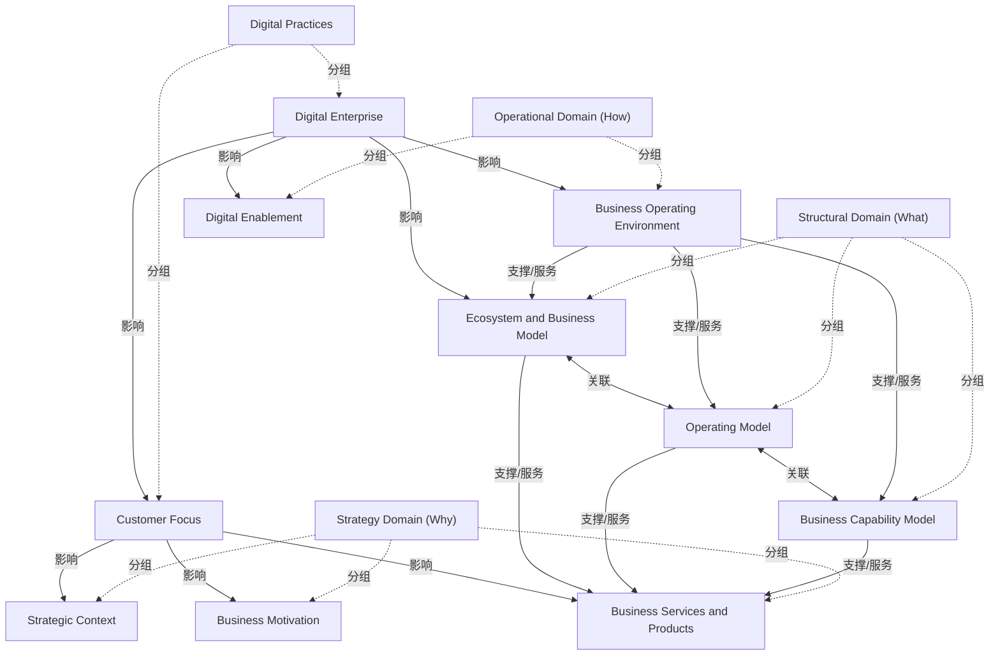

# G21H/fig3-1 · DBRM 要素——高层视图

类型：`architecture-concept-or-system-model`。在第 3 章开头给出 DBRM 的最高层视图：先把十个核心要素按四个域摆出来，让利益相关者看清模型范围与域的分工，再进入第 4 章的逐要素细化。正文明确说这张图只表示“关系存在”，不展开关系的细节；它的作用是建立共同的范围与词汇，而不是解释机制。

英文 PDF 物理页：[24]。本页为架构语义分析，原文与原图分别保留。

## 原图与可编辑图


[完整 JSON](fig3-1.json) · [可编辑 Mermaid](fig3-1.mmd) · [仅关系图](fig3-1.relations.mmd) · [层级分解图](fig3-1.hierarchy.mmd)

图形重建表达语义，不复制源图布局。虚线表示解释、矩阵映射或分组关系，不自动表示不确定性的概率。



## 架构分析

先看左侧三条横向域带的竖排标签，自上而下是战略域（为什么）、结构域（是什么）、运营域（怎么做）；再看纵贯这三条带的橙色数字实践列，列内上方是 Customer Focus、下方是 Digital Enterprise。然后顺着绿色箭头读：从数字实践列向右分出的箭头指向战略三要素、结构中的生态与业务模型、运营两要素；列内下方还有一条自下而上的箭头（Digital Enterprise→Customer Focus）。最后看结构域内部：三个方块之间的双向箭头表示相互依赖，顶部汇流线把三个结构要素汇成一个箭头送入业务服务与产品，底部汇流线由业务运营环境向上分三支送入三个结构要素。

- 本图有 14 个具名或隐含元素、15 条关系和 10 条包含/分组记录。
- 包含/分组树最大深度为 1；根节点为 数字实践（数字域）、战略域（为什么）、结构域（是什么）、运营域（怎么做）。
- 本图没有可直接确认为人员直属汇报的关系；视觉上下位置、能力分解和治理职责分别读取。
- 逐一核对四个域、十个核心要素及15条合并路径关系；结构三要素两两相邻双向，向上汇入Business Services and Products。
- 本图Business Operating Environment向上分三支进入结构要素，业务运营环境端没有向下箭头；不与fig4-1混用。
- 原文明确本图只说明关系存在；influence/serving是解读类别，不能据此推定强度或执行顺序。

### 如何用于项目

- 围绕作者目的读取本图实体、分组与连线，并用对应原文限定其含义。
- 把参考模型与项目事实分开，实际范围、约束、值和责任须有项目证据。

### 结构所表达的逻辑

- 十个核心要素与域的归属：数字域=客户聚焦、数字企业；战略域=战略语境、业务动机、业务服务与产品；结构域=生态与业务模型、运营模式、业务能力模型；运营域=业务运营环境、数字使能。
- 四个域回答不同问题：数字域强调由外而内的数字实践，战略域回答“为什么”，结构域回答“是什么”，运营域回答“怎么做”（左侧竖排标签）。
- 数字实践不是一个与战略/结构/运营并列的第四层，而是一条纵贯三层的竖列：客户聚焦位于战略带的高度，数字企业位于运营带的高度，表示数字实践贯穿三个域。
- 从数字实践列向右的箭头有明确分工：Customer Focus 指向战略语境、业务动机、业务服务与产品；Digital Enterprise 指向生态与业务模型、业务运营环境、数字使能。这与正文“客户聚焦与数字企业确保其他要素面向适当数字能力”的表述一致。
- Digital Enterprise 还有一条向上的箭头指向 Customer Focus，表示数字企业能力支撑/强化客户聚焦；图中没有反向箭头，不能读成二者互为因果。
- 结构域三个要素（生态与业务模型、运营模式、业务能力模型）之间是双向箭头，表示相互依赖、共同定义企业“是什么”，没有先后顺序。
- 结构三要素通过顶部汇流线共同支撑业务服务与产品（合流后只有一个箭头进入该要素）；业务运营环境通过底部汇流线向上支撑三个结构要素，表示运营环境使能结构模型的执行。
- 本图刻意不画关系细节：正文说 Figure 3-1 不表达实体间的详细关系，只表明关系存在；具体子要素与组内关系见图 4-1 与第 4 章。

## 上下级与包含

两层。第 1 层是四个域（战略域、结构域、运营域三条横带 + 数字实践一条竖带）；第 2 层是十个核心要素。数字实践列内 Customer Focus 与 Digital Enterprise 是并列的核心要素，不是父子；结构域三要素、运营域两要素、战略域三要素也各自并列。图中没有子要素层，子要素在图 4-1 才出现。

|父项|子项|层级类型|依据与解释|
|---|---|---|---|
|数字实践（数字域）|客户聚焦|visual_grouping|框、泳道、域或分类组的成员归属；没有额外证据不提升为业务组合或管理关系。|
|数字实践（数字域）|数字企业|visual_grouping|框、泳道、域或分类组的成员归属；没有额外证据不提升为业务组合或管理关系。|
|战略域（为什么）|战略语境|visual_grouping|框、泳道、域或分类组的成员归属；没有额外证据不提升为业务组合或管理关系。|
|战略域（为什么）|业务动机|visual_grouping|框、泳道、域或分类组的成员归属；没有额外证据不提升为业务组合或管理关系。|
|战略域（为什么）|业务服务与产品|visual_grouping|框、泳道、域或分类组的成员归属；没有额外证据不提升为业务组合或管理关系。|
|结构域（是什么）|生态与业务模型|visual_grouping|框、泳道、域或分类组的成员归属；没有额外证据不提升为业务组合或管理关系。|
|结构域（是什么）|运营模式|visual_grouping|框、泳道、域或分类组的成员归属；没有额外证据不提升为业务组合或管理关系。|
|结构域（是什么）|业务能力模型|visual_grouping|框、泳道、域或分类组的成员归属；没有额外证据不提升为业务组合或管理关系。|
|运营域（怎么做）|业务运营环境|visual_grouping|框、泳道、域或分类组的成员归属；没有额外证据不提升为业务组合或管理关系。|
|运营域（怎么做）|数字使能|visual_grouping|框、泳道、域或分类组的成员归属；没有额外证据不提升为业务组合或管理关系。|

## 全部元素与角色

|元素ID|原文名称|类型|含义|直接父项|深度|
|---|---|---|---|---|---|
|digital_practices|Digital Practices|group|纵贯三域的竖列，内部上方为客户聚焦、下方为数字企业；对应稿件第 3.2 节的数字域。|—||
|customer_focus|Customer Focus|concept|数字域要素；由外而内发现客户如何使用产品与服务以及隐藏需求。|数字实践（数字域）|1|
|digital_enterprise|Digital Enterprise|concept|数字域要素；数字产品与服务组合、数字运营与数字胜任力的总称。|数字实践（数字域）|1|
|strategy_domain|Strategy Domain (Why)|group|原图左侧竖排标签为“Strategy Domain (Why)”。|—||
|strategic_context|Strategic Context|concept|概念：战略语境|战略域（为什么）|1|
|business_motivation|Business Motivation|concept|概念：业务动机|战略域（为什么）|1|
|business_services|Business Services and Products|concept|概念：业务服务与产品|战略域（为什么）|1|
|structural_domain|Structural Domain (What)|group|原图左侧竖排标签为“Structural Domain (What)”。|—||
|ecosystem_model|Ecosystem and Business Model|concept|概念：生态与业务模型|结构域（是什么）|1|
|operating_model|Operating Model|concept|概念：运营模式|结构域（是什么）|1|
|capability_model|Business Capability Model|concept|概念：业务能力模型|结构域（是什么）|1|
|operational_domain|Operational Domain (How)|group|原图左侧竖排标签为“Operational Domain (How)”。|—||
|business_operating_env|Business Operating Environment|concept|概念：业务运营环境|运营域（怎么做）|1|
|digital_enablement|Digital Enablement|concept|概念：数字使能|运营域（怎么做）|1|

## 全部关系

全部为绿色实线箭头，无文字标签。方向分四类：①数字实践列→其他要素（影响/使能），箭头画在目标要素一侧；②Digital Enterprise→Customer Focus（列内向上）；③结构三要素之间的双向箭头（相互依赖）；④两条汇流线：顶部把三个结构要素汇成一个箭头送入业务服务与产品，底部由业务运营环境向上分三支送入三个结构要素（图 3-1 中业务运营环境一端没有箭头）。域带本身是背景容器，不是连线；要素之间的上下位置不表示层级，只有 parent 关系表示的域归属。

|主体|语义关系|客体|显式线/隐式|原文标签|依据|
|---|---|---|---|---|---|
|数字企业|影响|客户聚焦|显式连线||橙色列内自下而上的箭头，从 Digital Enterprise 顶边指向 Customer Focus 底边。|
|客户聚焦|影响|战略语境|显式连线||Customer Focus 右缘引出竖直分支，箭头指向 Strategic Context 左边缘。|
|客户聚焦|影响|业务动机|显式连线||同一分支向下，箭头指向 Business Motivation 左边缘。|
|客户聚焦|影响|业务服务与产品|显式连线||同一分支再向下，箭头指向 Business Services and Products 左边缘。|
|数字企业|影响|生态与业务模型|显式连线||Digital Enterprise 右缘引出的分支，箭头指向 Ecosystem and Business Model 左边缘。|
|数字企业|影响|业务运营环境|显式连线||Digital Enterprise 右缘引出分支，箭头指向 Business Operating Environment 左边缘。|
|数字企业|影响|数字使能|显式连线||同一分支向下，箭头指向 Digital Enablement 左边缘。|
|生态与业务模型|关联|运营模式|显式连线||两个方块之间的双向箭头，表示相互依赖。|
|运营模式|关联|业务能力模型|显式连线||两个方块之间的双向箭头，表示相互依赖。|
|生态与业务模型|支撑/服务|业务服务与产品|显式连线||顶部汇流线左端从 Ecosystem 顶边引出，向右汇入；箭头只在合流后进入 Business Services and Products。|
|运营模式|支撑/服务|业务服务与产品|显式连线||顶部汇流线中段从 Operating Model 顶边引出，合流后向上进入 Business Services and Products。|
|业务能力模型|支撑/服务|业务服务与产品|显式连线||顶部汇流线右端从 Business Capability Model 顶边引出，向左汇入同一箭头。|
|业务运营环境|支撑/服务|生态与业务模型|显式连线||底部汇流线由 Business Operating Environment 顶边向上引出，分成三支；此支箭头指向 Ecosystem 底边。|
|业务运营环境|支撑/服务|运营模式|显式连线||底部汇流线中支，箭头指向 Operating Model 底边。|
|业务运营环境|支撑/服务|业务能力模型|显式连线||底部汇流线右支，箭头指向 Business Capability Model 底边。|

## 误读检查

- 不要把四个域读成四个并列的层：数字实践是纵贯战略/结构/运营三带的竖列，不是第四层，也不是流程的第一站。
- 结构三要素之间的双向箭头不是流程顺序，而是相互依赖；图中没有时间先后，也没有“从生态到运营模式再到能力模型”的推进关系。
- 顶部汇流线虽然只有一个箭头进入业务服务与产品，但它汇集了三个结构要素；不要读成只有运营模式支撑业务服务与产品。
- 图3-1底部汇流从业务运营环境向上进入三个结构组；图4-1原图方向相反，仅向下进入业务运营环境，且结构组相邻箭头也由双向变为向右，必须分别读取。
- 箭头只表示“关系存在”，不表示强度、成熟度、价值流顺序或影响大小；原文明确说本图不表达详细关系。
- 中文稿当前引用的 figs/g21h_fig3-1.svg 把四域画成四列并删除了全部箭头，不能据它理解本图的关系结构。

## 原文证据

### [PDF 第 24 页](../../../documents/G21H.md#page-24)

> Figure 3-1 says nothing about the detailed relationships between the entities; only that they exist.
### [PDF 第 25 页](../../../documents/G21H.md#page-25)

> The Digital Domain is essential to enable an outside-in approach for the creation and management of Digital Products and Services with an increasing digital component or to lead the organization through the digital journey towards a digital business.
> The Customer Focus and Digital Enterprise elements are important for the organizations to adopt an outside-in mindset to ensure that all the other core elements of the DBRM are geared towards the implementation of appropriate digital capabilities. The digital practices are an essential element of ensuring that the journey towards digitalization becomes an effective process that creates sustainable value for the organization.
### [PDF 第 26 页](../../../documents/G21H.md#page-26)

> Each of the elements in Figure 3-1 is discussed in detail in Chapter 4.

## 来源与分析状态

所有元素/关系均有来源定位；未把历史解释重命名为本轮逐线视觉确认。源图与语义图是两种视图，布局不证明汇报或因果。

源 PDF SHA-256：`40881f73b66ae8cfabc279aba8fe3767182ac3e865823054d0aca58f6292a470`。

源图记录：[原始解释与转录](../../../figures/G21H/fig3-1.json)。

```json
{
  "quality": {
    "graph_integrity": "checked",
    "semantic_analysis": "typed-graph-and-context-analysis",
    "visual_review": "source-content-audited",
    "notice_zh": "所有元素/关系均有来源定位；未把历史解释重命名为本轮逐线视觉确认。源图与语义图是两种视图，布局不证明汇报或因果。"
  },
  "source_uncertainty": {
    "confidence": "high",
    "uncertainties_zh": [
      "数字实践列右侧的竖直干线同时连接 Customer Focus、Digital Enterprise 与生态/业务模型分支，图中未画连接点；本分析按分支高度把生态/业务模型归到 Digital Enterprise，若按整条干线理解则也可视为整个 Digital Practices 域的共同影响。",
      "底部汇流线在业务运营环境顶端没有箭头，故按“业务运营环境→结构三要素”解读；顶部汇流线三个结构要素均接入、只有一个箭头进入业务服务与产品，图中未标注合流规则。",
      "十要素的中文译名取自中文稿，未另行统一“业务服务与产品/业务服务与产品要素”等措辞。"
    ],
    "analyzed_from": [
      "英文 PDF 第 24 页 figure 截图（220 dpi）与 600 dpi 重渲染局部核对",
      "英文 PDF 第 24 页正文",
      "中文稿 G21He_TOGAF数字业务参考模型.md 第 214–253 行",
      "figs/g21h_fig3-1.svg 源码与文本内容"
    ],
    "date": "2026-10-31"
  },
  "source_conflicts": []
}
```
