# G21H/fig4-1 · DBRM 要素——详细视图

类型：`decomposition-or-organization-model`。第 4 章逐节讨论 DBRM 各要素的构成；本图先把每个核心要素“拆开”，让读者看到每个要素由哪些子要素组成（如客户聚焦由数字语境/需求、客户体验、数字价值构成），从而把第 3 章的高层范围与第 4 章的细部说明对应起来。它也是第 6 章把 DBRM 要素映射到 TOGAF 内容框架/元模型时的子要素索引。

英文 PDF 物理页：[27]。本页为架构语义分析，原文与原图分别保留。

## 原图与可编辑图


[完整 JSON](fig4-1.json) · [可编辑 Mermaid](fig4-1.mmd) · [仅关系图](fig4-1.relations.mmd) · [层级分解图](fig4-1.hierarchy.mmd)

图形重建表达语义，不复制源图布局。虚线表示解释、矩阵映射或分组关系，不自动表示不确定性的概率。

```mermaid
flowchart TB
  %% Semantic reconstruction; see original source image for exact layout.
  n0["Digital Practices"]
  n1["Customer Focus"]
  n2["Digital Context/Needs"]
  n3["Customer Experience"]
  n4["Digital Value"]
  n5["Digital Enterprise"]
  n6["Digital Products &amp; Service Portfolio/Model"]
  n7["Digital Operations"]
  n8["Digital Competencies"]
  n9["Strategy Domain (Why)"]
  n10["Strategic Context"]
  n11["Legislative and Regulatory Framework"]
  n12["Market Trends and Consumer Drivers"]
  n13["Industry Landscape and Competitors"]
  n14["Business Influencers and Customers"]
  n15["Investment and Stakeholder Value Creation Framework"]
  n16["Business Motivation"]
  n17["Business Vision and Mission"]
  n18["Business Strategy and Principles"]
  n19["Strategic Goals and Objectives &amp; Drivers"]
  n20["Business Measures, Outcome and Impact"]
  n21["Corporate Governance Framework and Enterprise Architecture Strategy"]
  n22["Business Services and Products"]
  n23["Primary Business Services"]
  n24["Core Business Products"]
  n25["Value Add Services"]
  n26["Structural Domain (What)"]
  n27["Ecosystem and Business Model"]
  n28["Strategic Principles and Business Model"]
  n29["Business Ecosystem Model"]
  n30["Policy and Risk Management Framework"]
  n31["Organization Culture and Behavior"]
  n32["Operating Model"]
  n33["Strategic Posture and Value Disciplines"]
  n34["Service Model"]
  n35["Organizational Model"]
  n36["Resource Model"]
  n37["Business Capability Model"]
  n38["Customer-Facing &amp; Marketing-Focused Capabilities"]
  n39["Operations Management Capabilities"]
  n40["Service Delivery Enabling Capabilities"]
  n41["Shared &amp; Support Capabilities"]
  n42["Operational Domain (How)"]
  n43["Business Operating Environment"]
  n44["Service Experience and Customer Journey Maps"]
  n45["Value Chain Model and Value Streams"]
  n46["Business Information Map"]
  n47["Business Process Map"]
  n48["Actors, Roles, and Organization Structure"]
  n49["Business Systems and Data Models"]
  n50["Digital Enablement"]
  n51["Digital Principles and Strategy"]
  n52["Digital Governance"]
  n53["Digital Products and Services"]
  n54["Agile Digital Delivery Model"]
  n55["Digital Platforms"]
  n4 -->|"支撑/服务"| n3
  n3 -->|"支撑/服务"| n2
  n8 -->|"支撑/服务"| n7
  n7 -->|"支撑/服务"| n6
  n6 -->|"关联"| n4
  n0 -->|"关联"| n10
  n0 -->|"关联"| n16
  n0 -->|"关联"| n22
  n0 -->|"关联"| n27
  n0 -->|"关联"| n43
  n0 -->|"关联"| n50
  n27 -->|"关联"| n32
  n32 -->|"关联"| n37
  n27 -->|"支撑/服务"| n22
  n32 -->|"支撑/服务"| n22
  n37 -->|"支撑/服务"| n22
  n27 -->|"关联"| n43
  n32 -->|"关联"| n43
  n37 -->|"关联"| n43
  n16 -->|"关联"| n22
  n0 -.->|"分组"| n1
  n1 -.->|"分组"| n2
  n1 -.->|"分组"| n3
  n1 -.->|"分组"| n4
  n0 -.->|"分组"| n5
  n5 -.->|"分组"| n6
  n5 -.->|"分组"| n7
  n5 -.->|"分组"| n8
  n9 -.->|"分组"| n10
  n10 -.->|"分组"| n11
  n10 -.->|"分组"| n12
  n10 -.->|"分组"| n13
  n10 -.->|"分组"| n14
  n10 -.->|"分组"| n15
  n9 -.->|"分组"| n16
  n16 -.->|"分组"| n17
  n16 -.->|"分组"| n18
  n16 -.->|"分组"| n19
  n16 -.->|"分组"| n20
  n16 -.->|"分组"| n21
  n9 -.->|"分组"| n22
  n22 -.->|"分组"| n23
  n22 -.->|"分组"| n24
  n22 -.->|"分组"| n25
  n26 -.->|"分组"| n27
  n27 -.->|"分组"| n28
  n27 -.->|"分组"| n29
  n27 -.->|"分组"| n30
  n27 -.->|"分组"| n31
  n26 -.->|"分组"| n32
  n32 -.->|"分组"| n33
  n32 -.->|"分组"| n34
  n32 -.->|"分组"| n35
  n32 -.->|"分组"| n36
  n26 -.->|"分组"| n37
  n37 -.->|"分组"| n38
  n37 -.->|"分组"| n39
  n37 -.->|"分组"| n40
  n37 -.->|"分组"| n41
  n42 -.->|"分组"| n43
  n43 -.->|"分组"| n44
  n43 -.->|"分组"| n45
  n43 -.->|"分组"| n46
  n43 -.->|"分组"| n47
  n43 -.->|"分组"| n48
  n43 -.->|"分组"| n49
  n42 -.->|"分组"| n50
  n50 -.->|"分组"| n51
  n50 -.->|"分组"| n52
  n50 -.->|"分组"| n53
  n50 -.->|"分组"| n54
  n50 -.->|"分组"| n55
```



## 架构分析

先读四域、十核心要素和42子要素。数字列内部白框向上连接，Portfolio/Model跨两容器连接Digital Value。数字实践外框右边有六条独立右向短箭头。结构域三组从左到右单向相连，并分别汇入上方业务服务与产品、下方业务运营环境。业务动机另有短箭头向下进入业务服务与产品。

- 本图有 56 个具名或隐含元素、20 条关系和 52 条包含/分组记录。
- 包含/分组树最大深度为 2；根节点为 数字实践（数字域）、战略域（为什么）、结构域（是什么）、运营域（怎么做）。
- 本图没有可直接确认为人员直属汇报的关系；视觉上下位置、能力分解和治理职责分别读取。
- 逐一核对56个标签/容器和42个子要素；子要素清单与原图一致。
- 纠正结构组相邻线为单向右箭头；底部汇流线为结构三组→Business Operating Environment单向，旧记录误作双向。
- 补入原图Business Motivation→Business Services and Products向下短箭头。
- 数字列向上跨容器线实际连Digital Products & Service Portfolio/Model→Digital Value；六条右向短箭头从Digital Practices外框起，并不是白色子要素间连线。

### 如何用于项目

- 按父项展开所有直接子项，检查同层粒度、重叠和缺项。
- 保留组成、分类、能力分解与组织汇报的区别；将示例名称替换为已确认的项目对象。

### 结构所表达的逻辑

- 图4-1与图3-1线型和方向有真实差异，不能按高层图推定细化图。
- 结构组之间只有向右箭头；结构组到业务运营环境只有向下汇流箭头。
- 数字列六条外连箭头的可见起点为Digital Practices外框边缘；各子要素的业务关联可由同高位置辅助理解，但不是直接连线。
- 组内白框的排列和包含不是执行顺序；只有数字列有明确向上箭头。

## 上下级与包含

四域包含十个核心要素，十要素展开为42个白色子要素。白框容器是视觉归组，不是人员汇报。数字列向上连线包含从Portfolio/Model跨容器到Digital Value的一条；组间箭头与fig3-1存在方向差异，不继承该图的拓扑。

|父项|子项|层级类型|依据与解释|
|---|---|---|---|
|数字实践（数字域）|客户聚焦|visual_grouping|框、泳道、域或分类组的成员归属；没有额外证据不提升为业务组合或管理关系。|
|客户聚焦|数字语境/需求|visual_grouping|框、泳道、域或分类组的成员归属；没有额外证据不提升为业务组合或管理关系。|
|客户聚焦|客户体验|visual_grouping|框、泳道、域或分类组的成员归属；没有额外证据不提升为业务组合或管理关系。|
|客户聚焦|数字价值|visual_grouping|框、泳道、域或分类组的成员归属；没有额外证据不提升为业务组合或管理关系。|
|数字实践（数字域）|数字企业|visual_grouping|框、泳道、域或分类组的成员归属；没有额外证据不提升为业务组合或管理关系。|
|数字企业|数字产品与服务组合/模型|visual_grouping|框、泳道、域或分类组的成员归属；没有额外证据不提升为业务组合或管理关系。|
|数字企业|数字运营|visual_grouping|框、泳道、域或分类组的成员归属；没有额外证据不提升为业务组合或管理关系。|
|数字企业|数字胜任力|visual_grouping|框、泳道、域或分类组的成员归属；没有额外证据不提升为业务组合或管理关系。|
|战略域（为什么）|战略语境|visual_grouping|框、泳道、域或分类组的成员归属；没有额外证据不提升为业务组合或管理关系。|
|战略语境|立法与监管框架|visual_grouping|框、泳道、域或分类组的成员归属；没有额外证据不提升为业务组合或管理关系。|
|战略语境|市场趋势与消费者驱动|visual_grouping|框、泳道、域或分类组的成员归属；没有额外证据不提升为业务组合或管理关系。|
|战略语境|行业格局与竞争者|visual_grouping|框、泳道、域或分类组的成员归属；没有额外证据不提升为业务组合或管理关系。|
|战略语境|业务影响者与客户|visual_grouping|框、泳道、域或分类组的成员归属；没有额外证据不提升为业务组合或管理关系。|
|战略语境|投资与利益相关者价值创造框架|visual_grouping|框、泳道、域或分类组的成员归属；没有额外证据不提升为业务组合或管理关系。|
|战略域（为什么）|业务动机|visual_grouping|框、泳道、域或分类组的成员归属；没有额外证据不提升为业务组合或管理关系。|
|业务动机|业务愿景与使命|visual_grouping|框、泳道、域或分类组的成员归属；没有额外证据不提升为业务组合或管理关系。|
|业务动机|业务战略与原则|visual_grouping|框、泳道、域或分类组的成员归属；没有额外证据不提升为业务组合或管理关系。|
|业务动机|战略目标、目的与驱动因素|visual_grouping|框、泳道、域或分类组的成员归属；没有额外证据不提升为业务组合或管理关系。|
|业务动机|业务度量、成果与影响|visual_grouping|框、泳道、域或分类组的成员归属；没有额外证据不提升为业务组合或管理关系。|
|业务动机|公司治理框架与企业架构战略|visual_grouping|框、泳道、域或分类组的成员归属；没有额外证据不提升为业务组合或管理关系。|
|战略域（为什么）|业务服务与产品|visual_grouping|框、泳道、域或分类组的成员归属；没有额外证据不提升为业务组合或管理关系。|
|业务服务与产品|主要业务服务|visual_grouping|框、泳道、域或分类组的成员归属；没有额外证据不提升为业务组合或管理关系。|
|业务服务与产品|核心业务产品|visual_grouping|框、泳道、域或分类组的成员归属；没有额外证据不提升为业务组合或管理关系。|
|业务服务与产品|增值服务|visual_grouping|框、泳道、域或分类组的成员归属；没有额外证据不提升为业务组合或管理关系。|
|结构域（是什么）|生态与业务模型|visual_grouping|框、泳道、域或分类组的成员归属；没有额外证据不提升为业务组合或管理关系。|
|生态与业务模型|战略原则与业务模型|visual_grouping|框、泳道、域或分类组的成员归属；没有额外证据不提升为业务组合或管理关系。|
|生态与业务模型|业务生态模型|visual_grouping|框、泳道、域或分类组的成员归属；没有额外证据不提升为业务组合或管理关系。|
|生态与业务模型|政策与风险管理框架|visual_grouping|框、泳道、域或分类组的成员归属；没有额外证据不提升为业务组合或管理关系。|
|生态与业务模型|组织文化与行为|visual_grouping|框、泳道、域或分类组的成员归属；没有额外证据不提升为业务组合或管理关系。|
|结构域（是什么）|运营模式|visual_grouping|框、泳道、域或分类组的成员归属；没有额外证据不提升为业务组合或管理关系。|
|运营模式|战略姿态与价值准则|visual_grouping|框、泳道、域或分类组的成员归属；没有额外证据不提升为业务组合或管理关系。|
|运营模式|服务模型|visual_grouping|框、泳道、域或分类组的成员归属；没有额外证据不提升为业务组合或管理关系。|
|运营模式|组织模型|visual_grouping|框、泳道、域或分类组的成员归属；没有额外证据不提升为业务组合或管理关系。|
|运营模式|资源模型|visual_grouping|框、泳道、域或分类组的成员归属；没有额外证据不提升为业务组合或管理关系。|
|结构域（是什么）|业务能力模型|visual_grouping|框、泳道、域或分类组的成员归属；没有额外证据不提升为业务组合或管理关系。|
|业务能力模型|面向客户与市场的营销能力|visual_grouping|框、泳道、域或分类组的成员归属；没有额外证据不提升为业务组合或管理关系。|
|业务能力模型|运营管理能力|visual_grouping|框、泳道、域或分类组的成员归属；没有额外证据不提升为业务组合或管理关系。|
|业务能力模型|服务交付使能能力|visual_grouping|框、泳道、域或分类组的成员归属；没有额外证据不提升为业务组合或管理关系。|
|业务能力模型|共享与支撑能力|visual_grouping|框、泳道、域或分类组的成员归属；没有额外证据不提升为业务组合或管理关系。|
|运营域（怎么做）|业务运营环境|visual_grouping|框、泳道、域或分类组的成员归属；没有额外证据不提升为业务组合或管理关系。|
|业务运营环境|服务体验与客户旅程地图|visual_grouping|框、泳道、域或分类组的成员归属；没有额外证据不提升为业务组合或管理关系。|
|业务运营环境|价值链模型与价值流|visual_grouping|框、泳道、域或分类组的成员归属；没有额外证据不提升为业务组合或管理关系。|
|业务运营环境|业务信息地图|visual_grouping|框、泳道、域或分类组的成员归属；没有额外证据不提升为业务组合或管理关系。|
|业务运营环境|业务流程地图|visual_grouping|框、泳道、域或分类组的成员归属；没有额外证据不提升为业务组合或管理关系。|
|业务运营环境|参与者、角色与组织结构|visual_grouping|框、泳道、域或分类组的成员归属；没有额外证据不提升为业务组合或管理关系。|
|业务运营环境|业务系统与数据模型|visual_grouping|框、泳道、域或分类组的成员归属；没有额外证据不提升为业务组合或管理关系。|
|运营域（怎么做）|数字使能|visual_grouping|框、泳道、域或分类组的成员归属；没有额外证据不提升为业务组合或管理关系。|
|数字使能|数字原则与战略|visual_grouping|框、泳道、域或分类组的成员归属；没有额外证据不提升为业务组合或管理关系。|
|数字使能|数字治理|visual_grouping|框、泳道、域或分类组的成员归属；没有额外证据不提升为业务组合或管理关系。|
|数字使能|数字产品与服务|visual_grouping|框、泳道、域或分类组的成员归属；没有额外证据不提升为业务组合或管理关系。|
|数字使能|敏捷数字交付模型|visual_grouping|框、泳道、域或分类组的成员归属；没有额外证据不提升为业务组合或管理关系。|
|数字使能|数字平台|visual_grouping|框、泳道、域或分类组的成员归属；没有额外证据不提升为业务组合或管理关系。|

## 全部元素与角色

|元素ID|原文名称|类型|含义|直接父项|深度|
|---|---|---|---|---|---|
|digital_practices|Digital Practices|group|分组：数字实践（数字域）|—||
|customer_focus|Customer Focus|group|分组：客户聚焦|数字实践（数字域）|1|
|cf_context|Digital Context/Needs|concept|概念：数字语境/需求|客户聚焦|2|
|cf_experience|Customer Experience|concept|概念：客户体验|客户聚焦|2|
|cf_value|Digital Value|concept|概念：数字价值|客户聚焦|2|
|digital_enterprise|Digital Enterprise|group|分组：数字企业|数字实践（数字域）|1|
|dent_portfolio|Digital Products & Service Portfolio/Model|concept|概念：数字产品与服务组合/模型|数字企业|2|
|dent_operations|Digital Operations|concept|概念：数字运营|数字企业|2|
|dent_competencies|Digital Competencies|concept|概念：数字胜任力|数字企业|2|
|strategy_domain|Strategy Domain (Why)|group|分组：战略域（为什么）|—||
|strategic_context|Strategic Context|group|分组：战略语境|战略域（为什么）|1|
|sc_legislative|Legislative and Regulatory Framework|concept|概念：立法与监管框架|战略语境|2|
|sc_market|Market Trends and Consumer Drivers|concept|概念：市场趋势与消费者驱动|战略语境|2|
|sc_industry|Industry Landscape and Competitors|concept|概念：行业格局与竞争者|战略语境|2|
|sc_influencers|Business Influencers and Customers|concept|概念：业务影响者与客户|战略语境|2|
|sc_investment|Investment and Stakeholder Value Creation Framework|concept|概念：投资与利益相关者价值创造框架|战略语境|2|
|business_motivation|Business Motivation|group|分组：业务动机|战略域（为什么）|1|
|bm_vision|Business Vision and Mission|concept|概念：业务愿景与使命|业务动机|2|
|bm_strategy|Business Strategy and Principles|concept|概念：业务战略与原则|业务动机|2|
|bm_goals|Strategic Goals and Objectives & Drivers|concept|概念：战略目标、目的与驱动因素|业务动机|2|
|bm_measures|Business Measures, Outcome and Impact|concept|概念：业务度量、成果与影响|业务动机|2|
|bm_governance|Corporate Governance Framework and Enterprise Architecture Strategy|concept|概念：公司治理框架与企业架构战略|业务动机|2|
|business_services|Business Services and Products|group|分组：业务服务与产品|战略域（为什么）|1|
|bsp_primary|Primary Business Services|concept|概念：主要业务服务|业务服务与产品|2|
|bsp_products|Core Business Products|concept|概念：核心业务产品|业务服务与产品|2|
|bsp_valueadd|Value Add Services|concept|概念：增值服务|业务服务与产品|2|
|structural_domain|Structural Domain (What)|group|分组：结构域（是什么）|—||
|ecosystem_model|Ecosystem and Business Model|group|分组：生态与业务模型|结构域（是什么）|1|
|eb_principles|Strategic Principles and Business Model|concept|概念：战略原则与业务模型|生态与业务模型|2|
|eb_ecosystem|Business Ecosystem Model|concept|概念：业务生态模型|生态与业务模型|2|
|eb_policy|Policy and Risk Management Framework|concept|概念：政策与风险管理框架|生态与业务模型|2|
|eb_culture|Organization Culture and Behavior|concept|概念：组织文化与行为|生态与业务模型|2|
|operating_model|Operating Model|group|分组：运营模式|结构域（是什么）|1|
|om_posture|Strategic Posture and Value Disciplines|concept|概念：战略姿态与价值准则|运营模式|2|
|om_service|Service Model|concept|概念：服务模型|运营模式|2|
|om_org|Organizational Model|concept|概念：组织模型|运营模式|2|
|om_resource|Resource Model|concept|概念：资源模型|运营模式|2|
|capability_model|Business Capability Model|group|分组：业务能力模型|结构域（是什么）|1|
|bcm_customer|Customer-Facing & Marketing-Focused Capabilities|concept|概念：面向客户与市场的营销能力|业务能力模型|2|
|bcm_operations|Operations Management Capabilities|concept|原图作 Operations Management Capabilities；中文稿表 6-2 也作“运营管理能力”，但 4.4.3 节对应条目写作“服务交付管理能力（Service Delivery Management Capabilities）”，稿件内部术语不一致。|业务能力模型|2|
|bcm_delivery|Service Delivery Enabling Capabilities|concept|概念：服务交付使能能力|业务能力模型|2|
|bcm_shared|Shared & Support Capabilities|concept|概念：共享与支撑能力|业务能力模型|2|
|operational_domain|Operational Domain (How)|group|分组：运营域（怎么做）|—||
|business_operating_env|Business Operating Environment|group|分组：业务运营环境|运营域（怎么做）|1|
|boe_experience|Service Experience and Customer Journey Maps|concept|概念：服务体验与客户旅程地图|业务运营环境|2|
|boe_valuechain|Value Chain Model and Value Streams|concept|概念：价值链模型与价值流|业务运营环境|2|
|boe_information|Business Information Map|concept|概念：业务信息地图|业务运营环境|2|
|boe_process|Business Process Map|concept|概念：业务流程地图|业务运营环境|2|
|boe_actors|Actors, Roles, and Organization Structure|concept|概念：参与者、角色与组织结构|业务运营环境|2|
|boe_systems|Business Systems and Data Models|concept|概念：业务系统与数据模型|业务运营环境|2|
|digital_enablement|Digital Enablement|group|分组：数字使能|运营域（怎么做）|1|
|den_principles|Digital Principles and Strategy|concept|概念：数字原则与战略|数字使能|2|
|den_governance|Digital Governance|concept|概念：数字治理|数字使能|2|
|den_products|Digital Products and Services|concept|概念：数字产品与服务|数字使能|2|
|den_agile|Agile Digital Delivery Model|concept|概念：敏捷数字交付模型|数字使能|2|
|den_platforms|Digital Platforms|concept|概念：数字平台|数字使能|2|

## 全部关系

绿色实线表示连接，图内无关系文字。左右结构组之间单向向右；上方汇流箭头进入业务服务与产品，下方汇流箭头进入业务运营环境。没有反向箭头，不能解释成双向。

|主体|语义关系|客体|显式线/隐式|原文标签|依据|
|---|---|---|---|---|---|
|数字价值|支撑/服务|客户体验|显式连线||客户聚焦容器内自下而上的箭头，从 Digital Value 顶边指向 Customer Experience 底边。|
|客户体验|支撑/服务|数字语境/需求|显式连线||客户聚焦容器内自下而上的箭头，从 Customer Experience 顶边指向 Digital Context/Needs 底边。|
|数字胜任力|支撑/服务|数字运营|显式连线||数字企业容器内自下而上的箭头，从 Digital Competencies 顶边指向 Digital Operations 底边。|
|数字运营|支撑/服务|数字产品与服务组合/模型|显式连线||数字企业容器内自下而上的箭头，从 Digital Operations 顶边指向 Digital Products & Service Portfolio/Model 底边。|
|数字产品与服务组合/模型|关联|数字价值|显式连线||按原始PDF可见箭头重新核验。|
|数字实践（数字域）|关联|战略语境|显式连线||按原始PDF可见箭头重新核验。|
|数字实践（数字域）|关联|业务动机|显式连线||按原始PDF可见箭头重新核验。|
|数字实践（数字域）|关联|业务服务与产品|显式连线||按原始PDF可见箭头重新核验。|
|数字实践（数字域）|关联|生态与业务模型|显式连线||按原始PDF可见箭头重新核验。|
|数字实践（数字域）|关联|业务运营环境|显式连线||按原始PDF可见箭头重新核验。|
|数字实践（数字域）|关联|数字使能|显式连线||按原始PDF可见箭头重新核验。|
|生态与业务模型|关联|运营模式|显式连线||按原始PDF可见箭头重新核验。|
|运营模式|关联|业务能力模型|显式连线||按原始PDF可见箭头重新核验。|
|生态与业务模型|支撑/服务|业务服务与产品|显式连线||顶部汇流线左端从 Ecosystem 组顶边引出，汇入后只有一个箭头向上进入 Business Services and Products。|
|运营模式|支撑/服务|业务服务与产品|显式连线||顶部汇流线中段从 Operating Model 组顶边引出，合流后向上进入 Business Services and Products。|
|业务能力模型|支撑/服务|业务服务与产品|显式连线||顶部汇流线右端从 Business Capability Model 组顶边引出，向左汇入同一箭头。|
|生态与业务模型|关联|业务运营环境|显式连线||按原始PDF可见箭头重新核验。|
|运营模式|关联|业务运营环境|显式连线||按原始PDF可见箭头重新核验。|
|业务能力模型|关联|业务运营环境|显式连线||按原始PDF可见箭头重新核验。|
|业务动机|关联|业务服务与产品|显式连线||Business Motivation下边界中央短线向下，箭头进入Business Services and Products。|

## 十个核心要素的子要素逐组转录（按图内从左到右、从上到下）

```json
{
  "id": "t_sub_elements",
  "title_zh": "十个核心要素的子要素逐组转录（按图内从左到右、从上到下）",
  "columns": [
    "域",
    "核心要素",
    "子要素"
  ],
  "rows": [
    [
      "数字",
      "客户聚焦 Customer Focus",
      "数字语境/需求 Digital Context/Needs；客户体验 Customer Experience；数字价值 Digital Value"
    ],
    [
      "数字",
      "数字企业 Digital Enterprise",
      "数字产品与服务组合/模型 Digital Products & Service Portfolio/Model；数字运营 Digital Operations；数字胜任力 Digital Competencies"
    ],
    [
      "战略",
      "战略语境 Strategic Context",
      "立法与监管框架 Legislative and Regulatory Framework；市场趋势与消费者驱动 Market Trends and Consumer Drivers；行业格局与竞争者 Industry Landscape and Competitors；业务影响者与客户 Business Influencers and Customers；投资与利益相关者价值创造框架 Investment and Stakeholder Value Creation Framework"
    ],
    [
      "战略",
      "业务动机 Business Motivation",
      "业务愿景与使命 Business Vision and Mission；业务战略与原则 Business Strategy and Principles；战略目标、目的与驱动因素 Strategic Goals and Objectives & Drivers；业务度量、成果与影响 Business Measures, Outcome and Impact；公司治理框架与企业架构战略 Corporate Governance Framework and Enterprise Architecture Strategy"
    ],
    [
      "战略",
      "业务服务与产品 Business Services and Products",
      "主要业务服务 Primary Business Services；核心业务产品 Core Business Products；增值服务 Value Add Services"
    ],
    [
      "结构",
      "生态与业务模型 Ecosystem and Business Model",
      "战略原则与业务模型 Strategic Principles and Business Model；业务生态模型 Business Ecosystem Model；政策与风险管理框架 Policy and Risk Management Framework；组织文化与行为 Organization Culture and Behavior"
    ],
    [
      "结构",
      "运营模式 Operating Model",
      "战略姿态与价值准则 Strategic Posture and Value Disciplines；服务模型 Service Model；组织模型 Organizational Model；资源模型 Resource Model"
    ],
    [
      "结构",
      "业务能力模型 Business Capability Model",
      "面向客户与市场的营销能力 Customer-Facing & Marketing-Focused Capabilities；运营管理能力 Operations Management Capabilities；服务交付使能能力 Service Delivery Enabling Capabilities；共享与支撑能力 Shared & Support Capabilities"
    ],
    [
      "运营",
      "业务运营环境 Business Operating Environment",
      "服务体验与客户旅程地图 Service Experience and Customer Journey Maps；价值链模型与价值流 Value Chain Model and Value Streams；业务信息地图 Business Information Map；业务流程地图 Business Process Map；参与者、角色与组织结构 Actors, Roles, and Organization Structure；业务系统与数据模型 Business Systems and Data Models"
    ],
    [
      "运营",
      "数字使能 Digital Enablement",
      "数字原则与战略 Digital Principles and Strategy；数字治理 Digital Governance；数字产品与服务 Digital Products and Services；敏捷数字交付模型 Agile Digital Delivery Model；数字平台 Digital Platforms"
    ]
  ],
  "notes_zh": "每行一个核心要素容器；子要素顺序即图内从左到右/从上到下。业务能力模型的第二项原图为 Operations Management Capabilities，中文稿正文对应条目写作“服务交付管理能力（Service Delivery Management Capabilities）”，二者术语不一致，表中按原图直译并在元素说明中注明。"
}
```

## 本轮语义修正

- 按原始PDF可见箭头重新核验。
- 按原始PDF可见箭头重新核验。
- 按原始PDF可见箭头重新核验。
- 按原始PDF可见箭头重新核验。
- 按原始PDF可见箭头重新核验。
- 按原始PDF可见箭头重新核验。
- 按原始PDF可见箭头重新核验。
- 按原始PDF可见箭头重新核验。
- 按原始PDF可见箭头重新核验。
- 按原始PDF可见箭头重新核验。
- 按原始PDF可见箭头重新核验。
- 按原始PDF可见箭头重新核验。
- Business Motivation下边界中央短线向下，箭头进入Business Services and Products。

## 误读检查

- 不要沿用fig3-1的双向结构组连接或业务运营环境向上的方向；本细化图是不同画法。
- 不要把所有白框的相邻摆放当成连接或流程。

## 原文证据

### [PDF 第 27 页](../../../documents/G21H.md#page-27)

> Figure 4-1 unpacks the high-level view to depict the details of each element.
### [PDF 第 28 页](../../../documents/G21H.md#page-28)

> The sum totality of how customers engage with the company and brand, not just in a snapshot in time, but throughout the entire arc of being a customer. The Customer Experience way of doing business that meets the expectations of customers by analyzing the interactions between the enterprise and its customers, to enable the delivery of a pleasant and differentiated Customer Experience. (Source: The O-AA Standard [C208])
> There are many ways in which digital systems deliver value. Digital technology generates value in both direct and indirect ways. The application of digital technology to create additional business value within the primary value chain of enterprises (digitalization).

## 来源与分析状态

所有元素/关系均有来源定位；未把历史解释重命名为本轮逐线视觉确认。源图与语义图是两种视图，布局不证明汇报或因果。

源 PDF SHA-256：`40881f73b66ae8cfabc279aba8fe3767182ac3e865823054d0aca58f6292a470`。

源图记录：[原始解释与转录](../../../figures/G21H/fig4-1.json)。

```json
{
  "quality": {
    "graph_integrity": "checked",
    "semantic_analysis": "typed-graph-and-context-analysis",
    "visual_review": "source-content-audited",
    "notice_zh": "所有元素/关系均有来源定位；未把历史解释重命名为本轮逐线视觉确认。源图与语义图是两种视图，布局不证明汇报或因果。"
  },
  "source_uncertainty": {
    "confidence": "high",
    "uncertainties_zh": [
      "业务能力模型第二项原图为 Operations Management Capabilities（运营管理能力），中文稿表 6-2 同作“运营管理能力”，但 4.4.3 节对应条目为“服务交付管理能力（Service Delivery Management Capabilities）”；label_zh 按原图与表 6-2 直译，并保留这一差异说明。",
      "底部汇流线在业务运营环境顶端有一个向下箭头，同时三个结构组底边各有一个向上箭头；本分析读作双向连接，但图中没有箭头标签，也可能只是绘图时在每个端点都加了箭头。",
      "数字实践列右侧干线同时服务 Customer Focus、Digital Enterprise 与生态/业务模型分支，图中未标连接点；本分析按分支高度把生态/业务模型归到 Digital Enterprise。",
      "客户聚焦容器内箭头方向（数字价值→客户体验→数字语境/需求）与正文 4.2.1 的叙述顺序相反，图义按箭头本身记录，未据此推断因果。"
    ],
    "analyzed_from": [
      "英文 PDF 第 27 页 figure 截图（220 dpi 与 600 dpi 局部放大）",
      "英文 PDF 第 27 页正文",
      "中文稿 G21He_TOGAF数字业务参考模型.md 第 258–505 行（4.1–4.5 节）",
      "figs/g21h_fig4-1.svg 源码与文本内容"
    ],
    "date": "2026-10-31"
  },
  "source_conflicts": []
}
```
