# G21H/fig5-1 · O-AA 构建块

类型：`architecture-concept-or-system-model`。第 5.2 节用这张图给出 O-AA 构建块的全景：哪些构建块属于“企业做什么”（面向体验与运营的实践），哪些属于“企业是什么”（产品、运营、组织、治理等结构），它们分别落在体验、工作系统、技术系统三个视角的哪一层，以及 O-AA 强调的三条品质（有意与涌现、并行淘汰弱者、持续可演进可重构）。目的是让数字架构开发者在选配构建块时有共同的地图，而不是给出流程步骤。

英文 PDF 物理页：[39]。本页为架构语义分析，原文与原图分别保留。

## 原图与可编辑图


[完整 JSON](fig5-1.json) · [可编辑 Mermaid](fig5-1.mmd) · [仅关系图](fig5-1.relations.mmd) · [层级分解图](fig5-1.hierarchy.mmd)

图形重建表达语义，不复制源图布局。虚线表示解释、矩阵映射或分组关系，不自动表示不确定性的概率。

```mermaid
flowchart TB
  %% Semantic reconstruction; see original source image for exact layout.
  n0["Architecture Development"]
  n1["What the Enterprise “Does”"]
  n2["What the Enterprise “Is”"]
  n3["Experience Perspective"]
  n4["Work System Perspective"]
  n5["Technical System Perspective"]
  n6["Strategy"]
  n7["Value"]
  n8["Data / Information &amp; AI"]
  n9["Software and Hardware Architecture"]
  n10["Experience Design"]
  n11["Corporate Brand Identity"]
  n12["Corporate Culture"]
  n13["Journey Maps Value Streams"]
  n14["Event Storming"]
  n15["Product Architecture"]
  n16["Operations Architecture"]
  n17["Organization"]
  n18["Governance"]
  n19["Domain-Driven Design"]
  n20["Intentional"]
  n21["Emergent"]
  n22["Concurrent"]
  n23["Eliminate the weak"]
  n24["持续演进与重构面板"]
  n25["有意与涌现面板"]
  n26["并行淘汰面板"]
  n27["第1行并行箭头图符"]
  n28["第2行并行箭头图符"]
  n29["第3行并行箭头图符"]
  n30["第4行并行箭头图符"]
  n31["第5行并行箭头图符"]
  n32["第6行并行箭头图符"]
  n33["第7行并行箭头图符"]
  n34["第8行并行箭头图符"]
  n35["Continuous"]
  n36["Evolvable"]
  n37["Refactored"]
  n21 -->|"迭代"| n20
  n20 -->|"迭代"| n21
  n24 -->|"迭代"| n24
  n0 -.->|"分组"| n1
  n0 -.->|"分组"| n2
  n0 -.->|"分组"| n3
  n0 -.->|"分组"| n4
  n0 -.->|"分组"| n5
  n0 -.->|"分组"| n6
  n0 -.->|"分组"| n7
  n0 -.->|"分组"| n8
  n0 -.->|"分组"| n9
  n1 -.->|"分组"| n10
  n1 -.->|"分组"| n11
  n1 -.->|"分组"| n12
  n1 -.->|"分组"| n13
  n1 -.->|"分组"| n14
  n2 -.->|"分组"| n15
  n2 -.->|"分组"| n16
  n2 -.->|"分组"| n17
  n2 -.->|"分组"| n18
  n2 -.->|"分组"| n19
  n25 -.->|"分组"| n20
  n25 -.->|"分组"| n21
  n26 -.->|"分组"| n22
  n26 -.->|"分组"| n23
  n0 -.->|"分组"| n24
  n0 -.->|"分组"| n25
  n0 -.->|"分组"| n26
  n26 -.->|"分组"| n27
  n26 -.->|"分组"| n28
  n26 -.->|"分组"| n29
  n26 -.->|"分组"| n30
  n26 -.->|"分组"| n31
  n26 -.->|"分组"| n32
  n26 -.->|"分组"| n33
  n26 -.->|"分组"| n34
  n24 -.->|"分组"| n35
  n24 -.->|"分组"| n36
  n24 -.->|"分组"| n37
```



## 架构分析

先读顶部标题“Architecture Development”，确认这是架构开发的总图。再看中间的大圆：左半蓝色是 What the Enterprise “Does”，右半绿色是 What the Enterprise “Is”；四条横向虚线自上而下切出 Experience、Work System、Technical System 三个视角，虚线左端有视角名称。圆心偏上是深青色 Value 圆，圆心下方是灰色竖带 Data / Information & AI，底部灰色横条是 Software and Hardware Architecture。最后看右侧三个橙色面板，它们不是构建块，而是 O-AA 的品质说明。

- 本图有 38 个具名或隐含元素、3 条关系和 37 条包含/分组记录。
- 包含/分组树最大深度为 2；根节点为 架构开发。
- 本图没有可直接确认为人员直属汇报的关系；视觉上下位置、能力分解和治理职责分别读取。
- 核对主图的两侧、三视角、各构建块和右侧三个橙色面板。
- 补录并行面板八行16段右向图符（段数1/3/2/3/1/2/3/1），没有图符到说明文字的线。
- 将持续/可演进/重构三处文字分开，保留椭圆回路而不把文字当流程端点。
- 删除根据色块相交推造的软件硬件→数据AI→价值有向支撑关系；仅保留可见覆盖关系的叙述。

### 如何用于项目

- 围绕作者目的读取本图实体、分组与连线，并用对应原文限定其含义。
- 把参考模型与项目事实分开，实际范围、约束、值和责任须有项目证据。

### 结构所表达的逻辑

- 构建块按两半分工：蓝色“做什么”一侧是 Experience Design、Corporate Brand Identity、Corporate Culture、Journey Maps Value Streams、Event Storming；绿色“是什么”一侧是 Product Architecture、Operations Architecture、Organization、Governance、Domain-Driven Design。
- 三个视角（体验、工作系统、技术系统）横切两半：Experience Design 与 Product Architecture 在体验视角；Journey Maps/Value Streams、Operations Architecture、Corporate Brand Identity、Corporate Culture、Organization、Governance 主要在工作系统视角；Event Storming 与 Domain-Driven Design 在技术系统视角。
- Corporate Brand Identity 与 Corporate Culture 是竖框，跨在工作系统与技术系统两条视角带之间；Organization 与 Governance 也是竖框，同样跨带，说明这些构建块不只属于单一视角。
- Strategy 是顶部中央唯一的灰色框，横跨蓝绿两半；Value 是深青色圆，位于蓝绿分界与体验/工作系统分界的交点，表示价值是两半与多视角的共同焦点。
- Data / Information & AI 是灰色竖带，纵跨工作系统与技术系统，向下与灰色横条 Software and Hardware Architecture 相接；后者位于技术系统带底部，Event Storming 与 Domain-Driven Design 压在它上面，表示软件与硬件架构是技术侧的基底。
- 右侧三个橙色面板是 O-AA 的品质/原则：Intentional & Emergent（两条弧线构成往复）、Concurrent 与 Eliminate the weak（多行平行箭头链，短链提前终止）、Continuous / Evolvable / Refactored（椭圆回路）。它们不是与圆内方块同级的构建块。
- 圆内构建块之间没有任何连线，关系完全由“在左半还是右半、在哪个视角带、在中心还是边缘”表达；这是一张分类地图，不是流程图。
- 正文强调这些构建块之间存在相互依赖，应以敏捷方式管理，以支持数字能力的增量交付和可持续的数字旅程（p39）。

## 上下级与包含

三层。第 1 层是外层“Architecture Development”面板；第 2 层是大圆内的两个半边（What the Enterprise “Does” / “Is”）与三个横向视角带（体验/工作系统/技术系统），二者是交叉分区而非父子；第 3 层是十个构建块方块。Strategy、Value、Data/Information & AI、Software and Hardware Architecture 是跨半边的中心/基底元素，不隶属于某一半边。右侧三个橙色面板与圆内构建块并列，属于品质说明层。

|父项|子项|层级类型|依据与解释|
|---|---|---|---|
|架构开发|企业“做什么”|visual_grouping|框、泳道、域或分类组的成员归属；没有额外证据不提升为业务组合或管理关系。|
|架构开发|企业“是什么”|visual_grouping|框、泳道、域或分类组的成员归属；没有额外证据不提升为业务组合或管理关系。|
|架构开发|体验视角|visual_grouping|框、泳道、域或分类组的成员归属；没有额外证据不提升为业务组合或管理关系。|
|架构开发|工作系统视角|visual_grouping|框、泳道、域或分类组的成员归属；没有额外证据不提升为业务组合或管理关系。|
|架构开发|技术系统视角|visual_grouping|框、泳道、域或分类组的成员归属；没有额外证据不提升为业务组合或管理关系。|
|架构开发|战略|visual_grouping|框、泳道、域或分类组的成员归属；没有额外证据不提升为业务组合或管理关系。|
|架构开发|价值|visual_grouping|框、泳道、域或分类组的成员归属；没有额外证据不提升为业务组合或管理关系。|
|架构开发|数据／信息与 AI|visual_grouping|框、泳道、域或分类组的成员归属；没有额外证据不提升为业务组合或管理关系。|
|架构开发|软件与硬件架构|visual_grouping|框、泳道、域或分类组的成员归属；没有额外证据不提升为业务组合或管理关系。|
|企业“做什么”|体验设计|visual_grouping|框、泳道、域或分类组的成员归属；没有额外证据不提升为业务组合或管理关系。|
|企业“做什么”|企业品牌标识|visual_grouping|框、泳道、域或分类组的成员归属；没有额外证据不提升为业务组合或管理关系。|
|企业“做什么”|企业文化|visual_grouping|框、泳道、域或分类组的成员归属；没有额外证据不提升为业务组合或管理关系。|
|企业“做什么”|旅程地图／价值流|visual_grouping|框、泳道、域或分类组的成员归属；没有额外证据不提升为业务组合或管理关系。|
|企业“做什么”|事件风暴|visual_grouping|框、泳道、域或分类组的成员归属；没有额外证据不提升为业务组合或管理关系。|
|企业“是什么”|产品架构|visual_grouping|框、泳道、域或分类组的成员归属；没有额外证据不提升为业务组合或管理关系。|
|企业“是什么”|运营架构|visual_grouping|框、泳道、域或分类组的成员归属；没有额外证据不提升为业务组合或管理关系。|
|企业“是什么”|组织|visual_grouping|框、泳道、域或分类组的成员归属；没有额外证据不提升为业务组合或管理关系。|
|企业“是什么”|治理|visual_grouping|框、泳道、域或分类组的成员归属；没有额外证据不提升为业务组合或管理关系。|
|企业“是什么”|领域驱动设计|visual_grouping|框、泳道、域或分类组的成员归属；没有额外证据不提升为业务组合或管理关系。|
|有意与涌现面板|有意的|visual_grouping|框、泳道、域或分类组的成员归属；没有额外证据不提升为业务组合或管理关系。|
|有意与涌现面板|涌现的|visual_grouping|框、泳道、域或分类组的成员归属；没有额外证据不提升为业务组合或管理关系。|
|并行淘汰面板|并行的|visual_grouping|框、泳道、域或分类组的成员归属；没有额外证据不提升为业务组合或管理关系。|
|并行淘汰面板|淘汰弱者|visual_grouping|框、泳道、域或分类组的成员归属；没有额外证据不提升为业务组合或管理关系。|
|架构开发|持续演进与重构面板|visual_grouping|框、泳道、域或分类组的成员归属；没有额外证据不提升为业务组合或管理关系。|
|架构开发|有意与涌现面板|visual_grouping|框、泳道、域或分类组的成员归属；没有额外证据不提升为业务组合或管理关系。|
|架构开发|并行淘汰面板|visual_grouping|框、泳道、域或分类组的成员归属；没有额外证据不提升为业务组合或管理关系。|
|并行淘汰面板|第1行并行箭头图符|visual_grouping|框、泳道、域或分类组的成员归属；没有额外证据不提升为业务组合或管理关系。|
|并行淘汰面板|第2行并行箭头图符|visual_grouping|框、泳道、域或分类组的成员归属；没有额外证据不提升为业务组合或管理关系。|
|并行淘汰面板|第3行并行箭头图符|visual_grouping|框、泳道、域或分类组的成员归属；没有额外证据不提升为业务组合或管理关系。|
|并行淘汰面板|第4行并行箭头图符|visual_grouping|框、泳道、域或分类组的成员归属；没有额外证据不提升为业务组合或管理关系。|
|并行淘汰面板|第5行并行箭头图符|visual_grouping|框、泳道、域或分类组的成员归属；没有额外证据不提升为业务组合或管理关系。|
|并行淘汰面板|第6行并行箭头图符|visual_grouping|框、泳道、域或分类组的成员归属；没有额外证据不提升为业务组合或管理关系。|
|并行淘汰面板|第7行并行箭头图符|visual_grouping|框、泳道、域或分类组的成员归属；没有额外证据不提升为业务组合或管理关系。|
|并行淘汰面板|第8行并行箭头图符|visual_grouping|框、泳道、域或分类组的成员归属；没有额外证据不提升为业务组合或管理关系。|
|持续演进与重构面板|持续|visual_grouping|框、泳道、域或分类组的成员归属；没有额外证据不提升为业务组合或管理关系。|
|持续演进与重构面板|可演进|visual_grouping|框、泳道、域或分类组的成员归属；没有额外证据不提升为业务组合或管理关系。|
|持续演进与重构面板|重构|visual_grouping|框、泳道、域或分类组的成员归属；没有额外证据不提升为业务组合或管理关系。|

## 全部元素与角色

|元素ID|原文名称|类型|含义|直接父项|深度|
|---|---|---|---|---|---|
|arch_dev|Architecture Development|group|整张图的外框与标题，表示这些构建块用于架构开发。|—||
|does_side|What the Enterprise “Does”|group|原图用弯引号；与右半“是什么”并列。|架构开发|1|
|is_side|What the Enterprise “Is”|group|分组：企业“是什么”|架构开发|1|
|exp_persp|Experience Perspective|note|说明：体验视角|架构开发|1|
|work_persp|Work System Perspective|note|说明：工作系统视角|架构开发|1|
|tech_persp|Technical System Perspective|note|说明：技术系统视角|架构开发|1|
|strategy|Strategy|concept|概念：战略|架构开发|1|
|value|Value|goal|目标/成果：价值|架构开发|1|
|data_ai|Data / Information & AI|data|信息/数据：数据／信息与 AI|架构开发|1|
|sw_hw|Software and Hardware Architecture|architecture|架构：软件与硬件架构|架构开发|1|
|experience_design|Experience Design|building_block|构建块：体验设计|企业“做什么”|2|
|brand_identity|Corporate Brand Identity|building_block|构建块：企业品牌标识|企业“做什么”|2|
|corporate_culture|Corporate Culture|building_block|构建块：企业文化|企业“做什么”|2|
|journey_maps|Journey Maps Value Streams|building_block|原图两行文字，中间没有斜杠；中文稿/标签表写作 Journey Maps / Value Streams。|企业“做什么”|2|
|event_storming|Event Storming|building_block|构建块：事件风暴|企业“做什么”|2|
|product_arch|Product Architecture|building_block|构建块：产品架构|企业“是什么”|2|
|operations_arch|Operations Architecture|building_block|构建块：运营架构|企业“是什么”|2|
|organization|Organization|building_block|构建块：组织|企业“是什么”|2|
|governance|Governance|building_block|构建块：治理|企业“是什么”|2|
|ddd|Domain-Driven Design|building_block|构建块：领域驱动设计|企业“是什么”|2|
|intentional|Intentional|principle|原则：有意的|有意与涌现面板|2|
|emergent|Emergent|principle|原则：涌现的|有意与涌现面板|2|
|concurrent|Concurrent|principle|面板内有 8 行蓝色平行箭头链，每行 1–3 段，长短不一；短链提前终止，表示并行推进中被淘汰的弱者。|并行淘汰面板|2|
|eliminate_weak|Eliminate the weak|note|中文图写作“消除/薄弱环节”。|并行淘汰面板|2|
|continuous_evol_refactor|持续演进与重构面板|group|包含Continuous、Evolvable、Refactored三个独立文字；两弧组成围绕Evolvable的椭圆回路。|架构开发|1|
|intentional_panel|有意与涌现面板|group|分组：有意与涌现面板|架构开发|1|
|concurrent_panel|并行淘汰面板|group|分组：并行淘汰面板|架构开发|1|
|parallel_row_1|第1行并行箭头图符|annotation|从左至右1段蓝色右向箭头；不连接文字或实体。|并行淘汰面板|2|
|parallel_row_2|第2行并行箭头图符|annotation|从左至右3段蓝色右向箭头；不连接文字或实体。|并行淘汰面板|2|
|parallel_row_3|第3行并行箭头图符|annotation|从左至右2段蓝色右向箭头；不连接文字或实体。|并行淘汰面板|2|
|parallel_row_4|第4行并行箭头图符|annotation|从左至右3段蓝色右向箭头；不连接文字或实体。|并行淘汰面板|2|
|parallel_row_5|第5行并行箭头图符|annotation|从左至右1段蓝色右向箭头；不连接文字或实体。|并行淘汰面板|2|
|parallel_row_6|第6行并行箭头图符|annotation|从左至右2段蓝色右向箭头；不连接文字或实体。|并行淘汰面板|2|
|parallel_row_7|第7行并行箭头图符|annotation|从左至右3段蓝色右向箭头；不连接文字或实体。|并行淘汰面板|2|
|parallel_row_8|第8行并行箭头图符|annotation|从左至右1段蓝色右向箭头；不连接文字或实体。|并行淘汰面板|2|
|continuous_label|Continuous|annotation|图中元素：持续|持续演进与重构面板|2|
|evolvable_label|Evolvable|annotation|图中元素：可演进|持续演进与重构面板|2|
|refactored_label|Refactored|annotation|图中元素：重构|持续演进与重构面板|2|

## 全部关系

左侧四条虚线划分三个视角，主图各色块之间无连接箭头。右上两弧表示有意与涌现往复；中间16段平行箭头没有实体端点；右下两弧组成演进回路。色块覆盖不等同有向支撑关系。

|主体|语义关系|客体|显式线/隐式|原文标签|依据|
|---|---|---|---|---|---|
|涌现的|迭代|有意的|显式连线||Intentional & Emergent 面板左侧的弧线，箭头向上指向 Intentional。|
|有意的|迭代|涌现的|显式连线||同一面板右侧的弧线，箭头向下指向 Emergent；两条弧线构成往复。|
|持续演进与重构面板|迭代|持续演进与重构面板|显式连线||面板内上弧向右、下弧向左组成回路，环绕Evolvable；不是Continuous到Refactored的连线。|

## 本轮否定的历史关系

以下旧解释保留用于追溯，不进入当前关系图、层级或知识图谱的有效边。

|旧记录|主体|旧关系|客体|否定依据|
|---|---|---|---|---|
|2|并行的|other|淘汰弱者|并行蓝箭头不连接Concurrent与Eliminate the weak文字；用八行图符逐行记录。|
|3|软件与硬件架构|serving|数据／信息与 AI|相交或覆盖的色块没有箭头；原图不足以确定有向serving业务关系。|
|4|数据／信息与 AI|serving|价值|相交或覆盖的色块没有箭头；原图不足以确定有向serving业务关系。|

## 本轮语义修正

- 并行蓝箭头不连接Concurrent与Eliminate the weak文字；用八行图符逐行记录。
- 相交或覆盖的色块没有箭头；原图不足以确定有向serving业务关系。
- 相交或覆盖的色块没有箭头；原图不足以确定有向serving业务关系。
- 面板内上弧向右、下弧向左组成回路，环绕Evolvable；不是Continuous到Refactored的连线。

## 误读检查

- 不要把左蓝右绿读成两个阶段或先后顺序；它是“企业做什么/是什么”的并列二分，两边同时存在。
- 四条水平虚线不是流程线，而是三个视角的分界；同一个构建块可以跨线（企业品牌标识、企业文化、组织、治理都是竖框跨带），不要强行把它归入单一视角。
- 圆心“Value”不是“价值流”（value stream）；它是 O-AA 关注的价值，位置在蓝绿分界与体验/工作系统分界的交点，不要与 Journey Maps Value Streams 中的 value streams 混为一谈。
- 右侧三个橙色面板不是构建块清单，而是 O-AA 的品质/原则；不要把它们当作与 Experience Design、Product Architecture 同级的要素，也不要把面板内的箭头读成构建块之间的依赖。
- “Concurrent / Eliminate the weak”面板的箭头链长度不一是示意“并行推进中弱者被淘汰”，不是精确的进度或数量数据。
- 中文稿的中文化 PNG 把“企业品牌标识/企业文化”缩得几乎不可读，且“消除薄弱环节”“有意图的/涌现的”等译法与标签表不一致；理解本图应以英文原图为准。

## 原文证据

### [PDF 第 39 页](../../../documents/G21H.md#page-39)

> Figure 5-1 depicts the O-AA building blocks and the relationships in line with the O-AA perspectives that should be considered when developing the Digital Architecture to enable the digital business.
### [PDF 第 40 页](../../../documents/G21H.md#page-40)

> Following is a summary description of the respective O-AA perspectives to be considered when developing the Digital Architecture for the digital business:
> Defines value from a client perspective. It analyzes a client’s job-to-be done; their pain points and gains. It also covers the emotional dimension of the experience, starting from an outside-in view that places customer needs and problems at the center. Design thinking and market research are incorporated into the broader Agile architecting discipline.
### [PDF 第 41 页](../../../documents/G21H.md#page-41)

> Combines customer research and product discovery during a set of design thinking iterations. This is not a linear process; it alternates between divergent and convergent thinking and is achieved through the development of journey maps. Journey maps bridge outside-in thinking with inside-out thinking by defining which activities deliver the experience customers expect. Experience Design discovers the products that meet the needs of client segments. Organizations should consider Experience Design when defining their Product Architecture. The Product Architecture will have an impact on the underlying Business Operating Environment and the respective Digital Enablement elements.
> The assignment of the functional elements of a product to its building blocks or product components (Source: Ulrich et al., 2020 [Ulrich et al., 2020]). The Product Architecture specifies what the Operations Architecture must do particularly well; i.e., what is required. The Product Architecture may require new operational capabilities that the Operations Architecture should deliver. The Product Architecture is developed concurrently with the Software and Hardware Architecture (Technology Architecture). The development of the Product Architecture must take into consideration core Business Services and Products, the respective Technology Architecture, and the Digital Enablement element. It would have an impact in the resulting experience, and the Digital Value realized by the target customers and digital product consumers.
### [PDF 第 42 页](../../../documents/G21H.md#page-42)

> Table 5-1 depicts the relationship between the DBRM elements and the respective Digital Architecture viewpoints.

## 来源与分析状态

所有元素/关系均有来源定位；未把历史解释重命名为本轮逐线视觉确认。源图与语义图是两种视图，布局不证明汇报或因果。

源 PDF SHA-256：`40881f73b66ae8cfabc279aba8fe3767182ac3e865823054d0aca58f6292a470`。

源图记录：[原始解释与转录](../../../figures/G21H/fig5-1.json)。

```json
{
  "quality": {
    "graph_integrity": "checked",
    "semantic_analysis": "typed-graph-and-context-analysis",
    "visual_review": "source-content-audited",
    "notice_zh": "所有元素/关系均有来源定位；未把历史解释重命名为本轮逐线视觉确认。源图与语义图是两种视图，布局不证明汇报或因果。"
  },
  "source_uncertainty": {
    "confidence": "high",
    "uncertainties_zh": [
      "右侧三个橙色面板内的箭头是 O-AA 品质的图标化表达；Intentional/Emergent 的往复可拆成两条箭头，Concurrent 的 8 行箭头链没有具体端点，Continuous/Evolvable/Refactored 的椭圆回路也没有拆成三节点循环，均按图标语义记录而非强行造要素间连线。",
      "Value、Data/Information & AI、Software and Hardware Architecture 三者之间的灰色形状相连但无箭头；本分析按自下而上的支撑关系记为隐含关系，方向为推断。",
      "Corporate Brand Identity/Culture 与 Organization/Governance 的竖框跨越视角分界，具体归属哪个视角带存在歧义；本分析只按左/右半归属，视角位置写入 position。",
      "三个橙色面板的字号、斜体与箭头细节在原图中较小，个别箭头端点（尤其 Intentional 面板上方）不易辨认。"
    ],
    "analyzed_from": [
      "英文 PDF 第 39 页 figure 截图（220 dpi）与 600 dpi 局部放大（三个橙色面板）",
      "英文 PDF 第 39 页正文",
      "中文稿 G21He_TOGAF数字业务参考模型.md 第 541–578 行（含图内标签对照表）",
      "figs/g21he_fig5-1_en.png 与 figs/zh/g21he_fig5-1_zh.png 目视比较"
    ],
    "date": "2026-10-31"
  },
  "source_conflicts": []
}
```
