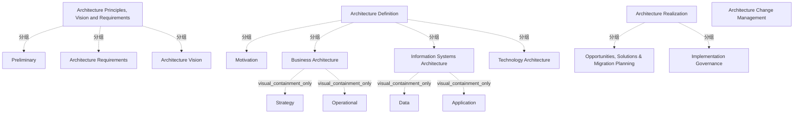

# G21H/fig6-1 · 按 ADM 阶段的 TOGAF 内容框架

类型：`decomposition-or-organization-model`。第 6.2 节要说明 DBRM 的 TOGAF ADM 生命周期要素如何与 TOGAF 内容框架对接。这张图把内容框架按 ADM 阶段归并成四个视觉块（原则/愿景/需求、架构定义、架构实现，加上纵贯的架构变更管理），让读者一眼看出每个阶段产出哪类内容，为表 6-1 的 DBRM 要素—ADM 阶段—内容框架映射提供总图。

英文 PDF 物理页：[43]。本页为架构语义分析，原文与原图分别保留。

## 原图与可编辑图


[完整 JSON](fig6-1.json) · [可编辑 Mermaid](fig6-1.mmd) · [仅关系图](fig6-1.relations.mmd) · [层级分解图](fig6-1.hierarchy.mmd)

图形重建表达语义，不复制源图布局。虚线表示解释、矩阵映射或分组关系，不自动表示不确定性的概率。



## 架构分析

自上而下读三个大色块：顶部橙色“架构原则、愿景与需求”里，Preliminary 与 Architecture Requirements 并排，Architecture Vision 通栏在下；中部灰色“架构定义”里，先是一条 Motivation 横带，下面并排三个架构列——Business Architecture（内含 Strategy、Operational 上下两块）、Information Systems Architecture（内含 Data、Application 左右两块）、Technology Architecture；底部暗红“架构实现”里，Opportunities, Solutions & Migration Planning 与 Implementation Governance 左右并排。最后看最右侧的浅黄竖带“架构变更管理”，它从顶部一直贯到底部，不属于任何一个大色块。

- 本图有 17 个具名或隐含元素、0 条关系和 13 条包含/分组记录。
- 包含/分组树最大深度为 2；根节点为 架构原则、愿景与需求、架构定义、架构实现、架构变更管理。
- 本图没有可直接确认为人员直属汇报的关系；视觉上下位置、能力分解和治理职责分别读取。
- 原图靠嵌套表达结构，没有连线；新语义图将包含单独显式化，不补造流程、数据流或依赖。
- 包含分组后有 4 个连通分量；分离可能源于图例、并列分类或独立示例，未自动补边。
- 逐一核对17个标签及全部父子容器：三大带、Business/Information Systems/Technology并列，Data与Application分框。
- 原图没有连接线；Architecture Change Management在黄色背景右侧纵向贯穿，不能推为单独阶段框或连接箭头。
- Preliminary与Architecture Requirements上排并列，Architecture Vision下排通栏；Opportunities/Solutions/Migration与Implementation Governance下层并列。

### 如何用于项目

- 按父项展开所有直接子项，检查同层粒度、重叠和缺项。
- 保留组成、分类、能力分解与组织汇报的区别；将示例名称替换为已确认的项目对象。

### 结构所表达的逻辑

- 四个内容块：Architecture Principles, Vision and Requirements（橙）、Architecture Definition（灰）、Architecture Realization（暗红），加上右侧纵贯全图的 Architecture Change Management（浅黄竖带）。
- 顶部块内部：Preliminary 与 Architecture Requirements 左右并排，Architecture Vision 通栏放在它们下面；三者都嵌在橙色大块内。
- 架构定义块内部：Motivation 是一条通栏横带，位于三个架构列之上；三个架构列从左到右为 Business Architecture、Information Systems Architecture、Technology Architecture。
- Business Architecture 内部再分上下两块：Strategy 在上、Operational 在下；Information Systems Architecture 内部再分左右两块：Data 在左、Application 在右；Technology Architecture 不再细分。
- 架构实现块内部左右并排：Opportunities, Solutions & Migration Planning 在左，Implementation Governance 在右。
- 架构变更管理画成纵贯全高的右侧竖带，而不是底部的一个块：表示变更管理横切所有阶段，不是 ADM 走完之后的最后一步。
- 图内没有任何箭头或连线，全部关系由嵌套（大块包小块）与相邻（并排/上下）表达；层级本身就是信息。
- 与 ADM 的对应：Preliminary→预备；Architecture Vision→阶段 A；Business Architecture/Motivation→阶段 B；Information Systems Architecture→阶段 C；Technology Architecture→阶段 D；Architecture Realization（机会/解决方案与迁移规划）→阶段 E/F；Implementation Governance→阶段 G；Architecture Change Management→阶段 H；Architecture Requirements 贯穿需求管理。

## 上下级与包含

两到三层。第 1 层是四个内容块（原则/愿景/需求、架构定义、架构实现、架构变更管理）；第 2 层是各块内的内容区（Preliminary、Architecture Requirements、Architecture Vision；Motivation、三个架构域；机会/解决方案与迁移规划、实施治理）；第 3 层只出现在 Business Architecture（Strategy、Operational）与 Information Systems Architecture（Data、Application）内部。架构变更管理没有子块，是与前三个内容块并列的竖带。

|父项|子项|层级类型|依据与解释|
|---|---|---|---|
|架构原则、愿景与需求|预备阶段|visual_grouping|框、泳道、域或分类组的成员归属；没有额外证据不提升为业务组合或管理关系。|
|架构原则、愿景与需求|架构需求|visual_grouping|框、泳道、域或分类组的成员归属；没有额外证据不提升为业务组合或管理关系。|
|架构原则、愿景与需求|架构愿景|visual_grouping|框、泳道、域或分类组的成员归属；没有额外证据不提升为业务组合或管理关系。|
|架构定义|动机|visual_grouping|框、泳道、域或分类组的成员归属；没有额外证据不提升为业务组合或管理关系。|
|架构定义|业务架构|visual_grouping|框、泳道、域或分类组的成员归属；没有额外证据不提升为业务组合或管理关系。|
|业务架构|战略|visual_containment_only|保存原图解释中的包含；业务关系类型需要图例或正文进一步限定。|
|业务架构|运营|visual_containment_only|保存原图解释中的包含；业务关系类型需要图例或正文进一步限定。|
|架构定义|信息系统架构|visual_grouping|框、泳道、域或分类组的成员归属；没有额外证据不提升为业务组合或管理关系。|
|信息系统架构|数据|visual_containment_only|保存原图解释中的包含；业务关系类型需要图例或正文进一步限定。|
|信息系统架构|应用|visual_containment_only|保存原图解释中的包含；业务关系类型需要图例或正文进一步限定。|
|架构定义|技术架构|visual_grouping|框、泳道、域或分类组的成员归属；没有额外证据不提升为业务组合或管理关系。|
|架构实现|机会、解决方案与迁移规划|visual_grouping|框、泳道、域或分类组的成员归属；没有额外证据不提升为业务组合或管理关系。|
|架构实现|实施治理|visual_grouping|框、泳道、域或分类组的成员归属；没有额外证据不提升为业务组合或管理关系。|

## 全部元素与角色

|元素ID|原文名称|类型|含义|直接父项|深度|
|---|---|---|---|---|---|
|aprv|Architecture Principles, Vision and Requirements|group|分组：架构原则、愿景与需求|—||
|preliminary|Preliminary|phase|阶段：预备阶段|架构原则、愿景与需求|1|
|arch_requirements|Architecture Requirements|artifact|制品：架构需求|架构原则、愿景与需求|1|
|arch_vision|Architecture Vision|artifact|制品：架构愿景|架构原则、愿景与需求|1|
|arch_definition|Architecture Definition|group|分组：架构定义|—||
|motivation|Motivation|artifact|制品：动机|架构定义|1|
|business_architecture|Business Architecture|architecture|架构：业务架构|架构定义|1|
|strategy|Strategy|artifact|制品：战略|业务架构|2|
|operational|Operational|artifact|制品：运营|业务架构|2|
|isa|Information Systems Architecture|architecture|架构：信息系统架构|架构定义|1|
|data|Data|artifact|制品：数据|信息系统架构|2|
|application|Application|artifact|制品：应用|信息系统架构|2|
|tech_arch|Technology Architecture|architecture|架构：技术架构|架构定义|1|
|arch_realization|Architecture Realization|group|分组：架构实现|—||
|opportunities|Opportunities, Solutions & Migration Planning|phase|阶段：机会、解决方案与迁移规划|架构实现|1|
|implementation_gov|Implementation Governance|phase|阶段：实施治理|架构实现|1|
|change_mgmt|Architecture Change Management|phase|原图为竖排大字；中文版被缩成极小横排，几乎不可读。|—||

## 全部关系

图中没有任何连线或箭头，因此没有方向语义。关系只有两种：①包含——大色块包住内部横条/竖块（如橙色块包含 Preliminary、Architecture Requirements、Architecture Vision）；②相邻——同一层内左右并排或上下堆叠（如 Data 与 Application 并排，Strategy 与 Operational 上下）。右侧“架构变更管理”以一条细竖线与主区隔开，是独立的竖带，不是主区的子块。

|主体|语义关系|客体|显式线/隐式|原文标签|依据|
|---|---|---|---|---|---|

## 误读检查

- 不要把四个块读成严格的 ADM 阶段顺序：它们是内容类别；Preliminary 与 Architecture Requirements 是并排的，Architecture Vision 在它们下方，而不是“先预备、再需求、再愿景”的一条竖线。
- “Motivation”是架构定义内的一条横带，不是与业务架构、信息系统架构、技术架构并列的第四个架构域。
- Business Architecture 里的“Strategy/Operational”不是两个 ADM 阶段，而是业务架构内部的两个内容块，对应 DBRM 的战略域/运营域；不要把它们读成阶段 B 之后还有两个阶段。
- 右侧“架构变更管理”不是 ADM 的最后一步底部块，而是纵贯全图、适用于所有阶段的横切内容；它在视觉上覆盖三层，位置本身就说明这一点。
- 图中没有箭头，不要自行补出阶段之间的流向或反馈；阶段顺序与迭代关系见正文 6.2 节与表 6-1。
- 中文化 PNG 右侧“架构变更管理”被缩成极小横排，容易漏读成装饰条；应以英文原图的竖排大字为准。

## 原文证据

### [PDF 第 43 页](../../../documents/G21H.md#page-43)

> Figure 6-1 depicts the TOGAF Content Framework in line with the ADM phases.
### [PDF 第 44 页](../../../documents/G21H.md#page-44)

> Following is a summary description of the respective components of the TOGAF Content Framework that should be considered when adapting the ADM processes to enable the adoption and the implementation of the DBRM:
> • Architecture Principles, Vision, Motivation, and Requirements models are intended to capture the surrounding context of formal architecture models, including general Architecture Principles, Strategic Context that forms input for architecture modeling, and requirements generated from the architecture

## 来源与分析状态

所有元素/关系均有来源定位；未把历史解释重命名为本轮逐线视觉确认。源图与语义图是两种视图，布局不证明汇报或因果。

源 PDF SHA-256：`40881f73b66ae8cfabc279aba8fe3767182ac3e865823054d0aca58f6292a470`。

源图记录：[原始解释与转录](../../../figures/G21H/fig6-1.json)。

```json
{
  "quality": {
    "graph_integrity": "checked",
    "semantic_analysis": "typed-graph-and-context-analysis",
    "visual_review": "source-content-audited",
    "notice_zh": "所有元素/关系均有来源定位；未把历史解释重命名为本轮逐线视觉确认。源图与语义图是两种视图，布局不证明汇报或因果。"
  },
  "source_uncertainty": {
    "confidence": "high",
    "uncertainties_zh": [
      "右侧“架构变更管理”竖带在主图之外，是否算作第四个内容块还是横切覆盖层，图中没有边框说明；本分析按横切层处理（与三个内容块并列但不属于任何一块）。",
      "原图没有把 Preliminary、Architecture Requirements、Architecture Vision 与具体阶段字母连起来，ADM 阶段对应关系（A/B/C/D/E-F/G/H、需求管理）是依据 6.2 节正文与表 6-1 补出的，不是图内文字。",
      "中文版“架构变更管理”缩得极小，若只读中文图可能完全漏掉这一层。"
    ],
    "analyzed_from": [
      "英文 PDF 第 43 页 figure 截图（220 dpi）",
      "英文 PDF 第 43 页正文",
      "中文稿 G21He_TOGAF数字业务参考模型.md 第 624–698 行（含图内标签对照表与表 6-1）",
      "figs/g21he_fig6-1_en.png 与 figs/zh/g21he_fig6-1_zh.png 目视比较"
    ],
    "date": "2026-10-31"
  },
  "source_conflicts": []
}
```
