# G21H/fig6-2 · TOGAF 架构景观分类模型汇总

类型：`architecture-concept-or-system-model`。第 6.4 节要说明架构景观中同时存在许多不同粒度的架构。这张图把 TOGAF 的汇总分类模型可视化：用 Level 轴区分企业战略架构、分段架构、能力架构三个层级，用 Breadth 轴表示同一层级可以有不同广度的多个架构，用 Time 轴表示这些架构分布在不同的时点。它帮助架构师为架构景观选择适当的粒度，并与表 6-3 的 DBRM 要素映射配合使用。

英文 PDF 物理页：[48]。本页为架构语义分析，原文与原图分别保留。

## 原图与可编辑图


[完整 JSON](fig6-2.json) · [可编辑 Mermaid](fig6-2.mmd) · [仅关系图](fig6-2.relations.mmd) · [层级分解图](fig6-2.hierarchy.mmd)

图形重建表达语义，不复制源图布局。虚线表示解释、矩阵映射或分组关系，不自动表示不确定性的概率。

```mermaid
flowchart TB
  %% Semantic reconstruction; see original source image for exact layout.
  n0["Breadth"]
  n1["Time"]
  n2["Level"]
  n3["Enterprise Strategic Architecture"]
  n4["Segment Architecture"]
  n5["Segment Architecture"]
  n6["Capability Architecture"]
  n7["Capability Architecture"]
  n8["Capability Architecture"]
  n9["后方无标签的分段架构重复块"]
  n10["后方无标签的能力架构重复块"]
```



## 架构分析

先读三条坐标轴：左上斜向后的 Breadth（广度），顶部向右的 Time（时间），左侧向下的 Level（层级）。再读三层块体：最上面黄色的是 Enterprise Strategic Architecture（企业战略架构），中间绿色的是 Segment Architecture（分段架构），最下面紫色的是 Capability Architecture（能力架构）。企业战略层只有一个通栏大块；分段层与能力层则沿纵深（广度）和左右（时间）排列多个长方体：前排带文字的是可见实例，后排只露出顶面/侧面的是同一层级的其他架构。

- 本图有 11 个具名或隐含元素、0 条关系和 0 条包含/分组记录。
- 本图没有可直接确认为人员直属汇报的关系；视觉上下位置、能力分解和治理职责分别读取。
- 包含分组后有 11 个连通分量；分离可能源于图例、并列分类或独立示例，未自动补边。
- 核对3坐标轴、1战略架构、2前排分段架构及3前排能力架构标签。
- 补记后方无文字的绿色分段架构重复块与紫色能力架构重复块；遮挡部分不猜总实体数或文字。
- 坐标轴Time向右、Breadth斜向右上、Level向下；没有架构块之间的连接箭头，位置不等于流程。

### 如何用于项目

- 围绕作者目的读取本图实体、分组与连线，并用对应原文限定其含义。
- 把参考模型与项目事实分开，实际范围、约束、值和责任须有项目证据。

### 结构所表达的逻辑

- 三个层级自上而下：Enterprise Strategic Architecture（最宽、只有一个前排大块）、Segment Architecture（中间层，前排可见两个块）、Capability Architecture（最下层，前排可见三个块）。
- Breadth 轴是左上角斜向后的箭头：沿该方向（向后）广度增大，同一层级向后复制出多个块，表示企业级/分段级/能力级不同广度的多个架构。
- Time 轴是顶部水平向右的箭头：同一层级左右排列多个块，表示架构景观持有企业在不同时点的架构视图。
- Level 轴是左侧竖直向下的箭头：战略架构在上、分段架构居中、能力架构在下；箭头向下表示层级由高到低，不要因为箭头向下就以为能力架构是最高层。
- 三层的数量关系是示意：越往上架构越少、覆盖范围越广（企业战略层 1 个通栏大块），越往下架构越多、覆盖范围越窄（能力层前排 3 个块，后方还有多排）。
- 图中没有任何块与块之间的连线或箭头，三个层级之间也没有画包含/治理线；层级关系完全由垂直位置表达，这是一张分类网格而不是流程图。
- 本图与正文表 6-3 配合：表 6-3 把战略架构、分段架构、能力架构分别映射到客户聚焦/战略语境/业务动机/生态与业务模型、业务服务与产品/运营模式/业务能力模型/数字企业、业务运营环境/数字使能。
- 三维透视是示意性的：块的纵深、宽度和间距不代表精确的数量或时间刻度，不能据块数推算企业实际有多少架构。

## 上下级与包含

三个层级：第 1 层 Enterprise Strategic Architecture（最广、覆盖整个企业），第 2 层 Segment Architecture（覆盖企业内的一个分段/领域），第 3 层 Capability Architecture（覆盖一个能力单元）。每个层级内部又有多个实例，沿 Breadth（纵深）和 Time（左右）两个方向排列；这些实例之间是并列关系，图中没有父子连线。层级之间也没有画出包含线，只有上下堆叠的位置关系。

|父项|子项|层级类型|依据与解释|
|---|---|---|---|
|—|—|无视觉包含|关系中明确的组成/特化见 JSON semantic_hierarchy。|

## 全部元素与角色

|元素ID|原文名称|类型|含义|直接父项|深度|
|---|---|---|---|---|---|
|axis_breadth|Breadth|note|坐标轴，不是架构要素；箭头指向后方，表示广度增大。|—||
|axis_time|Time|note|坐标轴，不是架构要素；箭头向右，表示时间推进。|—||
|axis_level|Level|note|坐标轴，不是架构要素；箭头向下，表示层级由高到低。|—||
|esa|Enterprise Strategic Architecture|architecture|最广、最少的层级；为运营与变革活动提供组织框架，支持高管层方向设定。|—||
|sa_1|Segment Architecture|architecture|架构：分段架构|—||
|sa_2|Segment Architecture|architecture|架构：分段架构|—||
|ca_1|Capability Architecture|architecture|架构：能力架构|—||
|ca_2|Capability Architecture|architecture|架构：能力架构|—||
|ca_3|Capability Architecture|architecture|架构：能力架构|—||
|unlabelled_segment_repetitions|后方无标签的分段架构重复块|group|前排两个有标签分段架构之后还有多层绿色块；不将遮挡区域补写为已知实体。|—||
|unlabelled_capability_repetitions|后方无标签的能力架构重复块|group|三个有标签前排块后方延伸多排紫色块；图中没有逐块名称或时间数值。|—||

## 全部关系

全图只有三条坐标轴箭头：Breadth 从左上角斜向后上方（箭头在远端），Time 从左上角水平向右（箭头在右端），Level 从左上角竖直向下（箭头在下端）。三条轴共用一个起点（左上角），表示三个维度；它们不是要素之间的关系线，也不表示块与块之间的流向。块体之间没有任何连线；层级与实例的关系由堆叠/复制的位置表达。

|主体|语义关系|客体|显式线/隐式|原文标签|依据|
|---|---|---|---|---|---|

## 误读检查

- 不要把三个层级读成时间先后、成熟度阶段或实施步骤；它们是同一时点上不同粒度的架构分类，三个层级可以同时存在。
- Breadth 斜轴指向后方，不是第三个空间维度上的“高度”；块体向后复制表示同一层级在不同广度上的多个架构，不是楼层。
- Level 箭头向下，但层级本身是上高下低（战略在上、能力在下）；不要因为箭头向下就以为能力架构是最高层或最终目标。
- 三维块体的数量是示意，不是精确计数；不要据后排露出的块数推断企业实际有多少个分段/能力架构。
- 图中没有画出层级之间的包含、治理或映射关系，只有三条坐标轴；不要自行补出“战略架构包含分段架构”的连线，层级关系是分类意义上的。
- 中文图把“层级”缩成极小横排，且同类块字号不一致（右“分段架构”很小、右“能力架构”很大），容易误读层级标签或以为字号大小有含义；以英文原图为准确认。

## 原文证据

### [PDF 第 48 页](../../../documents/G21H.md#page-48)

> Figure 6-2 depicts the TOGAF summary of the classification model for the Architecture Landscape to enable appropriate granularity for the definition of the Architecture Landscape.
> Figure 6-2: TOGAF Summary of the Classification Model for the Architecture Landscape
### [PDF 第 49 页](../../../documents/G21H.md#page-49)

> The Architecture Landscape is divided into three levels of granularity, as follows:
> • The Strategic Architecture provides an organizing framework for operational and change activity and allows for direction-setting at an executive level; it shows a long-term summary view of the entire enterprise

## 来源与分析状态

所有元素/关系均有来源定位；未把历史解释重命名为本轮逐线视觉确认。源图与语义图是两种视图，布局不证明汇报或因果。

源 PDF SHA-256：`40881f73b66ae8cfabc279aba8fe3767182ac3e865823054d0aca58f6292a470`。

源图记录：[原始解释与转录](../../../figures/G21H/fig6-2.json)。

```json
{
  "quality": {
    "graph_integrity": "checked",
    "semantic_analysis": "typed-graph-and-context-analysis",
    "visual_review": "source-content-audited",
    "notice_zh": "所有元素/关系均有来源定位；未把历史解释重命名为本轮逐线视觉确认。源图与语义图是两种视图，布局不证明汇报或因果。"
  },
  "source_uncertainty": {
    "confidence": "high",
    "uncertainties_zh": [
      "三条坐标轴是维度标注而非要素间关系，图中也没有任何块与块的连线；本分析把轴线记入 elements（type=note）与 legend/line_semantics，未强行构造 from/to 关系。",
      "每层后排的同色块数量与排列只能从被遮挡的顶面/侧面估读：紫色约 3 排、绿色约 2 排、黄色 1 层，具体块数不确定；元素表只列前排带文字标签的块，后排未单独建元素。",
      "Breadth 与 Time 两个方向的具体分工（哪个方向代表分段、哪个代表时点）图中只给轴名，没有刻度；本分析按轴名直读，未推断每个块的现实含义。",
      "中文图“层级”标签极小、同类块字号不一致，已按英文原图确认层级名称。"
    ],
    "analyzed_from": [
      "英文 PDF 第 48 页 figure 截图（220 dpi）与 2x2 放大分块",
      "英文 PDF 第 48 页正文",
      "中文稿 G21He_TOGAF数字业务参考模型.md 第 745–782 行（含图内标签对照表与表 6-3）",
      "figs/g21he_fig6-2_en.png 与 figs/zh/g21he_fig6-2_zh.png 目视比较"
    ],
    "date": "2026-10-31"
  },
  "source_conflicts": []
}
```
