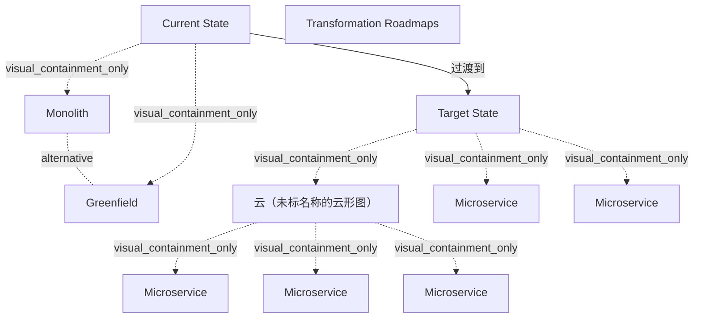

# G21I/fig10-1 · 范围转型

类型：`process-or-method-model`。第 10.2 节（阶段 E 的范围转型）用本图说明云原生与 MSA 的核心理念：目标状态是模块化、分布式、高度解耦的方案；由于微服务独立且自包含，每个模块的范围可以单独管理，各有自己的路线图与过渡计划。范围转型是阶段 E 的三类关键考虑之一（另两类为组织转型和技术转型）。

英文 PDF 物理页：[44]。本页为架构语义分析，原文与原图分别保留。

## 原图与可编辑图


[完整 JSON](fig10-1.json) · [可编辑 Mermaid](fig10-1.mmd) · [仅关系图](fig10-1.relations.mmd) · [层级分解图](fig10-1.hierarchy.mmd)

图形重建表达语义，不复制源图布局。虚线表示解释、矩阵映射或分组关系，不自动表示不确定性的概率。



## 架构分析

从左到右读。左侧“现状”下列出两种起点：单体（橙色框）和全新建设（绿框），二者是可选的两种情形，不是同时存在的两个部分。中间的大箭头是“转型路线图”（复数）。右侧“目标状态”是 5 个独立的微服务，其中 3 个画在云里，2 个在云外。

- 本图有 11 个具名或隐含元素、2 条关系和 8 条包含/分组记录。
- 包含/分组树最大深度为 2；根节点为 现状、转型路线图、目标状态。
- 本图没有可直接确认为人员直属汇报的关系；视觉上下位置、能力分解和治理职责分别读取。
- 包含分组后有 2 个连通分量；分离可能源于图例、并列分类或独立示例，未自动补边。
- 核对Current/Target、Monolith/Greenfield、路线图箭头以及五个独立Microservice标签：云内3、云外2。
- 仅一条向右大块转型箭头，Transformation Roadmaps是箭头内标签；删除将路线图标签另造为实体→目标的冗余边。
- Monolith与Greenfield为正文支持的当前状态选项，无二者间连接；云外两微服务是本图内容，不能假定MSA全部部署在云中。

### 如何用于项目

- 按阶段/事件/行为关系读取入口、出口、责任和产物；检查循环与例外路径。
- 工作流先后不表示组织管理权；在项目中显式记录条件和完成标准。

### 结构所表达的逻辑

- 现状有两种情形：可分解的单体方案，或没有遗留系统的全新建设（Greenfield）。
- 目标状态是模块化、分布式、高度解耦的方案，由多个彼此独立的微服务组成。
- 微服务独立且自包含，所以每个模块的范围可以单独管理，各有自己的路线图与过渡计划；箭头上写的是复数的“转型路线图”。
- 部分微服务在云内、部分在云外：原文指出微服务是云原生方案的一种，但也可以部署在云外；云原生则专为云设计。
- 阶段 E 还要考虑组织转型（每个微服务由单一团队拥有，治理结构精益、联邦式）和技术转型（异构技术格局、内外双重参考架构、交付与部署基础设施，以及数据转型），这些不在本图中。

## 上下级与包含

两组：“现状”下是单体与全新建设两种可选起点；“目标状态”下是 5 个微服务，其中 3 个位于云形图内。

|父项|子项|层级类型|依据与解释|
|---|---|---|---|
|现状|单体应用|visual_containment_only|保存原图解释中的包含；业务关系类型需要图例或正文进一步限定。|
|现状|全新建设（绿地）|visual_containment_only|保存原图解释中的包含；业务关系类型需要图例或正文进一步限定。|
|目标状态|云（未标名称的云形图）|visual_containment_only|保存原图解释中的包含；业务关系类型需要图例或正文进一步限定。|
|云（未标名称的云形图）|微服务|visual_containment_only|保存原图解释中的包含；业务关系类型需要图例或正文进一步限定。|
|云（未标名称的云形图）|微服务|visual_containment_only|保存原图解释中的包含；业务关系类型需要图例或正文进一步限定。|
|云（未标名称的云形图）|微服务|visual_containment_only|保存原图解释中的包含；业务关系类型需要图例或正文进一步限定。|
|目标状态|微服务|visual_containment_only|保存原图解释中的包含；业务关系类型需要图例或正文进一步限定。|
|目标状态|微服务|visual_containment_only|保存原图解释中的包含；业务关系类型需要图例或正文进一步限定。|

## 全部元素与角色

|元素ID|原文名称|类型|含义|直接父项|深度|
|---|---|---|---|---|---|
|current_state|Current State|architecture|架构：现状|—||
|monolith|Monolith|application|可分解的单体方案。|现状|1|
|greenfield|Greenfield|concept|没有遗留系统的全新建设场景。|现状|1|
|roadmaps|Transformation Roadmaps|artifact|复数：每个模块各有路线图与过渡计划。|—||
|target_state|Target State|architecture|模块化、分布式、高度解耦的方案。|—||
|cloud|云（未标名称的云形图）|technology|技术：云（未标名称的云形图）|目标状态|1|
|ms_1|Microservice|service|服务：微服务|云（未标名称的云形图）|2|
|ms_2|Microservice|service|服务：微服务|云（未标名称的云形图）|2|
|ms_3|Microservice|service|服务：微服务|云（未标名称的云形图）|2|
|ms_4|Microservice|service|部署在云外的微服务。|目标状态|1|
|ms_5|Microservice|service|服务：微服务|目标状态|1|

## 全部关系

只有一个大块箭头，从现状指向目标状态，标“转型路线图”。现状中的两个框之间、各微服务之间都没有连线。

|主体|语义关系|客体|显式线/隐式|原文标签|依据|
|---|---|---|---|---|---|
|现状|过渡到|目标状态|显式连线|Transformation Roadmaps|大块箭头|
|单体应用|alternative|全新建设（绿地）|implicit||p43正文明确当前状态可以为Greenfield或decomposable monolith；原图二者间无连线，语义为文本支持的备选起点。|

## 本轮否定的历史关系

以下旧解释保留用于追溯，不进入当前关系图、层级或知识图谱的有效边。

|旧记录|主体|旧关系|客体|否定依据|
|---|---|---|---|---|
|1|转型路线图|realization|目标状态|Transformation Roadmaps已经是唯一大箭头的标签；没有标签实体到Target的第二条线。|

## 本轮语义修正

- Transformation Roadmaps已经是唯一大箭头的标签；没有标签实体到Target的第二条线。
- p43正文明确当前状态可以为Greenfield或decomposable monolith；原图二者间无连线，语义为文本支持的备选起点。

## 误读检查

- 单体与全新建设是二选一的两种起点，不是需要同时迁移的两个系统。
- 箭头不表示一次性整体迁移；原文强调每个模块有自己的路线图与过渡计划。
- 云外的 2 个微服务不是“尚未迁移”的部分；原图没有区分它们的状态，正文只说明微服务也可以部署在云外。

## 原文证据

### [PDF 第 43 页](../../../documents/G21I.md#page-43)

> The TOGAF Opportunities & Solutions phase identifies delivery vehicles (projects, programs, or portfolios) that effectively deliver the Target Architecture defined in previous phases. It reviews the target business objectives and capabilities, consolidates the gaps from Phases B to D, and organizes groups of building blocks to address these capabilities. It then generates an outline Implementation and Migration Strategy.
> There are some nuances between a cloud-native solution and a microservices-based solution. Microservices are a type of cloud-native solution, but they can have non-cloud deployments as well. Cloud-native is exclusively designed for the cloud. The intent of cloud-native is to optimally use cloud- scale architecture and cloud services in the solution. Microservices have other constraints and motivations; refer to The Open Group White Paper: Microservices Architecture [W169] for a deeper understanding. The commonalities are that they are both very modular and highly distributed deployments. They are elastically scalable and resilient.
### [PDF 第 44 页](../../../documents/G21I.md#page-44)

> To successfully embrace cloud-native and MSA requires significant organizational transformation. The target state demands single team ownership of each module (microservice) and a lean, federated governance structure. Each team will autonomously own the entire lifecycle of the microservice, and there is a need for coordination to enable all capabilities of the desired target state solution.
> This new paradigm presents a good opportunity for adopting an Agile/DevOps methodology; see The Open Group White Paper: Benefits of DevOps Methodology for Microservices Solutions [W196].

## 来源与分析状态

所有元素/关系均有来源定位；未把历史解释重命名为本轮逐线视觉确认。源图与语义图是两种视图，布局不证明汇报或因果。

源 PDF SHA-256：`279f6c06124f49a147a168591965805115b2fc976eea2664e41e491ac5d163bf`。

源图记录：[原始解释与转录](../../../figures/G21I/fig10-1.json)。

```json
{
  "quality": {
    "graph_integrity": "checked",
    "semantic_analysis": "typed-graph-and-context-analysis",
    "visual_review": "source-content-audited",
    "notice_zh": "所有元素/关系均有来源定位；未把历史解释重命名为本轮逐线视觉确认。源图与语义图是两种视图，布局不证明汇报或因果。"
  },
  "source_uncertainty": {
    "confidence": "high",
    "uncertainties_zh": [
      "图中的云没有标签；“云内/云外”与“微服务可部署在云外”的对应来自第 10.1 节正文，图本身没有说明。"
    ],
    "analyzed_from": [
      "英文 PDF 第 44 页原图截图（220 dpi）",
      "英文 PDF 第 43–44 页正文",
      "中文稿 G21Ie_微服务架构.md 第 616–662 行（含图内标签对照表 L639–L648）",
      "figs/zh/g21ie_fig10-1_zh.png",
      "figs/g21ie_fig10-1_en.png（自动相似度 0.979）"
    ],
    "date": "2026-10-31"
  },
  "source_conflicts": []
}
```
