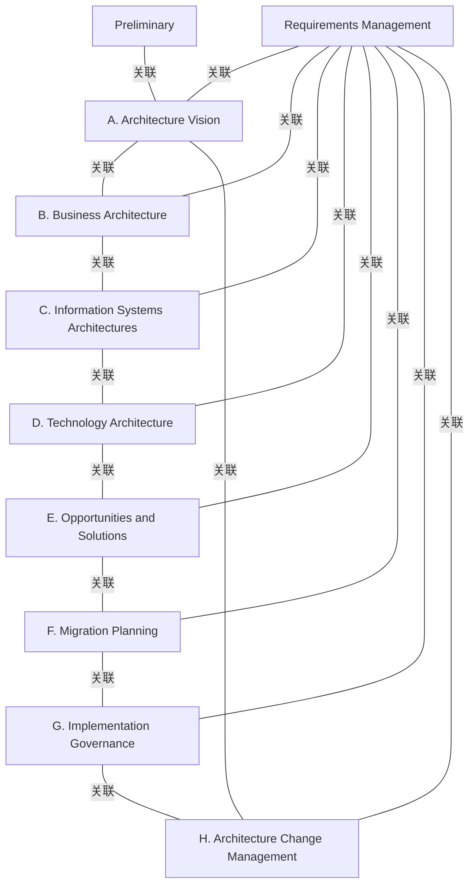

# G21I/fig4-1 · TOGAF 架构开发方法（ADM）

类型：`process-or-method-model`。本指南按 ADM 阶段组织：第 5–13 章依次对应预备阶段到阶段 H，说明采用 MSA 时架构师在各阶段要考虑什么、对阶段输出有何影响。本图让读者先认出熟悉的 ADM 结构，再进入逐阶段的 MSA 说明。

英文 PDF 物理页：[21]。本页为架构语义分析，原文与原图分别保留。

## 原图与可编辑图


[完整 JSON](fig4-1.json) · [可编辑 Mermaid](fig4-1.mmd) · [仅关系图](fig4-1.relations.mmd) · [层级分解图](fig4-1.hierarchy.mmd)

图形重建表达语义，不复制源图布局。虚线表示解释、矩阵映射或分组关系，不自动表示不确定性的概率。



## 架构分析

从顶部的预备阶段开始，它只连到下方的阶段 A。A–H 八个阶段围成一圈，按 TOGAF 惯例从 A 起顺时针读到 H，再回到 A。中心的需求管理用 8 条辐条与 A–H 相连。所有连线都没有箭头。

- 本图有 10 个具名或隐含元素、17 条关系和 0 条包含/分组记录。
- 本图没有可直接确认为人员直属汇报的关系；视觉上下位置、能力分解和治理职责分别读取。
- 逐一核对Preliminary、A–H及Requirements Management共10标签、17条无箭头线；不把轮盘布局当作强制顺序。
- 需求管理处于中心，分别连接八阶段；Preliminary只连接A。
- 附加章节对应表属于正文导航，不是图中表格。

### 如何用于项目

- 按阶段/事件/行为关系读取入口、出口、责任和产物；检查循环与例外路径。
- 工作流先后不表示组织管理权；在项目中显式记录条件和完成标准。

### 结构所表达的逻辑

- 预备阶段在循环之外，只接入阶段 A：它为企业做好开展架构工作的准备，A–H 才是可重复的开发循环。
- A–H以字母顺序环形排布，H与A之间有无箭头弧线；本文按阶段组织章节，实际迭代和回访不由本图的无向连线限定。
- 需求管理位于中心并连到每个阶段；原文把它列为“面向 MSA 的持续过程”，不是排在某个阶段之后的一步。
- 阶段 C 是“信息系统架构”，原文注明包括数据与应用两部分；本指南第 8 章分 8.1 数据架构、8.2 应用架构展开。
- 本指南第 5–13 章与图中的预备阶段、A–H 一一对应；原文说明它只讲与 MSA 相关的内容（聚焦架构中的微服务层），假定读者已了解 TOGAF 标准。

## 上下级与包含

没有嵌套。预备阶段、A–H 与需求管理都是 ADM 的阶段；需求管理用更大的橙色圆放在中心，表示它与所有阶段相关。

|父项|子项|层级类型|依据与解释|
|---|---|---|---|
|—|—|无视觉包含|关系中明确的组成/特化见 JSON semantic_hierarchy。|

## 全部元素与角色

|元素ID|原文名称|类型|含义|直接父项|深度|
|---|---|---|---|---|---|
|ph_prelim|Preliminary|phase|阶段：预备阶段|—||
|ph_a|A. Architecture Vision|phase|阶段：阶段 A：架构愿景|—||
|ph_b|B. Business Architecture|phase|阶段：阶段 B：业务架构|—||
|ph_c|C. Information Systems Architectures|phase|阶段：阶段 C：信息系统架构|—||
|ph_d|D. Technology Architecture|phase|阶段：阶段 D：技术架构|—||
|ph_e|E. Opportunities and Solutions|phase|阶段：阶段 E：机会与解决方案|—||
|ph_f|F. Migration Planning|phase|阶段：阶段 F：迁移规划|—||
|ph_g|G. Implementation Governance|phase|阶段：阶段 G：实施治理|—||
|ph_h|H. Architecture Change Management|phase|阶段：阶段 H：架构变更管理|—||
|ph_rm|Requirements Management|phase|原文称其为面向 MSA 的持续过程。|—||

## 全部关系

17条可见线均无箭头：Preliminary—A一条、A–H轮周八条、中心需求管理到八阶段八条。图形仅体现关联与环形布局；章节组织顺序不是本图的有向连线。

|主体|语义关系|客体|显式线/隐式|原文标签|依据|
|---|---|---|---|---|---|
|预备阶段|关联|阶段 A：架构愿景|显式连线||核对10标签及17条无箭头实线。|
|阶段 A：架构愿景|关联|阶段 B：业务架构|显式连线||核对10标签及17条无箭头实线。|
|阶段 B：业务架构|关联|阶段 C：信息系统架构|显式连线||核对10标签及17条无箭头实线。|
|阶段 C：信息系统架构|关联|阶段 D：技术架构|显式连线||核对10标签及17条无箭头实线。|
|阶段 D：技术架构|关联|阶段 E：机会与解决方案|显式连线||核对10标签及17条无箭头实线。|
|阶段 E：机会与解决方案|关联|阶段 F：迁移规划|显式连线||核对10标签及17条无箭头实线。|
|阶段 F：迁移规划|关联|阶段 G：实施治理|显式连线||核对10标签及17条无箭头实线。|
|阶段 G：实施治理|关联|阶段 H：架构变更管理|显式连线||核对10标签及17条无箭头实线。|
|阶段 H：架构变更管理|关联|阶段 A：架构愿景|显式连线||核对10标签及17条无箭头实线。|
|需求管理|关联|阶段 A：架构愿景|显式连线||核对10标签及17条无箭头实线。|
|需求管理|关联|阶段 B：业务架构|显式连线||核对10标签及17条无箭头实线。|
|需求管理|关联|阶段 C：信息系统架构|显式连线||核对10标签及17条无箭头实线。|
|需求管理|关联|阶段 D：技术架构|显式连线||核对10标签及17条无箭头实线。|
|需求管理|关联|阶段 E：机会与解决方案|显式连线||核对10标签及17条无箭头实线。|
|需求管理|关联|阶段 F：迁移规划|显式连线||核对10标签及17条无箭头实线。|
|需求管理|关联|阶段 G：实施治理|显式连线||核对10标签及17条无箭头实线。|
|需求管理|关联|阶段 H：架构变更管理|显式连线||核对10标签及17条无箭头实线。|

## ADM 阶段与本指南章节的对应（据中文稿目录与英文正文）

```json
{
  "id": "t_chapters",
  "title_zh": "ADM 阶段与本指南章节的对应（据中文稿目录与英文正文）",
  "columns": [
    "ADM 阶段",
    "本指南章节"
  ],
  "rows": [
    [
      "预备阶段 Preliminary",
      "第 5 章（含 5.3 治理与支持策略、5.4 初始架构存储库与 MSA 参考架构）"
    ],
    [
      "阶段 A：架构愿景",
      "第 6 章"
    ],
    [
      "阶段 B：业务架构",
      "第 7 章"
    ],
    [
      "阶段 C：信息系统架构（数据与应用）",
      "第 8 章"
    ],
    [
      "阶段 D：技术架构",
      "第 9 章"
    ],
    [
      "阶段 E：机会与解决方案",
      "第 10 章"
    ],
    [
      "阶段 F：迁移规划",
      "第 11 章"
    ],
    [
      "阶段 G：实施治理",
      "第 12 章"
    ],
    [
      "阶段 H：架构变更管理",
      "第 13 章"
    ],
    [
      "需求管理 Requirements Management",
      "无单独章节（原文列为面向 MSA 的持续过程）"
    ]
  ],
  "notes_zh": "图本身不含章节信息；本表帮助把图中的阶段与后文对上。"
}
```

## 本轮语义修正

- 核对10标签及17条无箭头实线。
- 核对10标签及17条无箭头实线。
- 核对10标签及17条无箭头实线。
- 核对10标签及17条无箭头实线。
- 核对10标签及17条无箭头实线。
- 核对10标签及17条无箭头实线。
- 核对10标签及17条无箭头实线。
- 核对10标签及17条无箭头实线。
- 核对10标签及17条无箭头实线。
- 核对10标签及17条无箭头实线。
- 核对10标签及17条无箭头实线。
- 核对10标签及17条无箭头实线。
- 核对10标签及17条无箭头实线。
- 核对10标签及17条无箭头实线。
- 核对10标签及17条无箭头实线。
- 核对10标签及17条无箭头实线。
- 核对10标签及17条无箭头实线。

## 误读检查

- 无箭头圆周线不能解释为强制先后顺序；A–H是布局及章节顺序，执行可按需要迭代。
- 需求管理不是 H 之后的第 10 步，而是贯穿全部阶段的持续过程。
- 预备阶段不在 A–H 循环之内。
- 原图右下角的空心大字是英文 PDF 的“Evaluation Copy”水印，不是图的内容。

## 原文证据

### [PDF 第 20 页](../../../documents/G21I.md#page-20)

> Those familiar with the TOGAF Standard will recognize the following graphical depiction of the ADM in Figure 4-1. This document will only focus on the microservices layer of the architecture and therefore only a subset of the ADM is relevant, as described below Figure 4-1.
### [PDF 第 21 页](../../../documents/G21I.md#page-21)

> The following chapters describe, for each phase of the TOGAF ADM, what the architect should consider, particularly when looking to apply MSA, and how this affects the outputs of the phase. In short, it explains how to use the TOGAF Standard to do MSA.
> This is not a standalone description. It assumes knowledge of the TOGAF Standard, and leaves out everything that is not related to MSA. The architect can find all the information needed on The Open Group TOGAF Standard website.

## 来源与分析状态

所有元素/关系均有来源定位；未把历史解释重命名为本轮逐线视觉确认。源图与语义图是两种视图，布局不证明汇报或因果。

源 PDF SHA-256：`279f6c06124f49a147a168591965805115b2fc976eea2664e41e491ac5d163bf`。

源图记录：[原始解释与转录](../../../figures/G21I/fig4-1.json)。

```json
{
  "quality": {
    "graph_integrity": "checked",
    "semantic_analysis": "typed-graph-and-context-analysis",
    "visual_review": "source-content-audited",
    "notice_zh": "所有元素/关系均有来源定位；未把历史解释重命名为本轮逐线视觉确认。源图与语义图是两种视图，布局不证明汇报或因果。"
  },
  "source_uncertainty": {
    "confidence": "high",
    "uncertainties_zh": [],
    "analyzed_from": [
      "英文 PDF 第 21 页原图截图（220 dpi）",
      "英文 PDF 第 20–21 页正文",
      "中文稿 G21Ie_微服务架构.md 第 173–215 行（含图内标签对照表 L196–L209）及全文章节标题",
      "figs/zh/g21ie_fig4-1_zh.png",
      "figs/g21ie_fig4-1_en.png（自动相似度 0.993）"
    ],
    "date": "2026-10-31"
  },
  "source_conflicts": []
}
```
