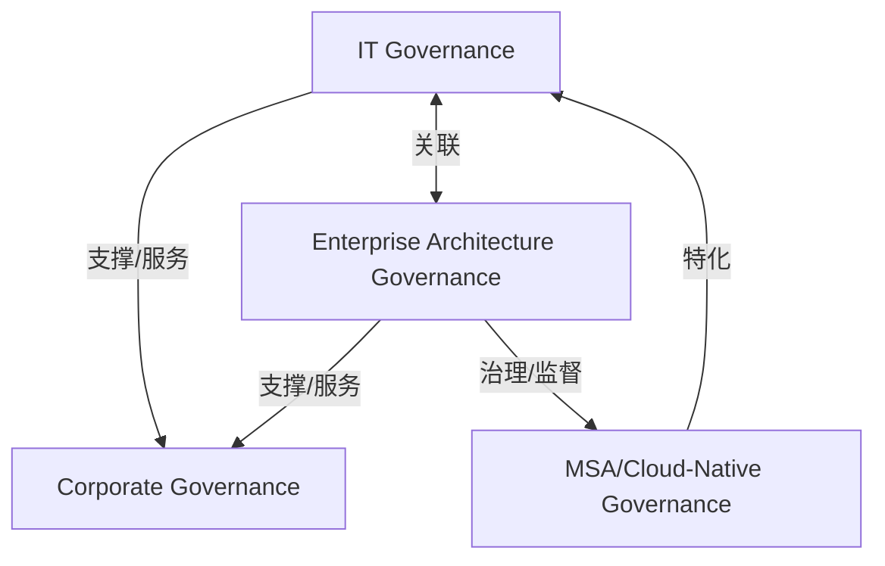

# G21I/fig5-1 · SOA 治理支持 IT 治理与企业架构治理

类型：`architecture-concept-or-system-model`。第 5.3 节（预备阶段的治理与支持策略）用本图给出 MSA 治理与企业架构治理、IT 治理之间关系的高层视图，说明 MSA 团队要走两条并行的治理轨道：只对本 MSA 生效的自主治理决策，同时不越出企业设定的护栏。

英文 PDF 物理页：[26]。本页为架构语义分析，原文与原图分别保留。

## 原图与可编辑图


[完整 JSON](fig5-1.json) · [可编辑 Mermaid](fig5-1.mmd) · [仅关系图](fig5-1.relations.mmd) · [层级分解图](fig5-1.hierarchy.mmd)

图形重建表达语义，不复制源图布局。虚线表示解释、矩阵映射或分组关系，不自动表示不确定性的概率。



## 架构分析

自上而下分三层读：顶部是企业治理；中间是并列的 IT 治理（左）和企业架构治理（右），两者用双向箭头“对齐”，并各有一条向上箭头“支持”企业治理；底部是 MSA/云原生治理，左侧箭头向上“扩展”IT 治理，右侧箭头从企业架构治理向下“约束”它。箭头所指为关系的宾语。

- 本图有 4 个具名或隐含元素、5 条关系和 0 条包含/分组记录。
- 本图没有可直接确认为人员直属汇报的关系；视觉上下位置、能力分解和治理职责分别读取。
- 治理边回答谁提供约束、指导或监督；它们与岗位汇报边分别存储。
- 四个治理框、五条连接、五处关系标注已与原图逐一核对。
- IT和EA向上Supports Corporate；IT↔EA为Aligns；MSA向上Extends IT；EA向下Constrains MSA。
- 正文明确MSA团队自治且受企业治理约束，未画框间包含或人员汇报结构。

### 如何用于项目

- 围绕作者目的读取本图实体、分组与连线，并用对应原文限定其含义。
- 把参考模型与项目事实分开，实际范围、约束、值和责任须有项目证据。

### 结构所表达的逻辑

- IT 治理和企业架构治理是同级的两个治理领域，二者相互对齐，并共同支持企业治理。
- MSA/云原生治理与上层有两种不同的关系：它扩展 IT 治理（在 IT 治理之上增加 MSA 专属的治理内容），同时受企业架构治理约束。
- “约束”对应正文所说的护栏：开发团队可以自由选择最合适的技术与方法，但必须遵守企业架构师制定的总体治理规则，或显式申请豁免；不遵守会使技术混乱与不稳定制度化。
- 正文强调 MSA 这类分布式架构的治理与传统企业架构（包括聚焦 SOA 的企业架构）大不相同；治理是应用要求的过程，应由架构师与实施团队并肩持续开展。
- 正文列出 MSA 需要的治理工具：变更发布前适当层级的评审（“四眼”原则）、生产管道的最小权限、稳健的变更监控、监控与测试的高度自动化。
- 图题仍写“SOA 治理”，图内最底层却是“MSA/云原生治理”；原文同页说明 MSA 治理参考模型与 SOA 治理参考模型大体相同，只是范围限于 MSA 过程（图 5-2）。

## 上下级与包含

三层：企业治理在最上层；IT 治理与企业架构治理在中层，二者同级；MSA/云原生治理在最下层。上下位置表示治理的层次，没有框中框的包含关系。

|父项|子项|层级类型|依据与解释|
|---|---|---|---|
|—|—|无视觉包含|关系中明确的组成/特化见 JSON semantic_hierarchy。|

### 业务组成与特化

|父项/范围/类型|子项/责任对象/实例|语义|
|---|---|---|
|IT 治理|微服务架构/云原生治理|type_specialization|

### 治理范围

|父项/范围/类型|子项/责任对象/实例|语义|
|---|---|---|
|企业架构治理|微服务架构/云原生治理|governs|

## 全部元素与角色

|元素ID|原文名称|类型|含义|直接父项|深度|
|---|---|---|---|---|---|
|corp_gov|Corporate Governance|concept|概念：企业治理|—||
|it_gov|IT Governance|concept|概念：IT 治理|—||
|ea_gov|Enterprise Architecture Governance|concept|概念：企业架构治理|—||
|msa_gov|MSA/Cloud-Native Governance|concept|MSA 团队自己的治理，只适用于本 MSA。|—||

## 全部关系

5 条蓝色粗箭头，均带标签：IT 治理→企业治理“支持”；企业架构治理→企业治理“支持”；IT 治理↔企业架构治理“对齐”（双向）；MSA/云原生治理→IT 治理“扩展”（箭头朝上）；企业架构治理→MSA/云原生治理“约束”（箭头朝下）。

|主体|语义关系|客体|显式线/隐式|原文标签|依据|
|---|---|---|---|---|---|
|IT 治理|支撑/服务|企业治理|显式连线|Supports|支撑/服务|
|企业架构治理|支撑/服务|企业治理|显式连线|Supports|支撑/服务|
|IT 治理|关联|企业架构治理|显式连线|Aligns|双向箭头|
|微服务架构/云原生治理|特化|IT 治理|显式连线|Extends|箭头朝上指向 IT 治理：MSA/云原生治理在 IT 治理基础上扩展|
|企业架构治理|治理/监督|微服务架构/云原生治理|显式连线|Constrains|箭头朝下指向 MSA/云原生治理：企业架构治理设定护栏|

## 误读检查

- “约束”的方向是企业架构治理约束 MSA/云原生治理，不是反过来；“扩展”的方向是 MSA/云原生治理扩展 IT 治理。
- IT 治理与企业架构治理是同级、相互对齐的关系，不是上下级。
- 图题中的“SOA”不代表图在讲 SOA 治理，图中的对象是 MSA/云原生治理。
- 未被引用的 figs/g21i_fig5-1.svg 与本图同号，画的却是“MSA 在各 ADM 阶段的关注点”，不能当作本图使用。

## 原文证据

### [PDF 第 25 页](../../../documents/G21I.md#page-25)

> For further information on DevOps and MSA, we recommend reviewing The Open Group White Paper: Benefits of DevOps Methodology for Microservices Solutions [W196]. A high-level view of how MSA governance is related to the Enterprise Architecture and IT governance is given in Figure 5-1.
### [PDF 第 26 页](../../../documents/G21I.md#page-26)

> Figure 5-1: SOA Governance Supports IT and Enterprise Architecture Governance

## 来源与分析状态

所有元素/关系均有来源定位；未把历史解释重命名为本轮逐线视觉确认。源图与语义图是两种视图，布局不证明汇报或因果。

源 PDF SHA-256：`279f6c06124f49a147a168591965805115b2fc976eea2664e41e491ac5d163bf`。

源图记录：[原始解释与转录](../../../figures/G21I/fig5-1.json)。

```json
{
  "quality": {
    "graph_integrity": "checked",
    "semantic_analysis": "typed-graph-and-context-analysis",
    "visual_review": "source-content-audited",
    "notice_zh": "所有元素/关系均有来源定位；未把历史解释重命名为本轮逐线视觉确认。源图与语义图是两种视图，布局不证明汇报或因果。"
  },
  "source_uncertainty": {
    "confidence": "high",
    "uncertainties_zh": [
      "“扩展”记为 specialization（MSA/云原生治理是 IT 治理的扩展），属解析者对关系类型的选择；原文没有进一步解释。",
      "中文稿 README 提到的“G21I 图 2-1/5-1 错配”没有留下具体记录；从现状推断，这两个自拟 SVG 曾分别被当作图 2-1、图 5-1 引用，修正后图 5-1 改引中文化 PNG，两个 SVG 都成了未被引用的文件。"
    ],
    "analyzed_from": [
      "英文 PDF 第 26 页原图截图（220 dpi）及像素扫描（确认 5 个箭头头部的位置与方向）",
      "英文 PDF 第 25–26 页正文；全文检索 SVG 中的术语",
      "中文稿 G21Ie_微服务架构.md 第 108–128、270–306 行（含图内标签对照表 L293–L304）",
      "中文稿 README.md 第 19 行、QA-文档对比核查报告.md 第 34 行",
      "figs/zh/g21ie_fig5-1_zh.png、figs/g21ie_fig5-1_en.png、figs/g21i_fig5-1.svg 与 figs/g21i_fig2-1.svg 源码"
    ],
    "date": "2026-10-31"
  },
  "source_conflicts": []
}
```
