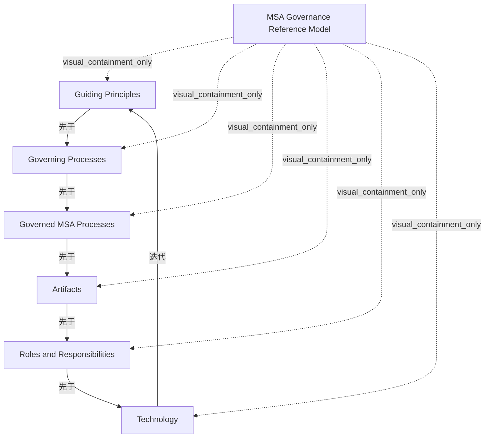

# G21I/fig5-2 · MSA 治理参考模型

类型：`process-or-method-model`。第 5.3 节用本图给出 MSA 治理参考模型：它与 SOA 治理参考模型大体相同，只是范围限于 MSA 流程。外圈箭头强调治理是过程而不是项目，各阶段构成持续改进循环：度量进展，需要时纠偏并更新流程。

英文 PDF 物理页：[26]。本页为架构语义分析，原文与原图分别保留。

## 原图与可编辑图


[完整 JSON](fig5-2.json) · [可编辑 Mermaid](fig5-2.mmd) · [仅关系图](fig5-2.relations.mmd) · [层级分解图](fig5-2.hierarchy.mmd)

图形重建表达语义，不复制源图布局。虚线表示解释、矩阵映射或分组关系，不自动表示不确定性的概率。



## 架构分析

从右上方的“指导原则”扇区开始，沿外圈箭头顺时针读：指导原则 → 治理流程 → 受治理的 MSA 流程 → 制品 → 角色与职责 → 技术，再回到指导原则。外圈上的 6 个箭头头部都位于扇区分界处，方向一致为顺时针。

- 本图有 7 个具名或隐含元素、6 条关系和 6 条包含/分组记录。
- 包含/分组树最大深度为 1；根节点为 MSA 治理参考模型。
- 本图没有可直接确认为人员直属汇报的关系；视觉上下位置、能力分解和治理职责分别读取。
- 核对六扇区文字与六个外圈顺时针箭头，中心三条直线仅划分六扇区。
- 正文明确持续改进环，因此保留循环；轮圈从Technology到Guiding Principles闭合，不把扇区当嵌套层级。

### 如何用于项目

- 按阶段/事件/行为关系读取入口、出口、责任和产物；检查循环与例外路径。
- 工作流先后不表示组织管理权；在项目中显式记录条件和完成标准。

### 结构所表达的逻辑

- 模型有 6 个组成部分：指导原则、治理流程、受治理的 MSA 流程、制品、角色与职责、技术。
- 原文说明 MSA 治理参考模型与 SOA 治理参考模型大体相同，区别只在于它限于 MSA 流程；图中“受治理的 MSA 流程”一格体现了这一点。
- “治理流程”与“受治理的 MSA 流程”是两回事：前者是实施治理的流程，后者是被治理的对象（MSA 的流程），二者在环上相邻。
- 外圈顺时针箭头把 6 个部分连成闭环：治理模型应被视为过程而不是项目，各阶段循环进行，度量进展并在需要时纠偏和更新流程。
- 原文没有逐一解释 6 个部分的含义，也没有给出相邻部分之间具体的输入/输出。

## 上下级与包含

一层：MSA 治理参考模型（图中没有单独的框，由整个圆表示）包含 6 个并列的组成部分，扇区等大，彼此没有上下级。

|父项|子项|层级类型|依据与解释|
|---|---|---|---|
|MSA 治理参考模型|指导原则|visual_containment_only|保存原图解释中的包含；业务关系类型需要图例或正文进一步限定。|
|MSA 治理参考模型|治理流程|visual_containment_only|保存原图解释中的包含；业务关系类型需要图例或正文进一步限定。|
|MSA 治理参考模型|受治理的微服务架构流程|visual_containment_only|保存原图解释中的包含；业务关系类型需要图例或正文进一步限定。|
|MSA 治理参考模型|制品|visual_containment_only|保存原图解释中的包含；业务关系类型需要图例或正文进一步限定。|
|MSA 治理参考模型|角色与职责|visual_containment_only|保存原图解释中的包含；业务关系类型需要图例或正文进一步限定。|
|MSA 治理参考模型|技术|visual_containment_only|保存原图解释中的包含；业务关系类型需要图例或正文进一步限定。|

## 全部元素与角色

|元素ID|原文名称|类型|含义|直接父项|深度|
|---|---|---|---|---|---|
|gov_model|MSA Governance Reference Model|framework|图中没有单独的框，由整个圆表示；名称来自图题。|—||
|s_principles|Guiding Principles|principle|原则：指导原则|MSA 治理参考模型|1|
|s_governing|Governing Processes|process|流程：治理流程|MSA 治理参考模型|1|
|s_governed|Governed MSA Processes|process|被治理的对象，即 MSA 的流程；SOA 治理参考模型中对应的是受治理的 SOA 流程（背景知识）。|MSA 治理参考模型|1|
|s_artifacts|Artifacts|artifact|制品：制品|MSA 治理参考模型|1|
|s_roles|Roles and Responsibilities|role|角色：角色与职责|MSA 治理参考模型|1|
|s_technology|Technology|technology|技术：技术|MSA 治理参考模型|1|

## 全部关系

外圈粗灰线带 6 个箭头头部，均为顺时针，各位于一条分隔线与外圈的交点，表示循环方向；关系清单把每段外圈记为相邻扇区之间的先后关系。三条细灰直径只用于分隔扇区，不表示对角扇区之间有关系。

|主体|语义关系|客体|显式线/隐式|原文标签|依据|
|---|---|---|---|---|---|
|指导原则|先于|治理流程|显式连线||外圈顺时针箭头（右上分界处）|
|治理流程|先于|受治理的微服务架构流程|显式连线||外圈顺时针箭头（右下分界处）|
|受治理的微服务架构流程|先于|制品|显式连线||外圈顺时针箭头（底部分界处）|
|制品|先于|角色与职责|显式连线||外圈顺时针箭头（左下分界处）|
|角色与职责|先于|技术|显式连线||外圈顺时针箭头（左上分界处）|
|技术|迭代|指导原则|显式连线||外圈顺时针箭头（顶部分界处），闭合循环|

## 误读检查

- 直径不是连线：被同一条直径穿过的对角扇区之间没有关系。
- 6 个部分在环上首尾相接，没有起点和终点；从“指导原则”读起只是阅读习惯，不表示它最重要。
- 原图中空心大字“Evaluation Copy”是英文 PDF 的水印，不是图的内容。
- 中文稿引用的中文化 PNG 中“角色与职责”字号特别大并遮住一段外圈，“受治理的微服务架构流程”字号极小，容易让人以为各部分权重不同；原图 6 个标签字号一致。

## 原文证据

### [PDF 第 25 页](../../../documents/G21I.md#page-25)

> any maturity assessment gaps identified over time. Of course, the organizational implications of an MSA distributed architecture must be assessed as part of this learning process.
> The TOGAF Standard does not attempt to describe all aspects of implementation and operational governance; only those areas directly related to the architecture under development. It assumes that detailed governance for those areas is in place. The Preliminary Phase includes confirmation of the architecture governance and support strategy as part of the Organizational Model for Enterprise Architecture. It needs to be understood up-front that the governance requirements for a distributed architecture such as MSA are going to be very different from traditional Enterprise Architectures, even those focused on SOA. In order to function efficiently, an MSA team must follow two parallel tracks for governance; making its own governance decisions as needed, applied only to that MSA, while still residing within the guardrails established for the enterprise.
### [PDF 第 26 页](../../../documents/G21I.md#page-26)

> The MSA Governance Reference Model is largely identical to the SOA Governance Reference Model, other than being restricted to MSA processes. It is depicted in Figure 5-2.
> Any governance model should be viewed as a process and not a project; therefore, the phases of the Governance Reference Model should be viewed as a continuous improvement loop, whereby progress is measured and course-correction and updates to the processes are performed when needed, as indicated in Figure 5-2.
### [PDF 第 27 页](../../../documents/G21I.md#page-27)

> The enterprise’s Architecture Repository contains a collection of models, patterns, architecture descriptions, and other artifacts that are available for the development of its architectures. They may result from previous architecture work in the enterprise or from work in other enterprises, or in industry bodies. The TOGAF Preliminary Phase includes the establishment of an Architecture Repository with an initial collection of material.
> The Architecture Repository may contain numerous artifacts that are outside the scope of the MSA. For this layer, the primary artifacts of interest to the team are those which identify microservices that have already been developed, the provenance of those services, and how to interact with them. This is addressed further in Chapter 12. Although service repositories have largely been proven as ineffective in the past, solutions exist to provide for this sort of microservice discovery and prevent duplication of effort. Microservices are reachable only through a published API, which nowadays is typically managed through an API management framework, which encompasses both service meshes and API

## 来源与分析状态

所有元素/关系均有来源定位；未把历史解释重命名为本轮逐线视觉确认。源图与语义图是两种视图，布局不证明汇报或因果。

源 PDF SHA-256：`279f6c06124f49a147a168591965805115b2fc976eea2664e41e491ac5d163bf`。

源图记录：[原始解释与转录](../../../figures/G21I/fig5-2.json)。

```json
{
  "quality": {
    "graph_integrity": "checked",
    "semantic_analysis": "typed-graph-and-context-analysis",
    "visual_review": "source-content-audited",
    "notice_zh": "所有元素/关系均有来源定位；未把历史解释重命名为本轮逐线视觉确认。源图与语义图是两种视图，布局不证明汇报或因果。"
  },
  "source_uncertainty": {
    "confidence": "high",
    "uncertainties_zh": [
      "原文没有解释 6 个组成部分各自的含义，也没有说明相邻部分之间传递什么；关系清单只按外圈箭头记录先后。"
    ],
    "analyzed_from": [
      "英文 PDF 第 26 页原图截图（220 dpi）",
      "英文 PDF 第 25–26 页正文",
      "中文稿 G21Ie_微服务架构.md 第 306–323 行（含图内标签对照表 L312–L321）",
      "figs/zh/g21ie_fig5-2_zh.png",
      "figs/g21ie_fig5-2_en.png（自动相似度 0.954）"
    ],
    "date": "2026-10-31"
  },
  "source_conflicts": []
}
```
