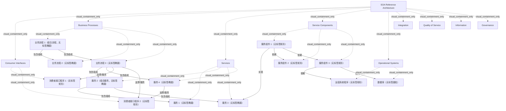

# G21I/fig5-3 · SOA 参考架构

类型：`architecture-concept-or-system-model`。第 5.4 节指出 MSA 参考架构仍在制定中，于是借用同类的 SOA 参考架构（ISO/IEC 18384）的分层来说明 MSA 所在的各层；正文逐层给出它们在 MSA 语境下的含义（如“微服务组件层”“微服务层”），图本身沿用 SOA 的层名。原文强调 MSA 不是完整的企业架构，只关注（微）服务所在的那些层；MSA 参考架构关注如何满足特定业务需求，SOA 参考架构关注企业集成。

英文 PDF 物理页：[28]。本页为架构语义分析，原文与原图分别保留。

## 原图与可编辑图


[完整 JSON](fig5-3.json) · [可编辑 Mermaid](fig5-3.mmd) · [仅关系图](fig5-3.relations.mmd) · [层级分解图](fig5-3.hierarchy.mmd)

图形重建表达语义，不复制源图布局。虚线表示解释、矩阵映射或分组关系，不自动表示不确定性的概率。



## 架构分析

先自上而下读白色面板里的 5 个水平层：消费者接口、业务流程、服务、服务组件、运营系统，层名在左，示意图形在右。再看面板外的 4 层嵌套色框，竖排标题由内到外为集成、服务质量、信息、治理，它们包住全部水平层，表示横切所有水平层。图形之间：粗实线树形线表示组合，带实心圆点的粗虚线表示使用/实现，细箭头表示调用（箭头指向被调用方）。

- 本图有 24 个具名或隐含元素、14 条关系和 23 条包含/分组记录。
- 包含/分组树最大深度为 2；根节点为 SOA 参考架构。
- 本图没有可直接确认为人员直属汇报的关系；视觉上下位置、能力分解和治理职责分别读取。
- 核对九个层标签、14个无名实例及14条关系路径。
- 四条虚线端点的实心圆位于消费者接口/服务组件侧，圆点不是箭头；六条粗实线组成两级组合树，四条细线有调用箭头。
- 图内标签Services与Service Components保留原样；正文解释使用Microservices和Microservice Components，不改写源图标签。
- 正文限定MSA服务组合只能在应用层进行，不能把SOA参考图内的组合关系无条件搬到微服务内部。

### 如何用于项目

- 围绕作者目的读取本图实体、分组与连线，并用对应原文限定其含义。
- 把参考模型与项目事实分开，实际范围、约束、值和责任须有项目证据。

### 结构所表达的逻辑

- 水平层自上而下：消费者接口（用户借以使用微服务的程序）→ 业务流程（业务流程及由其他业务流程和服务组成的组合）→ 服务（MSA 中为微服务及其描述、契约、策略和容器）→ 服务组件（实现微服务的软件组件，把微服务契约绑定到运营系统层中的实现）→ 运营系统（企业运营系统的程序与数据，以及支撑方案的新旧基础设施）。
- 4 个横切层贯穿全部水平层：集成（消息、消息转换、复杂事件处理、微服务组合、服务发现）；服务质量（性能、可靠性、可用性、可扩展性、安全性、可管理性的监控与管理）；信息（数据的管理、分析、解释与转换）；治理（治理规则与程序，以及支撑规则应用和程序运行的微服务与程序）。
- 示意图形表达典型的连接方式：消费者接口通过虚线使用业务流程或直接使用服务；业务流程可由其他业务流程和服务组合而成；服务由服务组件实现；服务组件再调用其他组件、运营系统中的程序和数据库。
- 原文在业务流程层特别说明：在 MSA 中只关心特定原子业务功能（ABF）与实现它的微服务之间的关系；由于组织和架构都是联邦式的，业务流程的需求更分散，各部分在很大程度上自主负责自己的需求。
- 原文在集成层特别说明：服务组合只能在应用层进行，不能发生在 MSA 内部。图中“服务”层的树形组合线是 SOA 参考架构的画法，不应理解为微服务之间互相组合。
- 图题为“SOA 参考架构”，图内层名是“Services”“Service Components”；正文把它们称为“微服务层”“微服务组件层”。

## 上下级与包含

根是 SOA 参考架构（由整张图表示）。其下 5 个水平层自上而下叠放；4 个横切层画成由内向外的嵌套色框，包住全部水平层。嵌套只是绘图方式，表示每个横切层都跨越全部水平层，横切层之间没有包含关系。各层内的示意图形以所在层为父元素。

|父项|子项|层级类型|依据与解释|
|---|---|---|---|
|SOA 参考架构|消费者接口|visual_containment_only|保存原图解释中的包含；业务关系类型需要图例或正文进一步限定。|
|SOA 参考架构|业务流程|visual_containment_only|保存原图解释中的包含；业务关系类型需要图例或正文进一步限定。|
|SOA 参考架构|服务|visual_containment_only|保存原图解释中的包含；业务关系类型需要图例或正文进一步限定。|
|SOA 参考架构|服务组件|visual_containment_only|保存原图解释中的包含；业务关系类型需要图例或正文进一步限定。|
|SOA 参考架构|运营系统|visual_containment_only|保存原图解释中的包含；业务关系类型需要图例或正文进一步限定。|
|SOA 参考架构|集成|visual_containment_only|保存原图解释中的包含；业务关系类型需要图例或正文进一步限定。|
|SOA 参考架构|服务质量|visual_containment_only|保存原图解释中的包含；业务关系类型需要图例或正文进一步限定。|
|SOA 参考架构|信息|visual_containment_only|保存原图解释中的包含；业务关系类型需要图例或正文进一步限定。|
|SOA 参考架构|治理|visual_containment_only|保存原图解释中的包含；业务关系类型需要图例或正文进一步限定。|
|消费者接口|消费者接口程序 1（无标签矩形）|visual_containment_only|保存原图解释中的包含；业务关系类型需要图例或正文进一步限定。|
|消费者接口|消费者接口程序 2（无标签矩形）|visual_containment_only|保存原图解释中的包含；业务关系类型需要图例或正文进一步限定。|
|业务流程|业务流程 1（组合流程，无标签椭圆）|visual_containment_only|保存原图解释中的包含；业务关系类型需要图例或正文进一步限定。|
|业务流程|业务流程 2（无标签椭圆）|visual_containment_only|保存原图解释中的包含；业务关系类型需要图例或正文进一步限定。|
|业务流程|业务流程 3（无标签椭圆）|visual_containment_only|保存原图解释中的包含；业务关系类型需要图例或正文进一步限定。|
|服务|服务 1（无标签椭圆）|visual_containment_only|保存原图解释中的包含；业务关系类型需要图例或正文进一步限定。|
|服务|服务 2（组合服务，无标签椭圆）|visual_containment_only|保存原图解释中的包含；业务关系类型需要图例或正文进一步限定。|
|服务|服务 3（无标签椭圆）|visual_containment_only|保存原图解释中的包含；业务关系类型需要图例或正文进一步限定。|
|服务|服务 4（无标签椭圆）|visual_containment_only|保存原图解释中的包含；业务关系类型需要图例或正文进一步限定。|
|服务组件|服务组件 1（无标签矩形）|visual_containment_only|保存原图解释中的包含；业务关系类型需要图例或正文进一步限定。|
|服务组件|服务组件 2（无标签矩形）|visual_containment_only|保存原图解释中的包含；业务关系类型需要图例或正文进一步限定。|
|服务组件|服务组件 3（无标签矩形）|visual_containment_only|保存原图解释中的包含；业务关系类型需要图例或正文进一步限定。|
|运营系统|运营系统程序（无标签矩形）|visual_containment_only|保存原图解释中的包含；业务关系类型需要图例或正文进一步限定。|
|运营系统|数据库（无标签圆柱）|visual_containment_only|保存原图解释中的包含；业务关系类型需要图例或正文进一步限定。|

### 业务组成与特化

|父项/范围/类型|子项/责任对象/实例|语义|
|---|---|---|
|业务流程 1（组合流程，无标签椭圆）|业务流程 2（无标签椭圆）|composition|
|业务流程 1（组合流程，无标签椭圆）|业务流程 3（无标签椭圆）|composition|
|业务流程 3（无标签椭圆）|服务 2（组合服务，无标签椭圆）|composition|
|业务流程 3（无标签椭圆）|服务 4（无标签椭圆）|composition|
|服务 2（组合服务，无标签椭圆）|服务 1（无标签椭圆）|composition|
|服务 2（组合服务，无标签椭圆）|服务 3（无标签椭圆）|composition|

## 全部元素与角色

|元素ID|原文名称|类型|含义|直接父项|深度|
|---|---|---|---|---|---|
|ra|SOA Reference Architecture|framework|由整张图表示，名称来自图题。|—||
|l_consumer|Consumer Interfaces|architecture|用户借以使用微服务的程序。|SOA 参考架构|1|
|l_bp|Business Processes|architecture|业务流程，以及由其他业务流程和服务组成的组合。|SOA 参考架构|1|
|l_services|Services|architecture|正文称“微服务层”：微服务及其描述、契约、策略和容纳组件的容器。|SOA 参考架构|1|
|l_components|Service Components|architecture|正文称“微服务组件层”：实现微服务的软件组件，把微服务契约绑定到运营系统层中的实现。|SOA 参考架构|1|
|l_ops|Operational Systems|architecture|企业运营系统的程序与数据，以及支撑方案的新旧基础设施。|SOA 参考架构|1|
|x_integration|Integration|architecture|横切层：构建块之间的集成与通信，包括消息、消息转换、复杂事件处理、微服务组合、服务发现。|SOA 参考架构|1|
|x_qos|Quality of Service|architecture|横切层：性能、可靠性、可用性、可扩展性、安全性、可管理性的监控与管理。|SOA 参考架构|1|
|x_information|Information|architecture|横切层：数据的管理、分析、解释与转换。|SOA 参考架构|1|
|x_governance|Governance|architecture|横切层：治理规则与程序，以及支撑规则应用和程序运行的微服务与程序。|SOA 参考架构|1|
|ci_1|消费者接口程序 1（无标签矩形）|application|应用：消费者接口程序 1（无标签矩形）|消费者接口|2|
|ci_2|消费者接口程序 2（无标签矩形）|application|应用：消费者接口程序 2（无标签矩形）|消费者接口|2|
|bp_1|业务流程 1（组合流程，无标签椭圆）|process|流程：业务流程 1（组合流程，无标签椭圆）|业务流程|2|
|bp_2|业务流程 2（无标签椭圆）|process|流程：业务流程 2（无标签椭圆）|业务流程|2|
|bp_3|业务流程 3（无标签椭圆）|process|流程：业务流程 3（无标签椭圆）|业务流程|2|
|svc_1|服务 1（无标签椭圆）|service|服务：服务 1（无标签椭圆）|服务|2|
|svc_2|服务 2（组合服务，无标签椭圆）|service|服务：服务 2（组合服务，无标签椭圆）|服务|2|
|svc_3|服务 3（无标签椭圆）|service|服务：服务 3（无标签椭圆）|服务|2|
|svc_4|服务 4（无标签椭圆）|service|服务：服务 4（无标签椭圆）|服务|2|
|comp_1|服务组件 1（无标签矩形）|application|应用：服务组件 1（无标签矩形）|服务组件|2|
|comp_2|服务组件 2（无标签矩形）|application|应用：服务组件 2（无标签矩形）|服务组件|2|
|comp_3|服务组件 3（无标签矩形）|application|应用：服务组件 3（无标签矩形）|服务组件|2|
|op_prog|运营系统程序（无标签矩形）|application|应用：运营系统程序（无标签矩形）|运营系统|2|
|op_db|数据库（无标签圆柱）|data|信息/数据：数据库（无标签圆柱）|运营系统|2|

## 全部关系

粗实线（树形，带竖向分支）：组合，上方图形由下方相连的图形组成；共 6 条：业务流程 1 由业务流程 2、3 组成，业务流程 3 由服务 2、4 组成，服务 2 由服务 1、3 组成。带实心圆点的粗虚线：使用/实现，共 4 条；圆点落在消费者接口程序或服务组件 1 的边上。细实线箭头：调用，共 4 条，箭头指向被调用的组件、运营系统程序或数据库。

|主体|语义关系|客体|显式线/隐式|原文标签|依据|
|---|---|---|---|---|---|
|业务流程 1（组合流程，无标签椭圆）|包含组成|业务流程 2（无标签椭圆）|显式连线||树形线：组合流程由其他业务流程组成|
|业务流程 1（组合流程，无标签椭圆）|包含组成|业务流程 3（无标签椭圆）|显式连线||包含组成|
|业务流程 3（无标签椭圆）|包含组成|服务 2（组合服务，无标签椭圆）|显式连线||业务流程由服务组成|
|业务流程 3（无标签椭圆）|包含组成|服务 4（无标签椭圆）|显式连线||包含组成|
|服务 2（组合服务，无标签椭圆）|包含组成|服务 1（无标签椭圆）|显式连线||SOA 参考架构中的服务组合；原文指出 MSA 中服务组合只能在应用层进行|
|服务 2（组合服务，无标签椭圆）|包含组成|服务 3（无标签椭圆）|显式连线||包含组成|
|业务流程 3（无标签椭圆）|支撑/服务|消费者接口程序 1（无标签矩形）|显式连线||虚线，圆点在消费者接口程序一端：消费者接口使用业务流程|
|业务流程 3（无标签椭圆）|支撑/服务|消费者接口程序 2（无标签矩形）|显式连线||圆点在消费者接口程序一端|
|服务 4（无标签椭圆）|支撑/服务|消费者接口程序 2（无标签矩形）|显式连线||消费者接口直接使用服务，绕过业务流程层；圆点在消费者接口程序一端|
|服务组件 1（无标签矩形）|实现|服务 3（无标签椭圆）|显式连线||虚线，圆点在服务组件一端：服务组件实现服务|
|服务组件 1（无标签矩形）|依赖|服务组件 2（无标签矩形）|显式连线||细箭头：组件调用其他组件|
|服务组件 1（无标签矩形）|依赖|服务组件 3（无标签矩形）|显式连线||依赖|
|服务组件 3（无标签矩形）|依赖|运营系统程序（无标签矩形）|显式连线||组件调用运营系统中的程序|
|服务组件 3（无标签矩形）|访问|数据库（无标签圆柱）|显式连线||组件访问数据库|

## 各层说明（按原文第 5.4 节逐层转述）

```json
{
  "id": "t_layers",
  "title_zh": "各层说明（按原文第 5.4 节逐层转述）",
  "columns": [
    "层（图内标签）",
    "类别",
    "原文中的名称",
    "内容"
  ],
  "rows": [
    [
      "消费者接口 Consumer Interfaces",
      "水平层 1",
      "Consumer Interfaces Layer",
      "用户借以使用微服务的程序"
    ],
    [
      "业务流程 Business Processes",
      "水平层 2",
      "Business Processes Layer",
      "业务流程，以及由其他业务流程和服务组成的组合；MSA 只关心特定 ABF 与实现它的微服务之间的关系"
    ],
    [
      "服务 Services",
      "水平层 3",
      "Microservices Layer",
      "微服务及其描述、契约、策略，以及容纳微服务组件的容器"
    ],
    [
      "服务组件 Service Components",
      "水平层 4",
      "Microservice Components Layer",
      "实现微服务（或微服务上的操作）的软件组件，把微服务契约绑定到运营系统层中的实现"
    ],
    [
      "运营系统 Operational Systems",
      "水平层 5",
      "Operational Systems Layer",
      "企业运营系统的程序与数据；支撑方案所需的新旧基础设施"
    ],
    [
      "集成 Integration",
      "横切层",
      "Integration Layer",
      "构建块之间的集成与通信：消息、消息转换、复杂事件处理、微服务组合、服务发现；服务组合只能在应用层进行"
    ],
    [
      "服务质量 Quality of Service",
      "横切层",
      "Quality of Service Layer",
      "监控与管理性能、可靠性、可用性、可扩展性、安全性与可管理性"
    ],
    [
      "信息 Information",
      "横切层",
      "Information Layer",
      "数据的管理、分析、解释与转换"
    ],
    [
      "治理 Governance",
      "横切层",
      "Governance Layer",
      "治理规则与程序；支撑规则应用和程序运行的微服务与程序"
    ]
  ],
  "notes_zh": "图中只有层名，内容来自英文 PDF 第 27–28 页正文（中文稿 L335–L357）。"
}
```

## 误读检查

- 4 个横切层是并列的，各自横跨全部水平层；不要因为色框嵌套就理解为“治理包含信息、信息包含服务质量”。
- 图中的“服务”“服务组件”是 SOA 参考架构的层名，放到 MSA 语境下对应正文的“微服务层”“微服务组件层”。
- 服务层里的树形组合线不表示 MSA 内部的服务组合；原文明确服务组合只能在应用层进行。
- 图中的图形都没有名称，只是示意各层之间的典型连接，不是某个具体系统的架构。
- 原图顶部和右下角的浅色空心笔画是英文 PDF 的“Evaluation Copy”水印和版权字样，不是图的内容。

## 原文证据

### [PDF 第 27 页](../../../documents/G21I.md#page-27)

> The enterprise’s Architecture Repository contains a collection of models, patterns, architecture descriptions, and other artifacts that are available for the development of its architectures. They may result from previous architecture work in the enterprise or from work in other enterprises, or in industry bodies. The TOGAF Preliminary Phase includes the establishment of an Architecture Repository with an initial collection of material.
> The Architecture Repository may contain numerous artifacts that are outside the scope of the MSA. For this layer, the primary artifacts of interest to the team are those which identify microservices that have already been developed, the provenance of those services, and how to interact with them. This is addressed further in Chapter 12. Although service repositories have largely been proven as ineffective in the past, solutions exist to provide for this sort of microservice discovery and prevent duplication of effort. Microservices are reachable only through a published API, which nowadays is typically managed through an API management framework, which encompasses both service meshes and API
### [PDF 第 28 页](../../../documents/G21I.md#page-28)

> In an MSA, we only worry about the relationship between a particular ABF and its implementation by the microservices. The requirements for these business processes will tend to be also much more distributed for an MSA implementation, since we are likely dealing with a federated organization as well as a federated architecture. Each part of that federated organization will be to a large extent autonomously responsible for its own requirements.
> ◦Integration of and communication between other building blocks, including messaging,

## 来源与分析状态

所有元素/关系均有来源定位；未把历史解释重命名为本轮逐线视觉确认。源图与语义图是两种视图，布局不证明汇报或因果。

源 PDF SHA-256：`279f6c06124f49a147a168591965805115b2fc976eea2664e41e491ac5d163bf`。

源图记录：[原始解释与转录](../../../figures/G21I/fig5-3.json)。

```json
{
  "quality": {
    "graph_integrity": "checked",
    "semantic_analysis": "typed-graph-and-context-analysis",
    "visual_review": "source-content-audited",
    "notice_zh": "所有元素/关系均有来源定位；未把历史解释重命名为本轮逐线视觉确认。源图与语义图是两种视图，布局不证明汇报或因果。"
  },
  "source_uncertainty": {
    "confidence": "high",
    "uncertainties_zh": [
      "图中没有图例；实线树形线、带圆点虚线、细箭头的含义是按 SOA 参考架构的惯常画法和正文逐层说明推断的，圆点所在一端为使用方/实现方也属推断。"
    ],
    "analyzed_from": [
      "英文 PDF 第 28 页原图截图（220 dpi）及左下放大分块",
      "英文 PDF 第 27–28 页正文",
      "中文稿 G21Ie_微服务架构.md 第 325–376 行（含图内标签对照表 L363–L375）",
      "figs/zh/g21ie_fig5-3_zh.png（含右侧横切层标题处的局部放大）",
      "figs/g21ie_fig5-3_en.png（自动相似度 0.97）"
    ],
    "date": "2026-10-31"
  },
  "source_conflicts": []
}
```
