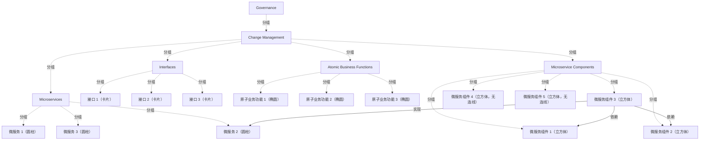

# G21I/fig6-2 · 项目架构

类型：`architecture-concept-or-system-model`。第 6.1 节说明项目级架构的开发：先弄清要实现的业务功能和推动采用 MSA 的业务驱动因素（可扩展性、韧性、故障转移等），明确 MSA 层在总体架构中的位置、它提供哪些原子业务功能（ABF），识别微服务输入输出与其他层交换的接口；治理与变更管理继承自总体企业架构。本图给出这种项目架构的示例。

英文 PDF 物理页：[33]。本页为架构语义分析，原文与原图分别保留。

## 原图与可编辑图


[完整 JSON](fig6-2.json) · [可编辑 Mermaid](fig6-2.mmd) · [仅关系图](fig6-2.relations.mmd) · [层级分解图](fig6-2.hierarchy.mmd)

图形重建表达语义，不复制源图布局。虚线表示解释、矩阵映射或分组关系，不自动表示不确定性的概率。



## 架构分析

自上而下读内框中的 4 条层带：接口（蓝色卡片）→ 原子业务功能（浅绿椭圆）→ 微服务（蓝色圆柱）→ 微服务组件（黄色立方体）。上三层各有 3 个实例，按列对齐。中间那个微服务用一条竖线连到它下方的一个组件，该组件再用两条箭头调用左侧两个组件；右侧两个组件没有连线。4 条层带外面先包着“变更管理”框，再包着“治理”框（两框标题竖排在右侧）。

- 本图有 20 个具名或隐含元素、3 条关系和 19 条包含/分组记录。
- 包含/分组树最大深度为 3；根节点为 治理。
- 本图没有可直接确认为人员直属汇报的关系；视觉上下位置、能力分解和治理职责分别读取。
- 逐一核对20节点：两层外框、四条层带、3接口/3ABF/3微服务/5组件实例。
- 只有三条实际连接：中央微服务与中央组件无箭头竖线、中央组件到左侧两个组件各一箭头；右侧两组件无连线。
- 删除仅凭同列对齐推定的六条实例对应边。原文支持层级职责，未规定无名示例实例的一一对应。

### 如何用于项目

- 围绕作者目的读取本图实体、分组与连线，并用对应原文限定其含义。
- 把参考模型与项目事实分开，实际范围、约束、值和责任须有项目证据。

### 结构所表达的逻辑

- 项目架构由 4 层组成：接口、原子业务功能、微服务、微服务组件；原文把 ABF 定义为企业内交付价值的最小业务功能单元，通常支撑单一业务能力。
- 接口层对应原文“识别微服务输入输出与其他架构层交换的接口”。
- 微服务由下层的微服务组件实现：图中一个微服务连到一个组件，该组件又调用另外两个组件，说明一个微服务的实现可以由多个组件协作完成。
- 变更管理和治理画成包住全部 4 层的外框：原文说治理与变更管理继承自总体企业架构，企业架构中定义的治理、变更管理、标准和公共基础设施由各项目架构继承。
- 这一项目级架构会在后续阶段扩展为解决方案架构；它比企业级架构更详细，但不是解决方案架构，也不应在技术等方面作不必要的限制。

## 上下级与包含

外层“治理”框包住内层“变更管理”框，内框中自上而下是 4 条层带；每条层带内是该层的示意实例。框的嵌套表示治理与变更管理覆盖全部 4 层。

|父项|子项|层级类型|依据与解释|
|---|---|---|---|
|治理|变更管理|visual_grouping|框、泳道、域或分类组的成员归属；没有额外证据不提升为业务组合或管理关系。|
|变更管理|接口|visual_grouping|框、泳道、域或分类组的成员归属；没有额外证据不提升为业务组合或管理关系。|
|变更管理|原子业务功能|visual_grouping|框、泳道、域或分类组的成员归属；没有额外证据不提升为业务组合或管理关系。|
|变更管理|微服务|visual_grouping|框、泳道、域或分类组的成员归属；没有额外证据不提升为业务组合或管理关系。|
|变更管理|微服务组件|visual_grouping|框、泳道、域或分类组的成员归属；没有额外证据不提升为业务组合或管理关系。|
|接口|接口 1（卡片）|visual_grouping|框、泳道、域或分类组的成员归属；没有额外证据不提升为业务组合或管理关系。|
|接口|接口 2（卡片）|visual_grouping|框、泳道、域或分类组的成员归属；没有额外证据不提升为业务组合或管理关系。|
|接口|接口 3（卡片）|visual_grouping|框、泳道、域或分类组的成员归属；没有额外证据不提升为业务组合或管理关系。|
|原子业务功能|原子业务功能 1（椭圆）|visual_grouping|框、泳道、域或分类组的成员归属；没有额外证据不提升为业务组合或管理关系。|
|原子业务功能|原子业务功能 2（椭圆）|visual_grouping|框、泳道、域或分类组的成员归属；没有额外证据不提升为业务组合或管理关系。|
|原子业务功能|原子业务功能 3（椭圆）|visual_grouping|框、泳道、域或分类组的成员归属；没有额外证据不提升为业务组合或管理关系。|
|微服务|微服务 1（圆柱）|visual_grouping|框、泳道、域或分类组的成员归属；没有额外证据不提升为业务组合或管理关系。|
|微服务|微服务 2（圆柱）|visual_grouping|框、泳道、域或分类组的成员归属；没有额外证据不提升为业务组合或管理关系。|
|微服务|微服务 3（圆柱）|visual_grouping|框、泳道、域或分类组的成员归属；没有额外证据不提升为业务组合或管理关系。|
|微服务组件|微服务组件 1（立方体）|visual_grouping|框、泳道、域或分类组的成员归属；没有额外证据不提升为业务组合或管理关系。|
|微服务组件|微服务组件 2（立方体）|visual_grouping|框、泳道、域或分类组的成员归属；没有额外证据不提升为业务组合或管理关系。|
|微服务组件|微服务组件 3（立方体）|visual_grouping|框、泳道、域或分类组的成员归属；没有额外证据不提升为业务组合或管理关系。|
|微服务组件|微服务组件 4（立方体，无连线）|visual_grouping|框、泳道、域或分类组的成员归属；没有额外证据不提升为业务组合或管理关系。|
|微服务组件|微服务组件 5（立方体，无连线）|visual_grouping|框、泳道、域或分类组的成员归属；没有额外证据不提升为业务组合或管理关系。|

## 全部元素与角色

|元素ID|原文名称|类型|含义|直接父项|深度|
|---|---|---|---|---|---|
|frame_gov|Governance|group|分组：治理|—||
|frame_change|Change Management|group|分组：变更管理|治理|1|
|l_interfaces|Interfaces|group|分组：接口|变更管理|2|
|l_abf|Atomic Business Functions|group|分组：原子业务功能|变更管理|2|
|l_ms|Microservices|group|分组：微服务|变更管理|2|
|l_mc|Microservice Components|group|分组：微服务组件|变更管理|2|
|if_1|接口 1（卡片）|application|与其他架构层交换微服务输入输出的接口。|接口|3|
|if_2|接口 2（卡片）|application|应用：接口 2（卡片）|接口|3|
|if_3|接口 3（卡片）|application|应用：接口 3（卡片）|接口|3|
|abf_1|原子业务功能 1（椭圆）|function|功能：原子业务功能 1（椭圆）|原子业务功能|3|
|abf_2|原子业务功能 2（椭圆）|function|功能：原子业务功能 2（椭圆）|原子业务功能|3|
|abf_3|原子业务功能 3（椭圆）|function|功能：原子业务功能 3（椭圆）|原子业务功能|3|
|ms_1|微服务 1（圆柱）|service|服务：微服务 1（圆柱）|微服务|3|
|ms_2|微服务 2（圆柱）|service|服务：微服务 2（圆柱）|微服务|3|
|ms_3|微服务 3（圆柱）|service|服务：微服务 3（圆柱）|微服务|3|
|mc_1|微服务组件 1（立方体）|application|应用：微服务组件 1（立方体）|微服务组件|3|
|mc_2|微服务组件 2（立方体）|application|应用：微服务组件 2（立方体）|微服务组件|3|
|mc_3|微服务组件 3（立方体）|application|应用：微服务组件 3（立方体）|微服务组件|3|
|mc_4|微服务组件 4（立方体，无连线）|application|应用：微服务组件 4（立方体，无连线）|微服务组件|3|
|mc_5|微服务组件 5（立方体，无连线）|application|应用：微服务组件 5（立方体，无连线）|微服务组件|3|

## 全部关系

可见三条线：中央微服务与其下组件间无箭头细线；中央组件到左侧两组件的折线箭头。接口、ABF与微服务之间无连线，排列不构成已验证实例映射。

|主体|语义关系|客体|显式线/隐式|原文标签|依据|
|---|---|---|---|---|---|
|微服务组件 3（立方体）|实现|微服务 2（圆柱）|显式连线||竖直细线：组件实现其上方的微服务|
|微服务组件 3（立方体）|依赖|微服务组件 2（立方体）|显式连线||折线箭头：组件调用组件|
|微服务组件 3（立方体）|依赖|微服务组件 1（立方体）|显式连线||依赖|

## 本轮否定的历史关系

以下旧解释保留用于追溯，不进入当前关系图、层级或知识图谱的有效边。

|旧记录|主体|旧关系|客体|否定依据|
|---|---|---|---|---|
|3|微服务 1（圆柱）|realization|原子业务功能 1（椭圆）|接口/ABF/微服务之间没有原图连线；相同列位置及层级职责不足以证明这些无名实例一一对应。|
|4|微服务 2（圆柱）|realization|原子业务功能 2（椭圆）|接口/ABF/微服务之间没有原图连线；相同列位置及层级职责不足以证明这些无名实例一一对应。|
|5|微服务 3（圆柱）|realization|原子业务功能 3（椭圆）|接口/ABF/微服务之间没有原图连线；相同列位置及层级职责不足以证明这些无名实例一一对应。|
|6|接口 1（卡片）|association|原子业务功能 1（椭圆）|接口/ABF/微服务之间没有原图连线；相同列位置及层级职责不足以证明这些无名实例一一对应。|
|7|接口 2（卡片）|association|原子业务功能 2（椭圆）|接口/ABF/微服务之间没有原图连线；相同列位置及层级职责不足以证明这些无名实例一一对应。|
|8|接口 3（卡片）|association|原子业务功能 3（椭圆）|接口/ABF/微服务之间没有原图连线；相同列位置及层级职责不足以证明这些无名实例一一对应。|

## 本轮语义修正

- 接口/ABF/微服务之间没有原图连线；相同列位置及层级职责不足以证明这些无名实例一一对应。
- 接口/ABF/微服务之间没有原图连线；相同列位置及层级职责不足以证明这些无名实例一一对应。
- 接口/ABF/微服务之间没有原图连线；相同列位置及层级职责不足以证明这些无名实例一一对应。
- 接口/ABF/微服务之间没有原图连线；相同列位置及层级职责不足以证明这些无名实例一一对应。
- 接口/ABF/微服务之间没有原图连线；相同列位置及层级职责不足以证明这些无名实例一一对应。
- 接口/ABF/微服务之间没有原图连线；相同列位置及层级职责不足以证明这些无名实例一一对应。

## 误读检查

- 治理与变更管理不是第 5、6 层，而是包住全部 4 层、继承自企业架构的外框。
- 右侧两个没有连线的组件只是示意更多组件，不表示它们不被使用。
- 原图右下的空心大字是英文 PDF 的“Evaluation Copy”水印，不是图的内容。
- 中文稿引用的中文化 PNG 中，“变更管理”的补丁盖住了层带右端，两层外框的嵌套关系不易看出。

## 原文证据

### [PDF 第 33 页](../../../documents/G21I.md#page-33)

> The development of the project architecture begins with a clear understanding of the business functions that are to be implemented via this architecture. It is at this point that the key business drivers which are mandating the use of an MSA should be enumerated: requirements for scalability, resiliency, failover, etc. The position of the MSA layer in the overall architecture must be made clear. What are the ABFs that are supplied by this layer? (The MSA Work Group understands an ABF to be the smallest unit of business function within an enterprise that delivers value, typically supporting a single business capability.) Interfaces where the microservice inputs and outputs are exchanged with other architectural layers should be identified. Governance and change management are inherited from the overall Enterprise Architecture. An example of a project architecture is shown in Figure 6-2.
### [PDF 第 34 页](../../../documents/G21I.md#page-34)

> The Enterprise Architecture applies to each component of the enterprise and describes aspects they have in common. Governance, change management, standards, and any common required infrastructures can be defined in the Enterprise Architecture and inherited by each project architecture.
> The Architecture Vision includes a high-level description of the final architecture that is envisaged.

## 来源与分析状态

所有元素/关系均有来源定位；未把历史解释重命名为本轮逐线视觉确认。源图与语义图是两种视图，布局不证明汇报或因果。

源 PDF SHA-256：`279f6c06124f49a147a168591965805115b2fc976eea2664e41e491ac5d163bf`。

源图记录：[原始解释与转录](../../../figures/G21I/fig6-2.json)。

```json
{
  "quality": {
    "graph_integrity": "checked",
    "semantic_analysis": "typed-graph-and-context-analysis",
    "visual_review": "source-content-audited",
    "notice_zh": "所有元素/关系均有来源定位；未把历史解释重命名为本轮逐线视觉确认。源图与语义图是两种视图，布局不证明汇报或因果。"
  },
  "source_uncertainty": {
    "confidence": "high",
    "uncertainties_zh": [
      "接口、原子业务功能、微服务三层实例之间没有连线；同列一一对应（微服务实现 ABF、接口暴露 ABF）是按上下对齐和正文推断的，原文没有明说。"
    ],
    "analyzed_from": [
      "英文 PDF 第 33 页原图截图（220 dpi）",
      "英文 PDF 第 33–34 页正文",
      "中文稿 G21Ie_微服务架构.md 第 430–463 行（含图内标签对照表 L444–L453）",
      "figs/zh/g21ie_fig6-2_zh.png",
      "figs/g21ie_fig6-2_en.png（自动相似度 0.97）"
    ],
    "date": "2026-10-31"
  },
  "source_conflicts": []
}
```
