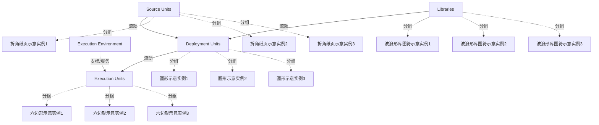

# G21I/fig9-1 · 微服务的开发、部署与执行

类型：`process-or-method-model`。第 9 章（阶段 D：技术架构）用本图说明微服务的开发、部署与执行，支撑“微服务独立开发、可独立部署”这一特征；阶段 D 需要规定微服务的部署机制和执行环境。

英文 PDF 物理页：[41]。本页为架构语义分析，原文与原图分别保留。

## 原图与可编辑图


[完整 JSON](fig9-1.json) · [可编辑 Mermaid](fig9-1.mmd) · [仅关系图](fig9-1.relations.mmd) · [层级分解图](fig9-1.hierarchy.mmd)

图形重建表达语义，不复制源图布局。虚线表示解释、矩阵映射或分组关系，不自动表示不确定性的概率。



## 架构分析

从左到右读：左侧上下两组输入是源单元和库，经“构建”箭头得到中间的部署单元，再经“部署”箭头得到右侧的执行单元；执行单元下方的长方形是执行环境。每种图形都画成多层叠放，表示有多个。

- 本图有 17 个具名或隐含元素、4 条关系和 12 条包含/分组记录。
- 包含/分组树最大深度为 1；根节点为 源单元、库、部署单元、执行单元、执行环境。
- 本图没有可直接确认为人员直属汇报的关系；视觉上下位置、能力分解和治理职责分别读取。
- 核对5组文字、Build与Deploy两大箭头；四类对象各画三个相叠形状，共12个图符。
- Build箭头由源单元和库共用，Deploy由部署单元到执行单元；执行环境与执行单元无可见线。
- 数量规则来自p42正文，不来自叠放图符：每微服务一源单元/部署单元，部署为一或多个执行单元。

### 如何用于项目

- 按阶段/事件/行为关系读取入口、出口、责任和产物；检查循环与例外路径。
- 工作流先后不表示组织管理权；在项目中显式记录条件和完成标准。

### 结构所表达的逻辑

- 每个微服务有自己的源单元，包含实现该微服务 ABF 的代码；源单元不与其他微服务的源单元共享代码，也不能访问它们的数据。
- 源单元可以使用库，但库只提供与业务无关的功能；构建时库与源单元一起进入部署单元。
- 每个微服务有一个部署单元，由它的源单元和所用的库构建而成；一个部署单元不能包含多个微服务的代码。
- 部署单元部署为一个执行单元；在大规模系统中，部署为运行相同代码的多个执行单元。
- 执行单元运行在执行环境中；阶段 D 的补充步骤之一是规定微服务的部署机制和执行环境。
- 编程语言、库、开发工具和构建机制的选择可交给各微服务的 DevOps 团队，但可能在一定程度上受技术架构约束。

## 上下级与包含

没有嵌套。层叠的图形只表示同类对象有多个；执行环境画在执行单元下方，表示承载关系，不是包含框。

|父项|子项|层级类型|依据与解释|
|---|---|---|---|
|源单元|折角纸页示意实例1|visual_grouping|框、泳道、域或分类组的成员归属；没有额外证据不提升为业务组合或管理关系。|
|源单元|折角纸页示意实例2|visual_grouping|框、泳道、域或分类组的成员归属；没有额外证据不提升为业务组合或管理关系。|
|源单元|折角纸页示意实例3|visual_grouping|框、泳道、域或分类组的成员归属；没有额外证据不提升为业务组合或管理关系。|
|库|波浪形库图符示意实例1|visual_grouping|框、泳道、域或分类组的成员归属；没有额外证据不提升为业务组合或管理关系。|
|库|波浪形库图符示意实例2|visual_grouping|框、泳道、域或分类组的成员归属；没有额外证据不提升为业务组合或管理关系。|
|库|波浪形库图符示意实例3|visual_grouping|框、泳道、域或分类组的成员归属；没有额外证据不提升为业务组合或管理关系。|
|部署单元|圆形示意实例1|visual_grouping|框、泳道、域或分类组的成员归属；没有额外证据不提升为业务组合或管理关系。|
|部署单元|圆形示意实例2|visual_grouping|框、泳道、域或分类组的成员归属；没有额外证据不提升为业务组合或管理关系。|
|部署单元|圆形示意实例3|visual_grouping|框、泳道、域或分类组的成员归属；没有额外证据不提升为业务组合或管理关系。|
|执行单元|六边形示意实例1|visual_grouping|框、泳道、域或分类组的成员归属；没有额外证据不提升为业务组合或管理关系。|
|执行单元|六边形示意实例2|visual_grouping|框、泳道、域或分类组的成员归属；没有额外证据不提升为业务组合或管理关系。|
|执行单元|六边形示意实例3|visual_grouping|框、泳道、域或分类组的成员归属；没有额外证据不提升为业务组合或管理关系。|

## 全部元素与角色

|元素ID|原文名称|类型|含义|直接父项|深度|
|---|---|---|---|---|---|
|source_units|Source Units|group|每个微服务一个，包含实现其 ABF 的代码。 原图该组显示三层相叠图符；三层仅示意多个对象，不指定固定基数。|—||
|libraries|Libraries|group|只提供与业务无关的功能。 原图该组显示三层相叠图符；三层仅示意多个对象，不指定固定基数。|—||
|deployment_units|Deployment Units|group|每个微服务一个，由源单元和所用库构建。 原图该组显示三层相叠图符；三层仅示意多个对象，不指定固定基数。|—||
|execution_units|Execution Units|group|部署单元的运行实例，可为一个或多个。 原图该组显示三层相叠图符；三层仅示意多个对象，不指定固定基数。|—||
|execution_env|Execution Environment|technology|技术：执行环境|—||
|source_units_instance_1|折角纸页示意实例1|annotation|原图形状实例，没有独立名称；其数量为绘图示意，不限制运行时对象数。|源单元|1|
|source_units_instance_2|折角纸页示意实例2|annotation|原图形状实例，没有独立名称；其数量为绘图示意，不限制运行时对象数。|源单元|1|
|source_units_instance_3|折角纸页示意实例3|annotation|原图形状实例，没有独立名称；其数量为绘图示意，不限制运行时对象数。|源单元|1|
|libraries_instance_1|波浪形库图符示意实例1|annotation|原图形状实例，没有独立名称；其数量为绘图示意，不限制运行时对象数。|库|1|
|libraries_instance_2|波浪形库图符示意实例2|annotation|原图形状实例，没有独立名称；其数量为绘图示意，不限制运行时对象数。|库|1|
|libraries_instance_3|波浪形库图符示意实例3|annotation|原图形状实例，没有独立名称；其数量为绘图示意，不限制运行时对象数。|库|1|
|deployment_units_instance_1|圆形示意实例1|annotation|原图形状实例，没有独立名称；其数量为绘图示意，不限制运行时对象数。|部署单元|1|
|deployment_units_instance_2|圆形示意实例2|annotation|原图形状实例，没有独立名称；其数量为绘图示意，不限制运行时对象数。|部署单元|1|
|deployment_units_instance_3|圆形示意实例3|annotation|原图形状实例，没有独立名称；其数量为绘图示意，不限制运行时对象数。|部署单元|1|
|execution_units_instance_1|六边形示意实例1|annotation|原图形状实例，没有独立名称；其数量为绘图示意，不限制运行时对象数。|执行单元|1|
|execution_units_instance_2|六边形示意实例2|annotation|原图形状实例，没有独立名称；其数量为绘图示意，不限制运行时对象数。|执行单元|1|
|execution_units_instance_3|六边形示意实例3|annotation|原图形状实例，没有独立名称；其数量为绘图示意，不限制运行时对象数。|执行单元|1|

## 全部关系

只有两个大块箭头，均从左指向右：“构建”从源单元和库指向部署单元，“部署”从部署单元指向执行单元。执行单元与执行环境之间没有连线，承载关系由上下位置表达（关系清单中标为推断）。

|主体|语义关系|客体|显式线/隐式|原文标签|依据|
|---|---|---|---|---|---|
|源单元|流动|部署单元|显式连线|Build|每个微服务的源单元构建为该微服务的一个部署单元|
|库|流动|部署单元|显式连线|Build|源单元所用的库一并构建进部署单元（与源单元共用同一个“构建”箭头）|
|部署单元|流动|执行单元|显式连线|Deploy|一个部署单元部署为一个执行单元，大规模时为运行相同代码的多个执行单元|
|执行环境|支撑/服务|执行单元|implicit||执行环境画在执行单元下方|

### 极性、基数与图文冲突

数值和符号按原图记录；业务解释与原图冲突时分别保存，不静默修正原文。

|关系ID|极性|基数/端点标记|冲突说明|
|---|---|---|---|
|G21I/fig9-1#r0001||"1:1"||
|G21I/fig9-1#r0003||"1:1..*"||

## 各单元的数量规则（据原文 p42）

```json
{
  "id": "t_cardinality",
  "title_zh": "各单元的数量规则（据原文 p42）",
  "columns": [
    "对象",
    "与微服务的对应",
    "规则"
  ],
  "rows": [
    [
      "源单元",
      "每个微服务 1 个",
      "不与其他微服务的源单元共享代码，不能访问其数据"
    ],
    [
      "库",
      "可选，可被使用",
      "只用于与业务无关的功能"
    ],
    [
      "部署单元",
      "每个微服务 1 个",
      "由源单元及其所用库构建；不能包含多个微服务的代码"
    ],
    [
      "执行单元",
      "每个部署单元 1 个或多个",
      "大规模系统中为运行相同代码的多个执行单元"
    ]
  ]
}
```

## 误读检查

- 层叠图形表示“有多个”，不表示版本历史或层级。
- 库不是共享的业务代码：原文规定库只用于与业务无关的功能，微服务之间不共享业务代码。
- 一个部署单元可以对应多个执行单元（运行相同代码的副本），但一个部署单元不能包含多个微服务的代码。
- 原图左上方的空心大字是英文 PDF 的“Evaluation Copy”水印，不是图的内容。

## 原文证据

### [PDF 第 41 页](../../../documents/G21I.md#page-41)

> The development, deployment, and execution of microservices is illustrated in Figure 9-1.
### [PDF 第 42 页](../../../documents/G21I.md#page-42)

> Each microservice has a source unit. This source unit contains the code that implements the microservice’s ABF. It does not share code with other microservice source units, and cannot access their data. It may use libraries for functions that are not business-related. Each microservice also has a deployment unit that is built from its source unit and the libraries that the source unit uses. A deployment unit cannot include code for more than one microservice. Each microservice deployment unit is deployed as a single execution unit or, in a system at scale, multiple execution units running the same code.
> Development of a Technology Architecture to support microservices typically requires the following additional steps in order to complete the steps described in the TOGAF Standard for Phase D (Technology Architecture):

## 来源与分析状态

所有元素/关系均有来源定位；未把历史解释重命名为本轮逐线视觉确认。源图与语义图是两种视图，布局不证明汇报或因果。

源 PDF SHA-256：`279f6c06124f49a147a168591965805115b2fc976eea2664e41e491ac5d163bf`。

源图记录：[原始解释与转录](../../../figures/G21I/fig9-1.json)。

```json
{
  "quality": {
    "graph_integrity": "checked",
    "semantic_analysis": "typed-graph-and-context-analysis",
    "visual_review": "source-content-audited",
    "notice_zh": "所有元素/关系均有来源定位；未把历史解释重命名为本轮逐线视觉确认。源图与语义图是两种视图，布局不证明汇报或因果。"
  },
  "source_uncertainty": {
    "confidence": "high",
    "uncertainties_zh": [],
    "analyzed_from": [
      "英文 PDF 第 41 页原图截图（220 dpi）",
      "英文 PDF 第 41–42 页正文",
      "中文稿 G21Ie_微服务架构.md 第 575–612 行（含图内标签对照表 L587–L597）",
      "figs/zh/g21ie_fig9-1_zh.png",
      "figs/g21ie_fig9-1_en.png（自动相似度 0.988）"
    ],
    "date": "2026-10-31"
  },
  "source_conflicts": []
}
```
