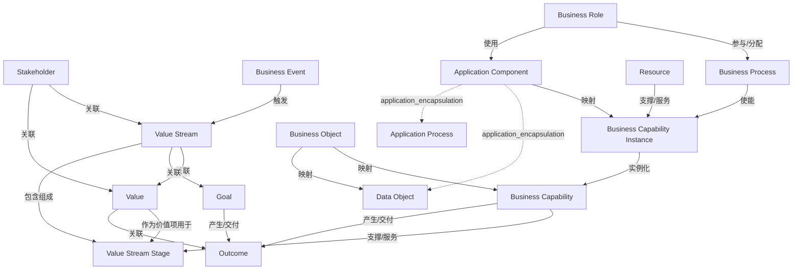

# G233/fig3-1 · ArchiMate 业务能力元素与关系

类型：`architecture-model`。为整本指南规定最小的 ArchiMate 元素集与合法关系集。作者在第 3 章开头指出：业务能力规划只需要 ArchiMate 的一个子集，先用这张图把“战略—价值流—能力—能力实例—落地要素”的语义固定下来，后续能力目录、价值流映射与实例模型都复用它；表 3-1 再逐元素解释这些元素在能力规划中的用法。

英文 PDF 物理页：[19]。本页为架构语义分析，原文与原图分别保留。

## 原图与可编辑图


[完整 JSON](fig3-1.json) · [可编辑 Mermaid](fig3-1.mmd) · [仅关系图](fig3-1.relations.mmd) · [层级分解图](fig3-1.hierarchy.mmd)

图形重建表达语义，不复制源图布局。虚线表示解释、矩阵映射或分组关系，不自动表示不确定性的概率。



## 架构分析

从上往下、从中间向两侧读。上方：Stakeholder 接收 Value、受益于 Value Stream；Value Stream 提出 Value、达成 Goal，Value 由 Outcome 度量。中轴：Business Event 触发 Value Stream，Value Stream 包含 Value Stream Stage，Business Capability 以带箭头的 Enables 支撑阶段。右侧目标链：Goal 导致 Outcome，Capability 交付 Outcome。下方落地链：Business Capability Instance 以空心三角“实例化”Business Capability，并被 Business Process 使能、由 Resource 服务、与 Application Process 对齐。左下：Business Object 对齐能力，并由应用组件内的 Data Object 表示；业务角色使用应用组件、在业务流程中活动。无箭头连线按标签的语法主语→宾语理解。

- 本图有 16 个具名或隐含元素、19 条关系和 2 条包含/分组记录。
- 包含/分组树最大深度为 1；根节点为 利益相关者、价值、目标、成果、价值流、价值流阶段、业务能力、业务能力实例、业务事件、业务对象、应用组件、资源、业务流程、业务角色。
- 本图没有可直接确认为人员直属汇报的关系；视觉上下位置、能力分解和治理职责分别读取。
- 能力实例→能力类型以 instantiates 记录，避免把特定实现当作子能力或继承子类。
- Instantiates连接能力实例和能力类型；实例不是子能力，不能用specialization表达业务语义。
- Application Component包裹Data Object和Application Process；Business Capability与Value Stream Stage之间是Enables，不是包含。
- 原图无箭头的被动标签需要按主语理解；Business Process是能力实例实现结果的行为机制，Business Role使用Application Component。
- 16个标签全部核对，19条有名关系核对端点；校正Aligned to从应用组件整体出发，非内部应用过程。
- Value和Outcome记法分别保存；标签Instantiates的业务语义优先于相似的空心三角外观。

### 如何用于项目

- 按节点类型建立业务、应用、数据、技术对象，并保留跨层服务、访问和实现关系。
- 交叉线不是连接点；角色分工、数据使用和组织汇报不得混用。

### 结构所表达的逻辑

- 全图用四种底色区分 ArchiMate 层：紫=动机（Stakeholder、Value、Goal、Outcome），黄=业务（Event、Object、Role、Process），沙=战略（Value Stream、Stage、Capability、Capability Instance、Resource），青=应用（Application Component、Data Object、Application Process）。
- Business Capability 是枢纽：向上用 Enables 支撑 Value Stream Stage（全图唯一带普通箭头的线），向下用 Instantiates 由 Business Capability Instance 实现（空心三角，方向为实例→能力）。
- “实例化”是能力从“做什么”变成“怎么做”的关键：能力实例再挂上 Business Role、Application Component、Business Object/Data Object、Business Process 与 Resource，这些要素才使能力可交付成果。
- 价值流是分层的：Value Stream Contains Value Stream Stage；Value是Value Stream Stage的价值项，阶段为价值流提供增量价值；价值最终由 Outcome 度量，而不是由活动量度量。
- 目标与成果是两种元素：Goal 是意图，Outcome 是结果；Value Stream Achieves Goal、Goal Results in Outcome、Value Measured by Outcome，Capability Delivers Outcome。
- Business Event 触发 Value Stream；表 3-1 补充说明业务事件至少触发价值流，也可触发单个价值流阶段，本图只画了触发整条价值流。
- Business Object 与 Data Object 不是一回事：前者是业务域概念对象（黄），后者是应用组件内为自动化处理而结构化的数据（青），两者以 Represented by 相连。
- 全图只有两处箭头，其余关系靠标签措辞定向；图中没有时间轴，Value Stream 与 Stage 是包含关系而非先后步骤。

## 上下级与包含

价值流包含价值阶段；应用组件封装数据对象和应用过程；能力实例到能力类型为实例化而非继承。其余关联不构成上下级。

|父项|子项|层级类型|依据与解释|
|---|---|---|---|
|应用组件|数据对象|application_encapsulation|应用组件包含其数据、行为或子组件。|
|应用组件|应用过程|application_encapsulation|应用组件包含其数据、行为或子组件。|

### 业务组成与特化

|父项/范围/类型|子项/责任对象/实例|语义|
|---|---|---|
|价值流|价值流阶段|composition|

### 类型与实例

|父项/范围/类型|子项/责任对象/实例|语义|
|---|---|---|
|业务能力|业务能力实例|instantiates|

## 全部元素与角色

|元素ID|原文名称|类型|含义|直接父项|深度|
|---|---|---|---|---|---|
|stakeholder|Stakeholder|stakeholder|利益相关者：利益相关者|—||
|value|Value|value|价值流提出、由成果度量的相对价值/效用。|—||
|goal|Goal|goal|目标/成果：目标|—||
|outcome|Outcome|outcome|成果：成果|—||
|value_stream|Value Stream|value_stream|价值流：价值流|—||
|value_stream_stage|Value Stream Stage|value_stream_stage|由 Contains 连线表示它是价值流的组成部分，视觉上未被价值流框包裹。|—||
|business_capability|Business Capability|capability|能力：业务能力|—||
|business_capability_instance|Business Capability Instance|capability|同一业务能力的一次具体实现，不是子能力。|—||
|business_event|Business Event|event|事件：业务事件|—||
|business_object|Business Object|data|信息/数据：业务对象|—||
|application_component|Application Component|application|应用：应用组件|—||
|data_object|Data Object|data|信息/数据：数据对象|应用组件|1|
|application_process|Application Process|process|流程：应用过程|应用组件|1|
|resource|Resource|resource|资源：资源|—||
|business_process|Business Process|process|流程：业务流程|—||
|business_role|Business Role|role|角色：业务角色|—||

## 全部关系

实线无箭头＝ArchiMate 关联，方向按标签读：Receives、Benefits from、Proposes、Achieves、Contains、Is value item for、Triggers、Aligned to、Represented by、Delivers、Served by、Enabled by、Activities in、Used by、Results in、Measured by。唯一带普通实心箭头的是 Business Capability → Value Stream Stage 的 Enables；唯一带空心三角的是 Business Capability Instance → Business Capability 的 Instantiates（画法类似 UML 泛化，语义是实例化）。

|主体|语义关系|客体|显式线/隐式|原文标签|依据|
|---|---|---|---|---|---|
|利益相关者|关联|价值流|显式连线|Benefits from|利益相关者从价值流获得收益；无箭头，方向按标签。|
|利益相关者|关联|价值|显式连线|Receives|利益相关者接收价值；无箭头。|
|价值流|关联|价值|显式连线|Proposes|价值流提出/交付价值；标签靠近价值流一侧，无箭头。|
|价值流|关联|目标|显式连线|Achieves|价值流达成目标；无箭头。|
|价值流|包含组成|价值流阶段|显式连线|Contains|价值流由阶段组成；竖向无箭头连线。|
|价值|作为价值项用于|价值流阶段|显式连线|Is value item for|Value为Value Stream Stage的价值项；结合表3-1 Value定义（p21）读关系标签，不能把阶段当作Value的价值项。|
|业务事件|触发|价值流|显式连线|Triggers|业务事件触发价值流；无箭头。|
|业务能力|支撑/服务|价值流阶段|显式连线|Enables|全图唯一带普通箭头的连线，箭头由业务能力指向价值流阶段。|
|业务能力实例|实例化|业务能力|显式连线|Instantiates|原图标签Instantiates以及p20能力实例说明：能力实例实例化能力，不是子类型继承。|
|业务能力|产生/交付|成果|显式连线|Delivers|业务能力交付成果；无箭头。|
|业务对象|映射|业务能力|显式连线|Aligned to|业务对象对齐（可分配给）一个或多个业务能力；无箭头。|
|业务对象|映射|数据对象|显式连线|Represented by|业务对象在应用组件中表示为数据对象；无箭头。|
|应用组件|映射|业务能力实例|显式连线|Aligned to|Aligned to线从Application Component右边框接到能力实例左边框；Application Process位于该线下方，不是线的端点。|
|资源|支撑/服务|业务能力实例|显式连线|Served by|图中Served by从能力实例读向Resource；转换为Resource支撑能力实例。|
|业务流程|使能|业务能力实例|显式连线|Enabled by|能力实例下方标签Enabled by读为能力实例由Business Process使能；表3-1 p20说明业务流程在能力实例语境中实现特定结果。|
|业务角色|参与/分配|业务流程|显式连线|Activities in|业务角色在业务流程中执行行为；无箭头。|
|业务角色|使用|应用组件|显式连线|Used by|Application Component下方Used by的用户是Business Role，规范语义为角色使用应用组件。|
|目标|产生/交付|成果|显式连线|Results in|目标导致成果；无箭头。|
|价值|关联|成果|显式连线|Measured by|价值由成果度量；无箭头。|

## 本轮语义修正

- Value为Value Stream Stage的价值项；结合表3-1 Value定义（p21）读关系标签，不能把阶段当作Value的价值项。
- 原图标签Instantiates以及p20能力实例说明：能力实例实例化能力，不是子类型继承。
- Aligned to线从Application Component右边框接到能力实例左边框；Application Process位于该线下方，不是线的端点。
- 图中Served by从能力实例读向Resource；转换为Resource支撑能力实例。
- 能力实例下方标签Enabled by读为能力实例由Business Process使能；表3-1 p20说明业务流程在能力实例语境中实现特定结果。
- Application Component下方Used by的用户是Business Role，规范语义为角色使用应用组件。

## 误读检查

- 不要把它当流程顺序图：Value Stream 与 Stage 是包含关系，图中没有时间轴，也没有阶段顺序。
- 不要把 Business Capability Instance 当成“二级能力/子能力”；它是同一能力的一次具体实现，元素类型仍是能力。
- 不要因为 Instantiates 用空心三角就理解成“继承/特化”；标签写明是实例化，方向是实例→能力。
- 不要把所有无箭头连线都当成双向关联：多数标签有明确的主谓方向（如 Event Triggers Value Stream），应按标签读。
- 中文稿第 3.1 节引用的 figs/g233_fig3-1.svg 只是 12 个名词框加装饰线，既缺元素也缺全部关系，不能据它理解本图；必须以英文原图为准。

## 原文证据

### [PDF 第 18 页](../../../documents/G233.md#page-18)

> The ArchiMate language is capable of modeling across all architecture domains, layers, and aspects. For business capability planning, only a subset of the ArchiMate elements is needed to support the models that will be developed. Figure 3-1 and Table 3-1 contain the elements that have been used to develop the models that will follow through the rest of this document. There are other ArchiMate elements that could be useful when developing business capability planning models, but starting with this subset is recommended.
### [PDF 第 19 页](../../../documents/G233.md#page-19)

> The business capability elements have clear relationships Figure 3-1 which help in understanding their role in the delivery of the capability and value. These elements and relationships are intended for use in the viewpoint expressed in the value stream model. Table 3-1 shows how these elements and relationships are used in the context of business capability planning.
> Table 3-1: Use of ArchiMate Business Capability Elements and Relationships
### [PDF 第 20 页](../../../documents/G233.md#page-20)

### [PDF 第 21 页](../../../documents/G233.md#page-21)

> In the examples provided, most of the relationships are implied by having elements nested within other elements. The relationships are still there, just not as explicit. Mapping the relationships between elements is of great importance and the reason it is almost mandatory that a modeling tool is used. The catalog of models is essential to trace interdependency to be able to perform the analysis for business capability planning.
> To properly execute business capability planning, an architecture modeling tool is essential. The relationships and interdependencies between business goals and outcomes, capability instances, and the resources of the organization needed to successfully deliver value to customers become overwhelming quite rapidly without a method to track and maintain them.

## 来源与分析状态

所有元素/关系均有来源定位；未把历史解释重命名为本轮逐线视觉确认。源图与语义图是两种视图，布局不证明汇报或因果。

源 PDF SHA-256：`d5c62f9edb2465d10e59f0a1c9c23fb5d8a0b14e506cf7739a09886fbee07754`。

源图记录：[原始解释与转录](../../../figures/G233/fig3-1.json)。

```json
{
  "quality": {
    "graph_integrity": "checked",
    "semantic_analysis": "typed-graph-and-context-analysis",
    "visual_review": "source-content-audited",
    "notice_zh": "所有元素/关系均有来源定位；未把历史解释重命名为本轮逐线视觉确认。源图与语义图是两种视图，布局不证明汇报或因果。"
  },
  "source_uncertainty": {
    "confidence": "high",
    "uncertainties_zh": [
      "16 个元素与 19 条关系均清晰可辨；但除 Enables、Instantiates 外都没有箭头，关系方向按标签语法推定。",
      "“Proposes”的主语存在歧义（价值流提出价值，还是价值向价值流提出主张），本文按“价值流提出价值”记录。",
      "“Is value item for”斜线穿过 Goal 框并终止于 Value 椭圆；若按正文语境理解“阶段的价值项服务于目标”，语义对象应为 Goal，但按画面端点记为 Value。"
    ],
    "analyzed_from": [
      "英文 PDF 第 19 页图 3-1 截图（figctx 裁剪）及 2×2、3×3 放大分块",
      "英文 PDF 第 18–19 页正文与表 3-1",
      "中文稿 G233e_业务能力规划.md 第 136–169 行（含表 3-1）",
      "figs/g233_fig3-1.svg 源码（12 个文本框与 12 条无标签连线）"
    ],
    "date": "2026-10-31"
  },
  "source_conflicts": []
}
```
