# G233/fig4-1 · 零售公司组织架构图

类型：`decomposition-or-organization-model`。第 4 章“做好功课”的第一个输入是组织结构。作者用它说明组织单元常与业务能力高度对齐（人员执行流程、分配资金/IT/资产），因此组织架构可以启发能力目录；同时用零售示例演示哪些层级能启发目录、哪些不能，以及组织架构比能力更易变、应避免名称一一对应。

英文 PDF 物理页：[23]。本页为架构语义分析，原文与原图分别保留。

## 原图与可编辑图


[完整 JSON](fig4-1.json) · [可编辑 Mermaid](fig4-1.mmd) · [仅关系图](fig4-1.relations.mmd) · [层级分解图](fig4-1.hierarchy.mmd)

图形重建表达语义，不复制源图布局。虚线表示解释、矩阵映射或分组关系，不自动表示不确定性的概率。

```mermaid
flowchart TB
  %% Semantic reconstruction; see original source image for exact layout.
  n0["Retail Organization"]
  n1["Finance"]
  n2["Accounts Payable"]
  n3["Accounts Receivable"]
  n4["Cash Management"]
  n5["Accounts Receivable"]
  n6["Accounts Payable"]
  n7["Supply Chain Management"]
  n8["Purchasing"]
  n9["Warehouse Management"]
  n10["Clothing Warehouses"]
  n11["Electronics Warehouses"]
  n12["Distribution"]
  n13["Sales"]
  n14["Retail Stores"]
  n15["Region A"]
  n16["Region B"]
  n17["Region C"]
  n18["Region D"]
  n19["Internet Store"]
  n20["Human Resources"]
  n21["Talent Management"]
  n22["Recruiting"]
  n23["Payroll"]
  n1 -.->|"汇报于"| n0
  n7 -.->|"汇报于"| n0
  n13 -.->|"汇报于"| n0
  n20 -.->|"汇报于"| n0
  n2 -.->|"汇报于"| n1
  n3 -.->|"汇报于"| n1
  n4 -.->|"汇报于"| n3
  n5 -.->|"汇报于"| n3
  n6 -.->|"汇报于"| n3
  n8 -.->|"汇报于"| n7
  n9 -.->|"汇报于"| n7
  n12 -.->|"汇报于"| n7
  n10 -.->|"汇报于"| n9
  n11 -.->|"汇报于"| n9
  n14 -.->|"汇报于"| n13
  n19 -.->|"汇报于"| n13
  n15 -.->|"汇报于"| n14
  n16 -.->|"汇报于"| n14
  n17 -.->|"汇报于"| n14
  n18 -.->|"汇报于"| n14
  n21 -.->|"汇报于"| n20
  n22 -.->|"汇报于"| n20
  n23 -.->|"汇报于"| n20
  n0 -.->|"organization_partition"| n1
  n1 -.->|"organization_partition"| n2
  n1 -.->|"organization_partition"| n3
  n3 -.->|"organization_partition"| n4
  n3 -.->|"organization_partition"| n5
  n3 -.->|"organization_partition"| n6
  n0 -.->|"organization_partition"| n7
  n7 -.->|"organization_partition"| n8
  n7 -.->|"organization_partition"| n9
  n9 -.->|"organization_partition"| n10
  n9 -.->|"organization_partition"| n11
  n7 -.->|"organization_partition"| n12
  n0 -.->|"organization_partition"| n13
  n13 -.->|"organization_partition"| n14
  n14 -.->|"organization_partition"| n15
  n14 -.->|"organization_partition"| n16
  n14 -.->|"organization_partition"| n17
  n14 -.->|"organization_partition"| n18
  n13 -.->|"organization_partition"| n19
  n0 -.->|"organization_partition"| n20
  n20 -.->|"organization_partition"| n21
  n20 -.->|"organization_partition"| n22
  n20 -.->|"organization_partition"| n23
```



## 架构分析

先读外层组织和4个主要职能域，再按嵌套读取部门及其下级组织。第22页正文赋予嵌套组织性汇报含义；这不能被直接转为个人直属上级表。

- 本图有 24 个具名或隐含元素、23 条关系和 23 条包含/分组记录。
- 包含/分组树最大深度为 3；根节点为 零售组织。
- 保留来源解释中的 23 条汇报/组织归属关系，其主体类型为 {'organization_unit': 23}；组织单元不是具体员工，来源示例不能变成项目现行人事结构。
- 24个组织单元及23个直接嵌套关系逐个核对，无画出的连线。
- 第22页正文明确这些嵌套代表组织单元向上级业务单元汇报，因此保留有文本支持的组织性reports_to，区别于人员汇报。
- 重复的Accounts Payable/Accounts Receivable分别在不同层级出现；不合并、不改源图层级。
- 产品仓库与地区门店按产品/地域划分，不是子能力层级。

### 如何用于项目

- 按父项展开所有直接子项，检查同层粒度、重叠和缺项。
- 保留组成、分类、能力分解与组织汇报的区别；将示例名称替换为已确认的项目对象。

### 结构所表达的逻辑

- 24个组织单元及23个直接嵌套关系逐个核对，无画出的连线。
- 第22页正文明确这些嵌套代表组织单元向上级业务单元汇报，因此保留有文本支持的组织性reports_to，区别于人员汇报。
- 重复的Accounts Payable/Accounts Receivable分别在不同层级出现；不合并、不改源图层级。
- 产品仓库与地区门店按产品/地域划分，不是子能力层级。

## 上下级与包含

Retail Organization→4个职能域→部门→地区/产品等下级组织单元。源文明确嵌套表示组织单元向上汇报；不含人员或岗位名册。

|父项|子项|层级类型|依据与解释|
|---|---|---|---|
|零售组织|财务|organization_partition|组织单元的组成/分区；此处不自动证明岗位直属汇报。|
|财务|应付账款|organization_partition|组织单元的组成/分区；此处不自动证明岗位直属汇报。|
|财务|应收账款|organization_partition|组织单元的组成/分区；此处不自动证明岗位直属汇报。|
|应收账款|现金管理|organization_partition|组织单元的组成/分区；此处不自动证明岗位直属汇报。|
|应收账款|应收账款|organization_partition|组织单元的组成/分区；此处不自动证明岗位直属汇报。|
|应收账款|应付账款|organization_partition|组织单元的组成/分区；此处不自动证明岗位直属汇报。|
|零售组织|供应链管理|organization_partition|组织单元的组成/分区；此处不自动证明岗位直属汇报。|
|供应链管理|采购|organization_partition|组织单元的组成/分区；此处不自动证明岗位直属汇报。|
|供应链管理|仓库管理|organization_partition|组织单元的组成/分区；此处不自动证明岗位直属汇报。|
|仓库管理|服装仓库|organization_partition|组织单元的组成/分区；此处不自动证明岗位直属汇报。|
|仓库管理|电子产品仓库|organization_partition|组织单元的组成/分区；此处不自动证明岗位直属汇报。|
|供应链管理|分销|organization_partition|组织单元的组成/分区；此处不自动证明岗位直属汇报。|
|零售组织|销售|organization_partition|组织单元的组成/分区；此处不自动证明岗位直属汇报。|
|销售|零售门店|organization_partition|组织单元的组成/分区；此处不自动证明岗位直属汇报。|
|零售门店|区域 A|organization_partition|组织单元的组成/分区；此处不自动证明岗位直属汇报。|
|零售门店|区域 B|organization_partition|组织单元的组成/分区；此处不自动证明岗位直属汇报。|
|零售门店|区域 C|organization_partition|组织单元的组成/分区；此处不自动证明岗位直属汇报。|
|零售门店|区域 D|organization_partition|组织单元的组成/分区；此处不自动证明岗位直属汇报。|
|销售|网上商店|organization_partition|组织单元的组成/分区；此处不自动证明岗位直属汇报。|
|零售组织|人力资源|organization_partition|组织单元的组成/分区；此处不自动证明岗位直属汇报。|
|人力资源|人才管理|organization_partition|组织单元的组成/分区；此处不自动证明岗位直属汇报。|
|人力资源|招聘|organization_partition|组织单元的组成/分区；此处不自动证明岗位直属汇报。|
|人力资源|薪资|organization_partition|组织单元的组成/分区；此处不自动证明岗位直属汇报。|

### 明确汇报关系

|父项/范围/类型|子项/责任对象/实例|语义|
|---|---|---|
|零售组织|财务|reports_to|
|零售组织|供应链管理|reports_to|
|零售组织|销售|reports_to|
|零售组织|人力资源|reports_to|
|财务|应付账款|reports_to|
|财务|应收账款|reports_to|
|应收账款|现金管理|reports_to|
|应收账款|应收账款|reports_to|
|应收账款|应付账款|reports_to|
|供应链管理|采购|reports_to|
|供应链管理|仓库管理|reports_to|
|供应链管理|分销|reports_to|
|仓库管理|服装仓库|reports_to|
|仓库管理|电子产品仓库|reports_to|
|销售|零售门店|reports_to|
|销售|网上商店|reports_to|
|零售门店|区域 A|reports_to|
|零售门店|区域 B|reports_to|
|零售门店|区域 C|reports_to|
|零售门店|区域 D|reports_to|
|人力资源|人才管理|reports_to|
|人力资源|招聘|reports_to|
|人力资源|薪资|reports_to|

## 全部元素与角色

|元素ID|原文名称|类型|含义|直接父项|深度|
|---|---|---|---|---|---|
|org_retail|Retail Organization|organization_unit|组织单元：零售组织|—||
|fin|Finance|organization_unit|组织单元：财务|零售组织|1|
|fin_ap|Accounts Payable|organization_unit|组织单元：应付账款|财务|2|
|fin_ar_dept|Accounts Receivable|organization_unit|作为部门容器，框内又含一个同名“Accounts Receivable”职能；原图如此。|财务|2|
|fin_cash|Cash Management|organization_unit|组织单元：现金管理|应收账款|3|
|fin_ar_func|Accounts Receivable|organization_unit|组织单元：应收账款|应收账款|3|
|fin_ap_func|Accounts Payable|organization_unit|与财务列顶部的 Accounts Payable 同名，但属于应收账款部门内的职能单元。|应收账款|3|
|scm|Supply Chain Management|organization_unit|组织单元：供应链管理|零售组织|1|
|scm_purchasing|Purchasing|organization_unit|组织单元：采购|供应链管理|2|
|scm_warehouse|Warehouse Management|organization_unit|组织单元：仓库管理|供应链管理|2|
|scm_wh_clothing|Clothing Warehouses|organization_unit|组织单元：服装仓库|仓库管理|3|
|scm_wh_electronics|Electronics Warehouses|organization_unit|组织单元：电子产品仓库|仓库管理|3|
|scm_distribution|Distribution|organization_unit|组织单元：分销|供应链管理|2|
|sales|Sales|organization_unit|组织单元：销售|零售组织|1|
|sales_stores|Retail Stores|organization_unit|组织单元：零售门店|销售|2|
|region_a|Region A|organization_unit|组织单元：区域 A|零售门店|3|
|region_b|Region B|organization_unit|组织单元：区域 B|零售门店|3|
|region_c|Region C|organization_unit|组织单元：区域 C|零售门店|3|
|region_d|Region D|organization_unit|组织单元：区域 D|零售门店|3|
|sales_internet|Internet Store|organization_unit|组织单元：网上商店|销售|2|
|hr|Human Resources|organization_unit|组织单元：人力资源|零售组织|1|
|hr_talent|Talent Management|organization_unit|组织单元：人才管理|人力资源|2|
|hr_recruiting|Recruiting|organization_unit|组织单元：招聘|人力资源|2|
|hr_payroll|Payroll|organization_unit|组织单元：薪资|人力资源|2|

## 全部关系

没有画出的线；组织汇报语义由第22页对该图的明确说明支持，23条关系均标为无显式连接。

|主体|语义关系|客体|显式线/隐式|原文标签|依据|
|---|---|---|---|---|---|
|财务|汇报于|零售组织|implicit||第22页明确说本图部门通过嵌套表示向上级业务单元组织性汇报；主体都是组织单元，不能推导具名员工或岗位的直属汇报。|
|供应链管理|汇报于|零售组织|implicit||第22页明确说本图部门通过嵌套表示向上级业务单元组织性汇报；主体都是组织单元，不能推导具名员工或岗位的直属汇报。|
|销售|汇报于|零售组织|implicit||第22页明确说本图部门通过嵌套表示向上级业务单元组织性汇报；主体都是组织单元，不能推导具名员工或岗位的直属汇报。|
|人力资源|汇报于|零售组织|implicit||第22页明确说本图部门通过嵌套表示向上级业务单元组织性汇报；主体都是组织单元，不能推导具名员工或岗位的直属汇报。|
|应付账款|汇报于|财务|implicit||第22页明确说本图部门通过嵌套表示向上级业务单元组织性汇报；主体都是组织单元，不能推导具名员工或岗位的直属汇报。|
|应收账款|汇报于|财务|implicit||第22页明确说本图部门通过嵌套表示向上级业务单元组织性汇报；主体都是组织单元，不能推导具名员工或岗位的直属汇报。|
|现金管理|汇报于|应收账款|implicit||第22页明确说本图部门通过嵌套表示向上级业务单元组织性汇报；主体都是组织单元，不能推导具名员工或岗位的直属汇报。|
|应收账款|汇报于|应收账款|implicit||第22页明确说本图部门通过嵌套表示向上级业务单元组织性汇报；主体都是组织单元，不能推导具名员工或岗位的直属汇报。|
|应付账款|汇报于|应收账款|implicit||第22页明确说本图部门通过嵌套表示向上级业务单元组织性汇报；主体都是组织单元，不能推导具名员工或岗位的直属汇报。|
|采购|汇报于|供应链管理|implicit||第22页明确说本图部门通过嵌套表示向上级业务单元组织性汇报；主体都是组织单元，不能推导具名员工或岗位的直属汇报。|
|仓库管理|汇报于|供应链管理|implicit||第22页明确说本图部门通过嵌套表示向上级业务单元组织性汇报；主体都是组织单元，不能推导具名员工或岗位的直属汇报。|
|分销|汇报于|供应链管理|implicit||第22页明确说本图部门通过嵌套表示向上级业务单元组织性汇报；主体都是组织单元，不能推导具名员工或岗位的直属汇报。|
|服装仓库|汇报于|仓库管理|implicit||第22页明确说本图部门通过嵌套表示向上级业务单元组织性汇报；主体都是组织单元，不能推导具名员工或岗位的直属汇报。|
|电子产品仓库|汇报于|仓库管理|implicit||第22页明确说本图部门通过嵌套表示向上级业务单元组织性汇报；主体都是组织单元，不能推导具名员工或岗位的直属汇报。|
|零售门店|汇报于|销售|implicit||第22页明确说本图部门通过嵌套表示向上级业务单元组织性汇报；主体都是组织单元，不能推导具名员工或岗位的直属汇报。|
|网上商店|汇报于|销售|implicit||第22页明确说本图部门通过嵌套表示向上级业务单元组织性汇报；主体都是组织单元，不能推导具名员工或岗位的直属汇报。|
|区域 A|汇报于|零售门店|implicit||第22页明确说本图部门通过嵌套表示向上级业务单元组织性汇报；主体都是组织单元，不能推导具名员工或岗位的直属汇报。|
|区域 B|汇报于|零售门店|implicit||第22页明确说本图部门通过嵌套表示向上级业务单元组织性汇报；主体都是组织单元，不能推导具名员工或岗位的直属汇报。|
|区域 C|汇报于|零售门店|implicit||第22页明确说本图部门通过嵌套表示向上级业务单元组织性汇报；主体都是组织单元，不能推导具名员工或岗位的直属汇报。|
|区域 D|汇报于|零售门店|implicit||第22页明确说本图部门通过嵌套表示向上级业务单元组织性汇报；主体都是组织单元，不能推导具名员工或岗位的直属汇报。|
|人才管理|汇报于|人力资源|implicit||第22页明确说本图部门通过嵌套表示向上级业务单元组织性汇报；主体都是组织单元，不能推导具名员工或岗位的直属汇报。|
|招聘|汇报于|人力资源|implicit||第22页明确说本图部门通过嵌套表示向上级业务单元组织性汇报；主体都是组织单元，不能推导具名员工或岗位的直属汇报。|
|薪资|汇报于|人力资源|implicit||第22页明确说本图部门通过嵌套表示向上级业务单元组织性汇报；主体都是组织单元，不能推导具名员工或岗位的直属汇报。|

## 本轮语义修正

- 第22页明确说本图部门通过嵌套表示向上级业务单元组织性汇报；主体都是组织单元，不能推导具名员工或岗位的直属汇报。
- 第22页明确说本图部门通过嵌套表示向上级业务单元组织性汇报；主体都是组织单元，不能推导具名员工或岗位的直属汇报。
- 第22页明确说本图部门通过嵌套表示向上级业务单元组织性汇报；主体都是组织单元，不能推导具名员工或岗位的直属汇报。
- 第22页明确说本图部门通过嵌套表示向上级业务单元组织性汇报；主体都是组织单元，不能推导具名员工或岗位的直属汇报。
- 第22页明确说本图部门通过嵌套表示向上级业务单元组织性汇报；主体都是组织单元，不能推导具名员工或岗位的直属汇报。
- 第22页明确说本图部门通过嵌套表示向上级业务单元组织性汇报；主体都是组织单元，不能推导具名员工或岗位的直属汇报。
- 第22页明确说本图部门通过嵌套表示向上级业务单元组织性汇报；主体都是组织单元，不能推导具名员工或岗位的直属汇报。
- 第22页明确说本图部门通过嵌套表示向上级业务单元组织性汇报；主体都是组织单元，不能推导具名员工或岗位的直属汇报。
- 第22页明确说本图部门通过嵌套表示向上级业务单元组织性汇报；主体都是组织单元，不能推导具名员工或岗位的直属汇报。
- 第22页明确说本图部门通过嵌套表示向上级业务单元组织性汇报；主体都是组织单元，不能推导具名员工或岗位的直属汇报。
- 第22页明确说本图部门通过嵌套表示向上级业务单元组织性汇报；主体都是组织单元，不能推导具名员工或岗位的直属汇报。
- 第22页明确说本图部门通过嵌套表示向上级业务单元组织性汇报；主体都是组织单元，不能推导具名员工或岗位的直属汇报。
- 第22页明确说本图部门通过嵌套表示向上级业务单元组织性汇报；主体都是组织单元，不能推导具名员工或岗位的直属汇报。
- 第22页明确说本图部门通过嵌套表示向上级业务单元组织性汇报；主体都是组织单元，不能推导具名员工或岗位的直属汇报。
- 第22页明确说本图部门通过嵌套表示向上级业务单元组织性汇报；主体都是组织单元，不能推导具名员工或岗位的直属汇报。
- 第22页明确说本图部门通过嵌套表示向上级业务单元组织性汇报；主体都是组织单元，不能推导具名员工或岗位的直属汇报。
- 第22页明确说本图部门通过嵌套表示向上级业务单元组织性汇报；主体都是组织单元，不能推导具名员工或岗位的直属汇报。
- 第22页明确说本图部门通过嵌套表示向上级业务单元组织性汇报；主体都是组织单元，不能推导具名员工或岗位的直属汇报。
- 第22页明确说本图部门通过嵌套表示向上级业务单元组织性汇报；主体都是组织单元，不能推导具名员工或岗位的直属汇报。
- 第22页明确说本图部门通过嵌套表示向上级业务单元组织性汇报；主体都是组织单元，不能推导具名员工或岗位的直属汇报。
- 第22页明确说本图部门通过嵌套表示向上级业务单元组织性汇报；主体都是组织单元，不能推导具名员工或岗位的直属汇报。
- 第22页明确说本图部门通过嵌套表示向上级业务单元组织性汇报；主体都是组织单元，不能推导具名员工或岗位的直属汇报。
- 第22页明确说本图部门通过嵌套表示向上级业务单元组织性汇报；主体都是组织单元，不能推导具名员工或岗位的直属汇报。

## 误读检查

- 不能说所有嵌套都没有汇报依据；本图正文明确说明组织性汇报。
- 不能把组织单元汇报替换成人员岗位汇报，或把地区/仓库自动当作能力分解。

## 原文证据

### [PDF 第 22 页](../../../documents/G233.md#page-22)

> The example retail organization has four main functional areas, each with smaller departments that report up to the parent business unit, as shown in Figure 4-1. In the model each of the functional areas is represented as a stakeholder in the ArchiMate language, and in the modeling tool with a hierarchy represented by the nesting of each stakeholder within the area to which they report organizationally.
### [PDF 第 23 页](../../../documents/G233.md#page-23)

> At this level, the organization chart is not at the detail required to really inform the overall capability catalog, but at a lower level it may be. It does indicate where there may be business capabilities. For example, within Finance there are three functions for Cash Management, Accounts Receivable, and Accounts Payable which for most organizations will be business capabilities. In areas like Warehouse Management and Retail Stores, the organizational hierarchy does not inform the business capability catalog due to them being geographically or, in this example, product-oriented.
> A common and simple business model is the Business Model Canvas™. By keeping the business model at an abstract level, it allows for a macro-level view that is both easy to communicate and usually provides insight that may not be as easily seen at the more detailed level.

## 来源与分析状态

所有元素/关系均有来源定位；未把历史解释重命名为本轮逐线视觉确认。源图与语义图是两种视图，布局不证明汇报或因果。

源 PDF SHA-256：`d5c62f9edb2465d10e59f0a1c9c23fb5d8a0b14e506cf7739a09886fbee07754`。

源图记录：[原始解释与转录](../../../figures/G233/fig4-1.json)。

```json
{
  "quality": {
    "graph_integrity": "checked",
    "semantic_analysis": "typed-graph-and-context-analysis",
    "visual_review": "source-content-audited",
    "notice_zh": "所有元素/关系均有来源定位；未把历史解释重命名为本轮逐线视觉确认。源图与语义图是两种视图，布局不证明汇报或因果。"
  },
  "source_uncertainty": {
    "confidence": "high",
    "uncertainties_zh": [
      "财务域中“Accounts Receivable”部门框与其内同名单元、以及两处“Accounts Payable”在原图重复出现，无法仅凭图判断是刻意表示“部门与职能同名”还是建模疏忽；本分析按嵌套层级照录。",
      "四个职能域使用白色容器而非紫色框，是否属于 ArchiMate 的 Group 元素无法仅凭图确认；正文明确称每个职能域表示为利益相关者，故按组织单元/利益相关者记录。",
      "Accounts Receivable 部门下同时出现 Cash Management、Accounts Receivable、Accounts Payable 三个职能（应付账款挂在应收账款部门下），业务上略反常；原图如此，本分析按画面照录。",
      "图中没有连线，23 条汇报关系全部由嵌套推断（explicit:false）。"
    ],
    "analyzed_from": [
      "英文 PDF 第 23 页图 4-1 截图（figctx 裁剪）与 2×2 放大分块",
      "英文 PDF 第 22–23 页正文",
      "中文稿 G233e_业务能力规划.md 第 186–226 行（含 22 条图内标签对照）",
      "figs/g233e_fig4-1_en.png 与 figs/zh/g233e_fig4-1_zh.png"
    ],
    "date": "2026-10-31"
  },
  "source_conflicts": []
}
```
