# G233/fig4-2 · 零售组织商业模式画布

类型：`business-model-canvas`。第 4.2 节示范“把业务模型保持在抽象层级”：画布给出易于沟通的宏观视图，也能暴露细粒度模型不易看到的洞察。作者特别要求“关键活动”一栏填本文档后文的价值流（而不是传统活动清单），从而把业务模型与价值流、能力规划衔接起来。

英文 PDF 物理页：[24]。本页为架构语义分析，原文与原图分别保留。

## 原图与可编辑图


[完整 JSON](fig4-2.json) · [可编辑 Mermaid](fig4-2.mmd) · [仅关系图](fig4-2.relations.mmd) · [层级分解图](fig4-2.hierarchy.mmd)

图形重建表达语义，不复制源图布局。虚线表示解释、矩阵映射或分组关系，不自动表示不确定性的概率。

```mermaid
flowchart TB
  %% Semantic reconstruction; see original source image for exact layout.
  n0["Key Partnerships"]
  n1["Key Activities"]
  n2["Key Resources"]
  n3["Value Propositions"]
  n4["Customer Relationships"]
  n5["Channels"]
  n6["Customer Segments"]
  n7["Cost Structure"]
  n8["Revenue Streams"]
  n9["Product Vendors"]
  n10["Suppliers"]
  n11["Credit Card Processor"]
  n12["Shareholders"]
  n13["Creditors"]
  n14["Retail (Online) with Capability Instances"]
  n15["Retail (Physical) with Capability Instances"]
  n16["Recruit Employee Value Stream with Capability Instances"]
  n17["Clothing Warehouse"]
  n18["Electronics Warehouse"]
  n19["Luxury feel at an affordable price"]
  n20["Expert advice"]
  n21["Retail Store"]
  n22["Website"]
  n23["Mobile App"]
  n24["Middle Class"]
  n25["Real Estate"]
  n26["Human Resources"]
  n27["Inventory"]
  n28["Retail Sales"]
  n29["Product Vendor Incentives"]
  n30["The Business Model Canvas: http://www.businessmodelgeneration.com This work is licensed under the Creative Commons Attribution-Share Alike 3.0 Unported License. To view a copy of this license, visit http://creativecommons.org/licenses/by-sa/3.0/"]
  n0 -.->|"分组"| n9
  n0 -.->|"分组"| n10
  n0 -.->|"分组"| n11
  n0 -.->|"分组"| n12
  n0 -.->|"分组"| n13
  n1 -.->|"分组"| n14
  n1 -.->|"分组"| n15
  n1 -.->|"分组"| n16
  n2 -.->|"分组"| n17
  n2 -.->|"分组"| n18
  n3 -.->|"分组"| n19
  n4 -.->|"分组"| n20
  n5 -.->|"分组"| n21
  n5 -.->|"分组"| n22
  n5 -.->|"分组"| n23
  n6 -.->|"分组"| n24
  n7 -.->|"分组"| n25
  n7 -.->|"分组"| n26
  n7 -.->|"分组"| n27
  n8 -.->|"分组"| n28
  n8 -.->|"分组"| n29
```



## 架构分析

按经典画布顺序读：左侧供给侧（关键合作伙伴 → 关键活动/关键资源），中间价值主张，右侧需求侧（客户关系/渠道 → 客户细分），底部成本结构与收入来源。每个彩色贴片是所属区块的一个实例；贴片之间没有连线，跨区块的关系靠同名主题（如产品供应商与产品供应商激励）自行关联。

- 本图有 31 个具名或隐含元素、0 条关系和 21 条包含/分组记录。
- 包含/分组树最大深度为 1；根节点为 关键合作伙伴、关键活动、关键资源、价值主张、客户关系、渠道、客户细分、成本结构、收入来源、商业模式画布：businessmodelgeneration.com；本作品按 CC BY-SA 3.0 Unported 许可使用；许可证副本见 creativecommons.org/licenses/by-sa/3.0/。
- 本图没有可直接确认为人员直属汇报的关系；视觉上下位置、能力分解和治理职责分别读取。
- 原图靠嵌套表达结构，没有连线；新语义图将包含单独显式化，不补造流程、数据流或依赖。
- 包含分组后有 10 个连通分量；分离可能源于图例、并列分类或独立示例，未自动补边。
- 9个画布区块、21个内容便签及1个许可说明逐项核对；无任何跨区块连线。
- Key Activities中的3个块引用价值流视图；右上角图标是视图引用符号，不是3个新的业务能力。
- 便签底色区分区块类别，没有红黄绿成熟度图例。底部许可及来源网址完整保留。

### 如何用于项目

- 先明确受益方和价值主张，再把各画布要素关联到能力、价值流及所需资源。
- 画布用于假设和共同理解；不能替代细化的实现架构或已验证经营数据。

### 结构所表达的逻辑

- 画布共九个区块、21 个条目：关键合作伙伴 5 项、关键活动 3 项、关键资源 2 项、价值主张 1 项、客户关系 1 项、渠道 3 项、客户细分 1 项、成本结构 3 项、收入来源 2 项。
- 三项关键活动都写成“价值流＋能力实例”：零售（线上）及能力实例、零售（实体）及能力实例、招聘员工价值流及能力实例；这是本画布与普通商业模式画布最大的不同，直接指向第 5–6 章的价值流/能力实例建模。
- 价值主张只有一句“以可负担的价格获得奢华感受”，对应客户细分“中产阶级”，构成“低价获得高端感受”的定位；客户关系“专家建议”与这一定位一致。
- 渠道有三条：零售门店、网站、移动应用；关键资源是服装仓库与电子产品仓库，分别对应后文按产品划分的仓库管理。
- 成本结构三项（房地产、人力资源、库存）与关键资源/活动呼应；收入来源两项（零售销售、产品供应商激励）说明除商品销售外还有来自供应商的返利/激励收入。
- “Product Vendors（产品供应商）”出现在关键合作伙伴，“Product Vendor Incentives（产品供应商激励）”出现在收入来源，二者不是重复项，而是同一类伙伴在成本侧与收入侧的两个角色。
- 画布刻意保持抽象：不画应用系统、不画流程细节；这些留给后文的价值流、能力目录与能力实例模型。

## 上下级与包含

两层：9 个画布区块（容器）→ 各区块内的条目贴片（含底部版权说明）。条目与区块是“属于”关系；条目之间没有上下级，也没有跨区块连线。

|父项|子项|层级类型|依据与解释|
|---|---|---|---|
|关键合作伙伴|产品供应商|visual_grouping|框、泳道、域或分类组的成员归属；没有额外证据不提升为业务组合或管理关系。|
|关键合作伙伴|供应商|visual_grouping|框、泳道、域或分类组的成员归属；没有额外证据不提升为业务组合或管理关系。|
|关键合作伙伴|信用卡处理商|visual_grouping|框、泳道、域或分类组的成员归属；没有额外证据不提升为业务组合或管理关系。|
|关键合作伙伴|股东|visual_grouping|框、泳道、域或分类组的成员归属；没有额外证据不提升为业务组合或管理关系。|
|关键合作伙伴|债权人|visual_grouping|框、泳道、域或分类组的成员归属；没有额外证据不提升为业务组合或管理关系。|
|关键活动|零售（线上）及能力实例|visual_grouping|框、泳道、域或分类组的成员归属；没有额外证据不提升为业务组合或管理关系。|
|关键活动|零售（实体）及能力实例|visual_grouping|框、泳道、域或分类组的成员归属；没有额外证据不提升为业务组合或管理关系。|
|关键活动|招聘员工价值流及能力实例|visual_grouping|框、泳道、域或分类组的成员归属；没有额外证据不提升为业务组合或管理关系。|
|关键资源|服装仓库|visual_grouping|框、泳道、域或分类组的成员归属；没有额外证据不提升为业务组合或管理关系。|
|关键资源|电子产品仓库|visual_grouping|框、泳道、域或分类组的成员归属；没有额外证据不提升为业务组合或管理关系。|
|价值主张|以可负担的价格获得奢华感受|visual_grouping|框、泳道、域或分类组的成员归属；没有额外证据不提升为业务组合或管理关系。|
|客户关系|专家建议|visual_grouping|框、泳道、域或分类组的成员归属；没有额外证据不提升为业务组合或管理关系。|
|渠道|零售门店|visual_grouping|框、泳道、域或分类组的成员归属；没有额外证据不提升为业务组合或管理关系。|
|渠道|网站|visual_grouping|框、泳道、域或分类组的成员归属；没有额外证据不提升为业务组合或管理关系。|
|渠道|移动应用|visual_grouping|框、泳道、域或分类组的成员归属；没有额外证据不提升为业务组合或管理关系。|
|客户细分|中产阶级|visual_grouping|框、泳道、域或分类组的成员归属；没有额外证据不提升为业务组合或管理关系。|
|成本结构|房地产|visual_grouping|框、泳道、域或分类组的成员归属；没有额外证据不提升为业务组合或管理关系。|
|成本结构|人力资源|visual_grouping|框、泳道、域或分类组的成员归属；没有额外证据不提升为业务组合或管理关系。|
|成本结构|库存|visual_grouping|框、泳道、域或分类组的成员归属；没有额外证据不提升为业务组合或管理关系。|
|收入来源|零售销售|visual_grouping|框、泳道、域或分类组的成员归属；没有额外证据不提升为业务组合或管理关系。|
|收入来源|产品供应商激励|visual_grouping|框、泳道、域或分类组的成员归属；没有额外证据不提升为业务组合或管理关系。|

## 全部元素与角色

|元素ID|原文名称|类型|含义|直接父项|深度|
|---|---|---|---|---|---|
|bmc_key_partnerships|Key Partnerships|group|分组：关键合作伙伴|—||
|bmc_key_activities|Key Activities|group|分组：关键活动|—||
|bmc_key_resources|Key Resources|group|分组：关键资源|—||
|bmc_value_propositions|Value Propositions|group|分组：价值主张|—||
|bmc_customer_relationships|Customer Relationships|group|分组：客户关系|—||
|bmc_channels|Channels|group|分组：渠道|—||
|bmc_customer_segments|Customer Segments|group|分组：客户细分|—||
|bmc_cost_structure|Cost Structure|group|分组：成本结构|—||
|bmc_revenue_streams|Revenue Streams|group|分组：收入来源|—||
|kp_product_vendors|Product Vendors|organization_unit|组织单元：产品供应商|关键合作伙伴|1|
|kp_suppliers|Suppliers|organization_unit|组织单元：供应商|关键合作伙伴|1|
|kp_credit_card|Credit Card Processor|organization_unit|组织单元：信用卡处理商|关键合作伙伴|1|
|kp_shareholders|Shareholders|stakeholder|利益相关者：股东|关键合作伙伴|1|
|kp_creditors|Creditors|stakeholder|利益相关者：债权人|关键合作伙伴|1|
|ka_retail_online|Retail (Online) with Capability Instances|value_stream|画布中引用另一个含能力实例的价值流视图，不是展开的阶段序列。|关键活动|1|
|ka_retail_physical|Retail (Physical) with Capability Instances|value_stream|画布中引用另一个含能力实例的价值流视图，不是展开的阶段序列。|关键活动|1|
|ka_recruit|Recruit Employee Value Stream with Capability Instances|value_stream|画布中引用另一个含能力实例的价值流视图，不是展开的阶段序列。|关键活动|1|
|kr_clothing_warehouse|Clothing Warehouse|resource|资源：服装仓库|关键资源|1|
|kr_electronics_warehouse|Electronics Warehouse|resource|资源：电子产品仓库|关键资源|1|
|vp_luxury|Luxury feel at an affordable price|goal|目标/成果：以可负担的价格获得奢华感受|价值主张|1|
|cr_expert_advice|Expert advice|service|服务：专家建议|客户关系|1|
|ch_retail_store|Retail Store|location|位置：零售门店|渠道|1|
|ch_website|Website|concept|画布语境中是渠道触点，不是应用系统。|渠道|1|
|ch_mobile_app|Mobile App|concept|画布语境中是渠道触点，不是应用系统。|渠道|1|
|cs_middle_class|Middle Class|stakeholder|利益相关者：中产阶级|客户细分|1|
|cost_real_estate|Real Estate|resource|资源：房地产|成本结构|1|
|cost_hr|Human Resources|resource|资源：人力资源|成本结构|1|
|cost_inventory|Inventory|resource|资源：库存|成本结构|1|
|rev_retail_sales|Retail Sales|resource|资源：零售销售|收入来源|1|
|rev_vendor_incentives|Product Vendor Incentives|resource|资源：产品供应商激励|收入来源|1|
|copyright_note|The Business Model Canvas: http://www.businessmodelgeneration.com This work is licensed under the Creative Commons Attribution-Share Alike 3.0 Unported License. To view a copy of this license, visit http://creativecommons.org/licenses/by-sa/3.0/|note|说明：商业模式画布：businessmodelgeneration.com；本作品按 CC BY-SA 3.0 Unported 许可使用；许可证副本见 creativecommons.org/licenses/by-sa/3.0/|—||

## 全部关系

图中没有任何连线。区块边界表示归属；同一主题在不同区块的重复（产品供应商/产品供应商激励、能力实例）靠阅读者关联，不由线条表达。

|主体|语义关系|客体|显式线/隐式|原文标签|依据|
|---|---|---|---|---|---|

## 商业模式画布逐格转录（按区块、自上而下）

```json
{
  "id": "t_canvas",
  "title_zh": "商业模式画布逐格转录（按区块、自上而下）",
  "columns": [
    "画布区块",
    "条目",
    "贴片颜色"
  ],
  "rows": [
    [
      "Key Partnerships 关键合作伙伴",
      "Product Vendors 产品供应商",
      "黄"
    ],
    [
      "Key Partnerships 关键合作伙伴",
      "Suppliers 供应商",
      "黄"
    ],
    [
      "Key Partnerships 关键合作伙伴",
      "Credit Card Processor 信用卡处理商",
      "黄"
    ],
    [
      "Key Partnerships 关键合作伙伴",
      "Shareholders 股东",
      "黄"
    ],
    [
      "Key Partnerships 关键合作伙伴",
      "Creditors 债权人",
      "黄"
    ],
    [
      "Key Activities 关键活动",
      "Retail (Online) with Capability Instances 零售（线上）及能力实例",
      "灰蓝"
    ],
    [
      "Key Activities 关键活动",
      "Retail (Physical) with Capability Instances 零售（实体）及能力实例",
      "灰蓝"
    ],
    [
      "Key Activities 关键活动",
      "Recruit Employee Value Stream with Capability Instances 招聘员工价值流及能力实例",
      "灰蓝"
    ],
    [
      "Key Resources 关键资源",
      "Clothing Warehouse 服装仓库",
      "青"
    ],
    [
      "Key Resources 关键资源",
      "Electronics Warehouse 电子产品仓库",
      "青"
    ],
    [
      "Value Propositions 价值主张",
      "Luxury feel at an affordable price 以可负担的价格获得奢华感受",
      "淡紫"
    ],
    [
      "Customer Relationships 客户关系",
      "Expert advice 专家建议",
      "粉"
    ],
    [
      "Channels 渠道",
      "Retail Store 零售门店",
      "橙"
    ],
    [
      "Channels 渠道",
      "Website 网站",
      "橙"
    ],
    [
      "Channels 渠道",
      "Mobile App 移动应用",
      "橙"
    ],
    [
      "Customer Segments 客户细分",
      "Middle Class 中产阶级",
      "玫瑰"
    ],
    [
      "Cost Structure 成本结构",
      "Real Estate 房地产",
      "橙红"
    ],
    [
      "Cost Structure 成本结构",
      "Human Resources 人力资源",
      "橙红"
    ],
    [
      "Cost Structure 成本结构",
      "Inventory 库存",
      "橙红"
    ],
    [
      "Revenue Streams 收入来源",
      "Retail Sales 零售销售",
      "浅绿"
    ],
    [
      "Revenue Streams 收入来源",
      "Product Vendor Incentives 产品供应商激励",
      "浅绿"
    ]
  ],
  "notes_zh": "共 9 个区块、21 个条目；贴片颜色只是 Archi 画布的便签配色，图内没有颜色图例，不表示成熟度或优先级。"
}
```

## 误读检查

- 不要把“关键活动”里的三项当成三个业务能力；它们是三条价值流（线上零售、实体零售、招聘员工），括号里的“及能力实例”提示后文会展开为能力实例模型。
- 不要把“产品供应商”与“产品供应商激励”当成重复项：前者是合作伙伴，后者是收入来源。
- 不要把画布上的贴片理解为系统或组织单元；这里是业务模型层面的概念，应用与组织在后续章节才出现。
- 不要把贴片颜色当成语义编码：颜色只是 Archi 画布的便签配色，图内没有颜色图例。
- 中文稿引用的是重绘 SVG（不是原图），它增加了标题并压缩了授权说明；中文 PNG 则存在字号溢出。两者结构完整，但不应据其判断原图的字号层级。

## 原文证据

### [PDF 第 23 页](../../../documents/G233.md#page-23)

> The Business Model Canvas is available in Archi as a canvas. A version for the fictitious retail organization is shown in Figure 4-2. For Key Activities use the value streams that you will see later in this document.
### [PDF 第 24 页](../../../documents/G233.md#page-24)

> There are usually many tangible business objects that are core to the way a business operates. Many of these business objects are also manifested in one or more applications as key data elements. Here is a sample of retail-oriented business objects:
> • Financial receipt: A record of the transfer of funds between the retailer and customer
### [PDF 第 25 页](../../../documents/G233.md#page-25)

> These key indicators are important in that they will usually determine the motivation of different stakeholders or roles that may or may not be clearly articulated anywhere else. In and of themselves, Key Performance Indicators (KPIs) are not useful for business capability planning unless there are measurable objectives that can be associated with them that can also be applied to the value stream models.
> The three items below are often readily available in financial plans, but there may be a need for more explicit business and strategic plans.

## 来源与分析状态

所有元素/关系均有来源定位；未把历史解释重命名为本轮逐线视觉确认。源图与语义图是两种视图，布局不证明汇报或因果。

源 PDF SHA-256：`d5c62f9edb2465d10e59f0a1c9c23fb5d8a0b14e506cf7739a09886fbee07754`。

源图记录：[原始解释与转录](../../../figures/G233/fig4-2.json)。

```json
{
  "quality": {
    "graph_integrity": "checked",
    "semantic_analysis": "typed-graph-and-context-analysis",
    "visual_review": "source-content-audited",
    "notice_zh": "所有元素/关系均有来源定位；未把历史解释重命名为本轮逐线视觉确认。源图与语义图是两种视图，布局不证明汇报或因果。"
  },
  "source_uncertainty": {
    "confidence": "high",
    "uncertainties_zh": [
      "画布贴片颜色无图例，本文按区块记录颜色，不赋予成熟度、优先级等语义。",
      "“Retail (Online)/(Physical)”在画布中是价值流而非普通活动，依据正文“Key Activities 使用价值流”；但图中没有画出其阶段或能力，无法从本图确认其边界。",
      "中文稿实际引用的是重绘 SVG，而骨架 assets 列的是未引用的中文 PNG；两者均已核对，均在 minor_deviation 级别。"
    ],
    "analyzed_from": [
      "英文 PDF 第 24 页图 4-2 截图（figctx 裁剪）与 2×2 放大分块",
      "英文 PDF 第 23–24 页正文",
      "中文稿 G233e_业务能力规划.md 第 227–271 行（含 27 条图内标签对照）",
      "figs/g233e_fig4-2_en.png、figs/zh/g233e_fig4-2_zh.png、figs/zh/g233e_fig4-2_zh.svg"
    ],
    "date": "2026-10-31"
  },
  "source_conflicts": []
}
```
