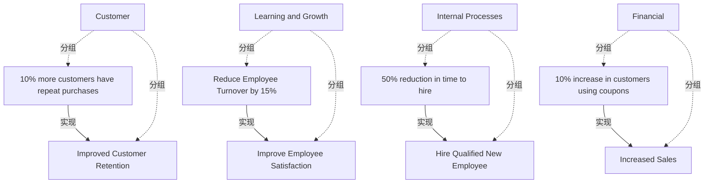

# G233/fig4-3 · 平衡计分卡

类型：`architecture-concept-or-system-model`。第 4.3.3 节说明平衡计分卡是“目标与可度量目的的来源”。作者把目标对齐到四个 BSC 维度，并把由某个目标实现的目的（度量/成果）链接到目标上，为后续能力规划提供可追踪的目标—成果链，也说明哪些能力实例的改进值得投入。

英文 PDF 物理页：[26]。本页为架构语义分析，原文与原图分别保留。

## 原图与可编辑图


[完整 JSON](fig4-3.json) · [可编辑 Mermaid](fig4-3.mmd) · [仅关系图](fig4-3.relations.mmd) · [层级分解图](fig4-3.hierarchy.mmd)

图形重建表达语义，不复制源图布局。虚线表示解释、矩阵映射或分组关系，不自动表示不确定性的概率。



## 架构分析

按四个象限读：左上客户、右上学习与成长、左下内部流程、右下财务。每个象限左侧是目标（Goals，同心圆靶心图标），右侧是带斜箭头的成果/度量（Outcomes，靶心带箭头图标）；虚线箭头一律从右侧度量指向左侧目标，表示“达到该度量即实现该目标”。

- 本图有 12 个具名或隐含元素、4 条关系和 8 条包含/分组记录。
- 包含/分组树最大深度为 1；根节点为 客户、学习与成长、内部流程、财务。
- 本图没有可直接确认为人员直属汇报的关系；视觉上下位置、能力分解和治理职责分别读取。
- 包含分组后有 4 个连通分量；分离可能源于图例、并列分类或独立示例，未自动补边。
- 4个虚线维度框、4个Goal和4个Outcome全部核对；4条虚线空心三角均由Outcome指向Goal。
- 原图百分数为复购客户增加10%、员工流失降低15%、招聘时间缩短50%、用券客户增加10%；原文未给基线或百分比点定义。
- 图中用券10%与第40页正文1%冲突，保持图中文字，并记录跨页差异而不自行择一覆盖。

### 如何用于项目

- 围绕作者目的读取本图实体、分组与连线，并用对应原文限定其含义。
- 把参考模型与项目事实分开，实际范围、约束、值和责任须有项目证据。

### 结构所表达的逻辑

- 4个虚线维度框、4个Goal和4个Outcome全部核对；4条虚线空心三角均由Outcome指向Goal。
- 原图百分数为复购客户增加10%、员工流失降低15%、招聘时间缩短50%、用券客户增加10%；原文未给基线或百分比点定义。
- 图中用券10%与第40页正文1%冲突，保持图中文字，并记录跨页差异而不自行择一覆盖。

## 上下级与包含

两层：4 个 BSC 维度（虚线容器）→ 每个维度下的一个目标与一个度量。目标与度量之间是“实现”关系，不是上下级；维度之间是并列视角，不是层级。

|父项|子项|层级类型|依据与解释|
|---|---|---|---|
|客户|提升客户留存|visual_grouping|框、泳道、域或分类组的成员归属；没有额外证据不提升为业务组合或管理关系。|
|客户|重复购买客户增加 10%|visual_grouping|框、泳道、域或分类组的成员归属；没有额外证据不提升为业务组合或管理关系。|
|学习与成长|提升员工满意度|visual_grouping|框、泳道、域或分类组的成员归属；没有额外证据不提升为业务组合或管理关系。|
|学习与成长|员工流失率降低 15%|visual_grouping|框、泳道、域或分类组的成员归属；没有额外证据不提升为业务组合或管理关系。|
|内部流程|招聘合格新员工|visual_grouping|框、泳道、域或分类组的成员归属；没有额外证据不提升为业务组合或管理关系。|
|内部流程|招聘时间缩短 50%|visual_grouping|框、泳道、域或分类组的成员归属；没有额外证据不提升为业务组合或管理关系。|
|财务|销售额增长|visual_grouping|框、泳道、域或分类组的成员归属；没有额外证据不提升为业务组合或管理关系。|
|财务|使用优惠券的客户增加 10%|visual_grouping|框、泳道、域或分类组的成员归属；没有额外证据不提升为业务组合或管理关系。|

## 全部元素与角色

|元素ID|原文名称|类型|含义|直接父项|深度|
|---|---|---|---|---|---|
|dim_customer|Customer|group|分组：客户|—||
|dim_learning|Learning and Growth|group|分组：学习与成长|—||
|dim_process|Internal Processes|group|分组：内部流程|—||
|dim_financial|Financial|group|分组：财务|—||
|goal_retention|Improved Customer Retention|goal|目标/成果：提升客户留存|客户|1|
|metric_repeat|10% more customers have repeat purchases|outcome|图中带目标箭头的Outcome记法，文本为预期变化幅度，不是实测结果或已验证KPI基线。|客户|1|
|goal_satisfaction|Improve Employee Satisfaction|goal|目标/成果：提升员工满意度|学习与成长|1|
|metric_turnover|Reduce Employee Turnover by 15%|outcome|图中带目标箭头的Outcome记法，文本为预期变化幅度，不是实测结果或已验证KPI基线。|学习与成长|1|
|goal_hire|Hire Qualified New Employee|goal|目标/成果：招聘合格新员工|内部流程|1|
|metric_time_to_hire|50% reduction in time to hire|outcome|图中带目标箭头的Outcome记法，文本为预期变化幅度，不是实测结果或已验证KPI基线。|内部流程|1|
|goal_sales|Increased Sales|goal|目标/成果：销售额增长|财务|1|
|metric_coupons|10% increase in customers using coupons|outcome|图中带目标箭头的Outcome记法，文本为预期变化幅度，不是实测结果或已验证KPI基线。|财务|1|

## 全部关系

四条虚线均带空心三角箭头，方向由右（度量/成果）指向左（目标），表示该可度量成果实现该目标（ArchiMate realization 的画法）；没有其他连线，维度之间不画关系。

|主体|语义关系|客体|显式线/隐式|原文标签|依据|
|---|---|---|---|---|---|
|重复购买客户增加 10%|实现|提升客户留存|显式连线||重复购买客户增加 10% 实现“提升客户留存”；箭头指向目标。|
|员工流失率降低 15%|实现|提升员工满意度|显式连线||员工流失率降低 15% 实现“提升员工满意度”；箭头指向目标。|
|招聘时间缩短 50%|实现|招聘合格新员工|显式连线||招聘时间缩短 50% 实现“招聘合格新员工”；箭头指向目标。|
|使用优惠券的客户增加 10%|实现|销售额增长|显式连线||使用优惠券的客户增加 10% 实现“销售额增长”；箭头指向目标。|

## 平衡计分卡四维度：目标与度量

```json
{
  "id": "t_bsc",
  "title_zh": "平衡计分卡四维度：目标与度量",
  "columns": [
    "维度",
    "目标（Goal）",
    "目的/度量（Outcome）"
  ],
  "rows": [
    [
      "Customer 客户",
      "Improved Customer Retention 提升客户留存",
      "10% more customers have repeat purchases 重复购买客户增加 10%"
    ],
    [
      "Learning and Growth 学习与成长",
      "Improve Employee Satisfaction 提升员工满意度",
      "Reduce Employee Turnover by 15% 员工流失率降低 15%"
    ],
    [
      "Internal Processes 内部流程",
      "Hire Qualified New Employee 招聘合格新员工",
      "50% reduction in time to hire 招聘时间缩短 50%"
    ],
    [
      "Financial 财务",
      "Increased Sales 销售额增长",
      "10% increase in customers using coupons 使用优惠券的客户增加 10%"
    ]
  ],
  "notes_zh": "每行的虚线箭头均由右列（度量）指向左列（目标）。"
}
```

## 误读检查

- 这些百分数是模型里的预期成果，不是实测数值。
- 用券客户增长图中10%与后文1%冲突，不应静默统一或视为已核准目标。

## 原文证据

### [PDF 第 25 页](../../../documents/G233.md#page-25)

> In Figure 4-3, objectives have been aligned to each of the balanced scorecard dimensions. Goals that are realized by a particular objective have also been linked.
### [PDF 第 26 页](../../../documents/G233.md#page-26)

> Understanding your organization’s application catalog and how information objects are or are not exchanged between applications is a key piece of homework that will help during the analysis stage of business capability planning.
> The following applications are used in this retail organization to instantiate the business capabilities required for the Acquire Retail Product Online value stream:
### [PDF 第 40 页](../../../documents/G233.md#page-40)

> This document was written during the COVID pandemic.[1] The innovation that occurred and continues to occur based on the pandemic is one of the largest step changes in the world in many years. The world of retail was no exception. Organizations that did not have an online fulfillment mechanism either created that new value stream or they perished. Physical retail stores have added customer pickup and other mechanisms to reduce physical interactions as a new option.
> Enterprise Architects at organizations can use the techniques described in this document to imagine new value streams that leverage existing business capability instances where they are available and facilitate the development of new or improved business capability instances where needed to allow for the new value stream to execute successfully.

## 来源与分析状态

所有元素/关系均有来源定位；未把历史解释重命名为本轮逐线视觉确认。源图与语义图是两种视图，布局不证明汇报或因果。

源 PDF SHA-256：`d5c62f9edb2465d10e59f0a1c9c23fb5d8a0b14e506cf7739a09886fbee07754`。

源图记录：[原始解释与转录](../../../figures/G233/fig4-3.json)。

```json
{
  "quality": {
    "graph_integrity": "checked",
    "semantic_analysis": "typed-graph-and-context-analysis",
    "visual_review": "source-content-audited",
    "notice_zh": "所有元素/关系均有来源定位；未把历史解释重命名为本轮逐线视觉确认。源图与语义图是两种视图，布局不证明汇报或因果。"
  },
  "source_uncertainty": {
    "confidence": "high",
    "uncertainties_zh": [
      "四个维度的排列顺序（客户、学习与成长在上，内部流程、财务在下）不是经典 BSC 的因果链顺序，图上也没有维度间连线，无法判断作者是否想表达因果。",
      "中文稿第 7.1 节（L651）把“使用优惠券的人数增加”写作 1%，本图为 10%；以图为准记录，差异写入 misreadings。",
      "中文 PNG 的灰色块是本地化渲染瑕疵，原图无此元素；其位置与“Reduce Employee Turnover by 15%”框重合。"
    ],
    "analyzed_from": [
      "英文 PDF 第 26 页图 4-3 截图（figctx 裁剪）与 2×2 放大分块",
      "英文 PDF 第 25–26 页正文",
      "中文稿 G233e_业务能力规划.md 第 300–326 行（含 12 条图内标签对照）",
      "figs/g233e_fig4-3_en.png 与 figs/zh/g233e_fig4-3_zh.png"
    ],
    "date": "2026-10-31"
  },
  "source_conflicts": []
}
```
