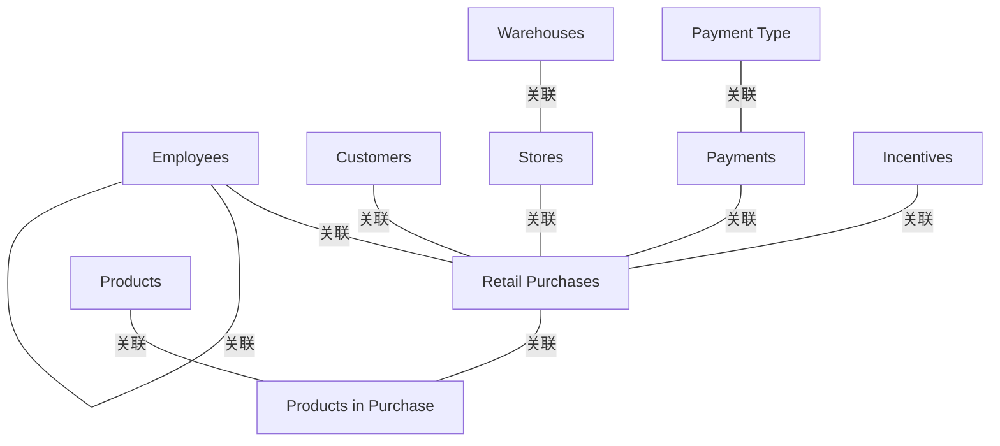

# G233/fig4-4 · 业务对象视图

类型：`architecture-metamodel`。第 4.4.2 节说明：概念数据模型就是业务对象及其关系的集合，很多行业标准模型可直接借用；这张业务对象视图是“简化零售概念数据模型”的基础，用来在考察能力实例时理解应用所拥有的信息对象，并为第 4.4.3 节的应用信息交换目录提供对象清单。

英文 PDF 物理页：[27]。本页为架构语义分析，原文与原图分别保留。

## 原图与可编辑图


[完整 JSON](fig4-4.json) · [可编辑 Mermaid](fig4-4.mmd) · [仅关系图](fig4-4.relations.mmd) · [层级分解图](fig4-4.hierarchy.mmd)

图形重建表达语义，不复制源图布局。虚线表示解释、矩阵映射或分组关系，不自动表示不确定性的概率。



## 架构分析

从画面中央的 Retail Purchases（零售购买）读起：它向上连员工、向左连客户与支付、向右连门店与购买中的产品、向下连激励。每条连线两端读基数：靠实体一侧的竖线=1，小圆圈=0（可选），鸦爪=多。再读两条链：Products in Purchase→Products、Payments→Payment Type；最后看 Employees 右上角的自我关联环。

- 本图有 10 个具名或隐含元素、10 条关系和 0 条包含/分组记录。
- 本图没有可直接确认为人员直属汇报的关系；视觉上下位置、能力分解和治理职责分别读取。
- 10个具名业务对象及10条关联逐项核对；Employee自环没有关系名，不能由此确认经理—下属。
- 旧单一1:N字段掩盖可选性与端点方向；改为from/to端分别保存0..1、0..*、1或未标。
- Retail Purchases—Products in Purchase及Retail Purchases—Stores的符号方向按源图保留，不按常识“修正”原图。

### 如何用于项目

- 使用本图的实体类型作为建模词表，建立本地实体ID，再分别填入关系端点与证据。
- 核对主动/被动关系的语义方向和基数；实现、使能、使用、包含及实例化分别建模。

### 结构所表达的逻辑

- 10个具名业务对象及10条关联逐项核对；Employee自环没有关系名，不能由此确认经理—下属。
- 旧单一1:N字段掩盖可选性与端点方向；改为from/to端分别保存0..1、0..*、1或未标。
- Retail Purchases—Products in Purchase及Retail Purchases—Stores的符号方向按源图保留，不按常识“修正”原图。

## 上下级与包含

没有上下级层级，只有实体间的基数关联。Retail Purchases 处于星型中心；Products in Purchase 是 Products 与 Retail Purchases 之间的关联实体；Payment Type 是 Payments 的查找实体；Warehouses 是 Stores 的上游主数据。

|父项|子项|层级类型|依据与解释|
|---|---|---|---|
|—|—|无视觉包含|关系中明确的组成/特化见 JSON semantic_hierarchy。|

## 全部元素与角色

|元素ID|原文名称|类型|含义|直接父项|深度|
|---|---|---|---|---|---|
|employees|Employees|data|信息/数据：员工|—||
|customers|Customers|data|信息/数据：客户|—||
|retail_purchases|Retail Purchases|data|交易事实实体，连接最多（6 条）。|—||
|stores|Stores|data|信息/数据：门店|—||
|warehouses|Warehouses|data|信息/数据：仓库|—||
|payments|Payments|data|信息/数据：支付|—||
|payment_type|Payment Type|data|信息/数据：支付类型|—||
|products_in_purchase|Products in Purchase|data|购买行/关联实体，连接 Retail Purchases 与 Products。|—||
|products|Products|data|信息/数据：产品|—||
|incentives|Incentives|data|信息/数据：激励|—||

## 全部关系

所有关系为无箭头关联；圆圈=0，短竖线=1，鸦爪=多。端点基数仅按可见符号抄录；未显示的端点保持null，不假定1。

|主体|语义关系|客体|显式线/隐式|原文标签|依据|
|---|---|---|---|---|---|
|客户|关联|零售购买|显式连线||逐端点读原图：customers端=1；retail_purchases端=0..*。|
|员工|关联|零售购买|显式连线||逐端点读原图：employees端=0..1；retail_purchases端=0..*。|
|支付|关联|零售购买|显式连线||逐端点读原图：payments端=0..1；retail_purchases端=0..*。原图基数与常见零售直觉可能不同，保留字面符号并要求业务核实。|
|激励|关联|零售购买|显式连线||逐端点读原图：incentives端=1；retail_purchases端=0..*。|
|支付类型|关联|支付|显式连线||逐端点读原图：payment_type端=1；payments端=0..*。|
|仓库|关联|门店|显式连线||逐端点读原图：warehouses端=1；stores端=0..*。|
|产品|关联|购买中的产品|显式连线||逐端点读原图：products端=0..1；products_in_purchase端=0..*。原图基数与常见零售直觉可能不同，保留字面符号并要求业务核实。|
|零售购买|关联|购买中的产品|显式连线||逐端点读原图：retail_purchases端=0..*；products_in_purchase端=0..1。原图基数与常见零售直觉可能不同，保留字面符号并要求业务核实。|
|门店|关联|零售购买|显式连线||逐端点读原图：stores端=0..*；retail_purchases端=1。原图基数与常见零售直觉可能不同，保留字面符号并要求业务核实。|
|员工|关联|员工|显式连线||逐端点读原图：employees端=未标；employees端=0..*。原图基数与常见零售直觉可能不同，保留字面符号并要求业务核实。|

### 极性、基数与图文冲突

数值和符号按原图记录；业务解释与原图冲突时分别保存，不静默修正原文。

|关系ID|极性|基数/端点标记|冲突说明|
|---|---|---|---|
|G233/fig4-4#r0001||{"from": "1", "to": "0..*", "basis": "literal-source-endpoint-notation", "notice_zh": "每个值描述该实体所在端的可见基数，不以业务直觉交换两端。"}||
|G233/fig4-4#r0002||{"from": "0..1", "to": "0..*", "basis": "literal-source-endpoint-notation", "notice_zh": "每个值描述该实体所在端的可见基数，不以业务直觉交换两端。"}||
|G233/fig4-4#r0003||{"from": "0..1", "to": "0..*", "basis": "literal-source-endpoint-notation", "notice_zh": "每个值描述该实体所在端的可见基数，不以业务直觉交换两端。"}||
|G233/fig4-4#r0004||{"from": "1", "to": "0..*", "basis": "literal-source-endpoint-notation", "notice_zh": "每个值描述该实体所在端的可见基数，不以业务直觉交换两端。"}||
|G233/fig4-4#r0005||{"from": "1", "to": "0..*", "basis": "literal-source-endpoint-notation", "notice_zh": "每个值描述该实体所在端的可见基数，不以业务直觉交换两端。"}||
|G233/fig4-4#r0006||{"from": "1", "to": "0..*", "basis": "literal-source-endpoint-notation", "notice_zh": "每个值描述该实体所在端的可见基数，不以业务直觉交换两端。"}||
|G233/fig4-4#r0007||{"from": "0..1", "to": "0..*", "basis": "literal-source-endpoint-notation", "notice_zh": "每个值描述该实体所在端的可见基数，不以业务直觉交换两端。"}||
|G233/fig4-4#r0008||{"from": "0..*", "to": "0..1", "basis": "literal-source-endpoint-notation", "notice_zh": "每个值描述该实体所在端的可见基数，不以业务直觉交换两端。"}||
|G233/fig4-4#r0009||{"from": "0..*", "to": "1", "basis": "literal-source-endpoint-notation", "notice_zh": "每个值描述该实体所在端的可见基数，不以业务直觉交换两端。"}||
|G233/fig4-4#r0010||{"from": null, "to": "0..*", "basis": "literal-source-endpoint-notation", "notice_zh": "每个值描述该实体所在端的可见基数，不以业务直觉交换两端。"}||

## 本轮语义修正

- 逐端点读原图：customers端=1；retail_purchases端=0..*。
- 逐端点读原图：employees端=0..1；retail_purchases端=0..*。
- 逐端点读原图：payments端=0..1；retail_purchases端=0..*。原图基数与常见零售直觉可能不同，保留字面符号并要求业务核实。
- 逐端点读原图：incentives端=1；retail_purchases端=0..*。
- 逐端点读原图：payment_type端=1；payments端=0..*。
- 逐端点读原图：warehouses端=1；stores端=0..*。
- 逐端点读原图：products端=0..1；products_in_purchase端=0..*。原图基数与常见零售直觉可能不同，保留字面符号并要求业务核实。
- 逐端点读原图：retail_purchases端=0..*；products_in_purchase端=0..1。原图基数与常见零售直觉可能不同，保留字面符号并要求业务核实。
- 逐端点读原图：stores端=0..*；retail_purchases端=1。原图基数与常见零售直觉可能不同，保留字面符号并要求业务核实。
- 逐端点读原图：employees端=未标；employees端=0..*。原图基数与常见零售直觉可能不同，保留字面符号并要求业务核实。

## 误读检查

- 概念数据模型示例不是经过业务验证的生产数据模型。
- 端点基数与通用业务预期有冲突时，必须回原图和业务要求确认，不覆盖源符号。
- 员工自环未给业务标签，不可作为人事汇报依据。

## 原文证据

### [PDF 第 24 页](../../../documents/G233.md#page-24)

> There are usually many tangible business objects that are core to the way a business operates. Many of these business objects are also manifested in one or more applications as key data elements. Here is a sample of retail-oriented business objects:
> • Financial receipt: A record of the transfer of funds between the retailer and customer
### [PDF 第 26 页](../../../documents/G233.md#page-26)

> Understanding your organization’s application catalog and how information objects are or are not exchanged between applications is a key piece of homework that will help during the analysis stage of business capability planning.
> The following applications are used in this retail organization to instantiate the business capabilities required for the Acquire Retail Product Online value stream:
### [PDF 第 27 页](../../../documents/G233.md#page-27)

> With the advent of Enterprise Resource Planning (ERP) and data warehouses, there are many industry standard data or information models that are available that could be useful in creating your business capability catalog. Most conceptual data models are a collection of business objects with relationships between them. The following view of business objects (Figure 4-4) provides the basis for a simplified retail conceptual data model.
### [PDF 第 28 页](../../../documents/G233.md#page-28)

> Armed with an application catalog and the conceptual data model, the assessment of how information is exchanged both transactionally and operationally can be completed. It is important to look at all forms of information exchange. At this level of analysis the mechanism by which the data is moved between applications is not as relevant.
> Table 4-1 provides a few examples of what this catalog might look like.

## 来源与分析状态

所有元素/关系均有来源定位；未把历史解释重命名为本轮逐线视觉确认。源图与语义图是两种视图，布局不证明汇报或因果。

源 PDF SHA-256：`d5c62f9edb2465d10e59f0a1c9c23fb5d8a0b14e506cf7739a09886fbee07754`。

源图记录：[原始解释与转录](../../../figures/G233/fig4-4.json)。

```json
{
  "quality": {
    "graph_integrity": "checked",
    "semantic_analysis": "typed-graph-and-context-analysis",
    "visual_review": "source-content-audited",
    "notice_zh": "所有元素/关系均有来源定位；未把历史解释重命名为本轮逐线视觉确认。源图与语义图是两种视图，布局不证明汇报或因果。"
  },
  "source_uncertainty": {
    "confidence": "medium",
    "uncertainties_zh": [
      "门店—零售购买、零售购买—购买中的产品两处鸦爪画在父端，字面基数与零售语义相反；无法确认是建模错误还是特殊业务规则，本分析按语义记 1:N 并在描述中标出画面差异。",
      "员工自关联环没有关系名，无法确定是“管理”“汇报”还是其他关系；另一端未画基数，1:N 是从鸦爪端推断的。",
      "英文 PDF 第 27 页图上有“Evaluation Copy”斜向水印，部分连线/符号被遮挡；基数符号本身仍可辨认，但不排除个别端点被水印干扰。",
      "圆圈在这些连线上表示 0（可选），本分析据此把员工/支付端读为 0..1；若把圆圈当作绘图工具端点符号，则这两条会变成 1:N。"
    ],
    "analyzed_from": [
      "英文 PDF 第 27 页图 4-4 截图（figctx 裁剪）、3×3 放大分块及端点高倍裁剪",
      "英文 PDF 第 24、27 页正文",
      "中文稿 G233e_业务能力规划.md 第 345–368 行（含 10 条图内标签对照）",
      "figs/g233e_fig4-4_en.png、figs/zh/g233e_fig4-4_zh.png 与 figs/zh/g233e_fig4-4_zh.svg 源码"
    ],
    "date": "2026-10-31"
  },
  "source_conflicts": []
}
```
