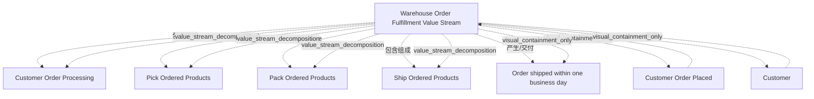

# G233/fig5-1 · 价值流阶段示例（仓库订单履约价值流）

类型：`process-or-method-model`。第 5.1.2 节用具体例子说明“价值流阶段”是什么：利益相关者价值很少由单一步骤产生，而是由一串顺序/并行的阶段逐步累加。作者把触发、利益相关者、阶段序列与最终成果放在同一个价值流框内，给读者一个可套用的模板。

英文 PDF 物理页：[31]。本页为架构语义分析，原文与原图分别保留。

## 原图与可编辑图


[完整 JSON](fig5-1.json) · [可编辑 Mermaid](fig5-1.mmd) · [仅关系图](fig5-1.relations.mmd) · [层级分解图](fig5-1.hierarchy.mmd)

图形重建表达语义，不复制源图布局。虚线表示解释、矩阵映射或分组关系，不自动表示不确定性的概率。



## 架构分析

先看沙色大框的标题“Warehouse Order Fulfillment Value Stream”，它界定范围；左上黄框是触发事件（客户下单），其右紫框是接收价值的利益相关者（客户）；中间一排白色 V 形框从左到右是四个阶段；右下紫八边形是价值流成功结束时交付的成果/价值项。全图没有连线，顺序由左右位置表达。

- 本图有 8 个具名或隐含元素、7 条关系和 7 条包含/分组记录。
- 包含/分组树最大深度为 1；根节点为 仓库订单履约价值流。
- 本图没有可直接确认为人员直属汇报的关系；视觉上下位置、能力分解和治理职责分别读取。
- 8个标签核对：1价值流、1触发事件、1客户、4个阶段、1个一天内发货成果。
- 所有7条语义关系来自框内归属及正文，图中没有独立连线。
- 正文明确价值流可以在阶段间停止；不能把四阶段的水平排列理解成必须连续不停地执行。

### 如何用于项目

- 按阶段/事件/行为关系读取入口、出口、责任和产物；检查循环与例外路径。
- 工作流先后不表示组织管理权；在项目中显式记录条件和完成标准。

### 结构所表达的逻辑

- 价值流由四个阶段组成，顺序为：Customer Order Processing（客户订单处理）→ Pick Ordered Products（拣选所订产品）→ Pack Ordered Products（包装所订产品）→ Ship Ordered Products（发运所订产品）。
- 触发是一个业务事件“Customer Order Placed（客户下单）”，不是客户本身；Customer（客户）是接收价值的利益相关者，两者在图中分开画。
- 成果写成可判定的终态“Order shipped within one business day（订单在一个工作日内发运）”，既是价值项也可直接作为最后阶段的退出标准。
- 价值流是一个整体容器：触发事件、利益相关者、四个阶段与成果都在同一个沙色框内，表示它们属于同一条价值流。
- 图中只画了阶段名称，没有画每个阶段的描述、进入标准、退出标准；正文说明这些字段在模型中另行记录，图只是结构示意。
- 图题虽为“Example Value Stream Stage”，实际画的是“一条价值流及其阶段序列”，用于说明单个阶段所处的上下文，而不是某个阶段的字段明细。
- 阶段框与价值流容器右上角用 V 形（chevron）图标，成果用靶心带箭头图标；这与图 3-1 的 Value Stream/Stage 与 Outcome 记法一致。
- 正文提醒价值流不一定连续流动，可在任一阶段因未产生所需价值而停止；本图没有画停止/分支路径，只给顺序主线。

## 上下级与包含

三层：价值流（沙色容器）→ 4 个价值流阶段（白框，同级并列）；触发事件与利益相关者是价值流的输入/参与要素，成果是价值流的输出，二者都不是阶段的子级。

|父项|子项|层级类型|依据与解释|
|---|---|---|---|
|仓库订单履约价值流|客户下单|visual_containment_only|保存原图解释中的包含；业务关系类型需要图例或正文进一步限定。|
|仓库订单履约价值流|客户|visual_containment_only|保存原图解释中的包含；业务关系类型需要图例或正文进一步限定。|
|仓库订单履约价值流|客户订单处理|value_stream_decomposition|价值流包含阶段；具体先后另看sequence关系。|
|仓库订单履约价值流|拣选所订产品|value_stream_decomposition|价值流包含阶段；具体先后另看sequence关系。|
|仓库订单履约价值流|包装所订产品|value_stream_decomposition|价值流包含阶段；具体先后另看sequence关系。|
|仓库订单履约价值流|发运所订产品|value_stream_decomposition|价值流包含阶段；具体先后另看sequence关系。|
|仓库订单履约价值流|订单在一个工作日内发运|visual_containment_only|保存原图解释中的包含；业务关系类型需要图例或正文进一步限定。|

### 业务组成与特化

|父项/范围/类型|子项/责任对象/实例|语义|
|---|---|---|
|仓库订单履约价值流|客户订单处理|composition|
|仓库订单履约价值流|拣选所订产品|composition|
|仓库订单履约价值流|包装所订产品|composition|
|仓库订单履约价值流|发运所订产品|composition|

## 全部元素与角色

|元素ID|原文名称|类型|含义|直接父项|深度|
|---|---|---|---|---|---|
|vs_warehouse|Warehouse Order Fulfillment Value Stream|value_stream|价值流：仓库订单履约价值流|—||
|ev_order_placed|Customer Order Placed|event|触发整条价值流的业务事件。|仓库订单履约价值流|1|
|st_customer|Customer|stakeholder|接收价值流所交付价值的利益相关者，不是执行者。|仓库订单履约价值流|1|
|stg_order_processing|Customer Order Processing|value_stream_stage|价值流阶段：客户订单处理|仓库订单履约价值流|1|
|stg_pick|Pick Ordered Products|value_stream_stage|价值流阶段：拣选所订产品|仓库订单履约价值流|1|
|stg_pack|Pack Ordered Products|value_stream_stage|价值流阶段：包装所订产品|仓库订单履约价值流|1|
|stg_ship|Ship Ordered Products|value_stream_stage|价值流阶段：发运所订产品|仓库订单履约价值流|1|
|out_shipped|Order shipped within one business day|outcome|价值项/成果，同时充当退出标准。|仓库订单履约价值流|1|

## 全部关系

图中没有任何连线。阶段先后由从左到右的排列表达；阶段属于该价值流由“位于沙色框内”表达；事件位于起点表示触发整条价值流；成果位于最后阶段下方表示由该价值流产出。这些关系在清单中标为 implicit。

|主体|语义关系|客体|显式线/隐式|原文标签|依据|
|---|---|---|---|---|---|
|客户下单|触发|仓库订单履约价值流|implicit||事件/成果通过嵌套和位置表达；右上角符号是元素记法，图中无连接箭头。|
|客户|关联|仓库订单履约价值流|implicit||客户是接收价值流的利益相关者。|
|仓库订单履约价值流|包含组成|客户订单处理|implicit||阶段画在价值流容器内，表示被该价值流包含。|
|仓库订单履约价值流|包含组成|拣选所订产品|implicit||包含组成|
|仓库订单履约价值流|包含组成|包装所订产品|implicit||包含组成|
|仓库订单履约价值流|包含组成|发运所订产品|implicit||包含组成|
|仓库订单履约价值流|产生/交付|订单在一个工作日内发运|implicit||事件/成果通过嵌套和位置表达；右上角符号是元素记法，图中无连接箭头。|

## 本轮语义修正

- 事件/成果通过嵌套和位置表达；右上角符号是元素记法，图中无连接箭头。
- 事件/成果通过嵌套和位置表达；右上角符号是元素记法，图中无连接箭头。

## 误读检查

- 不要把四个阶段读成四个部门或四个应用系统；它们是价值流阶段（增值活动序列）。
- 不要因为“Customer Order Placed”在 Customer Order Processing 上方，就以为它只触发第一个阶段；正文说业务事件至少触发价值流，也可触发阶段，本图表达的是触发整条价值流。
- 不要把“Customer”当成执行者；它是接收价值的利益相关者，执行者在该价值流中并未画出。
- 不要把右下紫色八边形当成第五个阶段；它是成果/价值项（Order shipped within one business day）。
- 不要把本图当作单个阶段的完整规格；它没有描述、进入/退出标准等字段，只是阶段上下文示意。
- 中文 PNG 的标题字号比原图小，但阶段名与成果文字完整，不能据此认为标题缺失。

## 原文证据

### [PDF 第 30 页](../../../documents/G233.md#page-30)

> Stakeholder value is rarely produced as the result of a single step or activity. More often, value is achieved through a series of sequential and/or parallel actions, or value stream stages, that incrementally create and add stakeholder value from one stage to the next; see Figure 5-1.
### [PDF 第 31 页](../../../documents/G233.md#page-31)

> • Exit Criteria: The end state condition that denotes the completion of the value stream stage (i.e., when the required value has been created or delivered to the stakeholders); in many instances the stage name and the exit criteria are almost identical
> • Value Item: The incremental value that is created or delivered to the participating stakeholder(s) by the value stream stage

## 来源与分析状态

所有元素/关系均有来源定位；未把历史解释重命名为本轮逐线视觉确认。源图与语义图是两种视图，布局不证明汇报或因果。

源 PDF SHA-256：`d5c62f9edb2465d10e59f0a1c9c23fb5d8a0b14e506cf7739a09886fbee07754`。

源图记录：[原始解释与转录](../../../figures/G233/fig5-1.json)。

```json
{
  "quality": {
    "graph_integrity": "checked",
    "semantic_analysis": "typed-graph-and-context-analysis",
    "visual_review": "source-content-audited",
    "notice_zh": "所有元素/关系均有来源定位；未把历史解释重命名为本轮逐线视觉确认。源图与语义图是两种视图，布局不证明汇报或因果。"
  },
  "source_uncertainty": {
    "confidence": "high",
    "uncertainties_zh": [
      "图中未画阶段间连线，是否存在并行/循环无法从图上判断；按从左到右记录为顺序。",
      "成果八边形带 Outcome（靶心带箭头）图标，按其作为退出标准/价值项的角色记为 goal 类型，而非独立的价值元素。",
      "中文 PNG 的容器标题字号/字重较原图弱，属于本地化排版差异，不影响结构判断。"
    ],
    "analyzed_from": [
      "英文 PDF 第 31 页图 5-1 截图（figctx 裁剪）与 2×2 放大分块",
      "英文 PDF 第 30–31 页正文",
      "中文稿 G233e_业务能力规划.md 第 425–445 行（含 8 条图内标签对照）",
      "figs/g233e_fig5-1_en.png 与 figs/zh/g233e_fig5-1_zh.png"
    ],
    "date": "2026-10-31"
  },
  "source_conflicts": []
}
```
