# G233/fig6-1 · 业务能力目录模型（示例）

类型：`decomposition-or-organization-model`。第 6.2.1 节给出能力目录的可视化样例：目录应覆盖组织运作所需的全部能力，并按类别/视角逻辑分组以便导航；同时用嵌套展示“一级能力—二级能力”的分解，示范目录要大到足够包容、小到可被有效导航。

英文 PDF 物理页：[35]。本页为架构语义分析，原文与原图分别保留。

## 原图与可编辑图


[完整 JSON](fig6-1.json) · [可编辑 Mermaid](fig6-1.mmd) · [仅关系图](fig6-1.relations.mmd) · [层级分解图](fig6-1.hierarchy.mmd)

图形重建表达语义，不复制源图布局。虚线表示解释、矩阵映射或分组关系，不自动表示不确定性的概率。

```mermaid
flowchart TB
  %% Semantic reconstruction; see original source image for exact layout.
  n0["Retail Storefront"]
  n1["Strategic"]
  n2["Operations (Core)"]
  n3["Basket Management"]
  n4["Catalog Products"]
  n5["Incentive Management"]
  n6["Store Layout Management"]
  n7["Customer Relationship Management"]
  n8["Business Planning"]
  n9["Market Research"]
  n10["Product Development"]
  n11["Program Management"]
  n12["Schedule Management"]
  n13["Risk Management"]
  n14["Identity Management"]
  n15["Contract Management"]
  n16["Business Planning"]
  n17["Human Resource Management"]
  n18["HR Position Management"]
  n19["Job Posting"]
  n20["Skills Assessment"]
  n21["Benefits Management"]
  n22["Finance Management"]
  n23["Payroll Management"]
  n24["Payment Processing"]
  n25["Delivery Management"]
  n26["Inventory Management"]
  n11 -.->|"包含组成"| n12
  n13 -.->|"包含组成"| n14
  n17 -.->|"包含组成"| n18
  n17 -.->|"包含组成"| n19
  n17 -.->|"包含组成"| n20
  n17 -.->|"包含组成"| n21
  n22 -.->|"包含组成"| n23
  n22 -.->|"包含组成"| n24
  n0 -.->|"分组"| n3
  n0 -.->|"分组"| n4
  n0 -.->|"分组"| n5
  n0 -.->|"分组"| n6
  n0 -.->|"分组"| n7
  n1 -.->|"分组"| n8
  n1 -.->|"分组"| n9
  n1 -.->|"分组"| n10
  n1 -.->|"分组"| n11
  n11 -.->|"capability_decomposition"| n12
  n1 -.->|"分组"| n13
  n13 -.->|"capability_decomposition"| n14
  n1 -.->|"分组"| n15
  n1 -.->|"分组"| n16
  n2 -.->|"分组"| n17
  n17 -.->|"capability_decomposition"| n18
  n17 -.->|"capability_decomposition"| n19
  n17 -.->|"capability_decomposition"| n20
  n17 -.->|"capability_decomposition"| n21
  n2 -.->|"分组"| n22
  n22 -.->|"capability_decomposition"| n23
  n22 -.->|"capability_decomposition"| n24
  n2 -.->|"分组"| n25
  n2 -.->|"分组"| n26
```



## 架构分析

从左到右读三个灰色分类带：Retail Storefront（门店前台）、Strategic（战略）、Operations (Core)（运营核心）。每个沙色框是一个一级业务能力；框内白色小框是其下的二级能力（如 Program Management 下的 Schedule Management）。分类带只表示目录分组，不表示流程或组织层级；全图没有箭头。

- 本图有 27 个具名或隐含元素、8 条关系和 24 条包含/分组记录。
- 包含/分组树最大深度为 2；根节点为 零售前台、战略、运营（核心）。
- 本图没有可直接确认为人员直属汇报的关系；视觉上下位置、能力分解和治理职责分别读取。
- 包含分组后有 3 个连通分量；分离可能源于图例、并列分类或独立示例，未自动补边。
- 3个真实灰色分类框、16个一级能力及8个二级能力，共27个节点完整。
- Strategic区域中的Business Planning确实出现两次，保留两个位置的记录，不擅自删重或改名。
- 8条父子能力组成关系均来自实际嵌套，无连接箭头；与三大分类归属区别保存。

### 如何用于项目

- 按父项展开所有直接子项，检查同层粒度、重叠和缺项。
- 保留组成、分类、能力分解与组织汇报的区别；将示例名称替换为已确认的项目对象。

### 结构所表达的逻辑

- 目录分三类：Retail Storefront 5 个一级能力（无二级）；Strategic 7 个一级能力（含重复的 Business Planning）＋2 个二级能力；Operations (Core) 4 个一级能力＋6 个二级能力。
- Retail Storefront 的五项是 Basket Management、Catalog Products、Incentive Management、Store Layout Management、Customer Relationship Management，都直接面向线上/门店购物体验。
- Strategic 含 Business Planning、Market Research、Product Development、Program Management（下含 Schedule Management）、Risk Management（下含 Identity Management）、Contract Management，以及第二个同名的 Business Planning 框。
- Operations (Core) 含 Human Resource Management（下含 HR Position Management、Job Posting、Skills Assessment、Benefits Management）、Finance Management（下含 Payroll Management、Payment Processing）、Delivery Management、Inventory Management。
- “Business Planning”在原图中出现两次（Strategic 左上与右中），两个框同名同级；更像原图的重复放置，而不是两个不同的能力，读图时不应据此推断存在两个业务规划能力。
- Identity Management 被嵌套在 Risk Management 之下，而不是单列；这是示例作者的归类选择，不应理解为“身份管理必然属于风险管理”。
- 二级能力只在需要说明分解时出现：Program Management、Risk Management、Human Resource Management、Finance Management 有下级；其余一级能力不再下钻。
- 目录是说明性示例，不是完整清单；正文提醒目录超过 100 项时，很可能把能力实例、实例组件或价值流阶段误当成能力。

## 上下级与包含

三层：3 个目录分类（灰色带）→ 16 个一级能力框（Business Planning 重复一次，按 15 个唯一名称计）→ 8 个二级能力（白色小框）。分类是导航分组，不是能力上下级；能力上下级只由框套框表达。

|父项|子项|层级类型|依据与解释|
|---|---|---|---|
|零售前台|购物篮管理|visual_grouping|框、泳道、域或分类组的成员归属；没有额外证据不提升为业务组合或管理关系。|
|零售前台|产品编目|visual_grouping|框、泳道、域或分类组的成员归属；没有额外证据不提升为业务组合或管理关系。|
|零售前台|激励管理|visual_grouping|框、泳道、域或分类组的成员归属；没有额外证据不提升为业务组合或管理关系。|
|零售前台|门店布局管理|visual_grouping|框、泳道、域或分类组的成员归属；没有额外证据不提升为业务组合或管理关系。|
|零售前台|客户关系管理|visual_grouping|框、泳道、域或分类组的成员归属；没有额外证据不提升为业务组合或管理关系。|
|战略|业务规划|visual_grouping|框、泳道、域或分类组的成员归属；没有额外证据不提升为业务组合或管理关系。|
|战略|市场研究|visual_grouping|框、泳道、域或分类组的成员归属；没有额外证据不提升为业务组合或管理关系。|
|战略|产品开发|visual_grouping|框、泳道、域或分类组的成员归属；没有额外证据不提升为业务组合或管理关系。|
|战略|项目群管理|visual_grouping|框、泳道、域或分类组的成员归属；没有额外证据不提升为业务组合或管理关系。|
|项目群管理|进度管理|capability_decomposition|同类能力的包含分解；能力实例与能力类型另以实例化关系记录。|
|战略|风险管理|visual_grouping|框、泳道、域或分类组的成员归属；没有额外证据不提升为业务组合或管理关系。|
|风险管理|身份管理|capability_decomposition|同类能力的包含分解；能力实例与能力类型另以实例化关系记录。|
|战略|合同管理|visual_grouping|框、泳道、域或分类组的成员归属；没有额外证据不提升为业务组合或管理关系。|
|战略|业务规划|visual_grouping|框、泳道、域或分类组的成员归属；没有额外证据不提升为业务组合或管理关系。|
|运营（核心）|人力资源管理|visual_grouping|框、泳道、域或分类组的成员归属；没有额外证据不提升为业务组合或管理关系。|
|人力资源管理|人力资源岗位管理|capability_decomposition|同类能力的包含分解；能力实例与能力类型另以实例化关系记录。|
|人力资源管理|职位发布|capability_decomposition|同类能力的包含分解；能力实例与能力类型另以实例化关系记录。|
|人力资源管理|技能评估|capability_decomposition|同类能力的包含分解；能力实例与能力类型另以实例化关系记录。|
|人力资源管理|福利管理|capability_decomposition|同类能力的包含分解；能力实例与能力类型另以实例化关系记录。|
|运营（核心）|财务管理|visual_grouping|框、泳道、域或分类组的成员归属；没有额外证据不提升为业务组合或管理关系。|
|财务管理|薪资管理|capability_decomposition|同类能力的包含分解；能力实例与能力类型另以实例化关系记录。|
|财务管理|支付处理|capability_decomposition|同类能力的包含分解；能力实例与能力类型另以实例化关系记录。|
|运营（核心）|交付管理|visual_grouping|框、泳道、域或分类组的成员归属；没有额外证据不提升为业务组合或管理关系。|
|运营（核心）|库存管理|visual_grouping|框、泳道、域或分类组的成员归属；没有额外证据不提升为业务组合或管理关系。|

### 业务组成与特化

|父项/范围/类型|子项/责任对象/实例|语义|
|---|---|---|
|项目群管理|进度管理|composition|
|风险管理|身份管理|composition|
|人力资源管理|人力资源岗位管理|composition|
|人力资源管理|职位发布|composition|
|人力资源管理|技能评估|composition|
|人力资源管理|福利管理|composition|
|财务管理|薪资管理|composition|
|财务管理|支付处理|composition|

## 全部元素与角色

|元素ID|原文名称|类型|含义|直接父项|深度|
|---|---|---|---|---|---|
|cat_storefront|Retail Storefront|group|分组：零售前台|—||
|cat_strategic|Strategic|group|分组：战略|—||
|cat_operations|Operations (Core)|group|分组：运营（核心）|—||
|cap_basket|Basket Management|capability|能力：购物篮管理|零售前台|1|
|cap_catalog_products|Catalog Products|capability|能力：产品编目|零售前台|1|
|cap_incentive|Incentive Management|capability|能力：激励管理|零售前台|1|
|cap_store_layout|Store Layout Management|capability|能力：门店布局管理|零售前台|1|
|cap_crm|Customer Relationship Management|capability|能力：客户关系管理|零售前台|1|
|cap_business_planning_1|Business Planning|capability|Strategic 左上；与原图右中的同名框重复。|战略|1|
|cap_market_research|Market Research|capability|能力：市场研究|战略|1|
|cap_product_dev|Product Development|capability|能力：产品开发|战略|1|
|cap_program|Program Management|capability|能力：项目群管理|战略|1|
|cap_schedule|Schedule Management|capability|能力：进度管理|项目群管理|2|
|cap_risk|Risk Management|capability|能力：风险管理|战略|1|
|cap_identity|Identity Management|capability|原图把它嵌在 Risk Management 内，属于示例的归类选择。|风险管理|2|
|cap_contract|Contract Management|capability|能力：合同管理|战略|1|
|cap_business_planning_2|Business Planning|capability|Strategic 右中；与原图左上同名框重复。|战略|1|
|cap_hr|Human Resource Management|capability|能力：人力资源管理|运营（核心）|1|
|cap_hr_position|HR Position Management|capability|能力：人力资源岗位管理|人力资源管理|2|
|cap_job_posting|Job Posting|capability|能力：职位发布|人力资源管理|2|
|cap_skills|Skills Assessment|capability|能力：技能评估|人力资源管理|2|
|cap_benefits|Benefits Management|capability|能力：福利管理|人力资源管理|2|
|cap_finance|Finance Management|capability|能力：财务管理|运营（核心）|1|
|cap_payroll|Payroll Management|capability|能力：薪资管理|财务管理|2|
|cap_payment_processing|Payment Processing|capability|能力：支付处理|财务管理|2|
|cap_delivery|Delivery Management|capability|能力：交付管理|运营（核心）|1|
|cap_inventory|Inventory Management|capability|能力：库存管理|运营（核心）|1|

## 全部关系

图中没有任何连线；分类归属由“位于灰色带内”表达，一级/二级关系由“白色小框嵌在沙色框内”表达。关系清单把 8 条二级→一级的分解补记为隐式 composition。

|主体|语义关系|客体|显式线/隐式|原文标签|依据|
|---|---|---|---|---|---|
|项目群管理|包含组成|进度管理|implicit||嵌套的父能力包含子能力；旧记录将composition的主体客体反写为子→父，现改父→子。|
|风险管理|包含组成|身份管理|implicit||嵌套的父能力包含子能力；旧记录将composition的主体客体反写为子→父，现改父→子。|
|人力资源管理|包含组成|人力资源岗位管理|implicit||嵌套的父能力包含子能力；旧记录将composition的主体客体反写为子→父，现改父→子。|
|人力资源管理|包含组成|职位发布|implicit||嵌套的父能力包含子能力；旧记录将composition的主体客体反写为子→父，现改父→子。|
|人力资源管理|包含组成|技能评估|implicit||嵌套的父能力包含子能力；旧记录将composition的主体客体反写为子→父，现改父→子。|
|人力资源管理|包含组成|福利管理|implicit||嵌套的父能力包含子能力；旧记录将composition的主体客体反写为子→父，现改父→子。|
|财务管理|包含组成|薪资管理|implicit||嵌套的父能力包含子能力；旧记录将composition的主体客体反写为子→父，现改父→子。|
|财务管理|包含组成|支付处理|implicit||嵌套的父能力包含子能力；旧记录将composition的主体客体反写为子→父，现改父→子。|

## 能力目录逐项转录（按分类带、自上而下）

```json
{
  "id": "t_catalog",
  "title_zh": "能力目录逐项转录（按分类带、自上而下）",
  "columns": [
    "分类",
    "一级能力（L1）",
    "二级能力（L2）"
  ],
  "rows": [
    [
      "Retail Storefront 零售前台",
      "Basket Management 购物篮管理",
      "—"
    ],
    [
      "Retail Storefront 零售前台",
      "Catalog Products 产品编目",
      "—"
    ],
    [
      "Retail Storefront 零售前台",
      "Incentive Management 激励管理",
      "—"
    ],
    [
      "Retail Storefront 零售前台",
      "Store Layout Management 门店布局管理",
      "—"
    ],
    [
      "Retail Storefront 零售前台",
      "Customer Relationship Management 客户关系管理",
      "—"
    ],
    [
      "Strategic 战略",
      "Business Planning 业务规划（左上）",
      "—"
    ],
    [
      "Strategic 战略",
      "Market Research 市场研究",
      "—"
    ],
    [
      "Strategic 战略",
      "Product Development 产品开发",
      "—"
    ],
    [
      "Strategic 战略",
      "Program Management 项目群管理",
      "Schedule Management 进度管理"
    ],
    [
      "Strategic 战略",
      "Risk Management 风险管理",
      "Identity Management 身份管理"
    ],
    [
      "Strategic 战略",
      "Contract Management 合同管理",
      "—"
    ],
    [
      "Strategic 战略",
      "Business Planning 业务规划（右中，重复框）",
      "—"
    ],
    [
      "Operations (Core) 运营（核心）",
      "Human Resource Management 人力资源管理",
      "HR Position Management 人力资源岗位管理；Job Posting 职位发布；Skills Assessment 技能评估；Benefits Management 福利管理"
    ],
    [
      "Operations (Core) 运营（核心）",
      "Finance Management 财务管理",
      "Payroll Management 薪资管理；Payment Processing 支付处理"
    ],
    [
      "Operations (Core) 运营（核心）",
      "Delivery Management 交付管理",
      "—"
    ],
    [
      "Operations (Core) 运营（核心）",
      "Inventory Management 库存管理",
      "—"
    ]
  ],
  "notes_zh": "原图中 Business Planning 出现两次，均记录；两个白框二级能力分别挂在 Program Management 与 Risk Management 下，HR 与 Finance 的二级能力各有多项。"
}
```

## 本轮语义修正

- 嵌套的父能力包含子能力；旧记录将composition的主体客体反写为子→父，现改父→子。
- 嵌套的父能力包含子能力；旧记录将composition的主体客体反写为子→父，现改父→子。
- 嵌套的父能力包含子能力；旧记录将composition的主体客体反写为子→父，现改父→子。
- 嵌套的父能力包含子能力；旧记录将composition的主体客体反写为子→父，现改父→子。
- 嵌套的父能力包含子能力；旧记录将composition的主体客体反写为子→父，现改父→子。
- 嵌套的父能力包含子能力；旧记录将composition的主体客体反写为子→父，现改父→子。
- 嵌套的父能力包含子能力；旧记录将composition的主体客体反写为子→父，现改父→子。
- 嵌套的父能力包含子能力；旧记录将composition的主体客体反写为子→父，现改父→子。

## 误读检查

- 中文稿第 6.2.1 节引用的 PNG 与其标签表其实是图 6-2 的价值流—能力映射，不是本图；不能据中文稿理解能力目录，必须以英文 PDF 第 35 页上图为准。
- 不要把两个同名的 Business Planning 当成两个能力；原图重复，按一个能力理解、按两个框记录。
- 不要把 Identity Management 理解为风险管理的必然子能力；这是示例的归类选择。
- 不要把灰色分类带当成组织部门或价值流阶段；它们只是目录的导航分类。
- 不要把“能力目录”与“能力地图/热力图”混为一谈：本图只列能力及层级，不含成熟度、差距或价值流映射。

## 原文证据

### [PDF 第 34 页](../../../documents/G233.md#page-34)

> The following business capability catalog model (Figure 6-1) shows a visual representation of the overall business capability catalog based on the business capabilities that have been illustrated in this document.
### [PDF 第 35 页](../../../documents/G233.md#page-35)

> Using value streams, as defined in Chapter 5, the next step is to identify which business capabilities are required to enable each value stream stage (Figure 6-2). This is done by reviewing the business capability map and linking (i.e., cross-mapping) the relevant business capabilities to each value stream stage.
> The purpose of this activity is to identify which business capabilities (out of the total set of capabilities) are critical to delivering stakeholder value, and therefore which ones need to be instantiated to a sufficient standard of quality to meet stakeholder expectations.

## 来源与分析状态

所有元素/关系均有来源定位；未把历史解释重命名为本轮逐线视觉确认。源图与语义图是两种视图，布局不证明汇报或因果。

源 PDF SHA-256：`d5c62f9edb2465d10e59f0a1c9c23fb5d8a0b14e506cf7739a09886fbee07754`。

源图记录：[原始解释与转录](../../../figures/G233/fig6-1.json)。

```json
{
  "quality": {
    "graph_integrity": "checked",
    "semantic_analysis": "typed-graph-and-context-analysis",
    "visual_review": "source-content-audited",
    "notice_zh": "所有元素/关系均有来源定位；未把历史解释重命名为本轮逐线视觉确认。源图与语义图是两种视图，布局不证明汇报或因果。"
  },
  "source_uncertainty": {
    "confidence": "medium",
    "uncertainties_zh": [
      "原图 Business Planning 重复出现两次，无法判断是刻意表示两个不同能力还是排版重复；本文按两个框记录、按一个能力解读，并在表格中标注。",
      "Identity Management 被嵌在 Risk Management 内，无法从图上判断是刻意的归类还是排版错位；按画面记录为二级能力。",
      "英文与中文的 fig6-1 PNG 均实际截取了图 6-2，标签表也对应图 6-2；本分析完全依据英文 PDF 第 35 页上图的能力目录。",
      "原图部分能力框字号偏大、贴近边框（如 Customer Relationship Management、Inventory Management），但文字完整可辨。"
    ],
    "analyzed_from": [
      "英文 PDF 第 35 页图 6-1 截图（figctx 裁剪）与 2×2 放大分块",
      "英文 PDF 第 34–35 页正文",
      "英文 PDF 第 35 页上图 6-1 与下图 6-2 两个裁剪（确认二者同页上下排列）",
      "中文稿 G233e_业务能力规划.md 第 501–530 行（含标签对照表）",
      "figs/g233e_fig6-1_en.png、figs/zh/g233e_fig6-1_zh.png（均确认为图 6-2 内容）"
    ],
    "date": "2026-10-31"
  },
  "source_conflicts": []
}
```
