# G233/fig6-2 · 把业务能力映射到价值流阶段

类型：`mapping-or-assessment-matrix`。第 6.3 节的核心活动：查阅能力目录，把相关能力链接（交叉映射）到每个价值流阶段，从而识别哪些能力对交付利益相关者价值最关键、因而必须被实例化到足够质量。这张图就是该活动的示例结果，也是图 6-3 能力实例模型的直接输入。

英文 PDF 物理页：[35]。本页为架构语义分析，原文与原图分别保留。

## 原图与可编辑图


[完整 JSON](fig6-2.json) · [可编辑 Mermaid](fig6-2.mmd) · [仅关系图](fig6-2.relations.mmd) · [层级分解图](fig6-2.hierarchy.mmd)

图形重建表达语义，不复制源图布局。虚线表示解释、矩阵映射或分组关系，不自动表示不确定性的概率。

```mermaid
flowchart TB
  %% Semantic reconstruction; see original source image for exact layout.
  n0["Acquire Retail Product Online Value Stream"]
  n1["Customer arrives at store"]
  n2["Customer"]
  n3["Browse Online Store"]
  n4["Select Product(s)"]
  n5["Review Basket"]
  n6["Purchase Products"]
  n7["Deliver Products"]
  n8["Store Layout Management"]
  n9["Catalog Products"]
  n10["Identity Management"]
  n11["Basket Management"]
  n12["Inventory Management"]
  n13["Delivery Management"]
  n14["Payment Processing"]
  n15["Warehouse Order Fulfillment Value Stream"]
  n16["Customer successfully acquires retail product"]
  n17["Catalog Products"]
  n18["Basket Management"]
  n19["Identity Management"]
  n20["Basket Management"]
  n21["Identity Management"]
  n22["Delivery Management"]
  n23["Inventory Management"]
  n1 -.->|"触发"| n0
  n0 -.->|"包含组成"| n3
  n0 -.->|"包含组成"| n4
  n0 -.->|"包含组成"| n5
  n0 -.->|"包含组成"| n6
  n0 -.->|"包含组成"| n7
  n2 -.-|"关联"| n0
  n8 -.->|"支撑/服务"| n3
  n9 -.->|"支撑/服务"| n3
  n10 -.->|"支撑/服务"| n3
  n11 -.->|"支撑/服务"| n4
  n17 -.->|"支撑/服务"| n4
  n12 -.->|"支撑/服务"| n4
  n18 -.->|"支撑/服务"| n5
  n19 -.->|"支撑/服务"| n5
  n13 -.->|"支撑/服务"| n6
  n14 -.->|"支撑/服务"| n6
  n20 -.->|"支撑/服务"| n6
  n21 -.->|"支撑/服务"| n6
  n15 -.->|"支撑/服务"| n7
  n22 -.->|"支撑/服务"| n7
  n23 -.->|"支撑/服务"| n7
  n0 -.->|"产生/交付"| n16
  n0 -.->|"visual_containment_only"| n1
  n0 -.->|"visual_containment_only"| n2
  n0 -.->|"value_stream_decomposition"| n3
  n0 -.->|"value_stream_decomposition"| n4
  n0 -.->|"value_stream_decomposition"| n5
  n0 -.->|"value_stream_decomposition"| n6
  n0 -.->|"value_stream_decomposition"| n7
  n3 -.->|"visual_containment_only"| n8
  n3 -.->|"visual_containment_only"| n9
  n3 -.->|"visual_containment_only"| n10
  n4 -.->|"visual_containment_only"| n11
  n4 -.->|"visual_containment_only"| n12
  n6 -.->|"visual_containment_only"| n13
  n6 -.->|"visual_containment_only"| n14
  n7 -.->|"visual_containment_only"| n15
  n0 -.->|"visual_containment_only"| n16
  n4 -.->|"visual_containment_only"| n17
  n5 -.->|"visual_containment_only"| n18
  n5 -.->|"visual_containment_only"| n19
  n6 -.->|"visual_containment_only"| n20
  n6 -.->|"visual_containment_only"| n21
  n7 -.->|"visual_containment_only"| n22
  n7 -.->|"visual_containment_only"| n23
```



## 架构分析

先读顶部沙色容器标题（Acquire Retail Product Online Value Stream），再看左上触发事件与客户；中间五列从左到右是阶段顺序：Browse Online Store → Select Product(s) → Review Basket → Purchase Products → Deliver Products。每列下方的沙色框就是使能该阶段的能力；同一能力出现在多列表示它被多个阶段复用。Deliver Products 列里的灰蓝色框不是能力，而是被调用的子价值流。

- 本图有 24 个具名或隐含元素、23 条关系和 23 条包含/分组记录。
- 包含/分组树最大深度为 2；根节点为 在线获取零售产品价值流。
- 本图没有可直接确认为人员直属汇报的关系；视觉上下位置、能力分解和治理职责分别读取。
- 5阶段共有14次能力出现和1个仓库价值流视图引用；补回被按同名合并的7个能力出现，最终24个元素。
- Basket Management、Identity Management等重复框分别属于所在阶段，不将一个节点虚拟地放到多个阶段外面。
- 源图标题说Online，但触发事件原文为Customer arrives at store；保留字面并提示该示例的抽象性。
- 图中无阶段间箭头；第37页明确客户可以回退、循环或跳过复核阶段。

### 如何用于项目

- 先固定行、列所代表的维度及单元格含义，再登记有证据的映射或评分。
- 空白、无关系、未测量和不适用分别处理；颜色不自动等于优先级。

### 结构所表达的逻辑

- 五个阶段及使能能力：Browse Online Store（Store Layout Management、Catalog Products、Identity Management）；Select Product(s)（Basket Management、Catalog Products、Inventory Management）；Review Basket（Basket Management、Identity Management）；Purchase Products（Delivery Management、Payment Processing、Basket Management、Identity Management）；Deliver Products（Warehouse Order Fulfillment Value Stream、Delivery Management、Inventory Management）。
- 能力复用很明显：Basket Management 出现在 3 个阶段，Identity Management 出现在 3 个阶段，Catalog Products、Delivery Management、Inventory Management 各出现 2 次；说明一个能力可以跨阶段使能多个价值流环节。
- Deliver Products 列的第一项不是能力而是子价值流“Warehouse Order Fulfillment Value Stream”，表示该阶段通过另一条价值流来完成；这是“价值流调用价值流”的建模手法（该子价值流的阶段见图 5-1）。
- 映射只表达“哪些能力使能哪个阶段”，不表达能力成熟度、差距或优劣；这些要到图 7-1/7-2 才引入。
- Purchase Products 列挂的能力最多（4 个），是跨能力协作最密集的阶段；这与正文对该阶段需处理配送方式、支付、身份与购物篮的描述一致。
- 按正文，映射的目的是挑出“关键能力”，而不是把所有能力都列上；因此图中列出的能力应理解为对该阶段至关重要的子集。
- 图 6-3 在本图基础上为每个能力框补上角色、应用组件、数据对象与流程，把“能力”变成“能力实例”。

## 上下级与包含

三层：价值流（容器）→ 5 个阶段（列）→ 阶段下的能力框（可多个，纵向并列）。能力框之间无上下级；同一能力在不同列是同一目录能力的多次引用，不是多个子能力。子价值流嵌在 Deliver Products 列内，属于该阶段的使能要素。

|父项|子项|层级类型|依据与解释|
|---|---|---|---|
|在线获取零售产品价值流|客户到店|visual_containment_only|保存原图解释中的包含；业务关系类型需要图例或正文进一步限定。|
|在线获取零售产品价值流|客户|visual_containment_only|保存原图解释中的包含；业务关系类型需要图例或正文进一步限定。|
|在线获取零售产品价值流|浏览在线商店|value_stream_decomposition|价值流包含阶段；具体先后另看sequence关系。|
|在线获取零售产品价值流|选择产品|value_stream_decomposition|价值流包含阶段；具体先后另看sequence关系。|
|在线获取零售产品价值流|查看购物篮|value_stream_decomposition|价值流包含阶段；具体先后另看sequence关系。|
|在线获取零售产品价值流|购买产品|value_stream_decomposition|价值流包含阶段；具体先后另看sequence关系。|
|在线获取零售产品价值流|交付产品|value_stream_decomposition|价值流包含阶段；具体先后另看sequence关系。|
|浏览在线商店|门店布局管理|visual_containment_only|保存原图解释中的包含；业务关系类型需要图例或正文进一步限定。|
|浏览在线商店|产品编目|visual_containment_only|保存原图解释中的包含；业务关系类型需要图例或正文进一步限定。|
|浏览在线商店|身份管理|visual_containment_only|保存原图解释中的包含；业务关系类型需要图例或正文进一步限定。|
|选择产品|购物篮管理|visual_containment_only|保存原图解释中的包含；业务关系类型需要图例或正文进一步限定。|
|选择产品|库存管理|visual_containment_only|保存原图解释中的包含；业务关系类型需要图例或正文进一步限定。|
|购买产品|交付管理|visual_containment_only|保存原图解释中的包含；业务关系类型需要图例或正文进一步限定。|
|购买产品|支付处理|visual_containment_only|保存原图解释中的包含；业务关系类型需要图例或正文进一步限定。|
|交付产品|仓库订单履约价值流|visual_containment_only|保存原图解释中的包含；业务关系类型需要图例或正文进一步限定。|
|在线获取零售产品价值流|客户成功获得零售产品|visual_containment_only|保存原图解释中的包含；业务关系类型需要图例或正文进一步限定。|
|选择产品|产品编目|visual_containment_only|保存原图解释中的包含；业务关系类型需要图例或正文进一步限定。|
|查看购物篮|购物篮管理|visual_containment_only|保存原图解释中的包含；业务关系类型需要图例或正文进一步限定。|
|查看购物篮|身份管理|visual_containment_only|保存原图解释中的包含；业务关系类型需要图例或正文进一步限定。|
|购买产品|购物篮管理|visual_containment_only|保存原图解释中的包含；业务关系类型需要图例或正文进一步限定。|
|购买产品|身份管理|visual_containment_only|保存原图解释中的包含；业务关系类型需要图例或正文进一步限定。|
|交付产品|交付管理|visual_containment_only|保存原图解释中的包含；业务关系类型需要图例或正文进一步限定。|
|交付产品|库存管理|visual_containment_only|保存原图解释中的包含；业务关系类型需要图例或正文进一步限定。|

### 业务组成与特化

|父项/范围/类型|子项/责任对象/实例|语义|
|---|---|---|
|在线获取零售产品价值流|浏览在线商店|composition|
|在线获取零售产品价值流|选择产品|composition|
|在线获取零售产品价值流|查看购物篮|composition|
|在线获取零售产品价值流|购买产品|composition|
|在线获取零售产品价值流|交付产品|composition|

## 全部元素与角色

|元素ID|原文名称|类型|含义|直接父项|深度|
|---|---|---|---|---|---|
|vs_acquire|Acquire Retail Product Online Value Stream|value_stream|价值流：在线获取零售产品价值流|—||
|ev_arrives|Customer arrives at store|event|事件：客户到店|在线获取零售产品价值流|1|
|st_customer|Customer|stakeholder|利益相关者：客户|在线获取零售产品价值流|1|
|stg_browse|Browse Online Store|value_stream_stage|价值流阶段：浏览在线商店|在线获取零售产品价值流|1|
|stg_select|Select Product(s)|value_stream_stage|价值流阶段：选择产品|在线获取零售产品价值流|1|
|stg_review|Review Basket|value_stream_stage|价值流阶段：查看购物篮|在线获取零售产品价值流|1|
|stg_purchase|Purchase Products|value_stream_stage|价值流阶段：购买产品|在线获取零售产品价值流|1|
|stg_deliver|Deliver Products|value_stream_stage|价值流阶段：交付产品|在线获取零售产品价值流|1|
|cap_store_layout|Store Layout Management|capability|仅出现在 Browse Online Store 下。|浏览在线商店|2|
|cap_catalog|Catalog Products|capability|同时出现在 Browse 与 Select 两列。|浏览在线商店|2|
|cap_identity|Identity Management|capability|出现在 Browse、Review、Purchase 三列。|浏览在线商店|2|
|cap_basket|Basket Management|capability|出现在 Select、Review、Purchase 三列。|选择产品|2|
|cap_inventory|Inventory Management|capability|出现在 Select 与 Deliver 两列。|选择产品|2|
|cap_delivery|Delivery Management|capability|出现在 Purchase 与 Deliver 两列。|购买产品|2|
|cap_payment|Payment Processing|capability|仅出现在 Purchase Products 下。|购买产品|2|
|vs_warehouse|Warehouse Order Fulfillment Value Stream|value_stream|作为 Deliver Products 阶段的使能要素嵌入，不是业务能力。|交付产品|2|
|out_acquired|Customer successfully acquires retail product|value|价值：客户成功获得零售产品|在线获取零售产品价值流|1|
|cap_catalog_select|Catalog Products|capability|同时出现在 Browse 与 Select 两列。|选择产品|2|
|cap_basket_review|Basket Management|capability|出现在 Select、Review、Purchase 三列。|查看购物篮|2|
|cap_identity_review|Identity Management|capability|出现在 Browse、Review、Purchase 三列。|查看购物篮|2|
|cap_basket_purchase|Basket Management|capability|出现在 Select、Review、Purchase 三列。|购买产品|2|
|cap_identity_purchase|Identity Management|capability|出现在 Browse、Review、Purchase 三列。|购买产品|2|
|cap_delivery_deliver|Delivery Management|capability|出现在 Purchase 与 Deliver 两列。|交付产品|2|
|cap_inventory_deliver|Inventory Management|capability|出现在 Select 与 Deliver 两列。|交付产品|2|

## 全部关系

图中没有任何连线（原图确实无连线）。阶段顺序由列从左到右表达；“能力使能该阶段”由能力框位于该阶段列下方隐含表达（关系清单标为推断）。中文 SVG 自加的竖线/斜线不是原图内容。

|主体|语义关系|客体|显式线/隐式|原文标签|依据|
|---|---|---|---|---|---|
|客户到店|触发|在线获取零售产品价值流|implicit||由嵌套、位置及正文表达，无独立连线。|
|在线获取零售产品价值流|包含组成|浏览在线商店|implicit||包含组成|
|在线获取零售产品价值流|包含组成|选择产品|implicit||包含组成|
|在线获取零售产品价值流|包含组成|查看购物篮|implicit||包含组成|
|在线获取零售产品价值流|包含组成|购买产品|implicit||包含组成|
|在线获取零售产品价值流|包含组成|交付产品|implicit||包含组成|
|客户|关联|在线获取零售产品价值流|implicit||客户是接收价值的利益相关者。|
|门店布局管理|支撑/服务|浏览在线商店|implicit||原图每个阶段内有独立能力框；逐出现保存，能力使能语义来自6.3节，图中未画连接箭头。|
|产品编目|支撑/服务|浏览在线商店|implicit||原图每个阶段内有独立能力框；逐出现保存，能力使能语义来自6.3节，图中未画连接箭头。|
|身份管理|支撑/服务|浏览在线商店|implicit||原图每个阶段内有独立能力框；逐出现保存，能力使能语义来自6.3节，图中未画连接箭头。|
|购物篮管理|支撑/服务|选择产品|implicit||原图每个阶段内有独立能力框；逐出现保存，能力使能语义来自6.3节，图中未画连接箭头。|
|产品编目|支撑/服务|选择产品|implicit||原图每个阶段内有独立能力框；逐出现保存，能力使能语义来自6.3节，图中未画连接箭头。|
|库存管理|支撑/服务|选择产品|implicit||原图每个阶段内有独立能力框；逐出现保存，能力使能语义来自6.3节，图中未画连接箭头。|
|购物篮管理|支撑/服务|查看购物篮|implicit||原图每个阶段内有独立能力框；逐出现保存，能力使能语义来自6.3节，图中未画连接箭头。|
|身份管理|支撑/服务|查看购物篮|implicit||原图每个阶段内有独立能力框；逐出现保存，能力使能语义来自6.3节，图中未画连接箭头。|
|交付管理|支撑/服务|购买产品|implicit||原图每个阶段内有独立能力框；逐出现保存，能力使能语义来自6.3节，图中未画连接箭头。|
|支付处理|支撑/服务|购买产品|implicit||原图每个阶段内有独立能力框；逐出现保存，能力使能语义来自6.3节，图中未画连接箭头。|
|购物篮管理|支撑/服务|购买产品|implicit||原图每个阶段内有独立能力框；逐出现保存，能力使能语义来自6.3节，图中未画连接箭头。|
|身份管理|支撑/服务|购买产品|implicit||原图每个阶段内有独立能力框；逐出现保存，能力使能语义来自6.3节，图中未画连接箭头。|
|仓库订单履约价值流|支撑/服务|交付产品|implicit||原图每个阶段内有独立能力框；逐出现保存，能力使能语义来自6.3节，图中未画连接箭头。|
|交付管理|支撑/服务|交付产品|implicit||原图每个阶段内有独立能力框；逐出现保存，能力使能语义来自6.3节，图中未画连接箭头。|
|库存管理|支撑/服务|交付产品|implicit||原图每个阶段内有独立能力框；逐出现保存，能力使能语义来自6.3节，图中未画连接箭头。|
|在线获取零售产品价值流|产生/交付|客户成功获得零售产品|implicit||由嵌套、位置及正文表达，无独立连线。|

## 阶段×能力交叉映射（按列逐项转录，列内自上而下）

```json
{
  "id": "t_mapping",
  "title_zh": "阶段×能力交叉映射（按列逐项转录，列内自上而下）",
  "columns": [
    "价值流阶段",
    "使能能力/子价值流"
  ],
  "rows": [
    [
      "Browse Online Store 浏览在线商店",
      "Store Layout Management 门店布局管理；Catalog Products 产品编目；Identity Management 身份管理"
    ],
    [
      "Select Product(s) 选择产品",
      "Basket Management 购物篮管理；Catalog Products 产品编目；Inventory Management 库存管理"
    ],
    [
      "Review Basket 查看购物篮",
      "Basket Management 购物篮管理；Identity Management 身份管理"
    ],
    [
      "Purchase Products 购买产品",
      "Delivery Management 交付管理；Payment Processing 支付处理；Basket Management 购物篮管理；Identity Management 身份管理"
    ],
    [
      "Deliver Products 交付产品",
      "Warehouse Order Fulfillment Value Stream 仓库订单履约价值流（子价值流）；Delivery Management 交付管理；Inventory Management 库存管理"
    ]
  ],
  "notes_zh": "同一能力在多列重复出现即多次使能；表中保留每次出现，便于核对原图。"
}
```

## 本轮语义修正

- 由嵌套、位置及正文表达，无独立连线。
- 原图每个阶段内有独立能力框；逐出现保存，能力使能语义来自6.3节，图中未画连接箭头。
- 原图每个阶段内有独立能力框；逐出现保存，能力使能语义来自6.3节，图中未画连接箭头。
- 原图每个阶段内有独立能力框；逐出现保存，能力使能语义来自6.3节，图中未画连接箭头。
- 原图每个阶段内有独立能力框；逐出现保存，能力使能语义来自6.3节，图中未画连接箭头。
- 原图每个阶段内有独立能力框；逐出现保存，能力使能语义来自6.3节，图中未画连接箭头。
- 原图每个阶段内有独立能力框；逐出现保存，能力使能语义来自6.3节，图中未画连接箭头。
- 原图每个阶段内有独立能力框；逐出现保存，能力使能语义来自6.3节，图中未画连接箭头。
- 原图每个阶段内有独立能力框；逐出现保存，能力使能语义来自6.3节，图中未画连接箭头。
- 原图每个阶段内有独立能力框；逐出现保存，能力使能语义来自6.3节，图中未画连接箭头。
- 原图每个阶段内有独立能力框；逐出现保存，能力使能语义来自6.3节，图中未画连接箭头。
- 原图每个阶段内有独立能力框；逐出现保存，能力使能语义来自6.3节，图中未画连接箭头。
- 原图每个阶段内有独立能力框；逐出现保存，能力使能语义来自6.3节，图中未画连接箭头。
- 原图每个阶段内有独立能力框；逐出现保存，能力使能语义来自6.3节，图中未画连接箭头。
- 原图每个阶段内有独立能力框；逐出现保存，能力使能语义来自6.3节，图中未画连接箭头。
- 原图每个阶段内有独立能力框；逐出现保存，能力使能语义来自6.3节，图中未画连接箭头。
- 由嵌套、位置及正文表达，无独立连线。

## 误读检查

- 不要把同一能力在多个列中出现理解为多个不同能力实例；在图 6-2 层面它们是同一目录能力被多个阶段复用，实例化是图 6-3 的事。
- 不要把 Deliver Products 列的“Warehouse Order Fulfillment Value Stream”当成一个能力；它是子价值流。
- 不要从本图读出能力差距或优先级；图中没有颜色、评分或排序。
- 中文稿引用的 figs/g233_fig6-2.svg 是占位符示意图（阶段 1–4、能力 A–D），既无真实名称也无原图版式，不能作为理解依据。
- 不要把列内能力框的上下顺序读成优先级或时间顺序；它们是并列的。

## 原文证据

### [PDF 第 35 页](../../../documents/G233.md#page-35)

> Using value streams, as defined in Chapter 5, the next step is to identify which business capabilities are required to enable each value stream stage (Figure 6-2). This is done by reviewing the business capability map and linking (i.e., cross-mapping) the relevant business capabilities to each value stream stage.
### [PDF 第 36 页](../../../documents/G233.md#page-36)

> The business capabilities captured in the value stream are defined as instances. This allows the correct capture of capabilities used in different areas of the organization which would otherwise conflict or create duplicates in the capability catalog.
> Modeling a value stream’s business capability instances provides the insight required to create, enhance, or merge business capabilities to improve value stream execution. With the gaps identified for actors, stakeholders, resources, applications, or processes documented, an investment plan needed to deliver those capability increments can be planned for implementation.
### [PDF 第 37 页](../../../documents/G233.md#page-37)

> Modeling value streams using business capability instances prevents the bloat of the business capability catalog. Many organizations create specializations of business capabilities within their catalog that really reflect how some business capabilities have been instantiated. At times this is obvious as the business capability catalog gets more elements, but it is usually where a business capability is decomposed into more business capabilities in the hierarchy.
> Finally, there is the concept of business capability interactions. Use of this component should be limited to ArchiMate information flow relationships. An information flow that can be contained within one application, and crosses many business capability instances, does not need to be identified. An information flow could be programmatic data exchange between two applications, a swivel chair interface where someone transcribes data from one application to another (expressed in the ArchiMate language as a data object[1]), or there is a person-to-person interaction verbally or through the exchange of a paper or paper-like artifact (expressed as a business object).

## 来源与分析状态

所有元素/关系均有来源定位；未把历史解释重命名为本轮逐线视觉确认。源图与语义图是两种视图，布局不证明汇报或因果。

源 PDF SHA-256：`d5c62f9edb2465d10e59f0a1c9c23fb5d8a0b14e506cf7739a09886fbee07754`。

源图记录：[原始解释与转录](../../../figures/G233/fig6-2.json)。

```json
{
  "quality": {
    "graph_integrity": "checked",
    "semantic_analysis": "typed-graph-and-context-analysis",
    "visual_review": "source-content-audited",
    "notice_zh": "所有元素/关系均有来源定位；未把历史解释重命名为本轮逐线视觉确认。源图与语义图是两种视图，布局不证明汇报或因果。"
  },
  "source_uncertainty": {
    "confidence": "high",
    "uncertainties_zh": [
      "原图没有连线，能力是否真的“使能”阶段只能由列位置推断；本文按推断关系记录。",
      "同一能力在多列重复时，原图没有编号区分，无法判断作者是否把它们视为同一能力的不同实例；按图 6-2 的定位，本文记为同一能力的多次映射。"
    ],
    "analyzed_from": [
      "英文 PDF 第 35 页图 6-2 截图（450 dpi）",
      "英文 PDF 第 35 页正文、图题与整页版式",
      "中文稿 G233e_业务能力规划.md 第 533–537 行",
      "figs/g233_fig6-2.svg 的文本与源码"
    ],
    "date": "2026-10-31"
  },
  "source_conflicts": []
}
```
