# G233/fig6-3 · 在线获取零售产品价值流

类型：`decomposition-or-organization-model`。第 6.4 节的核心示例：能力只有被“实例化”后才能分析如何改进。作者把前文的叙事（浏览、选择、查看购物篮、购买、交付）建模为价值流中的能力实例，示范“用嵌套而非箭头”表达能力由哪些人员、应用、流程、数据与资源组成，并让读者看到同一能力在不同阶段可以有不同实例。

英文 PDF 物理页：[39]。本页为架构语义分析，原文与原图分别保留。

## 原图与可编辑图


[完整 JSON](fig6-3.json) · [可编辑 Mermaid](fig6-3.mmd) · [仅关系图](fig6-3.relations.mmd) · [层级分解图](fig6-3.hierarchy.mmd)

图形重建表达语义，不复制源图布局。虚线表示解释、矩阵映射或分组关系，不自动表示不确定性的概率。

```mermaid
flowchart TB
  %% Semantic reconstruction; see original source image for exact layout.
  n0["Acquire Retail Product Online Value Stream"]
  n1["Customer arrives at store"]
  n2["Customer"]
  n3["Browse Online Store"]
  n4["Select Product(s)"]
  n5["Review Basket"]
  n6["Purchase Products"]
  n7["Deliver Products"]
  n8["Store Layout Management"]
  n9["Catalog Products"]
  n10["Identity Management"]
  n11["Basket Management"]
  n12["Catalog Products"]
  n13["Inventory Management"]
  n14["Basket Management"]
  n15["Incentive Management"]
  n16["Identity Management"]
  n17["Delivery Management"]
  n18["Payment Processing"]
  n19["Basket Management"]
  n20["Identity Management"]
  n21["Inventory Management"]
  n22["Inventory Management"]
  n23["Delivery Management"]
  n24["Warehouse Order Fulfillment Value Stream"]
  n25["Search Store"]
  n26["Navigate Store"]
  n27["Internet Browser"]
  n28["Online Store"]
  n29["Site Navigation"]
  n30["Product Catalog"]
  n31["Internet Browser"]
  n32["Personalization &#x27;Cookies&#x27;"]
  n33["Put Product in Basket"]
  n34["Online Store"]
  n35["Add Product to Basket"]
  n36["Online Store"]
  n37["Product Catalog"]
  n38["Product Information"]
  n39["Product Configuration"]
  n40["Modern Warehouse Management Application"]
  n41["Product Inventory"]
  n42["Online Store"]
  n43["Display Product Availability"]
  n44["Remove Product from Basket"]
  n45["Apply Voucher"]
  n46["Online Store"]
  n47["Adjust Basket Product Quantities"]
  n48["Apply Voucher Incentive"]
  n49["Online Store"]
  n50["Offer Basket-specific Incentives"]
  n51["Offer Loyalty-specific Incentives"]
  n52["Online Store"]
  n53["Website Authentication"]
  n54["CRM Application"]
  n55["Loyalty Customer Identity"]
  n56["Select Delivery Method"]
  n57["Online Store"]
  n58["Set Shipping Method"]
  n59["Provide Payment Information"]
  n60["Online Store"]
  n61["Validate Purchase Payment"]
  n62["Commercial Banking Application"]
  n63["Authorize Transaction"]
  n64["Online Store"]
  n65["Add Shipping Costs to Basket"]
  n66["Calculate Basket Total"]
  n67["Checkout"]
  n68["Online Store"]
  n69["Existing Customer Login"]
  n70["New Customer Creation"]
  n71["Modern Warehouse Management Application"]
  n72["Confirm order has been picked up by shipper"]
  n73["CRM Application"]
  n74["Notify customer products has shipped with tracking information"]
  n75["Legacy Warehouse Management Application"]
  n76["Confirm order is ready to be picked up by shipper"]
  n77["Delivery Driver"]
  n78["Confirm Package Delivery"]
  n79["Shipping Company Tracking Application"]
  n80["Notify customer of shipping progress"]
  n81["Customer finds the product they want to purchase"]
  n82["Customer selected products to purchase"]
  n83["Customer confirms basket for checkout"]
  n84["Customer pays for purchase"]
  n85["Customer receives purchase"]
  n86["Customer successfully acquires retail product"]
  n87["Customer"]
  n88["Customer"]
  n89["Customer"]
  n90["Customer"]
  n91["Customer"]
  n92["Customer"]
  n93["Customer"]
  n94["Customer"]
  n29 -->|"影响"| n30
  n43 -->|"流动"| n41
  n54 -->|"流动"| n52
  n61 -->|"流动"| n63
  n1 -.->|"触发"| n0
  n2 -.-|"关联"| n0
  n24 -.->|"支撑/服务"| n7
  n8 -.->|"支撑/服务"| n3
  n9 -.->|"支撑/服务"| n3
  n10 -.->|"支撑/服务"| n3
  n11 -.->|"支撑/服务"| n4
  n12 -.->|"支撑/服务"| n4
  n13 -.->|"支撑/服务"| n4
  n14 -.->|"支撑/服务"| n5
  n15 -.->|"支撑/服务"| n5
  n16 -.->|"支撑/服务"| n5
  n17 -.->|"支撑/服务"| n6
  n18 -.->|"支撑/服务"| n6
  n19 -.->|"支撑/服务"| n6
  n20 -.->|"支撑/服务"| n6
  n21 -.->|"支撑/服务"| n7
  n22 -.->|"支撑/服务"| n7
  n23 -.->|"支撑/服务"| n7
  n3 -.->|"产生/交付"| n81
  n4 -.->|"产生/交付"| n82
  n5 -.->|"产生/交付"| n83
  n6 -.->|"产生/交付"| n84
  n7 -.->|"产生/交付"| n85
  n0 -.->|"产生/交付"| n86
  n0 -.->|"visual_containment_only"| n1
  n0 -.->|"visual_containment_only"| n2
  n0 -.->|"value_stream_decomposition"| n3
  n0 -.->|"value_stream_decomposition"| n4
  n0 -.->|"value_stream_decomposition"| n5
  n0 -.->|"value_stream_decomposition"| n6
  n0 -.->|"value_stream_decomposition"| n7
  n3 -.->|"visual_containment_only"| n8
  n3 -.->|"visual_containment_only"| n9
  n3 -.->|"visual_containment_only"| n10
  n4 -.->|"visual_containment_only"| n11
  n4 -.->|"visual_containment_only"| n12
  n4 -.->|"visual_containment_only"| n13
  n5 -.->|"visual_containment_only"| n14
  n5 -.->|"visual_containment_only"| n15
  n5 -.->|"visual_containment_only"| n16
  n6 -.->|"visual_containment_only"| n17
  n6 -.->|"visual_containment_only"| n18
  n6 -.->|"visual_containment_only"| n19
  n6 -.->|"visual_containment_only"| n20
  n7 -.->|"visual_containment_only"| n21
  n7 -.->|"visual_containment_only"| n22
  n7 -.->|"visual_containment_only"| n23
  n7 -.->|"visual_containment_only"| n24
  n8 -.->|"visual_containment_only"| n25
  n8 -.->|"visual_containment_only"| n26
  n8 -.->|"visual_containment_only"| n27
  n8 -.->|"visual_containment_only"| n28
  n28 -.->|"application_encapsulation"| n29
  n9 -.->|"visual_containment_only"| n30
  n10 -.->|"visual_containment_only"| n31
  n31 -.->|"application_encapsulation"| n32
  n11 -.->|"visual_containment_only"| n33
  n11 -.->|"visual_containment_only"| n34
  n34 -.->|"application_encapsulation"| n35
  n12 -.->|"visual_containment_only"| n36
  n36 -.->|"application_encapsulation"| n37
  n37 -.->|"visual_containment_only"| n38
  n37 -.->|"visual_containment_only"| n39
  n13 -.->|"visual_containment_only"| n40
  n40 -.->|"application_encapsulation"| n41
  n13 -.->|"visual_containment_only"| n42
  n42 -.->|"application_encapsulation"| n43
  n14 -.->|"visual_containment_only"| n44
  n14 -.->|"visual_containment_only"| n45
  n14 -.->|"visual_containment_only"| n46
  n46 -.->|"application_encapsulation"| n47
  n46 -.->|"application_encapsulation"| n48
  n15 -.->|"visual_containment_only"| n49
  n49 -.->|"application_encapsulation"| n50
  n49 -.->|"application_encapsulation"| n51
  n16 -.->|"visual_containment_only"| n52
  n52 -.->|"application_encapsulation"| n53
  n16 -.->|"visual_containment_only"| n54
  n54 -.->|"application_encapsulation"| n55
  n17 -.->|"visual_containment_only"| n56
  n17 -.->|"visual_containment_only"| n57
  n57 -.->|"application_encapsulation"| n58
  n18 -.->|"visual_containment_only"| n59
  n18 -.->|"visual_containment_only"| n60
  n60 -.->|"application_encapsulation"| n61
  n18 -.->|"visual_containment_only"| n62
  n62 -.->|"application_encapsulation"| n63
  n19 -.->|"visual_containment_only"| n64
  n64 -.->|"application_encapsulation"| n65
  n64 -.->|"application_encapsulation"| n66
  n64 -.->|"application_encapsulation"| n67
  n20 -.->|"visual_containment_only"| n68
  n68 -.->|"application_encapsulation"| n69
  n68 -.->|"application_encapsulation"| n70
  n21 -.->|"visual_containment_only"| n71
  n71 -.->|"application_encapsulation"| n72
  n21 -.->|"visual_containment_only"| n73
  n73 -.->|"application_encapsulation"| n74
  n22 -.->|"visual_containment_only"| n75
  n22 -.->|"visual_containment_only"| n76
  n23 -.->|"visual_containment_only"| n77
  n23 -.->|"visual_containment_only"| n78
  n23 -.->|"visual_containment_only"| n79
  n79 -.->|"application_encapsulation"| n80
  n3 -.->|"visual_containment_only"| n81
  n4 -.->|"visual_containment_only"| n82
  n5 -.->|"visual_containment_only"| n83
  n6 -.->|"visual_containment_only"| n84
  n7 -.->|"visual_containment_only"| n85
  n0 -.->|"visual_containment_only"| n86
  n8 -.->|"visual_containment_only"| n87
  n11 -.->|"visual_containment_only"| n88
  n14 -.->|"visual_containment_only"| n89
  n17 -.->|"visual_containment_only"| n90
  n18 -.->|"visual_containment_only"| n91
  n19 -.->|"visual_containment_only"| n92
  n20 -.->|"visual_containment_only"| n93
  n23 -.->|"visual_containment_only"| n94
```



## 架构分析

从左到右五个阶段列：Browse Online Store、Select Product(s)、Review Basket、Purchase Products、Deliver Products。每列顶部的白卡是阶段，卡内每个沙色框是一个能力实例；能力框内从上到下读：谁参与（紫色 Customer）、哪个应用（青色框）、应用里嵌了什么数据对象/应用过程（白色）、由哪个业务流程或角色执行（黄色）。每列底部的紫色椭圆是该阶段的成果（退出标准），最右下的椭圆是整条价值流的成果。带标签的虚线是能力实例之间的信息流/校验，不是阶段顺序。

- 本图有 95 个具名或隐含元素、29 条关系和 94 条包含/分组记录。
- 包含/分组树最大深度为 5；根节点为 在线获取零售产品价值流。
- 本图没有可直接确认为人员直属汇报的关系；视觉上下位置、能力分解和治理职责分别读取。
- 87个既有节点完整核对，追加8个被合并的Customer框，最终95个可定位元素；同名应用跨实例的出现保持独立。
- 图中4条实际跨元素连接全部逐端点检查：Site Navigation—Product Catalog，Display Product Availability→Product Inventory，CRM→Online Store身份校验，Validate Purchase Payment→Authorize Transaction。
- 支付线从两个应用过程之间连接，库存查询线从Display Product Availability应用过程连接数据对象；修正旧的粗粒度组件端点。
- 5个阶段底部及整流底部均为Value椭圆，记录为价值项；未把阶段内上下排列改成步骤间箭头。
- 正文说明这些实例只展示成功执行所需的最少组件，不是完整应用分解；用户可回退或跳步，未规定绝对串行。

### 如何用于项目

- 按父项展开所有直接子项，检查同层粒度、重叠和缺项。
- 保留组成、分类、能力分解与组织汇报的区别；将示例名称替换为已确认的项目对象。

### 结构所表达的逻辑

- 五个阶段共 16 个能力实例，覆盖 8 种业务能力：Store Layout Management、Catalog Products、Identity Management、Basket Management、Inventory Management、Incentive Management、Delivery Management、Payment Processing。
- Inventory Management 出现两次且是两个不同实例：Deliver Products 列上方用 Modern Warehouse Management Application 与 CRM Application，下方用 Legacy Warehouse Management Application 加一个业务流程；这正是“同一能力、不同实例”的教学重点，也是第 7 章整合/退役决策的对象。
- Identity Management 在 Browse、Review、Purchase 三列各有一个实例，分别由 Internet Browser（Cookies）、Online Store＋CRM（网站认证/忠诚客户身份）、Online Store（登录/新建客户）实现；能力名相同但组件完全不同。
- Basket Management 在 Select、Review、Purchase 三列各一个实例：加购、调整数量/应用优惠券、计算总价/结账，展示同一能力在价值流不同环节的职责差异。
- 多数能力实例可追溯到具体应用：Internet Browser、Online Store、CRM Application、Modern/Legacy Warehouse Management Application、Commercial Banking Application、Shipping Company Tracking Application；Browse 列的 Catalog Products 只用业务对象 Product Catalog 表示，没有应用组件。
- Deliver Products 列首项不是能力而是子价值流 Warehouse Order Fulfillment Value Stream，表示该阶段通过另一条价值流完成（其阶段见图 5-1）。
- 每个阶段卡底部的紫色椭圆是阶段成果（如 Customer finds the product they want to purchase、Customer pays for purchase），最右下的 Customer successfully acquires retail product 是整条价值流的成果。
- 图上的显式连线只有四条：Influences、Real-time Query、Validates，以及一条无标签的支付授权虚线；其余关系全部由嵌套表达——正文明确说“使用嵌套而非箭头可提升可读性”。

## 上下级与包含

四层嵌套：价值流 → 阶段 → 能力实例 → 组件（利益相关者/应用组件/业务流程/业务对象）。应用组件内再嵌数据对象与应用过程（第五层）。同一能力在不同阶段是并列的不同实例，不是父子关系。

|父项|子项|层级类型|依据与解释|
|---|---|---|---|
|在线获取零售产品价值流|客户到店|visual_containment_only|保存原图解释中的包含；业务关系类型需要图例或正文进一步限定。|
|在线获取零售产品价值流|客户|visual_containment_only|保存原图解释中的包含；业务关系类型需要图例或正文进一步限定。|
|在线获取零售产品价值流|浏览在线商店|value_stream_decomposition|价值流包含阶段；具体先后另看sequence关系。|
|在线获取零售产品价值流|选择产品|value_stream_decomposition|价值流包含阶段；具体先后另看sequence关系。|
|在线获取零售产品价值流|查看购物篮|value_stream_decomposition|价值流包含阶段；具体先后另看sequence关系。|
|在线获取零售产品价值流|购买产品|value_stream_decomposition|价值流包含阶段；具体先后另看sequence关系。|
|在线获取零售产品价值流|交付产品|value_stream_decomposition|价值流包含阶段；具体先后另看sequence关系。|
|浏览在线商店|门店布局管理|visual_containment_only|保存原图解释中的包含；业务关系类型需要图例或正文进一步限定。|
|浏览在线商店|产品编目|visual_containment_only|保存原图解释中的包含；业务关系类型需要图例或正文进一步限定。|
|浏览在线商店|身份管理|visual_containment_only|保存原图解释中的包含；业务关系类型需要图例或正文进一步限定。|
|选择产品|购物篮管理|visual_containment_only|保存原图解释中的包含；业务关系类型需要图例或正文进一步限定。|
|选择产品|产品编目|visual_containment_only|保存原图解释中的包含；业务关系类型需要图例或正文进一步限定。|
|选择产品|库存管理|visual_containment_only|保存原图解释中的包含；业务关系类型需要图例或正文进一步限定。|
|查看购物篮|购物篮管理|visual_containment_only|保存原图解释中的包含；业务关系类型需要图例或正文进一步限定。|
|查看购物篮|激励管理|visual_containment_only|保存原图解释中的包含；业务关系类型需要图例或正文进一步限定。|
|查看购物篮|身份管理|visual_containment_only|保存原图解释中的包含；业务关系类型需要图例或正文进一步限定。|
|购买产品|交付管理|visual_containment_only|保存原图解释中的包含；业务关系类型需要图例或正文进一步限定。|
|购买产品|支付处理|visual_containment_only|保存原图解释中的包含；业务关系类型需要图例或正文进一步限定。|
|购买产品|购物篮管理|visual_containment_only|保存原图解释中的包含；业务关系类型需要图例或正文进一步限定。|
|购买产品|身份管理|visual_containment_only|保存原图解释中的包含；业务关系类型需要图例或正文进一步限定。|
|交付产品|库存管理|visual_containment_only|保存原图解释中的包含；业务关系类型需要图例或正文进一步限定。|
|交付产品|库存管理|visual_containment_only|保存原图解释中的包含；业务关系类型需要图例或正文进一步限定。|
|交付产品|交付管理|visual_containment_only|保存原图解释中的包含；业务关系类型需要图例或正文进一步限定。|
|交付产品|仓库订单履约价值流|visual_containment_only|保存原图解释中的包含；业务关系类型需要图例或正文进一步限定。|
|门店布局管理|搜索门店|visual_containment_only|保存原图解释中的包含；业务关系类型需要图例或正文进一步限定。|
|门店布局管理|浏览门店|visual_containment_only|保存原图解释中的包含；业务关系类型需要图例或正文进一步限定。|
|门店布局管理|互联网浏览器|visual_containment_only|保存原图解释中的包含；业务关系类型需要图例或正文进一步限定。|
|门店布局管理|在线商店|visual_containment_only|保存原图解释中的包含；业务关系类型需要图例或正文进一步限定。|
|在线商店|站点导航|application_encapsulation|应用组件包含其数据、行为或子组件。|
|产品编目|产品目录|visual_containment_only|保存原图解释中的包含；业务关系类型需要图例或正文进一步限定。|
|身份管理|互联网浏览器|visual_containment_only|保存原图解释中的包含；业务关系类型需要图例或正文进一步限定。|
|互联网浏览器|个性化 Cookie|application_encapsulation|应用组件包含其数据、行为或子组件。|
|购物篮管理|将产品放入购物篮|visual_containment_only|保存原图解释中的包含；业务关系类型需要图例或正文进一步限定。|
|购物篮管理|在线商店|visual_containment_only|保存原图解释中的包含；业务关系类型需要图例或正文进一步限定。|
|在线商店|将产品加入购物篮|application_encapsulation|应用组件包含其数据、行为或子组件。|
|产品编目|在线商店|visual_containment_only|保存原图解释中的包含；业务关系类型需要图例或正文进一步限定。|
|在线商店|产品目录|application_encapsulation|应用组件包含其数据、行为或子组件。|
|产品目录|产品信息|visual_containment_only|保存原图解释中的包含；业务关系类型需要图例或正文进一步限定。|
|产品目录|产品配置|visual_containment_only|保存原图解释中的包含；业务关系类型需要图例或正文进一步限定。|
|库存管理|现代仓库管理应用|visual_containment_only|保存原图解释中的包含；业务关系类型需要图例或正文进一步限定。|
|现代仓库管理应用|产品库存|application_encapsulation|应用组件包含其数据、行为或子组件。|
|库存管理|在线商店|visual_containment_only|保存原图解释中的包含；业务关系类型需要图例或正文进一步限定。|
|在线商店|展示产品可用性|application_encapsulation|应用组件包含其数据、行为或子组件。|
|购物篮管理|从购物篮移除产品|visual_containment_only|保存原图解释中的包含；业务关系类型需要图例或正文进一步限定。|
|购物篮管理|应用优惠券|visual_containment_only|保存原图解释中的包含；业务关系类型需要图例或正文进一步限定。|
|购物篮管理|在线商店|visual_containment_only|保存原图解释中的包含；业务关系类型需要图例或正文进一步限定。|
|在线商店|调整购物篮产品数量|application_encapsulation|应用组件包含其数据、行为或子组件。|
|在线商店|应用优惠券激励|application_encapsulation|应用组件包含其数据、行为或子组件。|
|激励管理|在线商店|visual_containment_only|保存原图解释中的包含；业务关系类型需要图例或正文进一步限定。|
|在线商店|提供购物篮专属激励|application_encapsulation|应用组件包含其数据、行为或子组件。|
|在线商店|提供忠诚度专属激励|application_encapsulation|应用组件包含其数据、行为或子组件。|
|身份管理|在线商店|visual_containment_only|保存原图解释中的包含；业务关系类型需要图例或正文进一步限定。|
|在线商店|网站认证|application_encapsulation|应用组件包含其数据、行为或子组件。|
|身份管理|客户关系管理应用|visual_containment_only|保存原图解释中的包含；业务关系类型需要图例或正文进一步限定。|
|客户关系管理应用|忠诚客户身份|application_encapsulation|应用组件包含其数据、行为或子组件。|
|交付管理|选择配送方式|visual_containment_only|保存原图解释中的包含；业务关系类型需要图例或正文进一步限定。|
|交付管理|在线商店|visual_containment_only|保存原图解释中的包含；业务关系类型需要图例或正文进一步限定。|
|在线商店|设置运输方式|application_encapsulation|应用组件包含其数据、行为或子组件。|
|支付处理|提供支付信息|visual_containment_only|保存原图解释中的包含；业务关系类型需要图例或正文进一步限定。|
|支付处理|在线商店|visual_containment_only|保存原图解释中的包含；业务关系类型需要图例或正文进一步限定。|
|在线商店|校验购买支付|application_encapsulation|应用组件包含其数据、行为或子组件。|
|支付处理|商业银行应用|visual_containment_only|保存原图解释中的包含；业务关系类型需要图例或正文进一步限定。|
|商业银行应用|授权交易|application_encapsulation|应用组件包含其数据、行为或子组件。|
|购物篮管理|在线商店|visual_containment_only|保存原图解释中的包含；业务关系类型需要图例或正文进一步限定。|
|在线商店|将运输费用加入购物篮|application_encapsulation|应用组件包含其数据、行为或子组件。|
|在线商店|计算购物篮总额|application_encapsulation|应用组件包含其数据、行为或子组件。|
|在线商店|结账|application_encapsulation|应用组件包含其数据、行为或子组件。|
|身份管理|在线商店|visual_containment_only|保存原图解释中的包含；业务关系类型需要图例或正文进一步限定。|
|在线商店|既有客户登录|application_encapsulation|应用组件包含其数据、行为或子组件。|
|在线商店|新建客户|application_encapsulation|应用组件包含其数据、行为或子组件。|
|库存管理|现代仓库管理应用|visual_containment_only|保存原图解释中的包含；业务关系类型需要图例或正文进一步限定。|
|现代仓库管理应用|确认订单已被承运商取件|application_encapsulation|应用组件包含其数据、行为或子组件。|
|库存管理|客户关系管理应用|visual_containment_only|保存原图解释中的包含；业务关系类型需要图例或正文进一步限定。|
|客户关系管理应用|通知客户产品已发货并附跟踪信息|application_encapsulation|应用组件包含其数据、行为或子组件。|
|库存管理|遗留仓库管理应用|visual_containment_only|保存原图解释中的包含；业务关系类型需要图例或正文进一步限定。|
|库存管理|确认订单已备妥、可被承运商取件|visual_containment_only|保存原图解释中的包含；业务关系类型需要图例或正文进一步限定。|
|交付管理|配送司机|visual_containment_only|保存原图解释中的包含；业务关系类型需要图例或正文进一步限定。|
|交付管理|确认包裹送达|visual_containment_only|保存原图解释中的包含；业务关系类型需要图例或正文进一步限定。|
|交付管理|运输公司跟踪应用|visual_containment_only|保存原图解释中的包含；业务关系类型需要图例或正文进一步限定。|
|运输公司跟踪应用|通知客户运输进度|application_encapsulation|应用组件包含其数据、行为或子组件。|
|浏览在线商店|客户找到想要购买的产品|visual_containment_only|保存原图解释中的包含；业务关系类型需要图例或正文进一步限定。|
|选择产品|客户已选出要购买的产品|visual_containment_only|保存原图解释中的包含；业务关系类型需要图例或正文进一步限定。|
|查看购物篮|客户确认购物篮并结账|visual_containment_only|保存原图解释中的包含；业务关系类型需要图例或正文进一步限定。|
|购买产品|客户完成购买付款|visual_containment_only|保存原图解释中的包含；业务关系类型需要图例或正文进一步限定。|
|交付产品|客户收到所购商品|visual_containment_only|保存原图解释中的包含；业务关系类型需要图例或正文进一步限定。|
|在线获取零售产品价值流|客户成功获得零售产品|visual_containment_only|保存原图解释中的包含；业务关系类型需要图例或正文进一步限定。|
|门店布局管理|客户|visual_containment_only|保存原图解释中的包含；业务关系类型需要图例或正文进一步限定。|
|购物篮管理|客户|visual_containment_only|保存原图解释中的包含；业务关系类型需要图例或正文进一步限定。|
|购物篮管理|客户|visual_containment_only|保存原图解释中的包含；业务关系类型需要图例或正文进一步限定。|
|交付管理|客户|visual_containment_only|保存原图解释中的包含；业务关系类型需要图例或正文进一步限定。|
|支付处理|客户|visual_containment_only|保存原图解释中的包含；业务关系类型需要图例或正文进一步限定。|
|购物篮管理|客户|visual_containment_only|保存原图解释中的包含；业务关系类型需要图例或正文进一步限定。|
|身份管理|客户|visual_containment_only|保存原图解释中的包含；业务关系类型需要图例或正文进一步限定。|
|交付管理|客户|visual_containment_only|保存原图解释中的包含；业务关系类型需要图例或正文进一步限定。|

## 全部元素与角色

|元素ID|原文名称|类型|含义|直接父项|深度|
|---|---|---|---|---|---|
|vs_acquire|Acquire Retail Product Online Value Stream|value_stream|价值流：在线获取零售产品价值流|—||
|ev_arrives|Customer arrives at store|event|事件：客户到店|在线获取零售产品价值流|1|
|st_customer|Customer|stakeholder|同一利益相关者在顶部与 9 个能力实例内重复出现（Store Layout、Basket×3、Incentive、Delivery×2、Payment、Identity×1）。|在线获取零售产品价值流|1|
|stg_browse|Browse Online Store|value_stream_stage|价值流阶段：浏览在线商店|在线获取零售产品价值流|1|
|stg_select|Select Product(s)|value_stream_stage|价值流阶段：选择产品|在线获取零售产品价值流|1|
|stg_review|Review Basket|value_stream_stage|价值流阶段：查看购物篮|在线获取零售产品价值流|1|
|stg_purchase|Purchase Products|value_stream_stage|价值流阶段：购买产品|在线获取零售产品价值流|1|
|stg_deliver|Deliver Products|value_stream_stage|价值流阶段：交付产品|在线获取零售产品价值流|1|
|cap_b_store_layout|Store Layout Management|capability|能力：门店布局管理|浏览在线商店|2|
|cap_b_catalog|Catalog Products|capability|能力：产品编目|浏览在线商店|2|
|cap_b_identity|Identity Management|capability|能力：身份管理|浏览在线商店|2|
|cap_s_basket|Basket Management|capability|能力：购物篮管理|选择产品|2|
|cap_s_catalog|Catalog Products|capability|能力：产品编目|选择产品|2|
|cap_s_inventory|Inventory Management|capability|能力：库存管理|选择产品|2|
|cap_r_basket|Basket Management|capability|能力：购物篮管理|查看购物篮|2|
|cap_r_incentive|Incentive Management|capability|能力：激励管理|查看购物篮|2|
|cap_r_identity|Identity Management|capability|能力：身份管理|查看购物篮|2|
|cap_p_delivery|Delivery Management|capability|能力：交付管理|购买产品|2|
|cap_p_payment|Payment Processing|capability|能力：支付处理|购买产品|2|
|cap_p_basket|Basket Management|capability|能力：购物篮管理|购买产品|2|
|cap_p_identity|Identity Management|capability|能力：身份管理|购买产品|2|
|cap_d_inventory_modern|Inventory Management|capability|用 Modern Warehouse Management Application 与 CRM Application 实现；现代仓库实例|交付产品|2|
|cap_d_inventory_legacy|Inventory Management|capability|用 Legacy Warehouse Management Application 实现，是整合/退役的对象；遗留仓库实例|交付产品|2|
|cap_d_delivery|Delivery Management|capability|能力：交付管理|交付产品|2|
|vs_warehouse|Warehouse Order Fulfillment Value Stream|value_stream|子价值流，不是能力。|交付产品|2|
|proc_b_search|Search Store|process|流程：搜索门店|门店布局管理|3|
|proc_b_navigate|Navigate Store|process|流程：浏览门店|门店布局管理|3|
|app_b_browser|Internet Browser|application|应用：互联网浏览器|门店布局管理|3|
|app_b_online_store|Online Store|application|应用：在线商店|门店布局管理|3|
|dat_b_site_nav|Site Navigation|data|信息/数据：站点导航|在线商店|4|
|obj_b_product_catalog|Product Catalog|data|黄色矩形，业务对象|产品编目|3|
|app_b_identity_browser|Internet Browser|application|身份实例|身份管理|3|
|dat_b_cookies|Personalization 'Cookies'|data|信息/数据：个性化 Cookie|互联网浏览器|4|
|proc_s_put_product|Put Product in Basket|process|流程：将产品放入购物篮|购物篮管理|3|
|app_s_basket_os|Online Store|application|加购实例|购物篮管理|3|
|ap_s_add_product|Add Product to Basket|process|流程：将产品加入购物篮|在线商店|4|
|app_s_catalog_os|Online Store|application|产品目录实例|产品编目|3|
|dat_s_product_catalog|Product Catalog|data|数据对象|在线商店|4|
|dat_s_product_info|Product Information|data|信息/数据：产品信息|产品目录|5|
|dat_s_product_config|Product Configuration|data|信息/数据：产品配置|产品目录|5|
|app_s_modern_wh|Modern Warehouse Management Application|application|应用：现代仓库管理应用|库存管理|3|
|dat_s_product_inventory|Product Inventory|data|信息/数据：产品库存|现代仓库管理应用|4|
|app_s_inventory_os|Online Store|application|库存展示实例|库存管理|3|
|ap_s_display_avail|Display Product Availability|process|流程：展示产品可用性|在线商店|4|
|proc_r_remove|Remove Product from Basket|process|流程：从购物篮移除产品|购物篮管理|3|
|proc_r_apply_voucher|Apply Voucher|process|流程：应用优惠券|购物篮管理|3|
|app_r_basket_os|Online Store|application|购物篮实例|购物篮管理|3|
|ap_r_adjust_qty|Adjust Basket Product Quantities|process|流程：调整购物篮产品数量|在线商店|4|
|ap_r_apply_voucher|Apply Voucher Incentive|process|流程：应用优惠券激励|在线商店|4|
|app_r_incentive_os|Online Store|application|激励实例|激励管理|3|
|ap_r_offer_basket|Offer Basket-specific Incentives|process|流程：提供购物篮专属激励|在线商店|4|
|ap_r_offer_loyalty|Offer Loyalty-specific Incentives|process|流程：提供忠诚度专属激励|在线商店|4|
|app_r_identity_os|Online Store|application|认证实例|身份管理|3|
|ap_r_website_auth|Website Authentication|process|流程：网站认证|在线商店|4|
|app_r_crm|CRM Application|application|应用：客户关系管理应用|身份管理|3|
|dat_r_loyalty_id|Loyalty Customer Identity|data|信息/数据：忠诚客户身份|客户关系管理应用|4|
|proc_p_select_delivery|Select Delivery Method|process|流程：选择配送方式|交付管理|3|
|app_p_delivery_os|Online Store|application|配送实例|交付管理|3|
|ap_p_set_shipping|Set Shipping Method|process|流程：设置运输方式|在线商店|4|
|proc_p_provide_payment|Provide Payment Information|process|流程：提供支付信息|支付处理|3|
|app_p_payment_os|Online Store|application|支付实例|支付处理|3|
|ap_p_validate_payment|Validate Purchase Payment|process|流程：校验购买支付|在线商店|4|
|app_p_banking|Commercial Banking Application|application|应用：商业银行应用|支付处理|3|
|ap_p_authorize|Authorize Transaction|process|流程：授权交易|商业银行应用|4|
|app_p_basket_os|Online Store|application|结账实例|购物篮管理|3|
|ap_p_add_shipping|Add Shipping Costs to Basket|process|流程：将运输费用加入购物篮|在线商店|4|
|ap_p_calc_total|Calculate Basket Total|process|流程：计算购物篮总额|在线商店|4|
|ap_p_checkout|Checkout|process|流程：结账|在线商店|4|
|app_p_identity_os|Online Store|application|身份实例|身份管理|3|
|ap_p_existing_login|Existing Customer Login|process|流程：既有客户登录|在线商店|4|
|ap_p_new_customer|New Customer Creation|process|流程：新建客户|在线商店|4|
|app_d_modern_wh|Modern Warehouse Management Application|application|交付实例|库存管理|3|
|ap_d_confirm_picked|Confirm order has been picked up by shipper|process|流程：确认订单已被承运商取件|现代仓库管理应用|4|
|app_d_crm|CRM Application|application|交付通知|库存管理|3|
|ap_d_notify_shipped|Notify customer products has shipped with tracking information|process|流程：通知客户产品已发货并附跟踪信息|客户关系管理应用|4|
|app_d_legacy_wh|Legacy Warehouse Management Application|application|应用：遗留仓库管理应用|库存管理|3|
|proc_d_confirm_ready|Confirm order is ready to be picked up by shipper|process|流程：确认订单已备妥、可被承运商取件|库存管理|3|
|role_delivery_driver|Delivery Driver|role|角色：配送司机|交付管理|3|
|proc_d_confirm_package|Confirm Package Delivery|process|流程：确认包裹送达|交付管理|3|
|app_d_shipping|Shipping Company Tracking Application|application|应用：运输公司跟踪应用|交付管理|3|
|ap_d_notify_progress|Notify customer of shipping progress|process|流程：通知客户运输进度|运输公司跟踪应用|4|
|out_browse|Customer finds the product they want to purchase|value|源图紫色椭圆Value（价值项），不要与带靶心箭头的Outcome混同。|浏览在线商店|2|
|out_select|Customer selected products to purchase|value|源图紫色椭圆Value（价值项），不要与带靶心箭头的Outcome混同。|选择产品|2|
|out_review|Customer confirms basket for checkout|value|源图紫色椭圆Value（价值项），不要与带靶心箭头的Outcome混同。|查看购物篮|2|
|out_purchase|Customer pays for purchase|value|源图紫色椭圆Value（价值项），不要与带靶心箭头的Outcome混同。|购买产品|2|
|out_deliver|Customer receives purchase|value|源图紫色椭圆Value（价值项），不要与带靶心箭头的Outcome混同。|交付产品|2|
|out_acquired|Customer successfully acquires retail product|value|源图紫色椭圆Value（价值项），不要与带靶心箭头的Outcome混同。|在线获取零售产品价值流|1|
|customer_cap_b_store_layout|Customer|stakeholder|源图同名利益相关者在此能力实例中的出现；不同出现不等于不同客户实体。|门店布局管理|3|
|customer_cap_s_basket|Customer|stakeholder|源图同名利益相关者在此能力实例中的出现；不同出现不等于不同客户实体。|购物篮管理|3|
|customer_cap_r_basket|Customer|stakeholder|源图同名利益相关者在此能力实例中的出现；不同出现不等于不同客户实体。|购物篮管理|3|
|customer_cap_p_delivery|Customer|stakeholder|源图同名利益相关者在此能力实例中的出现；不同出现不等于不同客户实体。|交付管理|3|
|customer_cap_p_payment|Customer|stakeholder|源图同名利益相关者在此能力实例中的出现；不同出现不等于不同客户实体。|支付处理|3|
|customer_cap_p_basket|Customer|stakeholder|源图同名利益相关者在此能力实例中的出现；不同出现不等于不同客户实体。|购物篮管理|3|
|customer_cap_p_identity|Customer|stakeholder|源图同名利益相关者在此能力实例中的出现；不同出现不等于不同客户实体。|身份管理|3|
|customer_cap_d_delivery|Customer|stakeholder|源图同名利益相关者在此能力实例中的出现；不同出现不等于不同客户实体。|交付管理|3|

## 全部关系

实线无箭头“Influences”：Browse 阶段的 Online Store 应用组件指向 Catalog Products 能力下的 Product Catalog 业务对象。虚线上箭头“Real-time Query”：Online Store 应用组件向 Modern Warehouse Management Application 内的 Product Inventory 数据对象查询库存（内部过程为 Display Product Availability）。虚线上箭头“Validates”：CRM Application 向 Online Store 提供身份/忠诚度校验（内部为 Website Authentication）。虚线下箭头（无标签）：Online Store 应用向 Commercial Banking Application 发起支付授权（内部为 Authorize Transaction）。其余全是嵌套包含，不画线。

|主体|语义关系|客体|显式线/隐式|原文标签|依据|
|---|---|---|---|---|---|
|站点导航|影响|产品目录|显式连线|Influences|放大原图逐端点核对：连线起止于组件内部数据对象/应用过程，而非一概连到应用组件边框。|
|展示产品可用性|流动|产品库存|显式连线|Real-time Query|放大原图逐端点核对：连线起止于组件内部数据对象/应用过程，而非一概连到应用组件边框。|
|客户关系管理应用|流动|在线商店|显式连线|Validates|虚线箭头由 CRM Application 指向 Online Store（内部为 Website Authentication），表示 CRM 校验客户身份/忠诚度。|
|校验购买支付|流动|授权交易|显式连线||放大原图逐端点核对：连线起止于组件内部数据对象/应用过程，而非一概连到应用组件边框。|
|客户到店|触发|在线获取零售产品价值流|implicit||本图以嵌套表达阶段与能力实例/价值的对应；不是独立连接箭头。|
|客户|关联|在线获取零售产品价值流|implicit||本图以嵌套表达阶段与能力实例/价值的对应；不是独立连接箭头。|
|仓库订单履约价值流|支撑/服务|交付产品|implicit||本图以嵌套表达阶段与能力实例/价值的对应；不是独立连接箭头。|
|门店布局管理|支撑/服务|浏览在线商店|implicit||本图以嵌套表达阶段与能力实例/价值的对应；不是独立连接箭头。|
|产品编目|支撑/服务|浏览在线商店|implicit||本图以嵌套表达阶段与能力实例/价值的对应；不是独立连接箭头。|
|身份管理|支撑/服务|浏览在线商店|implicit||本图以嵌套表达阶段与能力实例/价值的对应；不是独立连接箭头。|
|购物篮管理|支撑/服务|选择产品|implicit||本图以嵌套表达阶段与能力实例/价值的对应；不是独立连接箭头。|
|产品编目|支撑/服务|选择产品|implicit||本图以嵌套表达阶段与能力实例/价值的对应；不是独立连接箭头。|
|库存管理|支撑/服务|选择产品|implicit||本图以嵌套表达阶段与能力实例/价值的对应；不是独立连接箭头。|
|购物篮管理|支撑/服务|查看购物篮|implicit||本图以嵌套表达阶段与能力实例/价值的对应；不是独立连接箭头。|
|激励管理|支撑/服务|查看购物篮|implicit||本图以嵌套表达阶段与能力实例/价值的对应；不是独立连接箭头。|
|身份管理|支撑/服务|查看购物篮|implicit||本图以嵌套表达阶段与能力实例/价值的对应；不是独立连接箭头。|
|交付管理|支撑/服务|购买产品|implicit||本图以嵌套表达阶段与能力实例/价值的对应；不是独立连接箭头。|
|支付处理|支撑/服务|购买产品|implicit||本图以嵌套表达阶段与能力实例/价值的对应；不是独立连接箭头。|
|购物篮管理|支撑/服务|购买产品|implicit||本图以嵌套表达阶段与能力实例/价值的对应；不是独立连接箭头。|
|身份管理|支撑/服务|购买产品|implicit||本图以嵌套表达阶段与能力实例/价值的对应；不是独立连接箭头。|
|库存管理|支撑/服务|交付产品|implicit||本图以嵌套表达阶段与能力实例/价值的对应；不是独立连接箭头。|
|库存管理|支撑/服务|交付产品|implicit||本图以嵌套表达阶段与能力实例/价值的对应；不是独立连接箭头。|
|交付管理|支撑/服务|交付产品|implicit||本图以嵌套表达阶段与能力实例/价值的对应；不是独立连接箭头。|
|浏览在线商店|产生/交付|客户找到想要购买的产品|implicit||本图以嵌套表达阶段与能力实例/价值的对应；不是独立连接箭头。|
|选择产品|产生/交付|客户已选出要购买的产品|implicit||本图以嵌套表达阶段与能力实例/价值的对应；不是独立连接箭头。|
|查看购物篮|产生/交付|客户确认购物篮并结账|implicit||本图以嵌套表达阶段与能力实例/价值的对应；不是独立连接箭头。|
|购买产品|产生/交付|客户完成购买付款|implicit||本图以嵌套表达阶段与能力实例/价值的对应；不是独立连接箭头。|
|交付产品|产生/交付|客户收到所购商品|implicit||本图以嵌套表达阶段与能力实例/价值的对应；不是独立连接箭头。|
|在线获取零售产品价值流|产生/交付|客户成功获得零售产品|implicit||本图以嵌套表达阶段与能力实例/价值的对应；不是独立连接箭头。|

## 阶段×能力实例×组件逐项转录

```json
{
  "id": "t_instances",
  "title_zh": "阶段×能力实例×组件逐项转录",
  "columns": [
    "阶段",
    "能力实例",
    "应用组件（内嵌）",
    "业务流程/角色/对象",
    "阶段成果"
  ],
  "rows": [
    [
      "Browse Online Store 浏览在线商店",
      "Store Layout Management 门店布局管理",
      "Internet Browser 互联网浏览器；Online Store 在线商店（Site Navigation 站点导航）",
      "Search Store 搜索门店；Navigate Store 浏览门店",
      "Customer finds the product they want to purchase 客户找到想要购买的产品"
    ],
    [
      "Browse Online Store 浏览在线商店",
      "Catalog Products 产品编目",
      "—",
      "Product Catalog 产品目录（业务对象，黄）",
      "同上"
    ],
    [
      "Browse Online Store 浏览在线商店",
      "Identity Management 身份管理",
      "Internet Browser 互联网浏览器（Personalization 'Cookies' 个性化 Cookie）",
      "—",
      "同上"
    ],
    [
      "Select Product(s) 选择产品",
      "Basket Management 购物篮管理",
      "Online Store 在线商店（Add Product to Basket 加入购物篮）",
      "Put Product in Basket 将产品放入购物篮",
      "Customer selected products to purchase 客户已选出要购买的产品"
    ],
    [
      "Select Product(s) 选择产品",
      "Catalog Products 产品编目",
      "Online Store 在线商店（Product Catalog 产品目录 → Product Information 产品信息、Product Configuration 产品配置）",
      "—",
      "同上"
    ],
    [
      "Select Product(s) 选择产品",
      "Inventory Management 库存管理",
      "Modern Warehouse Management Application 现代仓库管理应用（Product Inventory 产品库存）；Online Store 在线商店（Display Product Availability 展示可用性）",
      "—",
      "同上"
    ],
    [
      "Review Basket 查看购物篮",
      "Basket Management 购物篮管理",
      "Online Store 在线商店（Adjust Basket Product Quantities 调整数量；Apply Voucher Incentive 应用优惠券激励）",
      "Remove Product from Basket 移除产品；Apply Voucher 应用优惠券",
      "Customer confirms basket for checkout 客户确认购物篮以结账"
    ],
    [
      "Review Basket 查看购物篮",
      "Incentive Management 激励管理",
      "Online Store 在线商店（Offer Basket-specific Incentives 购物篮激励；Offer Loyalty-specific Incentives 忠诚度激励）",
      "—",
      "同上"
    ],
    [
      "Review Basket 查看购物篮",
      "Identity Management 身份管理",
      "Online Store 在线商店（Website Authentication 网站认证）；CRM Application 客户关系管理应用（Loyalty Customer Identity 忠诚客户身份）",
      "—",
      "同上"
    ],
    [
      "Purchase Products 购买产品",
      "Delivery Management 交付管理",
      "Online Store 在线商店（Set Shipping Method 设置运输方式）",
      "Select Delivery Method 选择配送方式",
      "Customer pays for purchase 客户完成购买付款"
    ],
    [
      "Purchase Products 购买产品",
      "Payment Processing 支付处理",
      "Online Store 在线商店（Validate Purchase Payment 校验支付）；Commercial Banking Application 商业银行应用（Authorize Transaction 授权交易）",
      "Provide Payment Information 提供支付信息",
      "同上"
    ],
    [
      "Purchase Products 购买产品",
      "Basket Management 购物篮管理",
      "Online Store 在线商店（Add Shipping Costs to Basket 加运费；Calculate Basket Total 算总额；Checkout 结账）",
      "—",
      "同上"
    ],
    [
      "Purchase Products 购买产品",
      "Identity Management 身份管理",
      "Online Store 在线商店（Existing Customer Login 既有客户登录；New Customer Creation 新建客户）",
      "—",
      "同上"
    ],
    [
      "Deliver Products 交付产品",
      "Inventory Management（现代仓库实例）库存管理",
      "Modern Warehouse Management Application 现代仓库管理应用（Confirm order has been picked up by shipper 确认已取件）；CRM Application 客户关系管理应用（Notify customer products has shipped with tracking information 通知发货与跟踪）",
      "—",
      "Customer receives purchase 客户收到所购商品"
    ],
    [
      "Deliver Products 交付产品",
      "Inventory Management（遗留仓库实例）库存管理",
      "Legacy Warehouse Management Application 遗留仓库管理应用",
      "Confirm order is ready to be picked up by shipper 确认备妥待取件",
      "同上"
    ],
    [
      "Deliver Products 交付产品",
      "Delivery Management 交付管理",
      "Shipping Company Tracking Application 运输公司跟踪应用（Notify customer of shipping progress 通知运输进度）",
      "Delivery Driver 配送司机；Confirm Package Delivery 确认包裹送达",
      "同上"
    ]
  ],
  "notes_zh": "同一阶段多行即该列自上而下的多个能力实例；Deliver Products 列顶部另有子价值流 Warehouse Order Fulfillment Value Stream，不在本表能力行中。 业务对象（黄色矩形）也记在“业务流程/角色/对象”列。"
}
```

## 本轮语义修正

- 放大原图逐端点核对：连线起止于组件内部数据对象/应用过程，而非一概连到应用组件边框。
- 放大原图逐端点核对：连线起止于组件内部数据对象/应用过程，而非一概连到应用组件边框。
- 放大原图逐端点核对：连线起止于组件内部数据对象/应用过程，而非一概连到应用组件边框。
- 本图以嵌套表达阶段与能力实例/价值的对应；不是独立连接箭头。
- 本图以嵌套表达阶段与能力实例/价值的对应；不是独立连接箭头。
- 本图以嵌套表达阶段与能力实例/价值的对应；不是独立连接箭头。
- 本图以嵌套表达阶段与能力实例/价值的对应；不是独立连接箭头。
- 本图以嵌套表达阶段与能力实例/价值的对应；不是独立连接箭头。
- 本图以嵌套表达阶段与能力实例/价值的对应；不是独立连接箭头。
- 本图以嵌套表达阶段与能力实例/价值的对应；不是独立连接箭头。
- 本图以嵌套表达阶段与能力实例/价值的对应；不是独立连接箭头。
- 本图以嵌套表达阶段与能力实例/价值的对应；不是独立连接箭头。
- 本图以嵌套表达阶段与能力实例/价值的对应；不是独立连接箭头。
- 本图以嵌套表达阶段与能力实例/价值的对应；不是独立连接箭头。
- 本图以嵌套表达阶段与能力实例/价值的对应；不是独立连接箭头。
- 本图以嵌套表达阶段与能力实例/价值的对应；不是独立连接箭头。
- 本图以嵌套表达阶段与能力实例/价值的对应；不是独立连接箭头。
- 本图以嵌套表达阶段与能力实例/价值的对应；不是独立连接箭头。
- 本图以嵌套表达阶段与能力实例/价值的对应；不是独立连接箭头。
- 本图以嵌套表达阶段与能力实例/价值的对应；不是独立连接箭头。
- 本图以嵌套表达阶段与能力实例/价值的对应；不是独立连接箭头。
- 本图以嵌套表达阶段与能力实例/价值的对应；不是独立连接箭头。
- 本图以嵌套表达阶段与能力实例/价值的对应；不是独立连接箭头。
- 本图以嵌套表达阶段与能力实例/价值的对应；不是独立连接箭头。
- 本图以嵌套表达阶段与能力实例/价值的对应；不是独立连接箭头。
- 本图以嵌套表达阶段与能力实例/价值的对应；不是独立连接箭头。
- 本图以嵌套表达阶段与能力实例/价值的对应；不是独立连接箭头。
- 本图以嵌套表达阶段与能力实例/价值的对应；不是独立连接箭头。

## 误读检查

- 不要把两个 Inventory Management 当成重复绘制或错误；它们是现代仓库与遗留仓库两个不同能力实例，是本图最重要的信息。
- 不要把 Deliver Products 列首的灰色框当成能力；它是被调用的子价值流。
- 不要把白色小框都当成数据对象：应用框内的白色圆角框带箭头图标的是应用过程（如 Authorize Transaction），白色直角框是数据对象（如 Product Inventory）；Browse 列的 Product Catalog 是黄色业务对象，与 Select 列的白色 Product Catalog 数据对象不是同一层。
- 不要按虚线读阶段顺序：阶段顺序只由列从左到右表达，虚线是信息流/校验。
- 不要以为每个能力只出现一次；同一能力在不同阶段可以有完全不同的实例与组件。
- 中文稿标签表自述省略了能力组内的操作标签，若要核对细节必须看英文原图。

## 原文证据

### [PDF 第 36 页](../../../documents/G233.md#page-36)

> The business capabilities captured in the value stream are defined as instances. This allows the correct capture of capabilities used in different areas of the organization which would otherwise conflict or create duplicates in the capability catalog.
> Modeling a value stream’s business capability instances provides the insight required to create, enhance, or merge business capabilities to improve value stream execution. With the gaps identified for actors, stakeholders, resources, applications, or processes documented, an investment plan needed to deliver those capability increments can be planned for implementation.
### [PDF 第 37 页](../../../documents/G233.md#page-37)

> Modeling value streams using business capability instances prevents the bloat of the business capability catalog. Many organizations create specializations of business capabilities within their catalog that really reflect how some business capabilities have been instantiated. At times this is obvious as the business capability catalog gets more elements, but it is usually where a business capability is decomposed into more business capabilities in the hierarchy.
> Finally, there is the concept of business capability interactions. Use of this component should be limited to ArchiMate information flow relationships. An information flow that can be contained within one application, and crosses many business capability instances, does not need to be identified. An information flow could be programmatic data exchange between two applications, a swivel chair interface where someone transcribes data from one application to another (expressed in the ArchiMate language as a data object[1]), or there is a person-to-person interaction verbally or through the exchange of a paper or paper-like artifact (expressed as a business object).
### [PDF 第 38 页](../../../documents/G233.md#page-38)

> Figure 6-3 shows what the narrative looks like when modeled as business capability instances within the value stream.
### [PDF 第 39 页](../../../documents/G233.md#page-39)

> The business capability instances in the model allow for analysis to see how to improve the way the value stream executes. This is where an architecture modeling tool that spans architecture domains really proves its worth. As the inventory of models across domains becomes more complete, there is the ability to either drill down into a component of the business capability instance or see inter- dependencies with other value streams.

## 来源与分析状态

所有元素/关系均有来源定位；未把历史解释重命名为本轮逐线视觉确认。源图与语义图是两种视图，布局不证明汇报或因果。

源 PDF SHA-256：`d5c62f9edb2465d10e59f0a1c9c23fb5d8a0b14e506cf7739a09886fbee07754`。

源图记录：[原始解释与转录](../../../figures/G233/fig6-3.json)。

```json
{
  "quality": {
    "graph_integrity": "checked",
    "semantic_analysis": "typed-graph-and-context-analysis",
    "visual_review": "source-content-audited",
    "notice_zh": "所有元素/关系均有来源定位；未把历史解释重命名为本轮逐线视觉确认。源图与语义图是两种视图，布局不证明汇报或因果。"
  },
  "source_uncertainty": {
    "confidence": "high",
    "uncertainties_zh": [
      "能力实例内的 Customer 是同一利益相关者的重复出现还是一次独立分配，图上无法区分；本文按同一元素记录。",
      "Deliver Products 列两个 Inventory Management 实例在图中平级，未标明现代/遗留的先后或主次；本文按上下位置分别命名。",
      "“Confirm order has been picked up by shipper”在图中为白色圆角框（应用过程），“Confirm order is ready to be picked up by shipper”为黄色框（业务流程），二者措辞相近但元素类型不同，已分别记录。",
      "图中虚线端点落在应用组件边框（而非内部过程框），关系按应用级连接记录；语义上对应 Display Product Availability、Website Authentication、Authorize Transaction 等内部过程。"
    ],
    "analyzed_from": [
      "英文 PDF 第 39 页图 6-3 截图（500 dpi）与 650 dpi 五列分栏放大",
      "英文 PDF 第 36–39 页正文",
      "中文稿 G233e_业务能力规划.md 第 539–637 行（含标签对照表）",
      "figs/zh/g233e_fig6-3_zh.png 及其局部放大"
    ],
    "date": "2026-10-31"
  },
  "source_conflicts": []
}
```
