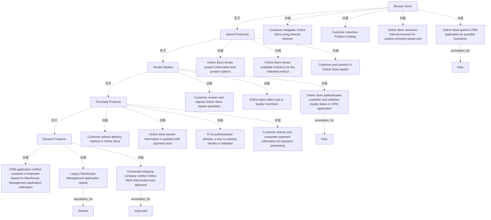

# G233/fig7-1 · 抽象化的在线获取零售产品价值流

类型：`process-or-method-model`。第 7.1.5 节要给“普通用户与高层领导”一个更易读的视图。ArchiMate 模型精确但不易懂，作者把上一节的能力实例评估结果叠加到一条抽象价值流上，用交通灯配色一眼看出哪些能力实例需要关注，作为下一轮规划的输入。

英文 PDF 物理页：[43]。本页为架构语义分析，原文与原图分别保留。

## 原图与可编辑图


[完整 JSON](fig7-1.json) · [可编辑 Mermaid](fig7-1.mmd) · [仅关系图](fig7-1.relations.mmd) · [层级分解图](fig7-1.hierarchy.mmd)

图形重建表达语义，不复制源图布局。虚线表示解释、矩阵映射或分组关系，不自动表示不确定性的概率。



## 架构分析

从左到右读五个 V 形阶段箭头：Browse Store → Select Product(s) → Review Basket → Purchase Products → Receive Products；每个箭头下方那一列圆角框是该阶段的活动（一句一个动作，已把应用、流程、角色压成叙述）。颜色是评估结论：绿色=未标变更（多数维持现状，其中 1 个标 Improved），琥珀=新增 New，红色=退役 Retired。

- 本图有 26 个具名或隐含元素、4 条关系和 21 条包含/分组记录。
- 包含/分组树最大深度为 2；根节点为 浏览商店、选择产品、查看购物篮、购买产品、接收产品。
- 本图没有可直接确认为人员直属汇报的关系；视觉上下位置、能力分解和治理职责分别读取。
- 5个阶段、17张说明卡片、4个星形标签全部核对；卡片颜色为14绿、2黄、1红。
- 2个New分别标CRM激励查询及身份/忠诚校验，Retired标旧仓库系统，Improved标物流已送达通知。
- 第42页明确红黄绿只据团队判断，没有实际评分准则；不能生成成熟度分数或风险数值。
- 最后阶段在本抽象图叫Receive Products；保留与详细图Deliver Products的命名区别。

### 如何用于项目

- 按阶段/事件/行为关系读取入口、出口、责任和产物；检查循环与例外路径。
- 工作流先后不表示组织管理权；在项目中显式记录条件和完成标准。

### 结构所表达的逻辑

- 五个阶段：Browse Store、Select Product(s)、Review Basket、Purchase Products、Receive Products；第五阶段由详细模型的 Deliver Products 改名为 Receive Products，视角从“商家交付”切换到“客户接收”。
- 17 个活动框按阶段分布为 4/3/3/4/3；全部用“谁（Customer/Online Store/CRM application/承运商）+ 做什么”的句子表达，不再画应用组件、数据对象等符号。
- 14 个绿框中 13 个没有标注、1 个标 Improved；2 个琥珀框均标 New；1 个红框标 Retired。
- 红框“Legacy Warehouse Management application retired”对应第 7.1.2 节整合现代/遗留仓库应用的决策。
- “Improved”标签落在 Receive Products 阶段的“Contracted shipping company notifies Online Store that product was delivered”，对应第 7.1.1 节用签名板改进交付管理的计划。
- 抽象化丢掉了组件级细节（如 Internet Browser、Site Navigation、Loyalty Customer Identity），只保留对业务读者有意义的活动句；这正是作者所说的“更叙述化、更易理解”的视图。
- 正文说明交通灯评估除团队判断外没有应用其他实际标准，因此颜色是主观评估结果，不是计算结果。
- 第五阶段的活动把 CRM、仓库管理、运输公司三方通知串成一条客户可见的交付链路，是整条价值流中最跨组织的一段。

## 上下级与包含

两层：5 个阶段（V 形箭头）→ 每阶段下的若干活动框（并列，无上下级）。活动框之间没有连线，先后关系由所在阶段与自上而下的阅读顺序暗示。

|父项|子项|层级类型|依据与解释|
|---|---|---|---|
|浏览商店|客户使用互联网浏览器浏览在线商店|classified_under|说明卡片按阶段列排列；星形标注贴在目标卡片外部。|
|浏览商店|客户搜索产品目录|classified_under|说明卡片按阶段列排列；星形标注贴在目标卡片外部。|
|浏览商店|在线商店在互联网浏览器中查找表明重复访问的 Cookie|classified_under|说明卡片按阶段列排列；星形标注贴在目标卡片外部。|
|浏览商店|在线商店查询 CRM 应用以寻找可能的激励|classified_under|说明卡片按阶段列排列；星形标注贴在目标卡片外部。|
|选择产品|在线商店展示产品信息与产品选项|classified_under|说明卡片按阶段列排列；星形标注贴在目标卡片外部。|
|选择产品|在线商店展示所选产品的可用库存|classified_under|说明卡片按阶段列排列；星形标注贴在目标卡片外部。|
|选择产品|客户把产品放入在线商店购物篮|classified_under|说明卡片按阶段列排列；星形标注贴在目标卡片外部。|
|查看购物篮|客户查看并调整在线商店购物篮数量|classified_under|说明卡片按阶段列排列；星形标注贴在目标卡片外部。|
|查看购物篮|在线商店提供购物车激励或忠诚度激励|classified_under|说明卡片按阶段列排列；星形标注贴在目标卡片外部。|
|查看购物篮|在线商店验证客户身份并在 CRM 应用中校验忠诚度状态|classified_under|说明卡片按阶段列排列；星形标注贴在目标卡片外部。|
|购买产品|客户在在线商店选择配送方式|classified_under|说明卡片按阶段列排列；星形标注贴在目标卡片外部。|
|购买产品|在线商店购物篮信息随支付价格更新|classified_under|说明卡片按阶段列排列；星形标注贴在目标卡片外部。|
|购买产品|若尚未认证，则校验新身份或既有身份|classified_under|说明卡片按阶段列排列；星形标注贴在目标卡片外部。|
|购买产品|客户选择并填写支付信息以供支付处理|classified_under|说明卡片按阶段列排列；星形标注贴在目标卡片外部。|
|接收产品|CRM 应用依据仓库管理应用的通知向客户告知发货情况|classified_under|说明卡片按阶段列排列；星形标注贴在目标卡片外部。|
|接收产品|遗留仓库管理应用已退役|classified_under|说明卡片按阶段列排列；星形标注贴在目标卡片外部。|
|接收产品|签约承运公司通知在线商店商品已送达|classified_under|说明卡片按阶段列排列；星形标注贴在目标卡片外部。|
|在线商店查询 CRM 应用以寻找可能的激励|新增|annotation_for|说明卡片按阶段列排列；星形标注贴在目标卡片外部。|
|在线商店验证客户身份并在 CRM 应用中校验忠诚度状态|新增|annotation_for|说明卡片按阶段列排列；星形标注贴在目标卡片外部。|
|遗留仓库管理应用已退役|退役|annotation_for|说明卡片按阶段列排列；星形标注贴在目标卡片外部。|
|签约承运公司通知在线商店商品已送达|改进|annotation_for|说明卡片按阶段列排列；星形标注贴在目标卡片外部。|

## 全部元素与角色

|元素ID|原文名称|类型|含义|直接父项|深度|
|---|---|---|---|---|---|
|stg_browse|Browse Store|value_stream_stage|价值流阶段：浏览商店|—||
|stg_select|Select Product(s)|value_stream_stage|价值流阶段：选择产品|—||
|stg_review|Review Basket|value_stream_stage|价值流阶段：查看购物篮|—||
|stg_purchase|Purchase Products|value_stream_stage|价值流阶段：购买产品|—||
|stg_receive|Receive Products|value_stream_stage|价值流阶段：接收产品|—||
|act_navigate|Customer navigates Online Store using Internet browser|process|流程：客户使用互联网浏览器浏览在线商店|浏览商店|1|
|act_search_catalog|Customer searches Product Catalog|process|流程：客户搜索产品目录|浏览商店|1|
|act_cookies|Online Store searches Internet browser for cookies showing repeat visit|process|流程：在线商店在互联网浏览器中查找表明重复访问的 Cookie|浏览商店|1|
|act_query_crm|Online Store queries CRM application for possible incentives|process|流程：在线商店查询 CRM 应用以寻找可能的激励|浏览商店|1|
|act_show_product|Online Store shows product information and product options|process|流程：在线商店展示产品信息与产品选项|选择产品|1|
|act_show_inventory|Online Store shows available inventory for the selected product|process|流程：在线商店展示所选产品的可用库存|选择产品|1|
|act_put_basket|Customer puts product in Online Store basket|process|流程：客户把产品放入在线商店购物篮|选择产品|1|
|act_review_qty|Customer reviews and adjusts Online Store basket quantities|process|流程：客户查看并调整在线商店购物篮数量|查看购物篮|1|
|act_offer_incentives|Online Store offers cart or loyalty incentives|process|流程：在线商店提供购物车激励或忠诚度激励|查看购物篮|1|
|act_authenticate|Online Store authenticates customer and validates loyalty status in CRM application|process|流程：在线商店验证客户身份并在 CRM 应用中校验忠诚度状态|查看购物篮|1|
|act_delivery_method|Customer selects delivery method in Online Store|process|流程：客户在在线商店选择配送方式|购买产品|1|
|act_basket_price|Online Store basket information is updated with payment price|process|流程：在线商店购物篮信息随支付价格更新|购买产品|1|
|act_identity_validate|If not authenticated already, a new or existing identity is validated|process|流程：若尚未认证，则校验新身份或既有身份|购买产品|1|
|act_payment|Customer selects and completes payment information for payment processing|process|流程：客户选择并填写支付信息以供支付处理|购买产品|1|
|act_notify_shipment|CRM application notifies customer of shipment based on Warehouse Management application notification|process|流程：CRM 应用依据仓库管理应用的通知向客户告知发货情况|接收产品|1|
|act_legacy_retired|Legacy Warehouse Management application retired|process|流程：遗留仓库管理应用已退役|接收产品|1|
|act_delivered|Contracted shipping company notifies Online Store that product was delivered|process|流程：签约承运公司通知在线商店商品已送达|接收产品|1|
|burst_new_query_crm|New|note|说明：新增|在线商店查询 CRM 应用以寻找可能的激励|2|
|burst_new_authenticate|New|note|说明：新增|在线商店验证客户身份并在 CRM 应用中校验忠诚度状态|2|
|burst_retired|Retired|note|说明：退役|遗留仓库管理应用已退役|2|
|burst_improved|Improved|note|说明：改进|签约承运公司通知在线商店商品已送达|2|

### 客户使用互联网浏览器浏览在线商店：属性

```json
{
  "status": "green"
}
```

### 客户搜索产品目录：属性

```json
{
  "status": "green"
}
```

### 在线商店在互联网浏览器中查找表明重复访问的 Cookie：属性

```json
{
  "status": "green"
}
```

### 在线商店查询 CRM 应用以寻找可能的激励：属性

```json
{
  "status": "amber"
}
```

### 在线商店展示产品信息与产品选项：属性

```json
{
  "status": "green"
}
```

### 在线商店展示所选产品的可用库存：属性

```json
{
  "status": "green"
}
```

### 客户把产品放入在线商店购物篮：属性

```json
{
  "status": "green"
}
```

### 客户查看并调整在线商店购物篮数量：属性

```json
{
  "status": "green"
}
```

### 在线商店提供购物车激励或忠诚度激励：属性

```json
{
  "status": "green"
}
```

### 在线商店验证客户身份并在 CRM 应用中校验忠诚度状态：属性

```json
{
  "status": "amber"
}
```

### 客户在在线商店选择配送方式：属性

```json
{
  "status": "green"
}
```

### 在线商店购物篮信息随支付价格更新：属性

```json
{
  "status": "green"
}
```

### 若尚未认证，则校验新身份或既有身份：属性

```json
{
  "status": "green"
}
```

### 客户选择并填写支付信息以供支付处理：属性

```json
{
  "status": "green"
}
```

### CRM 应用依据仓库管理应用的通知向客户告知发货情况：属性

```json
{
  "status": "green"
}
```

### 遗留仓库管理应用已退役：属性

```json
{
  "status": "red"
}
```

### 签约承运公司通知在线商店商品已送达：属性

```json
{
  "status": "green"
}
```

## 全部关系

图中没有任何连线；V 形箭头本身表达阶段方向（左→右），阶段归属由“活动框位于该箭头正下方”表达。颜色与爆炸标签是状态编码，不是关系。

|主体|语义关系|客体|显式线/隐式|原文标签|依据|
|---|---|---|---|---|---|
|浏览商店|先于|选择产品|adjacent-chevron-shapes||五个相邻箭头形阶段标题表示阅读顺序，阶段之间没有另画连接线。|
|选择产品|先于|查看购物篮|adjacent-chevron-shapes||五个相邻箭头形阶段标题表示阅读顺序，阶段之间没有另画连接线。|
|查看购物篮|先于|购买产品|adjacent-chevron-shapes||五个相邻箭头形阶段标题表示阅读顺序，阶段之间没有另画连接线。|
|购买产品|先于|接收产品|adjacent-chevron-shapes||五个相邻箭头形阶段标题表示阅读顺序，阶段之间没有另画连接线。|

## 阶段×活动×状态逐项转录

```json
{
  "id": "t_activities",
  "title_zh": "阶段×活动×状态逐项转录",
  "columns": [
    "阶段",
    "活动（原文）",
    "底色",
    "标注"
  ],
  "rows": [
    [
      "Browse Store 浏览商店",
      "Customer navigates Online Store using Internet browser 客户使用互联网浏览器浏览在线商店",
      "绿",
      "—"
    ],
    [
      "Browse Store 浏览商店",
      "Customer searches Product Catalog 客户搜索产品目录",
      "绿",
      "—"
    ],
    [
      "Browse Store 浏览商店",
      "Online Store searches Internet browser for cookies showing repeat visit 在线商店在互联网浏览器中查找表明重复访问的 Cookie",
      "绿",
      "—"
    ],
    [
      "Browse Store 浏览商店",
      "Online Store queries CRM application for possible incentives 在线商店查询 CRM 应用以寻找可能的激励",
      "琥珀",
      "New 新增"
    ],
    [
      "Select Product(s) 选择产品",
      "Online Store shows product information and product options 在线商店展示产品信息与产品选项",
      "绿",
      "—"
    ],
    [
      "Select Product(s) 选择产品",
      "Online Store shows available inventory for the selected product 在线商店展示所选产品的可用库存",
      "绿",
      "—"
    ],
    [
      "Select Product(s) 选择产品",
      "Customer puts product in Online Store basket 客户把产品放入在线商店购物篮",
      "绿",
      "—"
    ],
    [
      "Review Basket 查看购物篮",
      "Customer reviews and adjusts Online Store basket quantities 客户查看并调整在线商店购物篮数量",
      "绿",
      "—"
    ],
    [
      "Review Basket 查看购物篮",
      "Online Store offers cart or loyalty incentives 在线商店提供购物车激励或忠诚度激励",
      "绿",
      "—"
    ],
    [
      "Review Basket 查看购物篮",
      "Online Store authenticates customer and validates loyalty status in CRM application 在线商店验证客户身份并在 CRM 应用中校验忠诚度状态",
      "琥珀",
      "New 新增"
    ],
    [
      "Purchase Products 购买产品",
      "Customer selects delivery method in Online Store 客户在在线商店选择配送方式",
      "绿",
      "—"
    ],
    [
      "Purchase Products 购买产品",
      "Online Store basket information is updated with payment price 在线商店购物篮信息随支付价格更新",
      "绿",
      "—"
    ],
    [
      "Purchase Products 购买产品",
      "If not authenticated already, a new or existing identity is validated 若尚未认证，则校验新身份或既有身份",
      "绿",
      "—"
    ],
    [
      "Purchase Products 购买产品",
      "Customer selects and completes payment information for payment processing 客户选择并填写支付信息以供支付处理",
      "绿",
      "—"
    ],
    [
      "Receive Products 接收产品",
      "CRM application notifies customer of shipment based on Warehouse Management application notification CRM 应用依据仓库管理应用的通知向客户告知发货情况",
      "绿",
      "—"
    ],
    [
      "Receive Products 接收产品",
      "Legacy Warehouse Management application retired 遗留仓库管理应用已退役",
      "红",
      "Retired 退役"
    ],
    [
      "Receive Products 接收产品",
      "Contracted shipping company notifies Online Store that product was delivered 签约承运公司通知在线商店商品已送达",
      "绿",
      "Improved 改进"
    ]
  ],
  "cell_legend": [
    "绿=未标变更（14 个中 1 个标 Improved）",
    "琥珀=新增（New）",
    "红=退役（Retired）"
  ],
  "notes_zh": "每行对应一个活动框；框内文字按原图逐字转录，中文为对照。"
}
```

## 本轮语义修正

- 五个相邻箭头形阶段标题表示阅读顺序，阶段之间没有另画连接线。
- 五个相邻箭头形阶段标题表示阅读顺序，阶段之间没有另画连接线。
- 五个相邻箭头形阶段标题表示阅读顺序，阶段之间没有另画连接线。
- 五个相邻箭头形阶段标题表示阅读顺序，阶段之间没有另画连接线。

## 误读检查

- 不要把本图当成能力实例模型：它刻意抹掉了应用组件、数据对象与流程符号，只保留活动句子；需要细节要回到图 6-3。
- 不要把绿色理解为“已完成”或“成熟度高”；多数绿色未标变更，但其中一个标 Improved，说明绿色并不等于“绝不改动”。正文说颜色只是团队判断的关注点标记。
- 不要把 New/Improved/Retired 爆炸标签当成活动；它们是贴在活动框上的变更标注。
- 不要用本图的阶段名去对照图 6-1/6-2：Browse Store 对应 Browse Online Store，Receive Products 对应 Deliver Products，名称被缩短或改写。
- 中文稿的 PNG 有多处文字溢出/跑到框外，不能据其版式判断哪些文字属于哪个框；应以英文原图为准。
- 中文稿第 7.1.5 节实际引用的是 figs/zh/g233e_fig7-1_zh.png；figs/g233_fig7-1.svg 画的是“四种规划情景”，与图 7-1 无关，不能作为理解依据。

## 原文证据

### [PDF 第 40 页](../../../documents/G233.md#page-40)

> This document was written during the COVID pandemic.[1] The innovation that occurred and continues to occur based on the pandemic is one of the largest step changes in the world in many years. The world of retail was no exception. Organizations that did not have an online fulfillment mechanism either created that new value stream or they perished. Physical retail stores have added customer pickup and other mechanisms to reduce physical interactions as a new option.
> Enterprise Architects at organizations can use the techniques described in this document to imagine new value streams that leverage existing business capability instances where they are available and facilitate the development of new or improved business capability instances where needed to allow for the new value stream to execute successfully.
### [PDF 第 41 页](../../../documents/G233.md#page-41)

> needs to be taken in these situations to ensure that unidentified value streams that leverage this business capability instance are not impacted
> Identify distinct parts of each business capability that need to be enhanced or deprecated; those components should be identified within the model as “gaps” to provide the opportunity for further analysis. A consistent set of gaps that can be applied based on the component of the business capability that is affected will make planning easier. The following gap types are provided as examples:
### [PDF 第 42 页](../../../documents/G233.md#page-42)

> For the retail organization there are two Inventory Management applications. This is because of a merger that results in two different warehouses that use two different Inventory Management applications. To streamline the ordering process, the company has decided to consolidate the Modern Warehouse Management application versus the Legacy Warehouse Management application since the Legacy Warehouse Management application would be more difficult to integrate into the CRM application.
> An organization’s ability to enhance or create new value streams by re-using the business capabilities they already have is key to overall success. Invariably all organizations need to evolve for all kinds of reasons. Business capability planning ensures that business capability instances are only created when they are required within the context of a value stream.
### [PDF 第 43 页](../../../documents/G233.md#page-43)

> Many times, business capabilities cannot move to the final desired state in one step. There may also be dependencies that mean sequencing of capability increments needs to be coordinated. Depending on the gap that needs to be addressed, there could be sequencing where a business process change needs to occur ahead of an application enhancement. No matter the dependencies that would provide some form of stepwise change, one or more gaps being addressed together would be identified as a plateau; i.e., where the collection of enhancements to address the gaps preserve a functional value stream.
> The architecture model will be able to identify the business capabilities that have gaps and where those gaps may have dependencies. The management of the resources and the timing of who will deliver the business capability enhancements through work packages is left to the project or program. A gap is indicated using the ArchiMate gap element, where the same gap assigned to multiple business capabilities shows a potential grouping.

## 来源与分析状态

所有元素/关系均有来源定位；未把历史解释重命名为本轮逐线视觉确认。源图与语义图是两种视图，布局不证明汇报或因果。

源 PDF SHA-256：`d5c62f9edb2465d10e59f0a1c9c23fb5d8a0b14e506cf7739a09886fbee07754`。

源图记录：[原始解释与转录](../../../figures/G233/fig7-1.json)。

```json
{
  "quality": {
    "graph_integrity": "checked",
    "semantic_analysis": "typed-graph-and-context-analysis",
    "visual_review": "source-content-audited",
    "notice_zh": "所有元素/关系均有来源定位；未把历史解释重命名为本轮逐线视觉确认。源图与语义图是两种视图，布局不证明汇报或因果。"
  },
  "source_uncertainty": {
    "confidence": "high",
    "uncertainties_zh": [
      "原图没有图例说明绿/琥珀/红的精确含义，本文按交通灯常识与正文“红黄绿突出需关注实例”归纳；绿色也可能表示“未评估/正常”，无法进一步确认。",
      "“Improved”标签所在框仍为绿色，说明改进项不一定变色；颜色与爆炸标签不是一一对应关系。",
      "第五阶段活动“If not authenticated already…”在 Purchase 列而非 Review 列，与图 6-3 中身份校验分布在 Review/Purchase 两处不完全一致，属抽象化后的重排。"
    ],
    "analyzed_from": [
      "英文 PDF 第 43 页图 7-1 截图（500 dpi）与 700 dpi 局部",
      "英文 PDF 第 42–43 页正文",
      "中文稿 G233e_业务能力规划.md 第 688–733 行（含标签对照表）",
      "figs/g233_fig7-1.svg（源码）与 figs/zh/g233e_fig7-1_zh.png",
      "figs/g233e_fig7-1_en.png"
    ],
    "date": "2026-10-31"
  },
  "source_conflicts": []
}
```
