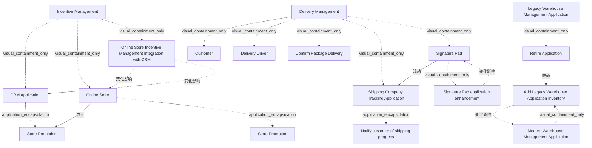

# G233/fig7-2 · 新增激励管理应用

类型：`decomposition-or-organization-model`。第 7.2 节要说明“能力增量如何被规划”：差距用 ArchiMate gap 元素表示，同一差距分配给多个能力表示可分组；平台期（plateau）是一组能保持价值流功能完整的增强。图 7-2 把 7.1 节的四种情景具体化为可执行的差距与依赖，是第 7 章从分析走向实施的落点。

英文 PDF 物理页：[44]。本页为架构语义分析，原文与原图分别保留。

## 原图与可编辑图


[完整 JSON](fig7-2.json) · [可编辑 Mermaid](fig7-2.mmd) · [仅关系图](fig7-2.relations.mmd) · [层级分解图](fig7-2.hierarchy.mmd)

图形重建表达语义，不复制源图布局。虚线表示解释、矩阵映射或分组关系，不自动表示不确定性的概率。



## 架构分析

从左到右三组：左边 Incentive Management 能力实例（CRM Application 与 Online Store 各有一个 Store Promotion 数据对象，中间一条“New API Call”箭头）；中间是 Legacy 与 Modern 两个仓库管理应用，分别挂着“Retire Application”事件与“Add Legacy Warehouse Application Inventory”差距；右边 Delivery Management 能力实例（客户、配送司机、确认送达、运输公司跟踪应用），下方一个绿色“Signature Pad”交付物（内含应用增强差距），用虚线箭头指向运输应用。绿色波浪底框是差距，绿色胶囊＋底座是交付物。

- 本图有 18 个具名或隐含元素、7 条关系和 14 条包含/分组记录。
- 包含/分组树最大深度为 2；根节点为 激励管理、遗留仓库管理应用、现代仓库管理应用、交付管理。
- 本图没有可直接确认为人员直属汇报的关系；视觉上下位置、能力分解和治理职责分别读取。
- 包含分组后有 3 个连通分量；分离可能源于图例、并列分类或独立示例，未自动补边。
- 18个原元素及2条实际连接逐项核对；3个绿色波底形均为Gap，Retire Application是事件而非第四个Gap。
- API调用终点是CRM内Store Promotion数据对象；签名板回传实心虚线箭头至运输跟踪应用。
- 库存迁移增强先于旧应用退役由正文明确；其他Gap按正文相互独立，未补造互相依赖。

### 如何用于项目

- 按父项展开所有直接子项，检查同层粒度、重叠和缺项。
- 保留组成、分类、能力分解与组织汇报的区别；将示例名称替换为已确认的项目对象。

### 结构所表达的逻辑

- 新建（Create）：Incentive Management 新增一个实例，通过“New API Call”让 Online Store 的 Store Promotion 数据与 CRM Application 的 Store Promotion 同步，从而向网站访客展示通用/个性化激励。
- 整合（Consolidate）：Modern Warehouse Management Application 内有一个差距“Add Legacy Warehouse Application Inventory”，即把电子产品仓库库存并入现代仓库应用；完成后 Legacy 实例即可退役。
- 退役（Retire）：Legacy Warehouse Management Application 内放的是粉色业务事件“Retire Application”，而不是差距——正文说明该应用不存在真正的差距，用事件标记退役。
- 优化（Optimize）：Delivery Management 实例下的“Signature Pad”交付物内含“Signature Pad application enhancement”差距，并用虚线箭头指向 Shipping Company Tracking Application，表示签名数据回传运输应用。
- 差距（gap）用绿色波浪底文档形＋Gap 图标表示；正文说同一 gap 分配给多个能力表示这些能力可能属于同一分组、可一起处理（同一平台期）。
- Delivery Management 实例包含 Customer、Delivery Driver（角色）、Confirm Package Delivery（流程）与运输公司跟踪应用，说明“优化”不是换应用，而是给现有实例加一个资源/应用增强。
- 图中没有画出平台期（plateau）边界；平台期是正文概念，指为解决一组差距而共同实施、能保持价值流功能完整的增强集合。
- 本例的差距彼此独立，唯一例外是退役：Legacy 应用被多个价值流使用，退役前必须确认这些价值流不受影响。

## 上下级与包含

三组并列：Incentive Management、仓库应用组（Legacy/Modern）、Delivery Management。能力框内嵌应用组件；应用组件内嵌数据对象、事件或差距；Signature Pad 交付物内嵌一个应用增强差距（交付物→差距两层）。

|父项|子项|层级类型|依据与解释|
|---|---|---|---|
|激励管理|客户关系管理应用|visual_containment_only|保存原图解释中的包含；业务关系类型需要图例或正文进一步限定。|
|客户关系管理应用|门店促销|application_encapsulation|应用组件包含其数据、行为或子组件。|
|激励管理|在线商店|visual_containment_only|保存原图解释中的包含；业务关系类型需要图例或正文进一步限定。|
|在线商店|门店促销|application_encapsulation|应用组件包含其数据、行为或子组件。|
|激励管理|在线商店激励管理与 CRM 集成|visual_containment_only|保存原图解释中的包含；业务关系类型需要图例或正文进一步限定。|
|遗留仓库管理应用|退役应用|visual_containment_only|保存原图解释中的包含；业务关系类型需要图例或正文进一步限定。|
|现代仓库管理应用|增加遗留仓库应用库存|visual_containment_only|保存原图解释中的包含；业务关系类型需要图例或正文进一步限定。|
|交付管理|客户|visual_containment_only|保存原图解释中的包含；业务关系类型需要图例或正文进一步限定。|
|交付管理|配送司机|visual_containment_only|保存原图解释中的包含；业务关系类型需要图例或正文进一步限定。|
|交付管理|确认包裹送达|visual_containment_only|保存原图解释中的包含；业务关系类型需要图例或正文进一步限定。|
|交付管理|运输公司跟踪应用|visual_containment_only|保存原图解释中的包含；业务关系类型需要图例或正文进一步限定。|
|运输公司跟踪应用|通知客户运输进度|application_encapsulation|应用组件包含其数据、行为或子组件。|
|交付管理|签名板|visual_containment_only|保存原图解释中的包含；业务关系类型需要图例或正文进一步限定。|
|签名板|签名板应用增强|visual_containment_only|保存原图解释中的包含；业务关系类型需要图例或正文进一步限定。|

## 全部元素与角色

|元素ID|原文名称|类型|含义|直接父项|深度|
|---|---|---|---|---|---|
|cap_incentive|Incentive Management|capability|能力：激励管理|—||
|app_crm|CRM Application|application|应用：客户关系管理应用|激励管理|1|
|obj_promo_crm|Store Promotion|data|CRM 数据对象|客户关系管理应用|2|
|app_online_store|Online Store|application|应用：在线商店|激励管理|1|
|obj_promo_os|Store Promotion|data|在线商店数据对象|在线商店|2|
|gap_integration|Online Store Incentive Management Integration with CRM|gap|ArchiMate Gap记法，表示待弥合差距，不是已经交付的功能或泛化需求。|激励管理|1|
|app_legacy|Legacy Warehouse Management Application|application|应用：遗留仓库管理应用|—||
|event_retire|Retire Application|event|事件：退役应用|遗留仓库管理应用|1|
|app_modern|Modern Warehouse Management Application|application|应用：现代仓库管理应用|—||
|gap_add_inventory|Add Legacy Warehouse Application Inventory|gap|ArchiMate Gap记法，表示待弥合差距，不是已经交付的功能或泛化需求。|现代仓库管理应用|1|
|cap_delivery|Delivery Management|capability|能力：交付管理|—||
|st_customer|Customer|stakeholder|利益相关者：客户|交付管理|1|
|role_delivery_driver|Delivery Driver|role|角色：配送司机|交付管理|1|
|proc_confirm_package|Confirm Package Delivery|process|流程：确认包裹送达|交付管理|1|
|app_shipping|Shipping Company Tracking Application|application|应用：运输公司跟踪应用|交付管理|1|
|ap_notify_progress|Notify customer of shipping progress|process|流程：通知客户运输进度|运输公司跟踪应用|2|
|art_signature_pad|Signature Pad|technology|签名板设备，图中绿色设备形；其内嵌应用增强差距。|交付管理|1|
|gap_signature_enh|Signature Pad application enhancement|gap|ArchiMate Gap记法，表示待弥合差距，不是已经交付的功能或泛化需求。|签名板|2|

## 全部关系

实线开口箭头“New API Call”：由 Online Store 指向上方 CRM Application，表示新增的接口调用。虚线实心箭头（无标签）：由 Signature Pad 交付物指向 Shipping Company Tracking Application，表示签名回传。除此之外没有连线，归属由嵌套表达。

|主体|语义关系|客体|显式线/隐式|原文标签|依据|
|---|---|---|---|---|---|
|在线商店|访问|门店促销|显式连线|New API Call|New API Call实线开口箭头从Online Store顶边到CRM内的Store Promotion数据对象底边；不只连接到CRM组件外框。|
|签名板|流动|运输公司跟踪应用|显式连线||虚线实心箭头由 Signature Pad 指向上方运输公司跟踪应用，表示签名回传。|
|在线商店激励管理与 CRM 集成|变化影响|在线商店|implicit||激励集成Gap涉及在线商店和CRM，正文说明需要二者接口；这是变更范围，不是图中依赖箭头。|
|增加遗留仓库应用库存|变化影响|现代仓库管理应用|implicit||库存整合Gap嵌入现代仓库应用，表示该应用的增强范围，无独立依赖线。|
|签名板应用增强|变化影响|签名板|implicit||Signature Pad application enhancement Gap嵌在Signature Pad设备中；不能因此断定Shipping应用也被该Gap修改。签名回传由另一条实际流表示。|
|在线商店激励管理与 CRM 集成|变化影响|客户关系管理应用|none||第42页说明新增CRM至Online Store接口，此Gap涉及CRM一侧；不是源图连线。|
|退役应用|依赖|增加遗留仓库应用库存|none||第43—44页明确须先增强现代仓库应用再退役旧应用；这是正文中的实施先决条件，图中没有跨两应用的箭头。|

## 本轮语义修正

- New API Call实线开口箭头从Online Store顶边到CRM内的Store Promotion数据对象底边；不只连接到CRM组件外框。
- 激励集成Gap涉及在线商店和CRM，正文说明需要二者接口；这是变更范围，不是图中依赖箭头。
- 库存整合Gap嵌入现代仓库应用，表示该应用的增强范围，无独立依赖线。
- Signature Pad application enhancement Gap嵌在Signature Pad设备中；不能因此断定Shipping应用也被该Gap修改。签名回传由另一条实际流表示。
- 第42页说明新增CRM至Online Store接口，此Gap涉及CRM一侧；不是源图连线。
- 第43—44页明确须先增强现代仓库应用再退役旧应用；这是正文中的实施先决条件，图中没有跨两应用的箭头。

## 误读检查

- 不要把粉色“Retire Application”当成差距；它是业务事件，表示退役这一状态变化。
- 不要把两个“Store Promotion”当成同一个数据对象；一个在 CRM 应用内，一个在 Online Store 内，靠新增 API 同步。
- 不要把绿色波浪底框当成文档/交付物；它们是 ArchiMate gap 元素，表示需要弥合的差距。
- 不要把“Signature Pad”外层当成 gap：外层是带底座的交付物/资源容器，没有 Gap 图标；内层“Signature Pad application enhancement”才是应用增强差距。
- 不要以为 Legacy/Modern 仓库应用属于某个能力框；它们直接画在价值流层面，是跨能力使用的应用组件。
- 中文稿 PNG 下方中央有巨大的“客户关系管理应用”白块（左右另有白块）覆盖模型文字，不能据其判断元素归属；必须看英文原图。

## 原文证据

### [PDF 第 41 页](../../../documents/G233.md#page-41)

> needs to be taken in these situations to ensure that unidentified value streams that leverage this business capability instance are not impacted
> Identify distinct parts of each business capability that need to be enhanced or deprecated; those components should be identified within the model as “gaps” to provide the opportunity for further analysis. A consistent set of gaps that can be applied based on the component of the business capability that is affected will make planning easier. The following gap types are provided as examples:
### [PDF 第 42 页](../../../documents/G233.md#page-42)

> For the retail organization there are two Inventory Management applications. This is because of a merger that results in two different warehouses that use two different Inventory Management applications. To streamline the ordering process, the company has decided to consolidate the Modern Warehouse Management application versus the Legacy Warehouse Management application since the Legacy Warehouse Management application would be more difficult to integrate into the CRM application.
> An organization’s ability to enhance or create new value streams by re-using the business capabilities they already have is key to overall success. Invariably all organizations need to evolve for all kinds of reasons. Business capability planning ensures that business capability instances are only created when they are required within the context of a value stream.
### [PDF 第 43 页](../../../documents/G233.md#page-43)

> Many times, business capabilities cannot move to the final desired state in one step. There may also be dependencies that mean sequencing of capability increments needs to be coordinated. Depending on the gap that needs to be addressed, there could be sequencing where a business process change needs to occur ahead of an application enhancement. No matter the dependencies that would provide some form of stepwise change, one or more gaps being addressed together would be identified as a plateau; i.e., where the collection of enhancements to address the gaps preserve a functional value stream.
> The architecture model will be able to identify the business capabilities that have gaps and where those gaps may have dependencies. The management of the resources and the timing of who will deliver the business capability enhancements through work packages is left to the project or program. A gap is indicated using the ArchiMate gap element, where the same gap assigned to multiple business capabilities shows a potential grouping.
### [PDF 第 44 页](../../../documents/G233.md#page-44)

> • Create: A new Incentive Management capability instance is going to be added to the first value stream, as shown in Figure 7-2
> • Retire: This is illustrated in Figure 7-2, again at the application level

## 来源与分析状态

所有元素/关系均有来源定位；未把历史解释重命名为本轮逐线视觉确认。源图与语义图是两种视图，布局不证明汇报或因果。

源 PDF SHA-256：`d5c62f9edb2465d10e59f0a1c9c23fb5d8a0b14e506cf7739a09886fbee07754`。

源图记录：[原始解释与转录](../../../figures/G233/fig7-2.json)。

```json
{
  "quality": {
    "graph_integrity": "checked",
    "semantic_analysis": "typed-graph-and-context-analysis",
    "visual_review": "source-content-audited",
    "notice_zh": "所有元素/关系均有来源定位；未把历史解释重命名为本轮逐线视觉确认。源图与语义图是两种视图，布局不证明汇报或因果。"
  },
  "source_uncertainty": {
    "confidence": "high",
    "uncertainties_zh": [
      "“Signature Pad”外层为绿色胶囊＋底座、无 Gap 图标，与图 C-1 的 Building Pass Card 同形，本文按交付物/资源容器（artifact）记录；内层“Signature Pad application enhancement”才是 gap。确切 ArchiMate 类型无法仅凭图形确认。",
      "“New API Call”箭头只有开口箭头、无标签框，方向由箭头指向 CRM 判断。",
      "图中未标出 plateau 边界，平台期只能依据正文概念理解。"
    ],
    "analyzed_from": [
      "英文 PDF 第 44 页图 7-2 截图（500 dpi）与 700 dpi 左右分栏",
      "英文 PDF 第 43–44 页正文",
      "中文稿 G233e_业务能力规划.md 第 737–779 行（含标签对照表）",
      "figs/zh/g233e_fig7-2_zh.png"
    ],
    "date": "2026-10-31"
  },
  "source_conflicts": []
}
```
