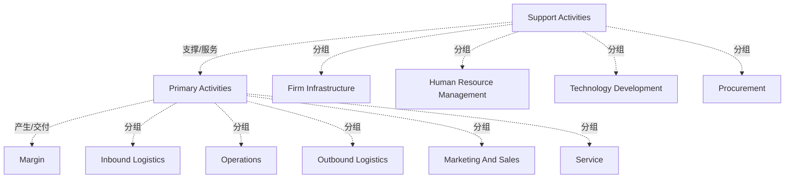

# G233/figB-1 · 迈克尔·波特的价值链（来源：《竞争优势》）

类型：`architecture-concept-or-system-model`。附录 B.5 用价值链说明另一种价值视角：价值链把企业拆成战略相关活动，以理解成本行为与差异化来源；它提供“企业如何生产经济价值（金钱）”的宏观视图，可作为决定“需要建模哪些价值流来保证价值链运转”的依据。作者把它与价值流对照，说明两者目的相近但切分方式不同。

英文 PDF 物理页：[52]。本页为架构语义分析，原文与原图分别保留。

## 原图与可编辑图


[完整 JSON](figB-1.json) · [可编辑 Mermaid](figB-1.mmd) · [仅关系图](figB-1.relations.mmd) · [层级分解图](figB-1.hierarchy.mmd)

图形重建表达语义，不复制源图布局。虚线表示解释、矩阵映射或分组关系，不自动表示不确定性的概率。



## 架构分析

先看两条花括号：左侧“Support Activities”覆盖上方四行，底部“Primary Activities”覆盖下方五列。主要活动从左到右读：Inbound Logistics → Operations → Outbound Logistics → Marketing And Sales → Service。支持活动自上而下读：Firm Infrastructure、Human Resource Management、Technology Development、Procurement，它们横贯并支撑所有主要活动。最右侧灰色大箭头“Margin”从顶到底包住整条链，表示总价值减去总成本后的剩余。

- 本图有 12 个具名或隐含元素、2 条关系和 9 条包含/分组记录。
- 包含/分组树最大深度为 1；根节点为 支持活动、主要活动、利润。
- 本图没有可直接确认为人员直属汇报的关系；视觉上下位置、能力分解和治理职责分别读取。
- 4项支持活动、5项主要活动、2个括号分类和同一灰色Margin带全部核对。
- Margin在同一带上印两次；不能把图形箭头轮廓当作活动间数据流。
- 图为Porter价值链，第52页图题和B.5明确；第51页B.4也引用Figure B-1但不能因此把图误标为Lean流程图。

### 如何用于项目

- 围绕作者目的读取本图实体、分组与连线，并用对应原文限定其含义。
- 把参考模型与项目事实分开，实际范围、约束、值和责任须有项目证据。

### 结构所表达的逻辑

- 五项主要活动：入站物流、运营、出站物流、市场营销与销售、服务；它们直接创造并交付产品/服务。
- 四项支持活动：企业基础设施、人力资源管理、技术开发、采购；它们不直接面向客户，但为所有主要活动提供支撑。
- Margin（利润）不是一项活动，而是整条链的剩余价值：总收入减去全部主要活动与支持活动的成本。图中用一条从顶贯到底的灰色箭头表示它包住整条链。
- 支持活动画成横贯四行，表示它们服务于所有主要活动，而不是只在某一列发生。
- 价值链以成本与利润为中心，给出经济价值的宏观视图；价值流以利益相关者价值为中心，给出端到端活动序列。两者粒度与目的不同。
- 正文建议：价值链可作为决定“需要建模哪些价值流”的依据——先看价值链哪些环节重要，再为这些环节建价值流模型。
- 价值链通常对整个组织或业务单元建模，与商业模式画布的粒度相近。
- 本图与 G178《价值流》附录 A 的图 A-1 是同一张图（同一来源、同一版式）。

## 上下级与包含

两层：两类活动（支持活动、主要活动）→ 各自包含的活动项。支持活动与主要活动是并列的两组，不是上下级；Margin 是覆盖全图的结果，不属于任何一组。

|父项|子项|层级类型|依据与解释|
|---|---|---|---|
|支持活动|企业基础设施|classified_under|大括号给活动类别，没有包围分类名的容器框。|
|支持活动|人力资源管理|classified_under|大括号给活动类别，没有包围分类名的容器框。|
|支持活动|技术开发|classified_under|大括号给活动类别，没有包围分类名的容器框。|
|支持活动|采购|classified_under|大括号给活动类别，没有包围分类名的容器框。|
|主要活动|入站物流|classified_under|大括号给活动类别，没有包围分类名的容器框。|
|主要活动|运营|classified_under|大括号给活动类别，没有包围分类名的容器框。|
|主要活动|出站物流|classified_under|大括号给活动类别，没有包围分类名的容器框。|
|主要活动|市场营销与销售|classified_under|大括号给活动类别，没有包围分类名的容器框。|
|主要活动|服务|classified_under|大括号给活动类别，没有包围分类名的容器框。|

## 全部元素与角色

|元素ID|原文名称|类型|含义|直接父项|深度|
|---|---|---|---|---|---|
|grp_support|Support Activities|group|分组：支持活动|—||
|grp_primary|Primary Activities|group|分组：主要活动|—||
|sup_infrastructure|Firm Infrastructure|function|功能：企业基础设施|支持活动|1|
|sup_hr|Human Resource Management|function|功能：人力资源管理|支持活动|1|
|sup_technology|Technology Development|function|功能：技术开发|支持活动|1|
|sup_procurement|Procurement|function|功能：采购|支持活动|1|
|pri_inbound|Inbound Logistics|function|功能：入站物流|主要活动|1|
|pri_operations|Operations|function|功能：运营|主要活动|1|
|pri_outbound|Outbound Logistics|function|功能：出站物流|主要活动|1|
|pri_marketing|Marketing And Sales|function|功能：市场营销与销售|主要活动|1|
|pri_service|Service|function|功能：服务|主要活动|1|
|margin|Margin|goal|同一灰色边际带上的两次Margin文字，不是两个独立利润值。|—||

### 利润：属性

```json
{
  "visible_label_occurrences": [
    "灰色右侧带上斜边Margin",
    "同一灰色带下斜边Margin"
  ]
}
```

## 全部关系

图中没有连线。分组由花括号表达；Margin 的涵盖范围由灰色箭头的跨度表达（从支持活动顶端到主要活动底端）；主要活动的先后由从左到右的排列暗示，但价值链本身不强调时间顺序。

|主体|语义关系|客体|显式线/隐式|原文标签|依据|
|---|---|---|---|---|---|
|支持活动|支撑/服务|主要活动|implicit||支持/主要活动与价值创造关系来自价值链含义和正文；原图没有单独连接线或流量数值。|
|主要活动|产生/交付|利润|implicit||支持/主要活动与价值创造关系来自价值链含义和正文；原图没有单独连接线或流量数值。|

## 本轮语义修正

- 支持/主要活动与价值创造关系来自价值链含义和正文；原图没有单独连接线或流量数值。
- 支持/主要活动与价值创造关系来自价值链含义和正文；原图没有单独连接线或流量数值。

## 误读检查

- 不要把 Margin 当成第六项主要活动；它是剩余价值，不是活动。
- 不要把四项支持活动理解为按时间先后发生；它们是横贯的支撑职能。
- 不要把主要活动的左右排列当成严格流程；波特价值链是活动分类，不是价值流阶段。
- 不要把本图与价值流图混用：价值链回答“钱如何被创造”，价值流回答“利益相关者价值如何被交付”。
- 中文稿 PNG 的“利润”方块过大并遮住右上角，且下方旋转的 Margin 未译；不要据其判断 Margin 的图形范围。

## 原文证据

### [PDF 第 51 页](../../../documents/G233.md#page-51)

> Lean value streams came out of the Lean Thinking movement, which originated in the automotive industry in Japan (at Toyota, the process is known as “material and information flow mapping”). The core premise of Lean Thinking is to identify and eliminate waste from a firm’s processes, with the goal of only retaining those activities that create or increase value for the end user. The lean value stream is a diagrammatic representation of the sequence of activities required to design, produce, and deliver a good or service to a customer (see Figure B-1). By adding performance metrics around each process (such as Processing Time, Response Time, and Percent Complete & Accurate), it becomes possible to use lean value streams to identify opportunities for waste reduction.
### [PDF 第 52 页](../../../documents/G233.md#page-52)

> Value chains were introduced by Michael Porter in his book Competitive Advantage: Creating and Sustaining Superior Performance [Porter, 2004]; see Figure B-1.
> Figure B-1: Michael Porter’s Value Chain (Source: Competitive Advantage)

## 来源与分析状态

所有元素/关系均有来源定位；未把历史解释重命名为本轮逐线视觉确认。源图与语义图是两种视图，布局不证明汇报或因果。

源 PDF SHA-256：`d5c62f9edb2465d10e59f0a1c9c23fb5d8a0b14e506cf7739a09886fbee07754`。

源图记录：[原始解释与转录](../../../figures/G233/figB-1.json)。

```json
{
  "quality": {
    "graph_integrity": "checked",
    "semantic_analysis": "typed-graph-and-context-analysis",
    "visual_review": "source-content-audited",
    "notice_zh": "所有元素/关系均有来源定位；未把历史解释重命名为本轮逐线视觉确认。源图与语义图是两种视图，布局不证明汇报或因果。"
  },
  "source_uncertainty": {
    "confidence": "high",
    "uncertainties_zh": [
      "本图是经典波特价值链的通用画法，原图未标注版本年份；引用信息取自图题“Source: Competitive Advantage”。",
      "Margin 箭头跨越支持活动与主要活动两部分，图中未用文字说明其计算口径，本文按波特原义（总收入减总成本）解释。"
    ],
    "analyzed_from": [
      "英文 PDF 第 52 页图 B-1 截图（450 dpi）",
      "英文 PDF 第 52 页 B.5 正文",
      "中文稿 G233e_业务能力规划.md 第 887–915 行（含标签对照表）",
      "figs/zh/g233e_figB-1_zh.png"
    ],
    "date": "2026-10-31"
  },
  "source_conflicts": []
}
```
