# G233/figC-1 · 带业务能力实例的招聘员工价值流

类型：`decomposition-or-organization-model`。附录 C 用一个更偏后台的价值流补足正文的零售案例，演示同一套能力实例建模方法在招聘域的应用；同时暴露该价值流的现实问题（执行时间是要求的两倍多、入职后出现技能差距），为“缩短招聘时间、改善岗位与候选人匹配”的改进目标提供模型基础。

英文 PDF 物理页：[55]。本页为架构语义分析，原文与原图分别保留。

## 原图与可编辑图


[完整 JSON](figC-1.json) · [可编辑 Mermaid](figC-1.mmd) · [仅关系图](figC-1.relations.mmd) · [层级分解图](figC-1.hierarchy.mmd)

图形重建表达语义，不复制源图布局。虚线表示解释、矩阵映射或分组关系，不自动表示不确定性的概率。

```mermaid
flowchart TB
  %% Semantic reconstruction; see original source image for exact layout.
  n0["Recruit Employee Value Stream"]
  n1["Position Vacancy"]
  n2["Hiring Manager"]
  n3["Employee Candidate"]
  n4["Define Position"]
  n5["Communicate Open Position"]
  n6["Select Final Candidates"]
  n7["Offer Position"]
  n8["Onboard Candidates"]
  n9["Program Management"]
  n10["Human Resource Matching"]
  n11["Hiring Manager"]
  n12["HR Position Management"]
  n13["File Sharing Application"]
  n14["Role Catalog"]
  n15["Position Description"]
  n16["HR Advisor"]
  n17["Finance Management"]
  n18["General Ledger"]
  n19["Compensation Budget"]
  n20["Financial Analyst"]
  n21["Approved Position Ready for Posting"]
  n22["Job Posting"]
  n23["Job Posting Website"]
  n24["Company Website"]
  n25["Recruiting Application"]
  n26["Job Posting"]
  n27["Recruiter"]
  n28["Candidate"]
  n29["Document Management"]
  n30["Recruiting Application"]
  n31["Résumé"]
  n32["Cover Letter"]
  n33["Skills Assessment"]
  n34["Reject Unqualified Candidates"]
  n35["HR Advisor"]
  n36["Manageable List of Qualified Candidates"]
  n37["Skills Assessment"]
  n38["Role Skills and Credentials"]
  n39["Recruiting Application"]
  n40["Score and Select Finalist Candidates"]
  n41["Hiring Manager"]
  n42["Interview Candidates"]
  n43["Schedule Management"]
  n44["Collaboration Application"]
  n45["Book Interview Times"]
  n46["HR Advisor"]
  n47["Candidate"]
  n48["Identity Management"]
  n49["What&#x27;s the process?"]
  n50["Gap"]
  n51["Ranked List of Candidates"]
  n52["Compensation Management"]
  n53["Salary Bands"]
  n54["Contract Management"]
  n55["HR Application"]
  n56["Employment Contract"]
  n57["Document Management"]
  n58["File Sharing Application"]
  n59["Pre-employment Information"]
  n60["Risk Management"]
  n61["Police Check Application"]
  n62["Investigate Reportable Offences"]
  n63["Signed Employment Contract"]
  n64["Facilities Management"]
  n65["Assign Office Space"]
  n66["Building Access Management"]
  n67["Building Pass Card"]
  n68["Identity Management"]
  n69["IAM Application"]
  n70["Employee Electronic Credentials"]
  n71["Payroll Management"]
  n72["HR Application"]
  n73["Payroll Application"]
  n74["Banking Application"]
  n75["Benefits Management"]
  n76["Benefits Application"]
  n77["Health Insurance"]
  n78["Retirement Plan"]
  n24 -->|"访问 &#91;图文冲突&#93;"| n26
  n29 -->|"流动"| n37
  n45 -->|"关联"| n44
  n73 -->|"流动"| n74
  n56 ---|"关联"| n69
  n1 -.->|"触发"| n0
  n2 -.-|"关联"| n0
  n3 -.-|"关联"| n0
  n9 -.->|"支撑/服务"| n4
  n12 -.->|"支撑/服务"| n4
  n17 -.->|"支撑/服务"| n4
  n22 -.->|"支撑/服务"| n5
  n29 -.->|"支撑/服务"| n5
  n33 -.->|"支撑/服务"| n5
  n37 -.->|"支撑/服务"| n6
  n43 -.->|"支撑/服务"| n6
  n48 -.->|"支撑/服务"| n6
  n52 -.->|"支撑/服务"| n7
  n54 -.->|"支撑/服务"| n7
  n57 -.->|"支撑/服务"| n7
  n60 -.->|"支撑/服务"| n7
  n64 -.->|"支撑/服务"| n8
  n68 -.->|"支撑/服务"| n8
  n71 -.->|"支撑/服务"| n8
  n75 -.->|"支撑/服务"| n8
  n4 -.->|"产生/交付"| n21
  n5 -.->|"产生/交付"| n36
  n6 -.->|"产生/交付"| n51
  n7 -.->|"产生/交付"| n63
  n0 -.->|"visual_containment_only"| n1
  n0 -.->|"visual_containment_only"| n2
  n0 -.->|"visual_containment_only"| n3
  n0 -.->|"value_stream_decomposition"| n4
  n0 -.->|"value_stream_decomposition"| n5
  n0 -.->|"value_stream_decomposition"| n6
  n0 -.->|"value_stream_decomposition"| n7
  n0 -.->|"value_stream_decomposition"| n8
  n4 -.->|"visual_containment_only"| n9
  n9 -.->|"visual_containment_only"| n10
  n9 -.->|"visual_containment_only"| n11
  n4 -.->|"visual_containment_only"| n12
  n12 -.->|"visual_containment_only"| n13
  n13 -.->|"application_encapsulation"| n14
  n14 -.->|"visual_containment_only"| n15
  n12 -.->|"visual_containment_only"| n16
  n4 -.->|"visual_containment_only"| n17
  n17 -.->|"visual_containment_only"| n18
  n18 -.->|"application_encapsulation"| n19
  n17 -.->|"visual_containment_only"| n20
  n4 -.->|"visual_containment_only"| n21
  n5 -.->|"visual_containment_only"| n22
  n22 -.->|"visual_containment_only"| n23
  n22 -.->|"visual_containment_only"| n24
  n22 -.->|"visual_containment_only"| n25
  n25 -.->|"application_encapsulation"| n26
  n22 -.->|"visual_containment_only"| n27
  n22 -.->|"visual_containment_only"| n28
  n5 -.->|"visual_containment_only"| n29
  n29 -.->|"visual_containment_only"| n30
  n30 -.->|"application_encapsulation"| n31
  n30 -.->|"application_encapsulation"| n32
  n5 -.->|"visual_containment_only"| n33
  n33 -.->|"visual_containment_only"| n34
  n33 -.->|"visual_containment_only"| n35
  n5 -.->|"visual_containment_only"| n36
  n6 -.->|"visual_containment_only"| n37
  n37 -.->|"visual_containment_only"| n38
  n37 -.->|"visual_containment_only"| n39
  n39 -.->|"application_encapsulation"| n40
  n37 -.->|"visual_containment_only"| n41
  n37 -.->|"visual_containment_only"| n42
  n6 -.->|"visual_containment_only"| n43
  n43 -.->|"visual_containment_only"| n44
  n43 -.->|"visual_containment_only"| n45
  n43 -.->|"visual_containment_only"| n46
  n43 -.->|"visual_containment_only"| n47
  n6 -.->|"visual_containment_only"| n48
  n48 -.->|"visual_containment_only"| n49
  n48 -.->|"visual_containment_only"| n50
  n0 -.->|"visual_containment_only"| n51
  n7 -.->|"visual_containment_only"| n52
  n52 -.->|"visual_containment_only"| n53
  n7 -.->|"visual_containment_only"| n54
  n54 -.->|"visual_containment_only"| n55
  n55 -.->|"application_encapsulation"| n56
  n7 -.->|"visual_containment_only"| n57
  n57 -.->|"visual_containment_only"| n58
  n58 -.->|"application_encapsulation"| n59
  n7 -.->|"visual_containment_only"| n60
  n60 -.->|"visual_containment_only"| n61
  n61 -.->|"application_encapsulation"| n62
  n7 -.->|"visual_containment_only"| n63
  n8 -.->|"visual_containment_only"| n64
  n64 -.->|"visual_containment_only"| n65
  n64 -.->|"visual_containment_only"| n66
  n64 -.->|"visual_containment_only"| n67
  n8 -.->|"visual_containment_only"| n68
  n68 -.->|"visual_containment_only"| n69
  n69 -.->|"application_encapsulation"| n70
  n8 -.->|"visual_containment_only"| n71
  n71 -.->|"visual_containment_only"| n72
  n72 -.->|"application_encapsulation"| n73
  n71 -.->|"visual_containment_only"| n74
  n8 -.->|"visual_containment_only"| n75
  n75 -.->|"visual_containment_only"| n76
  n76 -.->|"application_encapsulation"| n77
  n76 -.->|"application_encapsulation"| n78
```



## 架构分析

从左到右五列：Define Position → Communicate Open Position → Select Final Candidates → Offer Position → Onboard Candidates。顶部黄色是触发事件（Position Vacancy），两个紫色是利益相关者（Hiring Manager、Employee Candidate）。每列白卡内自上而下是能力实例；能力框内的紫色是参与者、黄色是角色/流程、青色是应用、黄色矩形是业务对象、白色矩形是数据对象、绿色波浪框是差距，绿色胶囊＋底座是交付物。每列底部紫色八边形（带靶心图标）是阶段成果，Onboard 列没有。带箭头的线跨越列时表示跨阶段的交接。

- 本图有 79 个具名或隐含元素、29 条关系和 78 条包含/分组记录。
- 包含/分组树最大深度为 5；根节点为 招聘员工价值流。
- 本图没有可直接确认为人员直属汇报的关系；视觉上下位置、能力分解和治理职责分别读取。
- 79个元素逐一核对：5阶段、17个能力实例及各业务/应用/数据/角色构件；招聘经理、HR Advisor、Candidate的多次出现不合并。
- 5条实际连线逐端点核对；公司网站指向Job Posting数据对象，薪资到银行为虚线，合同横线到IAM组件。
- Identity Management中的What's the process?和Gap是源文未解决设计问题，不改写为已经存在的身份流程。
- 第55页明说入职后员工尚未具备胜任岗位条件；未凭常识补“可上岗”终点或成功结果。
- Ranked List of Candidates的框位于白色阶段框下方；保留其与阶段的概念成果关系，并修正视觉父框。

### 如何用于项目

- 按父项展开所有直接子项，检查同层粒度、重叠和缺项。
- 保留组成、分类、能力分解与组织汇报的区别；将示例名称替换为已确认的项目对象。

### 结构所表达的逻辑

- 五个阶段：Define Position、Communicate Open Position、Select Final Candidates、Offer Position、Onboard Candidates；由职位空缺（Position Vacancy）触发，利益相关者是招聘经理与员工候选人。
- 共 17 个能力实例：Define 3 个（Program Management、HR Position Management、Finance Management）、Communicate 3 个（Job Posting、Document Management、Skills Assessment）、Select 3 个（Skills Assessment、Schedule Management、Identity Management）、Offer 4 个（Compensation Management、Contract Management、Document Management、Risk Management）、Onboard 4 个（Facilities Management、Identity Management、Payroll Management、Benefits Management）。
- 同一能力多次实例化：Document Management 在 Communicate 与 Offer 各一个（前者存简历/求职信，后者存入职前信息）；Skills Assessment 在 Communicate 与 Select 各一个（前者筛掉不合格者，后者打分选终选人）；Identity Management 在 Select 与 Onboard 各一个（前者流程未定并标了 Gap，后者发放电子凭证）。
- 两处跨列交接：Document Management 的简历数据以虚线箭头交给 Select 的 Skills Assessment；Offer 的 Employment Contract 以实线连到 Onboard 的 IAM Application，作为电子凭证的依据。
- 未知流程被显式建模：Select 的 Identity Management 里写着“What's the process?”，下方是一个标着“Gap”的绿色差距框——作者用占位问题表示该能力实例的流程尚未定义，这是本图最值得注意的“未完成”信号。
- Payroll Management 中 HR Application 内嵌 Payroll Application，再有实心箭头指向 Banking Application，表示工资发放到银行；这是图中唯一一条应用→应用的实心数据流。
- Facilities Management 末尾的 Building Pass Card 是绿色交付物（带底座），不是应用；它表示入职时发放的门禁卡这一产出。
- 前四个阶段各有明确的成果八边形（职位已批准可发布、可管理的合格候选人名单、候选人排名名单、已签署的劳动合同）；Onboard Candidates 阶段没有独立成果图形，止于阶段本身。

## 上下级与包含

四层：价值流 → 阶段 → 能力实例 → 组件（利益相关者/角色/应用/业务流程/业务对象/差距）。应用组件内再嵌数据对象或应用过程。Building Pass Card 与 Gap 是能力实例内的产出/差距，不再下钻。

|父项|子项|层级类型|依据与解释|
|---|---|---|---|
|招聘员工价值流|职位空缺|visual_containment_only|保存原图解释中的包含；业务关系类型需要图例或正文进一步限定。|
|招聘员工价值流|招聘经理|visual_containment_only|保存原图解释中的包含；业务关系类型需要图例或正文进一步限定。|
|招聘员工价值流|员工候选人|visual_containment_only|保存原图解释中的包含；业务关系类型需要图例或正文进一步限定。|
|招聘员工价值流|定义职位|value_stream_decomposition|价值流包含阶段；具体先后另看sequence关系。|
|招聘员工价值流|发布空缺职位|value_stream_decomposition|价值流包含阶段；具体先后另看sequence关系。|
|招聘员工价值流|筛选最终候选人|value_stream_decomposition|价值流包含阶段；具体先后另看sequence关系。|
|招聘员工价值流|发出职位录用|value_stream_decomposition|价值流包含阶段；具体先后另看sequence关系。|
|招聘员工价值流|候选人入职|value_stream_decomposition|价值流包含阶段；具体先后另看sequence关系。|
|定义职位|项目群管理|visual_containment_only|保存原图解释中的包含；业务关系类型需要图例或正文进一步限定。|
|项目群管理|人力资源匹配|visual_containment_only|保存原图解释中的包含；业务关系类型需要图例或正文进一步限定。|
|项目群管理|招聘经理|visual_containment_only|保存原图解释中的包含；业务关系类型需要图例或正文进一步限定。|
|定义职位|人力资源职位管理|visual_containment_only|保存原图解释中的包含；业务关系类型需要图例或正文进一步限定。|
|人力资源职位管理|文件共享应用|visual_containment_only|保存原图解释中的包含；业务关系类型需要图例或正文进一步限定。|
|文件共享应用|角色目录|application_encapsulation|应用组件包含其数据、行为或子组件。|
|角色目录|职位描述|visual_containment_only|保存原图解释中的包含；业务关系类型需要图例或正文进一步限定。|
|人力资源职位管理|人力资源顾问|visual_containment_only|保存原图解释中的包含；业务关系类型需要图例或正文进一步限定。|
|定义职位|财务管理|visual_containment_only|保存原图解释中的包含；业务关系类型需要图例或正文进一步限定。|
|财务管理|总账|visual_containment_only|保存原图解释中的包含；业务关系类型需要图例或正文进一步限定。|
|总账|薪酬预算|application_encapsulation|应用组件包含其数据、行为或子组件。|
|财务管理|财务分析师|visual_containment_only|保存原图解释中的包含；业务关系类型需要图例或正文进一步限定。|
|定义职位|职位已批准、可发布|visual_containment_only|保存原图解释中的包含；业务关系类型需要图例或正文进一步限定。|
|发布空缺职位|职位发布|visual_containment_only|保存原图解释中的包含；业务关系类型需要图例或正文进一步限定。|
|职位发布|招聘网站|visual_containment_only|保存原图解释中的包含；业务关系类型需要图例或正文进一步限定。|
|职位发布|公司网站|visual_containment_only|保存原图解释中的包含；业务关系类型需要图例或正文进一步限定。|
|职位发布|招聘应用|visual_containment_only|保存原图解释中的包含；业务关系类型需要图例或正文进一步限定。|
|招聘应用|职位发布|application_encapsulation|应用组件包含其数据、行为或子组件。|
|职位发布|招聘人员|visual_containment_only|保存原图解释中的包含；业务关系类型需要图例或正文进一步限定。|
|职位发布|候选人|visual_containment_only|保存原图解释中的包含；业务关系类型需要图例或正文进一步限定。|
|发布空缺职位|文档管理|visual_containment_only|保存原图解释中的包含；业务关系类型需要图例或正文进一步限定。|
|文档管理|招聘应用|visual_containment_only|保存原图解释中的包含；业务关系类型需要图例或正文进一步限定。|
|招聘应用|简历|application_encapsulation|应用组件包含其数据、行为或子组件。|
|招聘应用|求职信|application_encapsulation|应用组件包含其数据、行为或子组件。|
|发布空缺职位|技能评估|visual_containment_only|保存原图解释中的包含；业务关系类型需要图例或正文进一步限定。|
|技能评估|拒绝不合格候选人|visual_containment_only|保存原图解释中的包含；业务关系类型需要图例或正文进一步限定。|
|技能评估|人力资源顾问|visual_containment_only|保存原图解释中的包含；业务关系类型需要图例或正文进一步限定。|
|发布空缺职位|可管理的合格候选人名单|visual_containment_only|保存原图解释中的包含；业务关系类型需要图例或正文进一步限定。|
|筛选最终候选人|技能评估|visual_containment_only|保存原图解释中的包含；业务关系类型需要图例或正文进一步限定。|
|技能评估|职位技能与资质|visual_containment_only|保存原图解释中的包含；业务关系类型需要图例或正文进一步限定。|
|技能评估|招聘应用|visual_containment_only|保存原图解释中的包含；业务关系类型需要图例或正文进一步限定。|
|招聘应用|评分并选择入围候选人|application_encapsulation|应用组件包含其数据、行为或子组件。|
|技能评估|招聘经理|visual_containment_only|保存原图解释中的包含；业务关系类型需要图例或正文进一步限定。|
|技能评估|面试候选人|visual_containment_only|保存原图解释中的包含；业务关系类型需要图例或正文进一步限定。|
|筛选最终候选人|日程管理|visual_containment_only|保存原图解释中的包含；业务关系类型需要图例或正文进一步限定。|
|日程管理|协作应用|visual_containment_only|保存原图解释中的包含；业务关系类型需要图例或正文进一步限定。|
|日程管理|预约面试时间|visual_containment_only|保存原图解释中的包含；业务关系类型需要图例或正文进一步限定。|
|日程管理|人力资源顾问|visual_containment_only|保存原图解释中的包含；业务关系类型需要图例或正文进一步限定。|
|日程管理|候选人|visual_containment_only|保存原图解释中的包含；业务关系类型需要图例或正文进一步限定。|
|筛选最终候选人|身份管理|visual_containment_only|保存原图解释中的包含；业务关系类型需要图例或正文进一步限定。|
|身份管理|流程是什么？|visual_containment_only|保存原图解释中的包含；业务关系类型需要图例或正文进一步限定。|
|身份管理|差距|visual_containment_only|保存原图解释中的包含；业务关系类型需要图例或正文进一步限定。|
|招聘员工价值流|候选人排名名单|visual_containment_only|保存原图解释中的包含；业务关系类型需要图例或正文进一步限定。|
|发出职位录用|薪酬管理|visual_containment_only|保存原图解释中的包含；业务关系类型需要图例或正文进一步限定。|
|薪酬管理|薪资带宽|visual_containment_only|保存原图解释中的包含；业务关系类型需要图例或正文进一步限定。|
|发出职位录用|合同管理|visual_containment_only|保存原图解释中的包含；业务关系类型需要图例或正文进一步限定。|
|合同管理|人力资源应用|visual_containment_only|保存原图解释中的包含；业务关系类型需要图例或正文进一步限定。|
|人力资源应用|劳动合同|application_encapsulation|应用组件包含其数据、行为或子组件。|
|发出职位录用|文档管理|visual_containment_only|保存原图解释中的包含；业务关系类型需要图例或正文进一步限定。|
|文档管理|文件共享应用|visual_containment_only|保存原图解释中的包含；业务关系类型需要图例或正文进一步限定。|
|文件共享应用|入职前信息|application_encapsulation|应用组件包含其数据、行为或子组件。|
|发出职位录用|风险管理|visual_containment_only|保存原图解释中的包含；业务关系类型需要图例或正文进一步限定。|
|风险管理|警察审查应用|visual_containment_only|保存原图解释中的包含；业务关系类型需要图例或正文进一步限定。|
|警察审查应用|调查可报告的违规行为|application_encapsulation|应用组件包含其数据、行为或子组件。|
|发出职位录用|已签署的劳动合同|visual_containment_only|保存原图解释中的包含；业务关系类型需要图例或正文进一步限定。|
|候选人入职|设施管理|visual_containment_only|保存原图解释中的包含；业务关系类型需要图例或正文进一步限定。|
|设施管理|分配办公空间|visual_containment_only|保存原图解释中的包含；业务关系类型需要图例或正文进一步限定。|
|设施管理|楼宇门禁管理|visual_containment_only|保存原图解释中的包含；业务关系类型需要图例或正文进一步限定。|
|设施管理|楼宇门禁卡|visual_containment_only|保存原图解释中的包含；业务关系类型需要图例或正文进一步限定。|
|候选人入职|身份管理|visual_containment_only|保存原图解释中的包含；业务关系类型需要图例或正文进一步限定。|
|身份管理|身份与访问管理应用|visual_containment_only|保存原图解释中的包含；业务关系类型需要图例或正文进一步限定。|
|身份与访问管理应用|员工电子凭证|application_encapsulation|应用组件包含其数据、行为或子组件。|
|候选人入职|薪资管理|visual_containment_only|保存原图解释中的包含；业务关系类型需要图例或正文进一步限定。|
|薪资管理|人力资源应用|visual_containment_only|保存原图解释中的包含；业务关系类型需要图例或正文进一步限定。|
|人力资源应用|薪资应用|application_encapsulation|应用组件包含其数据、行为或子组件。|
|薪资管理|银行应用|visual_containment_only|保存原图解释中的包含；业务关系类型需要图例或正文进一步限定。|
|候选人入职|福利管理|visual_containment_only|保存原图解释中的包含；业务关系类型需要图例或正文进一步限定。|
|福利管理|福利应用|visual_containment_only|保存原图解释中的包含；业务关系类型需要图例或正文进一步限定。|
|福利应用|健康保险|application_encapsulation|应用组件包含其数据、行为或子组件。|
|福利应用|退休计划|application_encapsulation|应用组件包含其数据、行为或子组件。|

## 全部元素与角色

|元素ID|原文名称|类型|含义|直接父项|深度|
|---|---|---|---|---|---|
|vs_recruit|Recruit Employee Value Stream|value_stream|价值流：招聘员工价值流|—||
|ev_vacancy|Position Vacancy|event|事件：职位空缺|招聘员工价值流|1|
|st_hiring_manager|Hiring Manager|stakeholder|利益相关者：招聘经理|招聘员工价值流|1|
|st_candidate|Employee Candidate|stakeholder|利益相关者：员工候选人|招聘员工价值流|1|
|stg_define|Define Position|value_stream_stage|价值流阶段：定义职位|招聘员工价值流|1|
|stg_communicate|Communicate Open Position|value_stream_stage|价值流阶段：发布空缺职位|招聘员工价值流|1|
|stg_select|Select Final Candidates|value_stream_stage|价值流阶段：筛选最终候选人|招聘员工价值流|1|
|stg_offer|Offer Position|value_stream_stage|价值流阶段：发出职位录用|招聘员工价值流|1|
|stg_onboard|Onboard Candidates|value_stream_stage|价值流阶段：候选人入职|招聘员工价值流|1|
|cap_define_program|Program Management|capability|能力：项目群管理|定义职位|2|
|proc_hr_matching|Human Resource Matching|process|流程：人力资源匹配|项目群管理|3|
|role_hm_define|Hiring Manager|role|角色|项目群管理|3|
|cap_hr_position|HR Position Management|capability|能力：人力资源职位管理|定义职位|2|
|app_file_sharing_1|File Sharing Application|application|应用：文件共享应用|人力资源职位管理|3|
|obj_role_catalog|Role Catalog|data|信息/数据：角色目录|文件共享应用|4|
|obj_position_desc|Position Description|data|信息/数据：职位描述|角色目录|5|
|role_hr_advisor_1|HR Advisor|role|角色：人力资源顾问|人力资源职位管理|3|
|cap_define_finance|Finance Management|capability|能力：财务管理|定义职位|2|
|app_general_ledger|General Ledger|application|应用：总账|财务管理|3|
|obj_comp_budget|Compensation Budget|data|信息/数据：薪酬预算|总账|4|
|role_fin_analyst|Financial Analyst|role|角色：财务分析师|财务管理|3|
|out_position|Approved Position Ready for Posting|outcome|成果：职位已批准、可发布|定义职位|2|
|cap_job_posting|Job Posting|capability|能力：职位发布|发布空缺职位|2|
|app_job_posting_web|Job Posting Website|application|应用：招聘网站|职位发布|3|
|app_company_web|Company Website|application|应用：公司网站|职位发布|3|
|app_recruiting_posting|Recruiting Application|application|应用：招聘应用|职位发布|3|
|dat_job_posting|Job Posting|data|数据对象|招聘应用|4|
|role_recruiter|Recruiter|role|角色：招聘人员|职位发布|3|
|role_candidate_1|Candidate|role|角色|职位发布|3|
|cap_doc_1|Document Management|capability|能力：文档管理|发布空缺职位|2|
|app_recruiting_docs|Recruiting Application|application|文档|文档管理|3|
|obj_resume|Résumé|data|信息/数据：简历|招聘应用|4|
|obj_cover_letter|Cover Letter|data|信息/数据：求职信|招聘应用|4|
|cap_skills_1|Skills Assessment|capability|初筛|发布空缺职位|2|
|proc_reject|Reject Unqualified Candidates|process|流程：拒绝不合格候选人|技能评估|3|
|role_hr_advisor_2|HR Advisor|role|初筛|技能评估|3|
|out_manageable|Manageable List of Qualified Candidates|outcome|成果：可管理的合格候选人名单|发布空缺职位|2|
|cap_skills_2|Skills Assessment|capability|终选|筛选最终候选人|2|
|obj_role_skills|Role Skills and Credentials|data|信息/数据：职位技能与资质|技能评估|3|
|app_recruiting_score|Recruiting Application|application|评分|技能评估|3|
|ap_score|Score and Select Finalist Candidates|process|流程：评分并选择入围候选人|招聘应用|4|
|role_hm_select|Hiring Manager|role|终选|技能评估|3|
|proc_interview|Interview Candidates|process|流程：面试候选人|技能评估|3|
|cap_schedule|Schedule Management|capability|能力：日程管理|筛选最终候选人|2|
|app_collab|Collaboration Application|application|应用：协作应用|日程管理|3|
|proc_book|Book Interview Times|process|流程：预约面试时间|日程管理|3|
|role_hr_advisor_3|HR Advisor|role|排期|日程管理|3|
|role_candidate_2|Candidate|role|面试|日程管理|3|
|cap_identity_select|Identity Management|capability|筛选|筛选最终候选人|2|
|proc_whats_process|What's the process?|process|占位流程|身份管理|3|
|gap_identity|Gap|gap|ArchiMate gap 元素，表示该能力实例的流程尚未定义。|身份管理|3|
|out_ranked|Ranked List of Candidates|outcome|成果：候选人排名名单|招聘员工价值流|1|
|cap_compensation|Compensation Management|capability|能力：薪酬管理|发出职位录用|2|
|obj_salary_bands|Salary Bands|data|信息/数据：薪资带宽|薪酬管理|3|
|cap_contract|Contract Management|capability|能力：合同管理|发出职位录用|2|
|app_hr_contract|HR Application|application|合同|合同管理|3|
|obj_employment_contract|Employment Contract|data|信息/数据：劳动合同|人力资源应用|4|
|cap_doc_2|Document Management|capability|入职前|发出职位录用|2|
|app_file_sharing_2|File Sharing Application|application|入职前|文档管理|3|
|obj_preemployment|Pre-employment Information|data|信息/数据：入职前信息|文件共享应用|4|
|cap_risk|Risk Management|capability|能力：风险管理|发出职位录用|2|
|app_police|Police Check Application|application|应用：警察审查应用|风险管理|3|
|ap_investigate|Investigate Reportable Offences|process|流程：调查可报告的违规行为|警察审查应用|4|
|out_signed|Signed Employment Contract|outcome|成果：已签署的劳动合同|发出职位录用|2|
|cap_facilities|Facilities Management|capability|能力：设施管理|候选人入职|2|
|proc_assign_space|Assign Office Space|process|流程：分配办公空间|设施管理|3|
|app_building_access|Building Access Management|application|应用：楼宇门禁管理|设施管理|3|
|artifact_pass_card|Building Pass Card|technology|源图绿色设备形Building Pass Card；表示实体门禁卡，不是普通文档。|设施管理|3|
|cap_identity_onboard|Identity Management|capability|入职|候选人入职|2|
|app_iam|IAM Application|application|应用：身份与访问管理应用|身份管理|3|
|dat_employee_credentials|Employee Electronic Credentials|data|信息/数据：员工电子凭证|身份与访问管理应用|4|
|cap_payroll|Payroll Management|capability|能力：薪资管理|候选人入职|2|
|app_hr_payroll|HR Application|application|薪资|薪资管理|3|
|app_payroll_app|Payroll Application|application|应用：薪资应用|人力资源应用|4|
|app_banking|Banking Application|application|应用：银行应用|薪资管理|3|
|cap_benefits|Benefits Management|capability|能力：福利管理|候选人入职|2|
|app_benefits|Benefits Application|application|应用：福利应用|福利管理|3|
|obj_health|Health Insurance|data|信息/数据：健康保险|福利应用|4|
|obj_retirement|Retirement Plan|data|信息/数据：退休计划|福利应用|4|

## 全部关系

虚线向下箭头（无标签）：Company Website → Recruiting Application，表示职位发布到招聘系统。虚线向上斜箭头（无标签）：Communicate 的 Document Management → Select 的 Skills Assessment，表示简历/求职信进入筛选。实线向上箭头（无标签）：Book Interview Times → Collaboration Application。实线向下实心箭头（无标签）：Payroll Application → Banking Application。实线无箭头：Employment Contract → IAM Application。其余关系全部由嵌套表达。

|主体|语义关系|客体|显式线/隐式|原文标签|依据|
|---|---|---|---|---|---|
|公司网站|访问|职位发布|显式连线||公司网站的虚线开口箭头直接指向招聘应用内Job Posting数据对象；正文描述发布方向另有先后，不据此重画原图箭头。|
|文档管理|流动|技能评估|显式连线||虚线斜向上箭头，从 Communicate 的 Document Management 能力框指向 Select 的 Skills Assessment 能力框，表示简历/求职信进入终选。|
|预约面试时间|关联|协作应用|显式连线||从Book Interview Times业务流程向Collaboration Application的实线实心箭头，图中未给消息/数据名；不补造写入载荷。|
|薪资应用|流动|银行应用|显式连线||Payroll Application→Banking Application是虚线实心箭头；源图无载荷名称，不据此补造发放指令协议。|
|劳动合同|关联|身份与访问管理应用|显式连线||Employment Contract到IAM Application左侧组件凸耳的无箭头实线；连接表达关联，没有源文标签证明具体凭证生成算法。|
|职位空缺|触发|招聘员工价值流|implicit||阶段、实例及成果关系来自原图嵌套/位置和附录C说明；未画独立连线。|
|招聘经理|关联|招聘员工价值流|implicit||阶段、实例及成果关系来自原图嵌套/位置和附录C说明；未画独立连线。|
|员工候选人|关联|招聘员工价值流|implicit||阶段、实例及成果关系来自原图嵌套/位置和附录C说明；未画独立连线。|
|项目群管理|支撑/服务|定义职位|implicit||阶段、实例及成果关系来自原图嵌套/位置和附录C说明；未画独立连线。|
|人力资源职位管理|支撑/服务|定义职位|implicit||阶段、实例及成果关系来自原图嵌套/位置和附录C说明；未画独立连线。|
|财务管理|支撑/服务|定义职位|implicit||阶段、实例及成果关系来自原图嵌套/位置和附录C说明；未画独立连线。|
|职位发布|支撑/服务|发布空缺职位|implicit||阶段、实例及成果关系来自原图嵌套/位置和附录C说明；未画独立连线。|
|文档管理|支撑/服务|发布空缺职位|implicit||阶段、实例及成果关系来自原图嵌套/位置和附录C说明；未画独立连线。|
|技能评估|支撑/服务|发布空缺职位|implicit||阶段、实例及成果关系来自原图嵌套/位置和附录C说明；未画独立连线。|
|技能评估|支撑/服务|筛选最终候选人|implicit||阶段、实例及成果关系来自原图嵌套/位置和附录C说明；未画独立连线。|
|日程管理|支撑/服务|筛选最终候选人|implicit||阶段、实例及成果关系来自原图嵌套/位置和附录C说明；未画独立连线。|
|身份管理|支撑/服务|筛选最终候选人|implicit||阶段、实例及成果关系来自原图嵌套/位置和附录C说明；未画独立连线。|
|薪酬管理|支撑/服务|发出职位录用|implicit||阶段、实例及成果关系来自原图嵌套/位置和附录C说明；未画独立连线。|
|合同管理|支撑/服务|发出职位录用|implicit||阶段、实例及成果关系来自原图嵌套/位置和附录C说明；未画独立连线。|
|文档管理|支撑/服务|发出职位录用|implicit||阶段、实例及成果关系来自原图嵌套/位置和附录C说明；未画独立连线。|
|风险管理|支撑/服务|发出职位录用|implicit||阶段、实例及成果关系来自原图嵌套/位置和附录C说明；未画独立连线。|
|设施管理|支撑/服务|候选人入职|implicit||阶段、实例及成果关系来自原图嵌套/位置和附录C说明；未画独立连线。|
|身份管理|支撑/服务|候选人入职|implicit||阶段、实例及成果关系来自原图嵌套/位置和附录C说明；未画独立连线。|
|薪资管理|支撑/服务|候选人入职|implicit||阶段、实例及成果关系来自原图嵌套/位置和附录C说明；未画独立连线。|
|福利管理|支撑/服务|候选人入职|implicit||阶段、实例及成果关系来自原图嵌套/位置和附录C说明；未画独立连线。|
|定义职位|产生/交付|职位已批准、可发布|implicit||阶段、实例及成果关系来自原图嵌套/位置和附录C说明；未画独立连线。|
|发布空缺职位|产生/交付|可管理的合格候选人名单|implicit||阶段、实例及成果关系来自原图嵌套/位置和附录C说明；未画独立连线。|
|筛选最终候选人|产生/交付|候选人排名名单|implicit||阶段、实例及成果关系来自原图嵌套/位置和附录C说明；未画独立连线。|
|发出职位录用|产生/交付|已签署的劳动合同|implicit||阶段、实例及成果关系来自原图嵌套/位置和附录C说明；未画独立连线。|

### 极性、基数与图文冲突

数值和符号按原图记录；业务解释与原图冲突时分别保存，不静默修正原文。

|关系ID|极性|基数/端点标记|冲突说明|
|---|---|---|---|
|G233/figC-1#r0001||null|{"visual_direction": "Company Website -> Job Posting data object in Recruiting Application", "text_order": "PDF page 54: recruiter creates position in recruiting application and subsequently on company and contracted job posting websites", "resolution": "Preserve visual direction and prose order separately; the diagram has no direction label."}|

## 阶段×能力实例×组件逐项转录

```json
{
  "id": "t_recruit_instances",
  "title_zh": "阶段×能力实例×组件逐项转录",
  "columns": [
    "阶段",
    "能力实例",
    "应用组件与内嵌对象",
    "角色/流程/对象",
    "阶段成果"
  ],
  "rows": [
    [
      "Define Position 定义职位",
      "Program Management 项目群管理",
      "—",
      "Human Resource Matching 人力资源匹配（流程）；Hiring Manager 招聘经理（角色）",
      "Approved Position Ready for Posting 职位已批准、可发布"
    ],
    [
      "Define Position 定义职位",
      "HR Position Management 人力资源职位管理",
      "File Sharing Application 文件共享应用（Role Catalog 角色目录 → Position Description 职位描述）",
      "HR Advisor 人力资源顾问",
      "同上"
    ],
    [
      "Define Position 定义职位",
      "Finance Management 财务管理",
      "General Ledger 总账（Compensation Budget 薪酬预算）",
      "Financial Analyst 财务分析师",
      "同上"
    ],
    [
      "Communicate Open Position 发布空缺职位",
      "Job Posting 职位发布",
      "Job Posting Website 招聘网站；Company Website 公司网站；Recruiting Application 招聘应用（Job Posting 数据对象）",
      "Recruiter 招聘人员；Candidate 候选人",
      "Manageable List of Qualified Candidates 可管理的合格候选人名单"
    ],
    [
      "Communicate Open Position 发布空缺职位",
      "Document Management 文档管理",
      "Recruiting Application 招聘应用（Résumé 简历；Cover Letter 求职信）",
      "—",
      "同上"
    ],
    [
      "Communicate Open Position 发布空缺职位",
      "Skills Assessment 技能评估",
      "—",
      "Reject Unqualified Candidates 拒绝不合格者（流程）；HR Advisor 人力资源顾问",
      "同上"
    ],
    [
      "Select Final Candidates 筛选最终候选人",
      "Skills Assessment 技能评估",
      "Recruiting Application 招聘应用（Score and Select Finalist Candidates 评分并选择入围者）",
      "Role Skills and Credentials 职位技能与资质（数据）；Hiring Manager 招聘经理；Interview Candidates 面试候选人（流程）",
      "Ranked List of Candidates 候选人排名名单"
    ],
    [
      "Select Final Candidates 筛选最终候选人",
      "Schedule Management 日程管理",
      "Collaboration Application 协作应用",
      "Book Interview Times 预约面试时间（流程）；HR Advisor；Candidate",
      "同上"
    ],
    [
      "Select Final Candidates 筛选最终候选人",
      "Identity Management 身份管理",
      "—",
      "What's the process? 流程是什么？（占位流程）；Gap 差距",
      "同上"
    ],
    [
      "Offer Position 发出职位录用",
      "Compensation Management 薪酬管理",
      "—",
      "Salary Bands 薪资带宽（数据）",
      "Signed Employment Contract 已签署的劳动合同"
    ],
    [
      "Offer Position 发出职位录用",
      "Contract Management 合同管理",
      "HR Application 人力资源应用（Employment Contract 劳动合同）",
      "—",
      "同上"
    ],
    [
      "Offer Position 发出职位录用",
      "Document Management 文档管理",
      "File Sharing Application 文件共享应用（Pre-employment Information 入职前信息）",
      "—",
      "同上"
    ],
    [
      "Offer Position 发出职位录用",
      "Risk Management 风险管理",
      "Police Check Application 警察审查应用（Investigate Reportable Offences 调查可报告违规）",
      "—",
      "同上"
    ],
    [
      "Onboard Candidates 候选人入职",
      "Facilities Management 设施管理",
      "Building Access Management 楼宇门禁管理",
      "Assign Office Space 分配办公空间（流程）；Building Pass Card 楼宇门禁卡（交付物）",
      "无独立成果图形"
    ],
    [
      "Onboard Candidates 候选人入职",
      "Identity Management 身份管理",
      "IAM Application 身份与访问管理应用（Employee Electronic Credentials 员工电子凭证）",
      "—",
      "同上"
    ],
    [
      "Onboard Candidates 候选人入职",
      "Payroll Management 薪资管理",
      "HR Application 人力资源应用 → Payroll Application 薪资应用；Banking Application 银行应用",
      "—",
      "同上"
    ],
    [
      "Onboard Candidates 候选人入职",
      "Benefits Management 福利管理",
      "Benefits Application 福利应用（Health Insurance 健康保险；Retirement Plan 退休计划）",
      "—",
      "同上"
    ]
  ],
  "notes_zh": "同一能力在不同阶段出现多次时分行记录；角色/流程/对象列按图中元素类型标注。"
}
```

## 本轮语义修正

- 公司网站的虚线开口箭头直接指向招聘应用内Job Posting数据对象；正文描述发布方向另有先后，不据此重画原图箭头。
- 从Book Interview Times业务流程向Collaboration Application的实线实心箭头，图中未给消息/数据名；不补造写入载荷。
- Payroll Application→Banking Application是虚线实心箭头；源图无载荷名称，不据此补造发放指令协议。
- Employment Contract到IAM Application左侧组件凸耳的无箭头实线；连接表达关联，没有源文标签证明具体凭证生成算法。
- 阶段、实例及成果关系来自原图嵌套/位置和附录C说明；未画独立连线。
- 阶段、实例及成果关系来自原图嵌套/位置和附录C说明；未画独立连线。
- 阶段、实例及成果关系来自原图嵌套/位置和附录C说明；未画独立连线。
- 阶段、实例及成果关系来自原图嵌套/位置和附录C说明；未画独立连线。
- 阶段、实例及成果关系来自原图嵌套/位置和附录C说明；未画独立连线。
- 阶段、实例及成果关系来自原图嵌套/位置和附录C说明；未画独立连线。
- 阶段、实例及成果关系来自原图嵌套/位置和附录C说明；未画独立连线。
- 阶段、实例及成果关系来自原图嵌套/位置和附录C说明；未画独立连线。
- 阶段、实例及成果关系来自原图嵌套/位置和附录C说明；未画独立连线。
- 阶段、实例及成果关系来自原图嵌套/位置和附录C说明；未画独立连线。
- 阶段、实例及成果关系来自原图嵌套/位置和附录C说明；未画独立连线。
- 阶段、实例及成果关系来自原图嵌套/位置和附录C说明；未画独立连线。
- 阶段、实例及成果关系来自原图嵌套/位置和附录C说明；未画独立连线。
- 阶段、实例及成果关系来自原图嵌套/位置和附录C说明；未画独立连线。
- 阶段、实例及成果关系来自原图嵌套/位置和附录C说明；未画独立连线。
- 阶段、实例及成果关系来自原图嵌套/位置和附录C说明；未画独立连线。
- 阶段、实例及成果关系来自原图嵌套/位置和附录C说明；未画独立连线。
- 阶段、实例及成果关系来自原图嵌套/位置和附录C说明；未画独立连线。
- 阶段、实例及成果关系来自原图嵌套/位置和附录C说明；未画独立连线。
- 阶段、实例及成果关系来自原图嵌套/位置和附录C说明；未画独立连线。
- 阶段、实例及成果关系来自原图嵌套/位置和附录C说明；未画独立连线。
- 阶段、实例及成果关系来自原图嵌套/位置和附录C说明；未画独立连线。
- 阶段、实例及成果关系来自原图嵌套/位置和附录C说明；未画独立连线。
- 阶段、实例及成果关系来自原图嵌套/位置和附录C说明；未画独立连线。

## 误读检查

- 不要把“What's the process?”当成给读者的提问；它是模型里的占位流程，配合下方“Gap”表示该能力实例的流程尚未定义。
- 不要把“Gap”框当成一个流程或应用；它是 ArchiMate 差距元素，表示需要补上的空白。
- 不要把两条 Document Management / Skills Assessment 当成重复绘制；它们是同一能力在不同阶段的两次实例化，组件不同。
- 不要把 Building Pass Card 当成应用或数据对象；它是设施管理产出的实物交付物。
- 不要把跨列的虚线读成阶段顺序；阶段顺序由列位置表达，跨列线是交接。
- 不要以为每个阶段都有成果图形：前四个阶段各有一个带靶心图标的紫色成果八边形；Onboard Candidates 列没有独立成果图形，图中也没有整条价值流的最终成果图形，与图 6-3 不同。
- 中文稿 PNG 的“合同管理”巨型文字块覆盖了 Offer Position 列，不要据其判断 Contract Management 的组件。

## 原文证据

### [PDF 第 54 页](../../../documents/G233.md#page-54)

> The value stream has been broken down into the following five value stream stages that are also illustrated in Figure C-1. The value stream is initiated when a vacant position is created either as a new position or when an employee has left the organization:
### [PDF 第 55 页](../../../documents/G233.md#page-55)

> Figure C-1 models the value stream as well as business capability instances.
> Figure C-1: Recruit Employee Value Stream with Business Capability Instances

## 来源与分析状态

所有元素/关系均有来源定位；未把历史解释重命名为本轮逐线视觉确认。源图与语义图是两种视图，布局不证明汇报或因果。

源 PDF SHA-256：`d5c62f9edb2465d10e59f0a1c9c23fb5d8a0b14e506cf7739a09886fbee07754`。

源图记录：[原始解释与转录](../../../figures/G233/figC-1.json)。

```json
{
  "quality": {
    "graph_integrity": "checked",
    "semantic_analysis": "typed-graph-and-context-analysis",
    "visual_review": "source-content-audited",
    "notice_zh": "所有元素/关系均有来源定位；未把历史解释重命名为本轮逐线视觉确认。源图与语义图是两种视图，布局不证明汇报或因果。"
  },
  "source_uncertainty": {
    "confidence": "high",
    "uncertainties_zh": [
      "“Building Pass Card”使用绿色胶囊＋底座的图形，既非应用框也非差距框，本文按交付物（artifact）记录；其确切 ArchiMate 类型无法仅凭图形确认。",
      "“What's the process?”与“Gap”组合表达流程未定义，但图中没有文字说明二者的关系；本文按“占位流程＋差距”解释。",
      "Onboard Candidates 阶段没有独立成果图形（前四阶段为带靶心图标的紫色八边形），图中也未画整条价值流的最终成果图形（与图 6-3 不同），无法判断是有意省略还是版面所限。"
    ],
    "analyzed_from": [
      "英文 PDF 第 55 页图 C-1 截图（500 dpi）与 650 dpi 五列分栏放大",
      "英文 PDF 第 54–55 页附录 C 正文",
      "中文稿 G233e_业务能力规划.md 第 939–1006 行（含标签对照表）",
      "figs/zh/g233e_figC-1_zh.png"
    ],
    "date": "2026-10-31"
  },
  "source_conflicts": []
}
```
