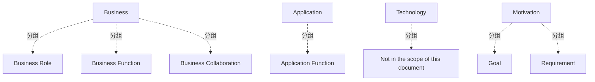

# G234/fig2-1 · 本文档使用的 ArchiMate 建模元素

类型：`notation-or-legend`。第 2.1 节声明全文参考模型采用 ArchiMate 正式记法，并先用一张图例统一元素名称、形状与建模范围；后文图 3-1、图 5-1、图 5-2 的每个框都依赖这套记法来区分“谁负责、做什么、产出什么”。

英文 PDF 物理页：[12]。本页为架构语义分析，原文与原图分别保留。

## 原图与可编辑图


[完整 JSON](fig2-1.json) · [可编辑 Mermaid](fig2-1.mmd) · [仅关系图](fig2-1.relations.mmd) · [层级分解图](fig2-1.hierarchy.mmd)

图形重建表达语义，不复制源图布局。虚线表示解释、矩阵映射或分组关系，不自动表示不确定性的概率。



## 架构分析

先看四个灰色带标题定位层：左上 Business、左下 Application、正下方 Technology、右侧 Motivation。每个带内是该层允许出现的元素示例；Technology 带内只有一句 “Not in the scope of this document”。图里没有任何连线，元素之间也没有上下级，只有“属于哪一层”的归属关系。

- 本图有 11 个具名或隐含元素、0 条关系和 7 条包含/分组记录。
- 包含/分组树最大深度为 1；根节点为 业务层、应用层、技术层、动机层。
- 本图没有可直接确认为人员直属汇报的关系；视觉上下位置、能力分解和治理职责分别读取。
- 原图靠嵌套表达结构，没有连线；新语义图将包含单独显式化，不补造流程、数据流或依赖。
- 包含分组后有 4 个连通分量；分离可能源于图例、并列分类或独立示例，未自动补边。
- 核对全部4层带、6个ArchiMate元素以及技术层范围说明；形状为记法图例，没有连线或表格。

### 如何用于项目

- 先用图例解释记法与颜色，再读取使用该符号的图。
- 记法符号是类型说明，不是实际项目实体。

### 结构所表达的逻辑

- 本图只定义记法，不是元数据管理模型；它回答“后文用哪些符号说话”。
- 动机层只有 Goal 与 Requirement，位于右侧独立带，表示建模从“为何要做”开始。
- 业务层列 Business Role、Business Function、Business Collaboration：角色与协作是主动结构（谁来做），业务功能是行为（做什么）。
- 应用层只列 Application Function，说明参考模型不细化应用组件、接口或服务。
- 技术层明确标注不在本文档范围，因此后文不会出现技术节点、设备或平台的技术架构模型。
- 原图靠形状与图标区分元素种类；中文重绘 SVG 抹平了形状差异并删掉技术层，是理解本图时最容易出错的地方。

## 上下级与包含

四个并列层带（Motivation / Business / Application / Technology）；元素隶属所在带。业务层三元素并列，动机层两元素并列，层与层之间没有上下级连线。

|父项|子项|层级类型|依据与解释|
|---|---|---|---|
|业务层|业务角色|visual_grouping|框、泳道、域或分类组的成员归属；没有额外证据不提升为业务组合或管理关系。|
|业务层|业务功能|visual_grouping|框、泳道、域或分类组的成员归属；没有额外证据不提升为业务组合或管理关系。|
|业务层|业务协作|visual_grouping|框、泳道、域或分类组的成员归属；没有额外证据不提升为业务组合或管理关系。|
|应用层|应用功能|visual_grouping|框、泳道、域或分类组的成员归属；没有额外证据不提升为业务组合或管理关系。|
|动机层|目标|visual_grouping|框、泳道、域或分类组的成员归属；没有额外证据不提升为业务组合或管理关系。|
|动机层|需求|visual_grouping|框、泳道、域或分类组的成员归属；没有额外证据不提升为业务组合或管理关系。|
|技术层|不在本文档范围内|visual_grouping|框、泳道、域或分类组的成员归属；没有额外证据不提升为业务组合或管理关系。|

## 全部元素与角色

|元素ID|原文名称|类型|含义|直接父项|深度|
|---|---|---|---|---|---|
|layer_business|Business|group|ArchiMate 业务层，包含三个元素。|—||
|layer_application|Application|group|ArchiMate 应用层，只列一个应用功能。|—||
|layer_technology|Technology|group|ArchiMate 技术层，带内只有范围说明。|—||
|layer_motivation|Motivation|group|ArchiMate 动机层，含目标与需求。|—||
|business_role|Business Role|role|执行特定行为的责任，可分配参与者。|业务层|1|
|business_function|Business Function|function|基于一组标准的业务行为集合。|业务层|1|
|business_collaboration|Business Collaboration|organization_unit|两个或以上业务内部主动结构要素的聚合，共同执行集体行为。|业务层|1|
|application_function|Application Function|function|可由应用组件执行的自动化行为。|应用层|1|
|goal|Goal|goal|对组织及其利益相关者的意图、方向或期望终态的高层陈述。|动机层|1|
|requirement|Requirement|requirement|定义适用于架构所描述特定系统之属性的需求陈述。|动机层|1|
|tech_scope_note|Not in the scope of this document|note|原图技术层唯一的文字，声明技术层不建模。|技术层|1|

## 全部关系

图中没有连线。层带边界表示 ArchiMate 分层；元素在带内的位置只表示归属，不表示顺序或依赖。

|主体|语义关系|客体|显式线/隐式|原文标签|依据|
|---|---|---|---|---|---|

## 误读检查

- 不要以为原图没有技术层：原图有 Technology 带，只是写明技术层不在本文档范围内。
- 不要把六个元素当成同一层级的清单；它们分属动机、业务、应用三层。
- 不要把中文稿 SVG 底部的“逐层把为何落到如何实现”当成原图结论，原图没有这句话，也没有箭头。

## 原文证据

### [PDF 第 12 页](../../../documents/G234.md#page-12)

> Figure 2-1: The ArchiMate Modeling Notation Elements Used in This Document

## 来源与分析状态

所有元素/关系均有来源定位；未把历史解释重命名为本轮逐线视觉确认。源图与语义图是两种视图，布局不证明汇报或因果。

源 PDF SHA-256：`34a1c590f938bf915182fe5bbe00d1d68f9a3e948697b5500ce7c5a9494f77e7`。

源图记录：[原始解释与转录](../../../figures/G234/fig2-1.json)。

```json
{
  "quality": {
    "graph_integrity": "checked",
    "semantic_analysis": "typed-graph-and-context-analysis",
    "visual_review": "source-content-audited",
    "notice_zh": "所有元素/关系均有来源定位；未把历史解释重命名为本轮逐线视觉确认。源图与语义图是两种视图，布局不证明汇报或因果。"
  },
  "source_uncertainty": {
    "confidence": "high",
    "uncertainties_zh": [
      "技术层在原图中只有一句范围说明，没有给出任何技术元素示例，无法判断原设计是否还省略了其他技术层元素。",
      "中文重绘 SVG 与英文原图差异很大，本分析以英文 PDF 第 12 页截图为准。"
    ],
    "analyzed_from": [
      "英文 PDF 第 12 页原图截图（2x2 放大分块）",
      "英文 PDF 第 12 页正文",
      "中文稿 G234e_信息架构_元数据管理.md 第 95–113 行",
      "figs/g234_legend.svg 源码"
    ],
    "date": "2026-10-31"
  },
  "source_conflicts": []
}
```
