# G234/fig3-1 · 元数据管理能力——高层功能

类型：`decomposition-or-organization-model`。第 3.1 节的高层参考模型，为 3.2 节业务功能表、3.3 节应用功能表和第 5 章的详细参考模型提供顶层索引：先看能力由哪两块组成，再逐项下钻。

英文 PDF 物理页：[17]。本页为架构语义分析，原文与原图分别保留。

## 原图与可编辑图


[完整 JSON](fig3-1.json) · [可编辑 Mermaid](fig3-1.mmd) · [仅关系图](fig3-1.relations.mmd) · [层级分解图](fig3-1.hierarchy.mmd)

图形重建表达语义，不复制源图布局。虚线表示解释、矩阵映射或分组关系，不自动表示不确定性的概率。

```mermaid
flowchart TB
  %% Semantic reconstruction; see original source image for exact layout.
  n0["Metadata Management Business Functions"]
  n1["Metadata Management Application Functions"]
  n2["Strategy &amp; Roadmaps Definition"]
  n3["Governance &amp; Measurement"]
  n4["Business Glossary Documentation"]
  n5["Data Dictionary Documentation"]
  n6["Data Usage Documentation"]
  n7["Rule &amp; Policy Documentation"]
  n8["Data Issue Documentation"]
  n9["Business Assets and Technical Assets Association"]
  n10["Metadata Repository Design"]
  n11["Communication &amp; Training"]
  n12["Acquisition"]
  n13["Governance"]
  n14["Reporting"]
  n15["Reference Data Management"]
  n16["Metadata Integration"]
  n17["Administration"]
  n0 -.->|"分组"| n2
  n0 -.->|"分组"| n3
  n0 -.->|"分组"| n4
  n0 -.->|"分组"| n5
  n0 -.->|"分组"| n6
  n0 -.->|"分组"| n7
  n0 -.->|"分组"| n8
  n0 -.->|"分组"| n9
  n0 -.->|"分组"| n10
  n0 -.->|"分组"| n11
  n1 -.->|"分组"| n12
  n1 -.->|"分组"| n13
  n1 -.->|"分组"| n14
  n1 -.->|"分组"| n15
  n1 -.->|"分组"| n16
  n1 -.->|"分组"| n17
```



## 架构分析

左黄组读业务功能：自上而下依次是战略与路线图定义、治理与度量、五个文档化功能、资产关联与存储库设计、沟通与培训。右蓝组读应用功能：采集在最上，其下并排治理与报表，再下是参考数据管理，右侧单列元数据集成，最下是管理。图中没有连线，包含关系由大组框表达，组内各项并列。

- 本图有 18 个具名或隐含元素、0 条关系和 16 条包含/分组记录。
- 包含/分组树最大深度为 1；根节点为 元数据管理业务功能、元数据管理应用功能。
- 本图没有可直接确认为人员直属汇报的关系；视觉上下位置、能力分解和治理职责分别读取。
- 原图靠嵌套表达结构，没有连线；新语义图将包含单独显式化，不补造流程、数据流或依赖。
- 包含分组后有 2 个连通分量；分离可能源于图例、并列分类或独立示例，未自动补边。
- 核对两个总功能组、10个业务功能和6个应用功能；包含关系完整，无跨组依赖箭头。

### 如何用于项目

- 按父项展开所有直接子项，检查同层粒度、重叠和缺项。
- 保留组成、分类、能力分解与组织汇报的区别；将示例名称替换为已确认的项目对象。

### 结构所表达的逻辑

- 业务侧 10 项：战略与路线图定义、治理与度量、业务术语表文档、数据字典文档、数据使用文档、规则与政策文档、数据问题文档、业务资产与技术资产关联、元数据存储库设计、沟通与培训。
- 应用侧 6 项：采集、治理、报表、参考数据管理、元数据集成、管理。
- 两组回答不同问题：业务功能说明要产出哪些文档与治理动作，应用功能说明用哪些自动化能力支撑；两组并非一一对应。
- 业务组的纵向次序暗示推进逻辑：先定战略与治理，再做五类文档，随后做资产关联与存储库设计，最后沟通培训；但图中没有箭头，不能当成严格流程。
- 应用组把“元数据集成”单列在右侧通栏，表示它是与其他应用功能并列的一类能力，而不是跨组的连接线。
- 本图只到一级功能；每项功能的二级细化见图 5-1（业务）和图 5-2（应用），定义见表 3-1、表 3-2。

## 上下级与包含

顶层是“元数据管理能力”（图中未单独画框）→ 两个并列组（业务功能、应用功能）→ 组内一级功能项。业务组 10 项并列，应用组 6 项并列，组内没有子功能。

|父项|子项|层级类型|依据与解释|
|---|---|---|---|
|元数据管理业务功能|战略与路线图定义|visual_grouping|框、泳道、域或分类组的成员归属；没有额外证据不提升为业务组合或管理关系。|
|元数据管理业务功能|治理与度量|visual_grouping|框、泳道、域或分类组的成员归属；没有额外证据不提升为业务组合或管理关系。|
|元数据管理业务功能|业务术语表文档|visual_grouping|框、泳道、域或分类组的成员归属；没有额外证据不提升为业务组合或管理关系。|
|元数据管理业务功能|数据字典文档|visual_grouping|框、泳道、域或分类组的成员归属；没有额外证据不提升为业务组合或管理关系。|
|元数据管理业务功能|数据使用文档|visual_grouping|框、泳道、域或分类组的成员归属；没有额外证据不提升为业务组合或管理关系。|
|元数据管理业务功能|规则与政策文档|visual_grouping|框、泳道、域或分类组的成员归属；没有额外证据不提升为业务组合或管理关系。|
|元数据管理业务功能|数据问题文档|visual_grouping|框、泳道、域或分类组的成员归属；没有额外证据不提升为业务组合或管理关系。|
|元数据管理业务功能|业务资产与技术资产关联|visual_grouping|框、泳道、域或分类组的成员归属；没有额外证据不提升为业务组合或管理关系。|
|元数据管理业务功能|元数据存储库设计|visual_grouping|框、泳道、域或分类组的成员归属；没有额外证据不提升为业务组合或管理关系。|
|元数据管理业务功能|沟通与培训|visual_grouping|框、泳道、域或分类组的成员归属；没有额外证据不提升为业务组合或管理关系。|
|元数据管理应用功能|采集|visual_grouping|框、泳道、域或分类组的成员归属；没有额外证据不提升为业务组合或管理关系。|
|元数据管理应用功能|治理|visual_grouping|框、泳道、域或分类组的成员归属；没有额外证据不提升为业务组合或管理关系。|
|元数据管理应用功能|报表|visual_grouping|框、泳道、域或分类组的成员归属；没有额外证据不提升为业务组合或管理关系。|
|元数据管理应用功能|参考数据管理|visual_grouping|框、泳道、域或分类组的成员归属；没有额外证据不提升为业务组合或管理关系。|
|元数据管理应用功能|元数据集成|visual_grouping|框、泳道、域或分类组的成员归属；没有额外证据不提升为业务组合或管理关系。|
|元数据管理应用功能|管理|visual_grouping|框、泳道、域或分类组的成员归属；没有额外证据不提升为业务组合或管理关系。|

## 全部元素与角色

|元素ID|原文名称|类型|含义|直接父项|深度|
|---|---|---|---|---|---|
|grp_business_functions|Metadata Management Business Functions|group|容纳 10 个高层业务功能。|—||
|grp_application_functions|Metadata Management Application Functions|group|容纳 6 个高层应用功能。|—||
|bf_strategy|Strategy & Roadmaps Definition|function|功能：战略与路线图定义|元数据管理业务功能|1|
|bf_governance|Governance & Measurement|function|功能：治理与度量|元数据管理业务功能|1|
|bf_glossary|Business Glossary Documentation|function|功能：业务术语表文档|元数据管理业务功能|1|
|bf_dictionary|Data Dictionary Documentation|function|功能：数据字典文档|元数据管理业务功能|1|
|bf_usage|Data Usage Documentation|function|功能：数据使用文档|元数据管理业务功能|1|
|bf_rules|Rule & Policy Documentation|function|功能：规则与政策文档|元数据管理业务功能|1|
|bf_issues|Data Issue Documentation|function|功能：数据问题文档|元数据管理业务功能|1|
|bf_assets|Business Assets and Technical Assets Association|function|功能：业务资产与技术资产关联|元数据管理业务功能|1|
|bf_repository|Metadata Repository Design|function|功能：元数据存储库设计|元数据管理业务功能|1|
|bf_training|Communication & Training|function|功能：沟通与培训|元数据管理业务功能|1|
|af_acquisition|Acquisition|function|功能：采集|元数据管理应用功能|1|
|af_governance|Governance|function|功能：治理|元数据管理应用功能|1|
|af_reporting|Reporting|function|功能：报表|元数据管理应用功能|1|
|af_reference_data|Reference Data Management|function|功能：参考数据管理|元数据管理应用功能|1|
|af_integration|Metadata Integration|function|功能：元数据集成|元数据管理应用功能|1|
|af_administration|Administration|function|功能：管理|元数据管理应用功能|1|

## 全部关系

全图无连线。大组框表示归属（这些功能属于业务侧或应用侧），组内位置只表示并列与阅读次序，不表示调用或依赖。

|主体|语义关系|客体|显式线/隐式|原文标签|依据|
|---|---|---|---|---|---|

## 误读检查

- 不要以为右侧应用功能是左侧业务功能的子集或实现；它们是两个不同层面的能力清单。
- 不要把“元数据集成”理解为连接左右两组的桥梁；它在原图中只是应用功能组里的一个独立框。
- 中文稿 SVG 只有业务功能，没有应用功能，不能据它判断本图范围；SVG 的五种颜色也没有任何图例依据。

## 原文证据

### [PDF 第 17 页](../../../documents/G234.md#page-17)


## 来源与分析状态

所有元素/关系均有来源定位；未把历史解释重命名为本轮逐线视觉确认。源图与语义图是两种视图，布局不证明汇报或因果。

源 PDF SHA-256：`34a1c590f938bf915182fe5bbe00d1d68f9a3e948697b5500ce7c5a9494f77e7`。

源图记录：[原始解释与转录](../../../figures/G234/fig3-1.json)。

```json
{
  "quality": {
    "graph_integrity": "checked",
    "semantic_analysis": "typed-graph-and-context-analysis",
    "visual_review": "source-content-audited",
    "notice_zh": "所有元素/关系均有来源定位；未把历史解释重命名为本轮逐线视觉确认。源图与语义图是两种视图，布局不证明汇报或因果。"
  },
  "source_uncertainty": {
    "confidence": "high",
    "uncertainties_zh": [
      "原图把业务功能排成 1-1-3-2-2-1 行，但没有说明这种排版是否隐含流程顺序；本分析只按视觉分组解读，不把位置当成严格流程。",
      "框右上角的折角箭头在原图中很小，按 ArchiMate 功能元素记号理解；无法从截图辨认更细的构造型文字。"
    ],
    "analyzed_from": [
      "英文 PDF 第 17 页原图截图（2x2 放大分块）",
      "英文 PDF 第 17 页正文（表 3-1 前五项）",
      "中文稿 G234e_信息架构_元数据管理.md 第 173–204 行（表 3-1、表 3-2）",
      "figs/g234_fig3-1.svg 源码"
    ],
    "date": "2026-10-31"
  },
  "source_conflicts": []
}
```
