# G234/fig4-1 · 元数据来源示意

类型：`decomposition-or-organization-model`。第 4.2 节开头说明元数据散落在多个来源、多个社区、不同流程与生命周期中，图 4-1 先把“有哪些域、每域能提供什么资产”摆出来，随后正文才建议按业务目标分步建立文档，而不是一次性全量登记。

英文 PDF 物理页：[23]。本页为架构语义分析，原文与原图分别保留。

## 原图与可编辑图


[完整 JSON](fig4-1.json) · [可编辑 Mermaid](fig4-1.mmd) · [仅关系图](fig4-1.relations.mmd) · [层级分解图](fig4-1.hierarchy.mmd)

图形重建表达语义，不复制源图布局。虚线表示解释、矩阵映射或分组关系，不自动表示不确定性的概率。

```mermaid
flowchart TB
  %% Semantic reconstruction; see original source image for exact layout.
  n0["Data Glossary, Policies, &amp; Quality"]
  n1["Business Processes"]
  n2["Security Management"]
  n3["Application Repository"]
  n4["Data Privacy"]
  n5["Risk Management"]
  n6["Reference Data"]
  n7["Data Glossary"]
  n8["Modeling Tools"]
  n9["Business Term"]
  n10["Business Data Object"]
  n11["Business Data Element"]
  n12["Business Data Quality Rule"]
  n13["Data Policy"]
  n14["Business Processes Modeling Tools"]
  n15["Business Rule"]
  n16["Process"]
  n17["Activity"]
  n18["Security Management Repositories"]
  n19["Control"]
  n20["Confidentiality Classification"]
  n21["Application Metadata Repositories"]
  n22["Application"]
  n23["Data Flow"]
  n24["Data Privacy Registries"]
  n25["Data Processing Activity"]
  n26["Data Privacy Assessment"]
  n27["Business Data Deletion Rule"]
  n28["Privacy Classification"]
  n29["Risk Management Registries"]
  n30["Committee"]
  n31["Control"]
  n32["Process"]
  n33["Reference Data Repository"]
  n34["Code Set"]
  n35["Code Value"]
  n36["Data Documentation and Governance"]
  n37["Business Data Domain"]
  n38["Role"]
  n39["Organization"]
  n40["Data Classification"]
  n41["Metadata Association"]
  n42["Metadata Activity Logs"]
  n43["Technical Metadata"]
  n44["Database"]
  n45["Data Set"]
  n46["Data Field"]
  n47["Data Flow"]
  n48["Technical Data Deletion Rule"]
  n49["Technical Data Quality Rule"]
  n50["BI &amp; Analytics Platform"]
  n51["Data Integration Tools"]
  n52["Database Management &amp; System Catalog"]
  n53["Relational"]
  n54["Analytical"]
  n55["STRUCTURED DATA"]
  n56["SEMI-STRUCTURED DATA"]
  n57["UNSTRUCTURED DATA"]
  n58["Operational Metadata"]
  n59["Data Quality Anomaly"]
  n60["Data Volume"]
  n61["Data Access Event"]
  n62["BI &amp; Analytics Platform"]
  n63["Administration &amp; Monitoring Tools"]
  n0 -.->|"分组"| n7
  n0 -.->|"分组"| n8
  n0 -.->|"分组"| n9
  n0 -.->|"分组"| n10
  n0 -.->|"分组"| n11
  n0 -.->|"分组"| n12
  n0 -.->|"分组"| n13
  n1 -.->|"分组"| n14
  n1 -.->|"分组"| n15
  n1 -.->|"分组"| n16
  n1 -.->|"分组"| n17
  n2 -.->|"分组"| n18
  n2 -.->|"分组"| n19
  n2 -.->|"分组"| n20
  n3 -.->|"分组"| n21
  n3 -.->|"分组"| n22
  n3 -.->|"分组"| n23
  n4 -.->|"分组"| n24
  n4 -.->|"分组"| n25
  n4 -.->|"分组"| n26
  n4 -.->|"分组"| n27
  n4 -.->|"分组"| n28
  n5 -.->|"分组"| n29
  n5 -.->|"分组"| n30
  n5 -.->|"分组"| n31
  n5 -.->|"分组"| n32
  n6 -.->|"分组"| n33
  n6 -.->|"分组"| n34
  n6 -.->|"分组"| n35
  n36 -.->|"分组"| n37
  n36 -.->|"分组"| n38
  n36 -.->|"分组"| n39
  n36 -.->|"分组"| n40
  n36 -.->|"分组"| n41
  n36 -.->|"分组"| n42
  n43 -.->|"分组"| n44
  n43 -.->|"分组"| n45
  n43 -.->|"分组"| n46
  n43 -.->|"分组"| n47
  n43 -.->|"分组"| n48
  n43 -.->|"分组"| n49
  n43 -.->|"分组"| n50
  n43 -.->|"分组"| n51
  n43 -.->|"分组"| n52
  n43 -.->|"分组"| n53
  n43 -.->|"分组"| n54
  n43 -.->|"分组"| n55
  n43 -.->|"分组"| n56
  n43 -.->|"分组"| n57
  n58 -.->|"分组"| n59
  n58 -.->|"分组"| n60
  n58 -.->|"分组"| n61
  n58 -.->|"分组"| n62
  n58 -.->|"分组"| n63
```



## 架构分析

先看顶部 7 列：每列标题是一个元数据域，列内标签是该域可提供的元数据资产。再看中部横带 “Data Documentation and Governance”，它是跨域共用的治理标签。最后看底部两框：左侧 Technical Metadata 列数据库/数据集/字段/数据流/删除规则/质量规则，并用图标区分关系型、分析型与结构化/半结构化/非结构化数据；右侧 Operational Metadata 列质量异常、数据量、访问事件和产生它们的工具。全图没有箭头。

- 本图有 64 个具名或隐含元素、0 条关系和 54 条包含/分组记录。
- 包含/分组树最大深度为 1；根节点为 数据术语表、政策与质量、业务流程、安全管理、应用存储库、数据隐私、风险管理、参考数据、数据文档化与治理、技术元数据、运营元数据。
- 本图没有可直接确认为人员直属汇报的关系；视觉上下位置、能力分解和治理职责分别读取。
- 原图靠嵌套表达结构，没有连线；新语义图将包含单独显式化，不补造流程、数据流或依赖。
- 包含分组后有 10 个连通分量；分离可能源于图例、并列分类或独立示例，未自动补边。
- 核对7个来源域、6项横向文档治理资产及底部技术/运营元数据全部64标签；重复的Control、Process、Data Flow、BI平台按区域保留。
- 核对两张转录表全部行；源图没有资产之间的显式连线，数据库/文件图标只表达数据形态。

### 如何用于项目

- 按父项展开所有直接子项，检查同层粒度、重叠和缺项。
- 保留组成、分类、能力分解与组织汇报的区别；将示例名称替换为已确认的项目对象。

### 结构所表达的逻辑

- 7 个元数据域：数据术语表/政策/质量、业务流程、安全管理、应用存储库、数据隐私、风险管理、参考数据。
- 同一类资产会跨域出现：Control 同时出现在安全管理与风险管理，Process/Activity 同时出现在业务流程与数据隐私，说明“域”是视角而非互斥分区。
- 中部 “Data Documentation and Governance” 不属于任何单一域，它把业务数据域、角色、组织、数据分类、元数据关联、元数据活动日志作为贯穿各域的治理维度。
- 技术元数据框把资产（Database、Data Set、Data Field、Data Flow、Technical Data Deletion Rule、Technical Data Quality Rule）与数据形态（Relational、Analytical；Structured/Semi-structured/Unstructured data）并列，暗示形态决定采集方式。
- 运营元数据框用零散小方块示意事件流，资产是 Data Quality Anomaly、Data Volume、Data Access Event，由 BI & Analytics Platform 与 Administration & Monitoring Tools 产生。
- 图注说明这些元数据域是从用例中提炼后套用到本文语境的，因此清单是基线而非穷举；这与正文“分步推进”的建议一致。

## 上下级与包含

两层：元数据域（L1，7 个并列列）→ 域内元数据资产（L2）。底部 Technical Metadata 与 Operational Metadata 是两个并列大类（L1），其下资产与数据形态为 L2。中部治理横带独立于所有域。

|父项|子项|层级类型|依据与解释|
|---|---|---|---|
|数据术语表、政策与质量|数据术语表|visual_grouping|框、泳道、域或分类组的成员归属；没有额外证据不提升为业务组合或管理关系。|
|数据术语表、政策与质量|建模工具|visual_grouping|框、泳道、域或分类组的成员归属；没有额外证据不提升为业务组合或管理关系。|
|数据术语表、政策与质量|业务术语|visual_grouping|框、泳道、域或分类组的成员归属；没有额外证据不提升为业务组合或管理关系。|
|数据术语表、政策与质量|业务数据对象|visual_grouping|框、泳道、域或分类组的成员归属；没有额外证据不提升为业务组合或管理关系。|
|数据术语表、政策与质量|业务数据元素|visual_grouping|框、泳道、域或分类组的成员归属；没有额外证据不提升为业务组合或管理关系。|
|数据术语表、政策与质量|业务数据质量规则|visual_grouping|框、泳道、域或分类组的成员归属；没有额外证据不提升为业务组合或管理关系。|
|数据术语表、政策与质量|数据政策|visual_grouping|框、泳道、域或分类组的成员归属；没有额外证据不提升为业务组合或管理关系。|
|业务流程|业务流程建模工具|visual_grouping|框、泳道、域或分类组的成员归属；没有额外证据不提升为业务组合或管理关系。|
|业务流程|业务规则|visual_grouping|框、泳道、域或分类组的成员归属；没有额外证据不提升为业务组合或管理关系。|
|业务流程|流程|visual_grouping|框、泳道、域或分类组的成员归属；没有额外证据不提升为业务组合或管理关系。|
|业务流程|活动|visual_grouping|框、泳道、域或分类组的成员归属；没有额外证据不提升为业务组合或管理关系。|
|安全管理|安全管理存储库|visual_grouping|框、泳道、域或分类组的成员归属；没有额外证据不提升为业务组合或管理关系。|
|安全管理|控制|visual_grouping|框、泳道、域或分类组的成员归属；没有额外证据不提升为业务组合或管理关系。|
|安全管理|保密性分级|visual_grouping|框、泳道、域或分类组的成员归属；没有额外证据不提升为业务组合或管理关系。|
|应用存储库|应用元数据存储库|visual_grouping|框、泳道、域或分类组的成员归属；没有额外证据不提升为业务组合或管理关系。|
|应用存储库|应用|visual_grouping|框、泳道、域或分类组的成员归属；没有额外证据不提升为业务组合或管理关系。|
|应用存储库|数据流|visual_grouping|框、泳道、域或分类组的成员归属；没有额外证据不提升为业务组合或管理关系。|
|数据隐私|数据隐私登记册|visual_grouping|框、泳道、域或分类组的成员归属；没有额外证据不提升为业务组合或管理关系。|
|数据隐私|数据处理活动|visual_grouping|框、泳道、域或分类组的成员归属；没有额外证据不提升为业务组合或管理关系。|
|数据隐私|数据隐私评估|visual_grouping|框、泳道、域或分类组的成员归属；没有额外证据不提升为业务组合或管理关系。|
|数据隐私|业务数据删除规则|visual_grouping|框、泳道、域或分类组的成员归属；没有额外证据不提升为业务组合或管理关系。|
|数据隐私|隐私分级|visual_grouping|框、泳道、域或分类组的成员归属；没有额外证据不提升为业务组合或管理关系。|
|风险管理|风险管理登记册|visual_grouping|框、泳道、域或分类组的成员归属；没有额外证据不提升为业务组合或管理关系。|
|风险管理|委员会|visual_grouping|框、泳道、域或分类组的成员归属；没有额外证据不提升为业务组合或管理关系。|
|风险管理|控制|visual_grouping|框、泳道、域或分类组的成员归属；没有额外证据不提升为业务组合或管理关系。|
|风险管理|流程|visual_grouping|框、泳道、域或分类组的成员归属；没有额外证据不提升为业务组合或管理关系。|
|参考数据|参考数据存储库|visual_grouping|框、泳道、域或分类组的成员归属；没有额外证据不提升为业务组合或管理关系。|
|参考数据|代码集|visual_grouping|框、泳道、域或分类组的成员归属；没有额外证据不提升为业务组合或管理关系。|
|参考数据|代码值|visual_grouping|框、泳道、域或分类组的成员归属；没有额外证据不提升为业务组合或管理关系。|
|数据文档化与治理|业务数据域|visual_grouping|框、泳道、域或分类组的成员归属；没有额外证据不提升为业务组合或管理关系。|
|数据文档化与治理|角色|visual_grouping|框、泳道、域或分类组的成员归属；没有额外证据不提升为业务组合或管理关系。|
|数据文档化与治理|组织|visual_grouping|框、泳道、域或分类组的成员归属；没有额外证据不提升为业务组合或管理关系。|
|数据文档化与治理|数据分类|visual_grouping|框、泳道、域或分类组的成员归属；没有额外证据不提升为业务组合或管理关系。|
|数据文档化与治理|元数据关联|visual_grouping|框、泳道、域或分类组的成员归属；没有额外证据不提升为业务组合或管理关系。|
|数据文档化与治理|元数据活动日志|visual_grouping|框、泳道、域或分类组的成员归属；没有额外证据不提升为业务组合或管理关系。|
|技术元数据|数据库|visual_grouping|框、泳道、域或分类组的成员归属；没有额外证据不提升为业务组合或管理关系。|
|技术元数据|数据集|visual_grouping|框、泳道、域或分类组的成员归属；没有额外证据不提升为业务组合或管理关系。|
|技术元数据|数据字段|visual_grouping|框、泳道、域或分类组的成员归属；没有额外证据不提升为业务组合或管理关系。|
|技术元数据|数据流|visual_grouping|框、泳道、域或分类组的成员归属；没有额外证据不提升为业务组合或管理关系。|
|技术元数据|技术数据删除规则|visual_grouping|框、泳道、域或分类组的成员归属；没有额外证据不提升为业务组合或管理关系。|
|技术元数据|技术数据质量规则|visual_grouping|框、泳道、域或分类组的成员归属；没有额外证据不提升为业务组合或管理关系。|
|技术元数据|BI 与分析平台|visual_grouping|框、泳道、域或分类组的成员归属；没有额外证据不提升为业务组合或管理关系。|
|技术元数据|数据集成工具|visual_grouping|框、泳道、域或分类组的成员归属；没有额外证据不提升为业务组合或管理关系。|
|技术元数据|数据库管理与系统目录|visual_grouping|框、泳道、域或分类组的成员归属；没有额外证据不提升为业务组合或管理关系。|
|技术元数据|关系型|visual_grouping|框、泳道、域或分类组的成员归属；没有额外证据不提升为业务组合或管理关系。|
|技术元数据|分析型|visual_grouping|框、泳道、域或分类组的成员归属；没有额外证据不提升为业务组合或管理关系。|
|技术元数据|结构化数据|visual_grouping|框、泳道、域或分类组的成员归属；没有额外证据不提升为业务组合或管理关系。|
|技术元数据|半结构化数据|visual_grouping|框、泳道、域或分类组的成员归属；没有额外证据不提升为业务组合或管理关系。|
|技术元数据|非结构化数据|visual_grouping|框、泳道、域或分类组的成员归属；没有额外证据不提升为业务组合或管理关系。|
|运营元数据|数据质量异常|visual_grouping|框、泳道、域或分类组的成员归属；没有额外证据不提升为业务组合或管理关系。|
|运营元数据|数据量|visual_grouping|框、泳道、域或分类组的成员归属；没有额外证据不提升为业务组合或管理关系。|
|运营元数据|数据访问事件|visual_grouping|框、泳道、域或分类组的成员归属；没有额外证据不提升为业务组合或管理关系。|
|运营元数据|BI 与分析平台|visual_grouping|框、泳道、域或分类组的成员归属；没有额外证据不提升为业务组合或管理关系。|
|运营元数据|管理与监控工具|visual_grouping|框、泳道、域或分类组的成员归属；没有额外证据不提升为业务组合或管理关系。|

## 全部元素与角色

|元素ID|原文名称|类型|含义|直接父项|深度|
|---|---|---|---|---|---|
|d_glossary|Data Glossary, Policies, & Quality|group|该域提供术语、对象、元素、质量规则与政策类资产。|—||
|d_business_processes|Business Processes|group|分组：业务流程|—||
|d_security|Security Management|group|分组：安全管理|—||
|d_application_repo|Application Repository|group|分组：应用存储库|—||
|d_data_privacy|Data Privacy|group|分组：数据隐私|—||
|d_risk|Risk Management|group|分组：风险管理|—||
|d_reference_data|Reference Data|group|分组：参考数据|—||
|a_data_glossary|Data Glossary|artifact|制品：数据术语表|数据术语表、政策与质量|1|
|a_modeling_tools|Modeling Tools|application|应用：建模工具|数据术语表、政策与质量|1|
|a_business_term|Business Term|data|信息/数据：业务术语|数据术语表、政策与质量|1|
|a_business_data_object|Business Data Object|data|信息/数据：业务数据对象|数据术语表、政策与质量|1|
|a_business_data_element|Business Data Element|data|信息/数据：业务数据元素|数据术语表、政策与质量|1|
|a_business_dq_rule|Business Data Quality Rule|principle|原则：业务数据质量规则|数据术语表、政策与质量|1|
|a_data_policy|Data Policy|principle|原则：数据政策|数据术语表、政策与质量|1|
|a_bp_modeling_tools|Business Processes Modeling Tools|application|应用：业务流程建模工具|业务流程|1|
|a_business_rule|Business Rule|principle|原则：业务规则|业务流程|1|
|a_process|Process|process|流程：流程|业务流程|1|
|a_activity|Activity|process|流程：活动|业务流程|1|
|a_security_repo|Security Management Repositories|artifact|制品：安全管理存储库|安全管理|1|
|a_security_control|Control|risk|风险：控制|安全管理|1|
|a_confidentiality|Confidentiality Classification|data|信息/数据：保密性分级|安全管理|1|
|a_app_repo|Application Metadata Repositories|artifact|制品：应用元数据存储库|应用存储库|1|
|a_application|Application|application|应用：应用|应用存储库|1|
|a_app_data_flow|Data Flow|data|信息/数据：数据流|应用存储库|1|
|a_privacy_registries|Data Privacy Registries|artifact|制品：数据隐私登记册|数据隐私|1|
|a_processing_activity|Data Processing Activity|process|流程：数据处理活动|数据隐私|1|
|a_privacy_assessment|Data Privacy Assessment|artifact|制品：数据隐私评估|数据隐私|1|
|a_business_deletion_rule|Business Data Deletion Rule|principle|原则：业务数据删除规则|数据隐私|1|
|a_privacy_classification|Privacy Classification|data|信息/数据：隐私分级|数据隐私|1|
|a_risk_registries|Risk Management Registries|artifact|制品：风险管理登记册|风险管理|1|
|a_risk_committee|Committee|organization_unit|组织单元：委员会|风险管理|1|
|a_risk_control|Control|risk|风险：控制|风险管理|1|
|a_risk_process|Process|process|流程：流程|风险管理|1|
|a_reference_repo|Reference Data Repository|artifact|制品：参考数据存储库|参考数据|1|
|a_code_set|Code Set|data|信息/数据：代码集|参考数据|1|
|a_code_value|Code Value|data|信息/数据：代码值|参考数据|1|
|grp_governance_band|Data Documentation and Governance|group|跨域的治理标签带。|—||
|g_business_domain|Business Data Domain|data|信息/数据：业务数据域|数据文档化与治理|1|
|g_role|Role|role|角色：角色|数据文档化与治理|1|
|g_organization|Organization|organization_unit|组织单元：组织|数据文档化与治理|1|
|g_data_classification|Data Classification|data|信息/数据：数据分类|数据文档化与治理|1|
|g_metadata_association|Metadata Association|artifact|制品：元数据关联|数据文档化与治理|1|
|g_activity_logs|Metadata Activity Logs|data|信息/数据：元数据活动日志|数据文档化与治理|1|
|grp_technical|Technical Metadata|group|分组：技术元数据|—||
|t_database|Database|data|信息/数据：数据库|技术元数据|1|
|t_data_set|Data Set|data|信息/数据：数据集|技术元数据|1|
|t_data_field|Data Field|data|信息/数据：数据字段|技术元数据|1|
|t_data_flow|Data Flow|data|信息/数据：数据流|技术元数据|1|
|t_deletion_rule|Technical Data Deletion Rule|principle|原则：技术数据删除规则|技术元数据|1|
|t_dq_rule|Technical Data Quality Rule|principle|原则：技术数据质量规则|技术元数据|1|
|t_bi_platform|BI & Analytics Platform|application|应用：BI 与分析平台|技术元数据|1|
|t_integration_tools|Data Integration Tools|application|应用：数据集成工具|技术元数据|1|
|t_db_tools|Database Management & System Catalog|application|应用：数据库管理与系统目录|技术元数据|1|
|t_relational|Relational|data|信息/数据：关系型|技术元数据|1|
|t_analytical|Analytical|data|信息/数据：分析型|技术元数据|1|
|t_structured|STRUCTURED DATA|note|说明：结构化数据|技术元数据|1|
|t_semi_structured|SEMI-STRUCTURED DATA|note|说明：半结构化数据|技术元数据|1|
|t_unstructured|UNSTRUCTURED DATA|note|说明：非结构化数据|技术元数据|1|
|grp_operational|Operational Metadata|group|分组：运营元数据|—||
|o_dq_anomaly|Data Quality Anomaly|data|信息/数据：数据质量异常|运营元数据|1|
|o_data_volume|Data Volume|metric|度量：数据量|运营元数据|1|
|o_access_event|Data Access Event|event|事件：数据访问事件|运营元数据|1|
|o_bi_platform|BI & Analytics Platform|application|应用：BI 与分析平台|运营元数据|1|
|o_admin_tools|Administration & Monitoring Tools|application|应用：管理与监控工具|运营元数据|1|

## 全部关系

全图没有任何连线或箭头。归属由“标签在哪个域列/哪个大框内”表达；中部横带的位置表示它跨域适用；底部数据形态图标只是示意，不表示数据流。

|主体|语义关系|客体|显式线/隐式|原文标签|依据|
|---|---|---|---|---|---|

## 元数据域 × 域内元数据资产（按原图逐列转录）

```json
{
  "id": "t_domains",
  "title_zh": "元数据域 × 域内元数据资产（按原图逐列转录）",
  "columns": [
    "元数据域",
    "域内元数据资产"
  ],
  "rows": [
    [
      "Data Glossary, Policies, & Quality 数据术语表、政策与质量",
      "Data Glossary；Modeling Tools；Business Term；Business Data Object；Business Data Element；Business Data Quality Rule；Data Policy"
    ],
    [
      "Business Processes 业务流程",
      "Business Processes Modeling Tools；Business Rule；Process；Activity"
    ],
    [
      "Security Management 安全管理",
      "Security Management Repositories；Control；Confidentiality Classification"
    ],
    [
      "Application Repository 应用存储库",
      "Application Metadata Repositories；Application；Data Flow"
    ],
    [
      "Data Privacy 数据隐私",
      "Data Privacy Registries；Data Processing Activity；Data Privacy Assessment；Business Data Deletion Rule；Privacy Classification"
    ],
    [
      "Risk Management 风险管理",
      "Risk Management Registries；Committee；Control；Process"
    ],
    [
      "Reference Data 参考数据",
      "Reference Data Repository；Code Set；Code Value"
    ]
  ],
  "notes_zh": "行序即原图从左到右的列序；同一资产名可出现在多个域。"
}
```

## 底部两大元数据类别及其资产

```json
{
  "id": "t_bottom_groups",
  "title_zh": "底部两大元数据类别及其资产",
  "columns": [
    "类别",
    "资产与形态"
  ],
  "rows": [
    [
      "Technical Metadata 技术元数据",
      "Database；Data Set；Data Field；Data Flow；Technical Data Deletion Rule；Technical Data Quality Rule；BI & Analytics Platform；Data Integration Tools；Database Management & System Catalog；数据形态：Relational、Analytical（STRUCTURED DATA）、SEMI-STRUCTURED DATA、UNSTRUCTURED DATA"
    ],
    [
      "Operational Metadata 运营元数据",
      "Data Quality Anomaly；Data Volume；Data Access Event；BI & Analytics Platform；Administration & Monitoring Tools"
    ]
  ],
  "notes_zh": "Technical Metadata 框内的数据形态由数据库/文件图标示意，不是可点击资产标签。"
}
```

## 误读检查

- 不要把 7 列读成流程步骤或成熟度阶段，它们是并列的元数据域。
- 不要因为某资产在一个域出现就认为它只属于该域；Control、Process、Activity 都跨域重复。
- 不要把底部的数据库/文件图标当成数据流或系统接口，它们只是数据形态示意，没有箭头。
- 不要把中部横带当成第三个大类；它是一条治理标签带，横跨上方 7 个域。
- 中文稿 SVG 画的是“5 个来源系统 → 元数据存储库”，与本图的域/资产清单完全不同，不能据它理解本图。

## 原文证据

### [PDF 第 22 页](../../../documents/G234.md#page-22)

> Metadata is available in multiple sources within an organization; see Figure 4-1. The main challenge is to bring together different kinds of metadata, from different communities, with different processes and lifecycles, in order to achieve specific business goals such as data compliance, data quality monitoring, and data accessibility.
### [PDF 第 23 页](../../../documents/G234.md#page-23)

> (Metadata domains have been harvested from use cases and applied to the context of this document.)
> Our recommendation is to engage in a step-by-step progressive approach to build the metadata documentation rather than attempt to document all the assets identified in the existing metadata sources at the same time.

## 来源与分析状态

所有元素/关系均有来源定位；未把历史解释重命名为本轮逐线视觉确认。源图与语义图是两种视图，布局不证明汇报或因果。

源 PDF SHA-256：`34a1c590f938bf915182fe5bbe00d1d68f9a3e948697b5500ce7c5a9494f77e7`。

源图记录：[原始解释与转录](../../../figures/G234/fig4-1.json)。

```json
{
  "quality": {
    "graph_integrity": "checked",
    "semantic_analysis": "typed-graph-and-context-analysis",
    "visual_review": "source-content-audited",
    "notice_zh": "所有元素/关系均有来源定位；未把历史解释重命名为本轮逐线视觉确认。源图与语义图是两种视图，布局不证明汇报或因果。"
  },
  "source_uncertainty": {
    "confidence": "high",
    "uncertainties_zh": [
      "原图资产标签的字距很小，个别空格在 PDF 中缺失（如 BusinessTerm），本分析按正常英文词距记录。",
      "“Data Documentation and Governance” 横带属于图内元素还是图题的一部分，版式上无边框区分；按图内横带处理。"
    ],
    "analyzed_from": [
      "英文 PDF 第 23 页原图截图（2x2 与 3x3 放大分块）",
      "英文 PDF 第 22–23 页正文",
      "中文稿 G234e_信息架构_元数据管理.md 第 226–231 行",
      "figs/g234_fig4-1.svg 源码"
    ],
    "date": "2026-10-31"
  },
  "source_conflicts": []
}
```
