# G234/fig4-10 · 技术元数据推断

类型：`architecture-concept-or-system-model`。说明技术元数据的两种获得方式之一——事后推断：当数据模式与运营元数据不是“按设计”定义时，需要剖析数据内容、抽取最低限度结构，才能纳入元数据管理与治理。

英文 PDF 物理页：[29]。本页为架构语义分析，原文与原图分别保留。

## 原图与可编辑图


[完整 JSON](fig4-10.json) · [可编辑 Mermaid](fig4-10.mmd) · [仅关系图](fig4-10.relations.mmd) · [层级分解图](fig4-10.hierarchy.mmd)

图形重建表达语义，不复制源图布局。虚线表示解释、矩阵映射或分组关系，不自动表示不确定性的概率。

```mermaid
flowchart TB
  %% Semantic reconstruction; see original source image for exact layout.
  n0["METADATA"]
  n1["Metadata Management"]
  n2["元数据管理者（3 人，无标签）"]
  n3["DATA"]
  n4["Data Profiling"]
  n5["Structured"]
  n6["RDBMS, metadata store"]
  n7["Semi-Structured"]
  n8["Parquet, Avro, etc."]
  n9["Unstructured"]
  n10["PDF, DOCX, JPG, AVI, etc."]
  n11["Structured data can be easily collected from database dictionaries, technical metadata stores, data integration repositories, etc. Note: Data schema collection does not require access to data."]
  n12["Semi-structured files come with a structure but do not guarantee schema stability over time as each file may have its own structure."]
  n13["Unstructured data – we cannot manage what we don&#x27;t know: a minimum of structure (shapes in an image; email address from a document, etc.) must be extracted from the unstructured data before analysis and governance. Such exercise requires scanning the data content which may be very intensive data processing if there are millions of files to scan."]
  n14["元数据使用者图标1"]
  n15["元数据使用者图标2"]
  n16["元数据使用者图标3"]
  n4 -->|"访问"| n5
  n4 -->|"访问"| n7
  n4 -->|"访问"| n9
  n7 -->|"流动"| n5
  n9 -->|"流动"| n7
  n4 -->|"流动"| n1
  n5 -->|"流动"| n1
  n11 ---|"关联"| n5
  n12 ---|"关联"| n7
  n13 ---|"关联"| n9
  n0 -.->|"分组"| n1
  n0 -.->|"分组"| n2
  n3 -.->|"分组"| n4
  n3 -.->|"分组"| n5
  n5 -.->|"visual_containment_only"| n6
  n3 -.->|"分组"| n7
  n7 -.->|"visual_containment_only"| n8
  n3 -.->|"分组"| n9
  n9 -.->|"visual_containment_only"| n10
  n2 -.->|"分组"| n14
  n2 -.->|"分组"| n15
  n2 -.->|"分组"| n16
```



## 架构分析

左侧虚线框分上下两带：上带 METADATA 只有 Metadata Management 框与三名管理者；下带 DATA 是灰色梯形数据域，左侧竖胶囊 Data Profiling，右侧自上而下 Structured、Semi-Structured、Unstructured 三类存储。蓝色箭头从数据域指向元数据管理，灰色箭头表示剖析读取与层间结构推断。右侧三段说明分别用细线指向对应的数据层。

- 本图有 17 个具名或隐含元素、10 条关系和 12 条包含/分组记录。
- 包含/分组树最大深度为 2；根节点为 元数据、数据、结构化数据可容易地从数据库字典、技术元数据存储、数据集成存储库等收集。注意：收集数据模式不需要访问数据。、半结构化文件带有结构，但不能保证模式随时间稳定，因为每个文件可能有自己的结构。、非结构化数据——我们无法管理自己不知道的内容：在分析与治理前，必须从非结构化数据中抽取最低限度的结构（图像中的形状、文档中的电子邮件地址等）。这项工作需要扫描数据内容，如果要扫描数百万个文件，可能是非常密集的数据处理。。
- 本图没有可直接确认为人员直属汇报的关系；视觉上下位置、能力分解和治理职责分别读取。
- 核对两层标签、三类数据及格式说明、三条完整旁注文字、三条数据剖析连接、结构化转换箭头与两条向上元数据箭头。
- 将顶部3个无名使用者图标分别保存；旁注线只是连接数据类别区域，不是数据处理流程。

### 如何用于项目

- 围绕作者目的读取本图实体、分组与连线，并用对应原文限定其含义。
- 把参考模型与项目事实分开，实际范围、约束、值和责任须有项目证据。

### 结构所表达的逻辑

- 结构化数据（RDBMS、元数据存储）可从数据库字典、技术元数据存储、数据集成存储库直接收集，收集模式本身不需要访问数据。
- 半结构化文件（Parquet、Avro 等）自带结构，但不能保证模式随时间稳定，每个文件可能有自己的结构。
- 非结构化数据（PDF、DOCX、JPG、AVI 等）必须先抽取最低限度结构（图像中的形状、文档中的电子邮件地址等），才能分析与治理；这需要扫描数据内容，海量文件时计算量很大。
- Data Profiling 是可复用的横向能力，同时读取三类数据；它本身不是元数据存储库。
- 只有两条蓝色箭头跨越 METADATA/DATA 分界：一条来自 Data Profiling，一条来自结构化存储，说明元数据上行的两个入口。
- 正文指出技术元数据可“按设计”获得，也可事后借助元数据推断、机器学习等技术提取；本图对应后者。

## 上下级与包含

两层：METADATA（元数据管理 + 管理者）在上，DATA（数据剖析 + 三类数据）在下；DATA 内三类数据自上而下为 Structured、Semi-Structured、Unstructured，Data Profiling 位于左侧纵向贯穿。

|父项|子项|层级类型|依据与解释|
|---|---|---|---|
|元数据|元数据管理|visual_grouping|框、泳道、域或分类组的成员归属；没有额外证据不提升为业务组合或管理关系。|
|元数据|元数据管理者（3 人，无标签）|visual_grouping|框、泳道、域或分类组的成员归属；没有额外证据不提升为业务组合或管理关系。|
|数据|数据剖析|visual_grouping|框、泳道、域或分类组的成员归属；没有额外证据不提升为业务组合或管理关系。|
|数据|结构化数据|visual_grouping|框、泳道、域或分类组的成员归属；没有额外证据不提升为业务组合或管理关系。|
|结构化数据|关系数据库管理系统、元数据存储|visual_containment_only|保存原图解释中的包含；业务关系类型需要图例或正文进一步限定。|
|数据|半结构化数据|visual_grouping|框、泳道、域或分类组的成员归属；没有额外证据不提升为业务组合或管理关系。|
|半结构化数据|Parquet、Avro 等|visual_containment_only|保存原图解释中的包含；业务关系类型需要图例或正文进一步限定。|
|数据|非结构化数据|visual_grouping|框、泳道、域或分类组的成员归属；没有额外证据不提升为业务组合或管理关系。|
|非结构化数据|PDF、DOCX、JPG、AVI 等|visual_containment_only|保存原图解释中的包含；业务关系类型需要图例或正文进一步限定。|
|元数据管理者（3 人，无标签）|元数据使用者图标1|visual_grouping|框、泳道、域或分类组的成员归属；没有额外证据不提升为业务组合或管理关系。|
|元数据管理者（3 人，无标签）|元数据使用者图标2|visual_grouping|框、泳道、域或分类组的成员归属；没有额外证据不提升为业务组合或管理关系。|
|元数据管理者（3 人，无标签）|元数据使用者图标3|visual_grouping|框、泳道、域或分类组的成员归属；没有额外证据不提升为业务组合或管理关系。|

## 全部元素与角色

|元素ID|原文名称|类型|含义|直接父项|深度|
|---|---|---|---|---|---|
|band_metadata|METADATA|group|元数据层带。|—||
|metadata_management|Metadata Management|application|应用：元数据管理|元数据|1|
|metadata_managers|元数据管理者（3 人，无标签）|group|原图为三个青色人物图标，无文字标签。|元数据|1|
|band_data|DATA|group|数据层带，内含灰色梯形数据域。|—||
|data_profiling|Data Profiling|function|功能：数据剖析|数据|1|
|structured|Structured|data|信息/数据：结构化数据|数据|1|
|structured_detail|RDBMS, metadata store|note|说明：关系数据库管理系统、元数据存储|结构化数据|2|
|semi_structured|Semi-Structured|data|信息/数据：半结构化数据|数据|1|
|semi_detail|Parquet, Avro, etc.|note|说明：Parquet、Avro 等|半结构化数据|2|
|unstructured|Unstructured|data|信息/数据：非结构化数据|数据|1|
|unstructured_detail|PDF, DOCX, JPG, AVI, etc.|note|说明：PDF、DOCX、JPG、AVI 等|非结构化数据|2|
|note_structured|Structured data can be easily collected from database dictionaries, technical metadata stores, data integration repositories, etc. Note: Data schema collection does not require access to data.|note|说明：结构化数据可容易地从数据库字典、技术元数据存储、数据集成存储库等收集。注意：收集数据模式不需要访问数据。|—||
|note_semi|Semi-structured files come with a structure but do not guarantee schema stability over time as each file may have its own structure.|note|说明：半结构化文件带有结构，但不能保证模式随时间稳定，因为每个文件可能有自己的结构。|—||
|note_unstructured|Unstructured data – we cannot manage what we don't know: a minimum of structure (shapes in an image; email address from a document, etc.) must be extracted from the unstructured data before analysis and governance. Such exercise requires scanning the data content which may be very intensive data processing if there are millions of files to scan.|note|说明：非结构化数据——我们无法管理自己不知道的内容：在分析与治理前，必须从非结构化数据中抽取最低限度的结构（图像中的形状、文档中的电子邮件地址等）。这项工作需要扫描数据内容，如果要扫描数百万个文件，可能是非常密集的数据处理。|—||
|metadata_manager_1|元数据使用者图标1|actor|参与者：元数据使用者图标1|元数据管理者（3 人，无标签）|2|
|metadata_manager_2|元数据使用者图标2|actor|参与者：元数据使用者图标2|元数据管理者（3 人，无标签）|2|
|metadata_manager_3|元数据使用者图标3|actor|参与者：元数据使用者图标3|元数据管理者（3 人，无标签）|2|

## 全部关系

蓝色向上箭头 = 元数据采集/上行；灰色横向线 = 数据剖析读取该类数据（无箭头）；灰色向上箭头 = 由下层数据向上推断结构；细灰引线 = 说明文字指向对应数据层，不是流程。

|主体|语义关系|客体|显式线/隐式|原文标签|依据|
|---|---|---|---|---|---|
|数据剖析|访问|结构化数据|显式连线||数据剖析到结构化存储的横向细线，无箭头。|
|数据剖析|访问|半结构化数据|显式连线||访问|
|数据剖析|访问|非结构化数据|显式连线||访问|
|半结构化数据|流动|结构化数据|显式连线||灰色向上箭头：由半结构化数据向上推断/补全结构。|
|非结构化数据|流动|半结构化数据|显式连线||灰色向上箭头：由非结构化数据抽取最低结构后向上层归并。|
|数据剖析|流动|元数据管理|显式连线||蓝色箭头：剖析结果作为元数据上行。|
|结构化数据|流动|元数据管理|显式连线||蓝色箭头：结构化存储的技术元数据上行。|
|结构化数据可容易地从数据库字典、技术元数据存储、数据集成存储库等收集。注意：收集数据模式不需要访问数据。|关联|结构化数据|显式连线||说明框的引线指向 Structured 层。|
|半结构化文件带有结构，但不能保证模式随时间稳定，因为每个文件可能有自己的结构。|关联|半结构化数据|显式连线||关联|
|非结构化数据——我们无法管理自己不知道的内容：在分析与治理前，必须从非结构化数据中抽取最低限度的结构（图像中的形状、文档中的电子邮件地址等）。这项工作需要扫描数据内容，如果要扫描数百万个文件，可能是非常密集的数据处理。|关联|非结构化数据|显式连线||关联|

## 误读检查

- 不要把 Data Profiling 当成元数据存储库或 ETL 工具；它是读取数据、产出技术元数据的剖析组件。
- 不要以为三类数据各自都有一条蓝色箭头直连元数据管理；图中只有 Data Profiling 与结构化存储两条。
- 不要把层间的灰色向上箭头读成数据流向上层；它表示结构推断的方向。
- 右侧三个方框是说明注释，不是图例，也不代表三个处理步骤。

## 原文证据

### [PDF 第 29 页](../../../documents/G234.md#page-29)

> ◦The metadata solution may have access to all the data; indeed, sometimes the tool will have
> ◦The metadata agent can be an intrusive component for critical applications

## 来源与分析状态

所有元素/关系均有来源定位；未把历史解释重命名为本轮逐线视觉确认。源图与语义图是两种视图，布局不证明汇报或因果。

源 PDF SHA-256：`34a1c590f938bf915182fe5bbe00d1d68f9a3e948697b5500ce7c5a9494f77e7`。

源图记录：[原始解释与转录](../../../figures/G234/fig4-10.json)。

```json
{
  "quality": {
    "graph_integrity": "checked",
    "semantic_analysis": "typed-graph-and-context-analysis",
    "visual_review": "source-content-audited",
    "notice_zh": "所有元素/关系均有来源定位；未把历史解释重命名为本轮逐线视觉确认。源图与语义图是两种视图，布局不证明汇报或因果。"
  },
  "source_uncertainty": {
    "confidence": "high",
    "uncertainties_zh": [
      "层间两条灰色向上箭头的具体语义（结构推断还是数据抽取）原文未逐箭头说明，按“由下层向上抽取结构”理解。",
      "元数据管理框上方的三个人物图标没有标签，按元数据管理者/用户处理。",
      "右侧说明框文字很多，本分析按原图三段完整转录；中文 SVG 为压缩改写。"
    ],
    "analyzed_from": [
      "英文 PDF 第 29 页原图截图（2x2 与 3x3 放大分块）",
      "英文 PDF 第 29 页正文",
      "中文稿 G234e_信息架构_元数据管理.md 第 465–491 行",
      "figs/g234e_fig4-10_en.png、figs/zh/g234e_fig4-10_zh.png、figs/zh/g234e_fig4-10_zh.svg"
    ],
    "date": "2026-10-31"
  },
  "source_conflicts": []
}
```
