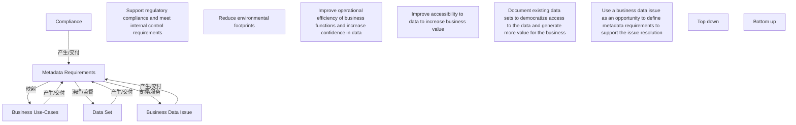

# G234/fig4-2 · 元数据需求收集示意

类型：`process-or-method-model`。展示收集元数据需求的四个起点与两条总体方向，并强调每种起点都不是单向索取：需求要被定义出来，也要被应用回数据集、业务用例或数据问题，才能产生价值。

英文 PDF 物理页：[24]。本页为架构语义分析，原文与原图分别保留。

## 原图与可编辑图


[完整 JSON](fig4-2.json) · [可编辑 Mermaid](fig4-2.mmd) · [仅关系图](fig4-2.relations.mmd) · [层级分解图](fig4-2.hierarchy.mmd)

图形重建表达语义，不复制源图布局。虚线表示解释、矩阵映射或分组关系，不自动表示不确定性的概率。



## 架构分析

左半读自上而下：Compliance 与 Business Use-Cases 在上，各自上方有两张驱动/收益卡；右半读自下而上：Data Set 与 Business Data Issue 在下，各带一张米色做法说明。中央 Metadata Requirements 是汇聚点。每条箭头旁的文字说明动作方向，箭头指向即动作的宾语。

- 本图有 13 个具名或隐含元素、7 条关系和 0 条包含/分组记录。
- 本图没有可直接确认为人员直属汇报的关系；视觉上下位置、能力分解和治理职责分别读取。
- 治理边回答谁提供约束、指导或监督；它们与岗位汇报边分别存储。
- 包含分组后有 9 个连通分量；分离可能源于图例、并列分类或独立示例，未自动补边。
- 核对13个标签与7条显式需求关系，所有箭头端点与标签方向一致。
- 两个大方向箭头表达方法方向，四张上部说明卡与两张底部说明卡没有连接线；将历史8条虚构关系标记拒绝。

### 如何用于项目

- 按阶段/事件/行为关系读取入口、出口、责任和产物；检查循环与例外路径。
- 工作流先后不表示组织管理权；在项目中显式记录条件和完成标准。

### 结构所表达的逻辑

- 四类起点：合规要求、业务用例（自上而下）；数据集、业务数据问题（自下而上）。
- 合规由两类驱动支撑：支持监管合规与内控、减少环境足迹；业务用例由两类收益支撑：提升业务功能运营效率与数据信心、提升数据可访问性以增加业务价值。
- Compliance → Metadata Requirements 是单向箭头（Define metadata req.）：合规要求直接推导元数据需求，不再回写。
- Business Use-Cases、Data Set、Business Data Issue 与中央节点之间都是双向箭头：既定义需求，也把需求应用回起点（Link data to use-cases、Apply metadata req. on data set、Support business data issue resolution）。
- 左右两条长箭头 Top down（向下）与 Bottom up（向上）方向相反，但终点都是同一组元数据需求，说明两条路径可并存。
- 底部两张米色卡给出自下而上的具体做法：为现有数据集建档以民主化访问并产生业务价值；把业务数据问题当作定义需求、支持问题解决的机会。

## 上下级与包含

两条方法路径（Top down / Bottom up）各自包含两个起点；中央 Metadata Requirements 不隶属于任何一条路径，而是四个起点的共同汇聚点。驱动卡属于合规，收益卡属于业务用例。

|父项|子项|层级类型|依据与解释|
|---|---|---|---|
|—|—|无视觉包含|关系中明确的组成/特化见 JSON semantic_hierarchy。|

### 治理范围

|父项/范围/类型|子项/责任对象/实例|语义|
|---|---|---|
|元数据需求|数据集|governs|

## 全部元素与角色

|元素ID|原文名称|类型|含义|直接父项|深度|
|---|---|---|---|---|---|
|metadata_requirements|Metadata Requirements|requirement|四个起点共同指向的需求集合。|—||
|compliance|Compliance|goal|目标/成果：合规|—||
|card_regulatory|Support regulatory compliance and meet internal control requirements|goal|目标/成果：支持监管合规并满足内控要求|—||
|card_footprint|Reduce environmental footprints|goal|目标/成果：减少环境足迹|—||
|business_use_cases|Business Use-Cases|capability|能力：业务用例|—||
|card_efficiency|Improve operational efficiency of business functions and increase confidence in data|goal|目标/成果：提升业务功能运营效率并增强对数据的信心|—||
|card_accessibility|Improve accessibility to data to increase business value|goal|目标/成果：提升数据可访问性以增加业务价值|—||
|data_set|Data Set|data|信息/数据：数据集|—||
|note_data_set|Document existing data sets to democratize access to the data and generate more value for the business|note|说明：为现有数据集建档，以民主化数据访问并为业务创造更多价值|—||
|business_data_issue|Business Data Issue|risk|风险：业务数据问题|—||
|note_issue|Use a business data issue as an opportunity to define metadata requirements to support the issue resolution|note|说明：把业务数据问题作为定义元数据需求、支持问题解决的机会|—||
|ind_top_down|Top down|annotation|图中元素：自上而下|—||
|ind_bottom_up|Bottom up|annotation|图中元素：自下而上|—||

## 全部关系

七条细箭头连接需求和四类来源。左右两个粗空心箭头表示自上而下/自下而上方法方向，不作为实体关系。说明卡位置相邻没有连线。

|主体|语义关系|客体|显式线/隐式|原文标签|依据|
|---|---|---|---|---|---|
|合规|产生/交付|元数据需求|显式连线|Define metadata req.|产生/交付|
|业务用例|产生/交付|元数据需求|显式连线|Define metadata req.|产生/交付|
|元数据需求|映射|业务用例|显式连线|Link data to use-cases|映射|
|数据集|产生/交付|元数据需求|显式连线|Define metadata req. to generate business value|产生/交付|
|元数据需求|治理/监督|数据集|显式连线|Apply metadata req. on data set|治理/监督|
|业务数据问题|产生/交付|元数据需求|显式连线|Define metadata req. for impact analysis|产生/交付|
|元数据需求|支撑/服务|业务数据问题|显式连线|Support business data issue resolution|支撑/服务|

## 本轮否定的历史关系

以下旧解释保留用于追溯，不进入当前关系图、层级或知识图谱的有效边。

|旧记录|主体|旧关系|客体|否定依据|
|---|---|---|---|---|
|7|自上而下|other|数据集|源图只有版面对应关系；没有该端点对之间的显式连接线。Top down/Bottom up大箭头是方向注记，不连接数据集或用例节点。|
|8|自下而上|other|业务用例|源图只有版面对应关系；没有该端点对之间的显式连接线。Top down/Bottom up大箭头是方向注记，不连接数据集或用例节点。|
|9|支持监管合规并满足内控要求|association|合规|源图只有版面对应关系；没有该端点对之间的显式连接线。Top down/Bottom up大箭头是方向注记，不连接数据集或用例节点。|
|10|减少环境足迹|association|合规|源图只有版面对应关系；没有该端点对之间的显式连接线。Top down/Bottom up大箭头是方向注记，不连接数据集或用例节点。|
|11|提升业务功能运营效率并增强对数据的信心|association|业务用例|源图只有版面对应关系；没有该端点对之间的显式连接线。Top down/Bottom up大箭头是方向注记，不连接数据集或用例节点。|
|12|提升数据可访问性以增加业务价值|association|业务用例|源图只有版面对应关系；没有该端点对之间的显式连接线。Top down/Bottom up大箭头是方向注记，不连接数据集或用例节点。|
|13|为现有数据集建档，以民主化数据访问并为业务创造更多价值|association|数据集|源图只有版面对应关系；没有该端点对之间的显式连接线。Top down/Bottom up大箭头是方向注记，不连接数据集或用例节点。|
|14|把业务数据问题作为定义元数据需求、支持问题解决的机会|association|业务数据问题|源图只有版面对应关系；没有该端点对之间的显式连接线。Top down/Bottom up大箭头是方向注记，不连接数据集或用例节点。|

## 本轮语义修正

- 源图只有版面对应关系；没有该端点对之间的显式连接线。Top down/Bottom up大箭头是方向注记，不连接数据集或用例节点。
- 源图只有版面对应关系；没有该端点对之间的显式连接线。Top down/Bottom up大箭头是方向注记，不连接数据集或用例节点。
- 源图只有版面对应关系；没有该端点对之间的显式连接线。Top down/Bottom up大箭头是方向注记，不连接数据集或用例节点。
- 源图只有版面对应关系；没有该端点对之间的显式连接线。Top down/Bottom up大箭头是方向注记，不连接数据集或用例节点。
- 源图只有版面对应关系；没有该端点对之间的显式连接线。Top down/Bottom up大箭头是方向注记，不连接数据集或用例节点。
- 源图只有版面对应关系；没有该端点对之间的显式连接线。Top down/Bottom up大箭头是方向注记，不连接数据集或用例节点。
- 源图只有版面对应关系；没有该端点对之间的显式连接线。Top down/Bottom up大箭头是方向注记，不连接数据集或用例节点。
- 源图只有版面对应关系；没有该端点对之间的显式连接线。Top down/Bottom up大箭头是方向注记，不连接数据集或用例节点。

## 误读检查

- 不要把四条连线都读成单向；只有 Compliance 是单向，其余三条是双向。
- 不要把 Top down / Bottom up 两条长箭头当成数据流或流程步骤，它们是方法方向的标识。
- 不要把业务用例上方的两张卡当成两个额外的起点，它们是业务用例的收益说明。
- 中文稿 SVG 只是两段要点清单，没有中央节点和箭头，不能据它理解各起点的指向。

## 原文证据

### [PDF 第 23 页](../../../documents/G234.md#page-23)

> There are different approaches to define metadata requirements (see Figure 4-2):
### [PDF 第 24 页](../../../documents/G234.md#page-24)

> The top-down approach (compliance, business use cases) often has strong business support; metadata consistency is required and guaranteed by validation processes and workflows. The bottom-up approach is more opportunistic and does not always have strong business support. For this approach it is important to show the value with concrete examples before further automation and governance. In both cases, it is important to clarify the metadata requirements including the expected level of metadata quality required.
> Metadata quality is enforced by processes and validation workflows that can vary per metadata scope. There are mainly two approaches (see Figure 4-3):

## 来源与分析状态

所有元素/关系均有来源定位；未把历史解释重命名为本轮逐线视觉确认。源图与语义图是两种视图，布局不证明汇报或因果。

源 PDF SHA-256：`34a1c590f938bf915182fe5bbe00d1d68f9a3e948697b5500ce7c5a9494f77e7`。

源图记录：[原始解释与转录](../../../figures/G234/fig4-2.json)。

```json
{
  "quality": {
    "graph_integrity": "checked",
    "semantic_analysis": "typed-graph-and-context-analysis",
    "visual_review": "source-content-audited",
    "notice_zh": "所有元素/关系均有来源定位；未把历史解释重命名为本轮逐线视觉确认。源图与语义图是两种视图，布局不证明汇报或因果。"
  },
  "source_uncertainty": {
    "confidence": "high",
    "uncertainties_zh": [
      "Business Use-Cases 与 Metadata Requirements 之间的两条箭头几乎平行，2x 截图可辨认箭头指向，但两条线的起止点略有交叠。",
      "四张驱动/收益卡与下方方框之间没有画线，只能按版式判断归属。"
    ],
    "analyzed_from": [
      "英文 PDF 第 24 页原图截图（2x2 放大分块）",
      "英文 PDF 第 23–24 页正文",
      "中文稿 G234e_信息架构_元数据管理.md 第 234–251 行",
      "figs/g234_fig4-2.svg 源码"
    ],
    "date": "2026-10-31"
  },
  "source_conflicts": []
}
```
