# G234/fig4-3 · 元数据质量保障方法

类型：`process-or-method-model`。第 4.2.2 节说明元数据质量由流程与校验工作流保障，而流程可随元数据范围而异；本图把两种模式的取舍一次对照清楚，供架构师按元数据范围选型。

英文 PDF 物理页：[25]。本页为架构语义分析，原文与原图分别保留。

## 原图与可编辑图


[完整 JSON](fig4-3.json) · [可编辑 Mermaid](fig4-3.mmd) · [仅关系图](fig4-3.relations.mmd) · [层级分解图](fig4-3.hierarchy.mmd)

图形重建表达语义，不复制源图布局。虚线表示解释、矩阵映射或分组关系，不自动表示不确定性的概率。

```mermaid
flowchart TB
  %% Semantic reconstruction; see original source image for exact layout.
  n0["Normative Approach"]
  n1["Crowd-Sourcing Approach"]
  n2["规范式质量目标"]
  n3["众包式质量目标"]
  n4["Precision"]
  n5["Accuracy"]
  n6["Integrity"]
  n7["Consistency"]
  n8["Completeness"]
  n9["Timeliness"]
  n10["Standard-Based"]
  n11["Created by a few, then published as read-only"]
  n12["Static, change lifecycle management"]
  n13["Collaboration-Based Metadata"]
  n14["Created by many, edited by many"]
  n15["Dynamic, eventual consistency"]
  n16["System of reference (quality, reporting)"]
  n17["&#x27;Crowd sourcing&#x27; metadata collection"]
  n18["Metadata Repository"]
  n19["Central Team"]
  n20["Create, Modify"]
  n21["Read"]
  n22["Consumers"]
  n23["Change Request: Creation, Modification"]
  n24["Metadata Repository"]
  n25["Read"]
  n26["Create, Modify"]
  n27["Communities of Contributors"]
  n2 -->|"影响"| n0
  n3 -->|"影响"| n1
  n19 -->|"流动"| n18
  n18 -->|"流动"| n22
  n22 -->|"流动"| n23
  n23 -->|"流动"| n19
  n24 -->|"流动"| n27
  n27 -->|"流动"| n24
  n2 -.->|"分组"| n4
  n2 -.->|"分组"| n5
  n2 -.->|"分组"| n6
  n2 -.->|"分组"| n7
  n3 -.->|"分组"| n8
  n3 -.->|"分组"| n9
  n10 -.->|"visual_containment_only"| n11
  n10 -.->|"visual_containment_only"| n12
  n13 -.->|"visual_containment_only"| n14
  n13 -.->|"visual_containment_only"| n15
```



## 架构分析

左右两列对照读。每列自上而下：圆形方法图标 → 斜箭头指向的质量目标 → 青色模式卡（名称 + 两条特征）→ 场景标题 → 底部小型流程图。先读上半部理解“追求什么质量、由谁创建”，再读下半部理解“谁写、谁读、变更如何回流”。

- 本图有 28 个具名或隐含元素、8 条关系和 10 条包含/分组记录。
- 包含/分组树最大深度为 1；根节点为 规范式方法、众包式方法、规范式质量目标、众包式质量目标、基于标准的、基于协作的元数据、参考系统（质量、报告）、“众包”元数据采集、元数据存储库、中央团队、创建、修改、读取、消费者、变更请求：创建、修改、元数据存储库、读取、创建、修改、贡献者社区。
- 本图没有可直接确认为人员直属汇报的关系；视觉上下位置、能力分解和治理职责分别读取。
- 包含分组后有 12 个连通分量；分离可能源于图例、并列分类或独立示例，未自动补边。
- 核对两种方法的6项质量目标、全部说明文字及两个存储库的创建/读取流程。
- 质量目标两条箭头和下方6条流程连接可见；中部标准/协作说明、参考系统标题与存储库之间没有连接线，拒绝6条历史推断关联。

### 如何用于项目

- 按阶段/事件/行为关系读取入口、出口、责任和产物；检查循环与例外路径。
- 工作流先后不表示组织管理权；在项目中显式记录条件和完成标准。

### 结构所表达的逻辑

- 规范式追求精确（Precision）、准确（Accuracy）、完整（Integrity）、一致（Consistency）；众包式追求完备（Completeness）与及时（Timeliness）。
- 规范式：由少数人创建、以只读方式发布、静态、通过变更生命周期管理；定位是“质量与报表的参考系统”。
- 众包式：多人创建、多人编辑、动态、最终一致；定位是“众包式元数据采集”。
- 规范式流程是一个闭环：中央团队创建/修改 → 元数据存储库 → 消费者只读 → 消费者提出变更请求 → 中央团队处理。
- 众包式流程没有中央审批：贡献者社区直接创建/修改存储库，同时从存储库读取。
- 两种模式不是二选一，正文明确可按元数据范围分别采用；图中用左右并列而非箭头连接，正表示它们是可并存的选项。

## 上下级与包含

两个并列模式（规范式 / 众包式）。每个模式内部：质量目标 → 方法圆 → 模式卡（特征）→ 场景 → 流程角色（存储库、团队/社区、消费者）。

|父项|子项|层级类型|依据与解释|
|---|---|---|---|
|规范式质量目标|精确性|visual_grouping|框、泳道、域或分类组的成员归属；没有额外证据不提升为业务组合或管理关系。|
|规范式质量目标|准确性|visual_grouping|框、泳道、域或分类组的成员归属；没有额外证据不提升为业务组合或管理关系。|
|规范式质量目标|完整性|visual_grouping|框、泳道、域或分类组的成员归属；没有额外证据不提升为业务组合或管理关系。|
|规范式质量目标|一致性|visual_grouping|框、泳道、域或分类组的成员归属；没有额外证据不提升为业务组合或管理关系。|
|众包式质量目标|完备性|visual_grouping|框、泳道、域或分类组的成员归属；没有额外证据不提升为业务组合或管理关系。|
|众包式质量目标|及时性|visual_grouping|框、泳道、域或分类组的成员归属；没有额外证据不提升为业务组合或管理关系。|
|基于标准的|由少数人创建，随后以只读方式发布|visual_containment_only|保存原图解释中的包含；业务关系类型需要图例或正文进一步限定。|
|基于标准的|静态，变更生命周期管理|visual_containment_only|保存原图解释中的包含；业务关系类型需要图例或正文进一步限定。|
|基于协作的元数据|由多人创建、由多人编辑|visual_containment_only|保存原图解释中的包含；业务关系类型需要图例或正文进一步限定。|
|基于协作的元数据|动态，最终一致性|visual_containment_only|保存原图解释中的包含；业务关系类型需要图例或正文进一步限定。|

## 全部元素与角色

|元素ID|原文名称|类型|含义|直接父项|深度|
|---|---|---|---|---|---|
|normative_approach|Normative Approach|concept|以规则与校验保证元数据质量的方法。|—||
|crowd_sourcing_approach|Crowd-Sourcing Approach|concept|概念：众包式方法|—||
|grp_quality_normative|规范式质量目标|group|Precision、Accuracy、Integrity、Consistency 四个标签组成，原图无组框。|—||
|grp_quality_crowd|众包式质量目标|group|Completeness 与 Timeliness 两个标签组成，原图无组框。|—||
|q_precision|Precision|metric|度量：精确性|规范式质量目标|1|
|q_accuracy|Accuracy|metric|度量：准确性|规范式质量目标|1|
|q_integrity|Integrity|metric|度量：完整性|规范式质量目标|1|
|q_consistency|Consistency|metric|度量：一致性|规范式质量目标|1|
|q_completeness|Completeness|metric|度量：完备性|众包式质量目标|1|
|q_timeliness|Timeliness|metric|度量：及时性|众包式质量目标|1|
|standard_based|Standard-Based|concept|概念：基于标准的|—||
|std_created|Created by a few, then published as read-only|annotation|图中元素：由少数人创建，随后以只读方式发布|基于标准的|1|
|std_static|Static, change lifecycle management|annotation|图中元素：静态，变更生命周期管理|基于标准的|1|
|collaboration_based|Collaboration-Based Metadata|concept|概念：基于协作的元数据|—||
|collab_created|Created by many, edited by many|annotation|图中元素：由多人创建、由多人编辑|基于协作的元数据|1|
|collab_dynamic|Dynamic, eventual consistency|annotation|图中元素：动态，最终一致性|基于协作的元数据|1|
|system_of_reference|System of reference (quality, reporting)|note|说明：参考系统（质量、报告）|—||
|crowd_collection|'Crowd sourcing' metadata collection|note|说明：“众包”元数据采集|—||
|repo_standard|Metadata Repository|artifact|制品：元数据存储库|—||
|central_team|Central Team|organization_unit|组织单元：中央团队|—||
|btn_create_standard|Create, Modify|process|流程：创建、修改|—||
|btn_read_standard|Read|process|流程：读取|—||
|consumers|Consumers|role|角色：消费者|—||
|change_request|Change Request: Creation, Modification|artifact|制品：变更请求：创建、修改|—||
|repo_crowd|Metadata Repository|artifact|制品：元数据存储库|—||
|btn_read_crowd|Read|process|流程：读取|—||
|btn_create_crowd|Create, Modify|process|流程：创建、修改|—||
|communities|Communities of Contributors|organization_unit|组织单元：贡献者社区|—||

## 全部关系

斜箭头把左侧质量属性指向方法圆，表示该模式追求这些质量；底部细箭头表示创建/修改与读取的流向，消费者到变更请求再到中央团队的折线表示反馈回路。橙色下划线只是分隔线，不是箭头。

|主体|语义关系|客体|显式线/隐式|原文标签|依据|
|---|---|---|---|---|---|
|规范式质量目标|影响|规范式方法|显式连线||一组质量属性整体用一条斜箭头指向方法圆。|
|众包式质量目标|影响|众包式方法|显式连线||一组质量属性整体用一条斜箭头指向众包式方法圆。|
|中央团队|流动|元数据存储库|显式连线|Create, Modify|流动|
|元数据存储库|流动|消费者|显式连线|Read|流动|
|消费者|流动|变更请求：创建、修改|显式连线||消费者到变更请求气泡的连线，无箭头。|
|变更请求：创建、修改|流动|中央团队|显式连线||变更请求回到中央团队处理。|
|元数据存储库|流动|贡献者社区|显式连线|Read|流动|
|贡献者社区|流动|元数据存储库|显式连线|Create, Modify|流动|

## 本轮否定的历史关系

以下旧解释保留用于追溯，不进入当前关系图、层级或知识图谱的有效边。

|旧记录|主体|旧关系|客体|否定依据|
|---|---|---|---|---|
|2|规范式方法|association|基于标准的|源图为圆形标题、说明色块、标题和存储库的纵向排版，没有连接线。|
|3|众包式方法|association|基于协作的元数据|源图为圆形标题、说明色块、标题和存储库的纵向排版，没有连接线。|
|4|基于标准的|association|参考系统（质量、报告）|源图为圆形标题、说明色块、标题和存储库的纵向排版，没有连接线。|
|5|基于协作的元数据|association|“众包”元数据采集|源图为圆形标题、说明色块、标题和存储库的纵向排版，没有连接线。|
|6|参考系统（质量、报告）|association|元数据存储库|源图为圆形标题、说明色块、标题和存储库的纵向排版，没有连接线。|
|7|“众包”元数据采集|association|元数据存储库|源图为圆形标题、说明色块、标题和存储库的纵向排版，没有连接线。|

## 本轮语义修正

- 源图为圆形标题、说明色块、标题和存储库的纵向排版，没有连接线。
- 源图为圆形标题、说明色块、标题和存储库的纵向排版，没有连接线。
- 源图为圆形标题、说明色块、标题和存储库的纵向排版，没有连接线。
- 源图为圆形标题、说明色块、标题和存储库的纵向排版，没有连接线。
- 源图为圆形标题、说明色块、标题和存储库的纵向排版，没有连接线。
- 源图为圆形标题、说明色块、标题和存储库的纵向排版，没有连接线。

## 误读检查

- 不要以为众包式不追求质量；它用完备性与及时性替代精确性与一致性，是不同质量目标的取舍。
- “System of reference (quality, reporting)”不是某个外部系统名，而是说该模式下的存储库是质量与报表的权威参考。
- 不要把底部两组流程看成同一套角色的两种画法：左边有中央团队与消费者，右边只有贡献者社区。
- 中文稿 SVG 只列要点，丢失了读写流程，不能据它判断谁创建、谁只读。

## 原文证据

### [PDF 第 24 页](../../../documents/G234.md#page-24)

> Metadata quality is enforced by processes and validation workflows that can vary per metadata scope. There are mainly two approaches (see Figure 4-3):
### [PDF 第 25 页](../../../documents/G234.md#page-25)

> The metadata repository is supported by a Metadata Management IT solution, which is a combination of technologies (set of functions), a data model, and processes (metadata update and validation workflows) in order to support Metadata Management activities.

## 来源与分析状态

所有元素/关系均有来源定位；未把历史解释重命名为本轮逐线视觉确认。源图与语义图是两种视图，布局不证明汇报或因果。

源 PDF SHA-256：`34a1c590f938bf915182fe5bbe00d1d68f9a3e948697b5500ce7c5a9494f77e7`。

源图记录：[原始解释与转录](../../../figures/G234/fig4-3.json)。

```json
{
  "quality": {
    "graph_integrity": "checked",
    "semantic_analysis": "typed-graph-and-context-analysis",
    "visual_review": "source-content-audited",
    "notice_zh": "所有元素/关系均有来源定位；未把历史解释重命名为本轮逐线视觉确认。源图与语义图是两种视图，布局不证明汇报或因果。"
  },
  "source_uncertainty": {
    "confidence": "high",
    "uncertainties_zh": [
      "消费者到变更请求的连线在原图中无箭头，按“提出请求”的隐含方向记录。",
      "左侧四条质量属性与圆之间只有一条斜箭头，无法判断原意是四项分别影响还是整体影响，本分析按整体影响记录。"
    ],
    "analyzed_from": [
      "英文 PDF 第 25 页原图截图（2x2 与 3x3 放大分块）",
      "英文 PDF 第 24 页正文（4.2.2 节）",
      "中文稿 G234e_信息架构_元数据管理.md 第 253–256 行",
      "figs/g234_fig4-3.svg 源码"
    ],
    "date": "2026-10-31"
  },
  "source_conflicts": []
}
```
