# G234/fig4-4 · 元数据管理 IT 方案

类型：`architecture-concept-or-system-model`。第 4.3 节开篇把“元数据管理 IT 方案”定义为技术（功能集）、数据模型与流程（更新与校验工作流）的组合，并用图说明它不是单一工具，而是三块能力相加后共同支撑业务需求。

英文 PDF 物理页：[25]。本页为架构语义分析，原文与原图分别保留。

## 原图与可编辑图


[完整 JSON](fig4-4.json) · [可编辑 Mermaid](fig4-4.mmd) · [仅关系图](fig4-4.relations.mmd) · [层级分解图](fig4-4.hierarchy.mmd)

图形重建表达语义，不复制源图布局。虚线表示解释、矩阵映射或分组关系，不自动表示不确定性的概率。

```mermaid
flowchart TB
  %% Semantic reconstruction; see original source image for exact layout.
  n0["Business Requirements"]
  n1["Marketing"]
  n2["Finance"]
  n3["HR"]
  n4["…"]
  n5["Metadata Management IT Solution"]
  n6["Metadata Management 1. Technology"]
  n7["Metadata Management 2. Data Model"]
  n8["Metadata Management 3. Processes (Workflows)"]
  n9["Quality"]
  n10["Documentation"]
  n11["Security, Privacy, Compliance"]
  n12["Governance"]
  n13["Quality"]
  n14["Documentation"]
  n15["Security, Privacy, Compliance"]
  n16["Governance"]
  n17["Quality"]
  n18["Documentation"]
  n19["Security, Privacy, Compliance"]
  n20["Governance"]
  n21["Quality"]
  n22["Documentation"]
  n23["Security, Privacy, Compliance"]
  n24["Governance"]
  n25["Quality"]
  n26["Documentation"]
  n27["Security, Privacy, Compliance"]
  n28["Governance"]
  n29["元数据登记界面截图"]
  n30["实体与关系模型截图"]
  n31["验证工作流截图"]
  n32["+"]
  n33["+"]
  n5 -->|"支撑/服务"| n0
  n0 -.->|"分组"| n1
  n0 -.->|"分组"| n2
  n0 -.->|"分组"| n3
  n0 -.->|"分组"| n4
  n5 -.->|"分组"| n6
  n5 -.->|"分组"| n7
  n5 -.->|"分组"| n8
  n1 -.->|"visual_containment_only"| n13
  n1 -.->|"visual_containment_only"| n14
  n1 -.->|"visual_containment_only"| n15
  n1 -.->|"visual_containment_only"| n16
  n2 -.->|"visual_containment_only"| n17
  n2 -.->|"visual_containment_only"| n18
  n2 -.->|"visual_containment_only"| n19
  n2 -.->|"visual_containment_only"| n20
  n3 -.->|"visual_containment_only"| n21
  n3 -.->|"visual_containment_only"| n22
  n3 -.->|"visual_containment_only"| n23
  n3 -.->|"visual_containment_only"| n24
  n4 -.->|"visual_containment_only"| n25
  n4 -.->|"visual_containment_only"| n26
  n4 -.->|"visual_containment_only"| n27
  n4 -.->|"visual_containment_only"| n28
  n6 -.->|"visual_containment_only"| n29
  n7 -.->|"visual_containment_only"| n30
  n8 -.->|"visual_containment_only"| n31
  n5 -.->|"分组"| n32
  n5 -.->|"分组"| n33
```



## 架构分析

先看上方米色 3D 箱 Business Requirements：内部按部门分组（Marketing、Finance、HR、…），每个部门用多个人物图标表示不同关注点。再看下方蓝色 3D 箱 Metadata Management IT Solution：三个青色面板从左到右是 1. Technology、2. Data Model、3. Processes (Workflows)，面板之间用 “+” 连接。中间一条向上箭头表示方案支撑业务需求。右侧图例解释人物颜色。

- 本图有 34 个具名或隐含元素、1 条关系和 28 条包含/分组记录。
- 包含/分组树最大深度为 2；根节点为 业务需求、元数据管理 IT 方案、质量、文档化、安全、隐私、合规、治理。
- 本图没有可直接确认为人员直属汇报的关系；视觉上下位置、能力分解和治理职责分别读取。
- 包含分组后有 5 个连通分量；分离可能源于图例、并列分类或独立示例，未自动补边。
- 核对两层总框、四个业务部门组，每个部门均含质量/文档化/安全隐私合规/治理四类人员，共16个图标实例。
- 核对三项IT组成、两个加号和向上支撑业务需求的箭头；新增3幅内嵌截图的类型描述。
- 原PDF以5倍放大检查，内嵌截图内部大量文字仍不可可靠辨读。已保留这一原始像素限制，不虚构截图的表单值、实体名或工作流细节。

### 如何用于项目

- 围绕作者目的读取本图实体、分组与连线，并用对应原文限定其含义。
- 把参考模型与项目事实分开，实际范围、约束、值和责任须有项目证据。

### 结构所表达的逻辑

- 方案 = 技术（功能集）+ 数据模型 + 流程（元数据更新与校验工作流），三者是相加关系，不是先后步骤。
- 1. Technology 面板是一张元数据管理工具界面截图，代表工具能力，不展开具体技术组件。
- 2. Data Model 面板是一张实体关系图截图，对应正文“澄清要记录的元数据资产及其关系”。
- 3. Processes (Workflows) 面板是一张工作流截图，对应元数据校验与更新流程。
- 业务需求侧以部门（Marketing、Finance、HR、…）和四类角色（Quality、Documentation、Security/Privacy/Compliance、Governance）表示，说明同一方案要同时满足多部门、多关注点。
- 全图只有一条箭头，方向是方案 → 业务需求，表示“支撑”，而不是需求 → 方案。

## 上下级与包含

两层：Business Requirements（业务侧）在上，Metadata Management IT Solution（方案侧）在下；方案内三个面板并列，面板本身不细分组件。

|父项|子项|层级类型|依据与解释|
|---|---|---|---|
|业务需求|市场|visual_grouping|框、泳道、域或分类组的成员归属；没有额外证据不提升为业务组合或管理关系。|
|业务需求|财务|visual_grouping|框、泳道、域或分类组的成员归属；没有额外证据不提升为业务组合或管理关系。|
|业务需求|人力资源|visual_grouping|框、泳道、域或分类组的成员归属；没有额外证据不提升为业务组合或管理关系。|
|业务需求|其他部门（省略号）|visual_grouping|框、泳道、域或分类组的成员归属；没有额外证据不提升为业务组合或管理关系。|
|元数据管理 IT 方案|元数据管理 1. 技术|visual_grouping|框、泳道、域或分类组的成员归属；没有额外证据不提升为业务组合或管理关系。|
|元数据管理 IT 方案|元数据管理 2. 数据模型|visual_grouping|框、泳道、域或分类组的成员归属；没有额外证据不提升为业务组合或管理关系。|
|元数据管理 IT 方案|元数据管理 3. 流程（工作流）|visual_grouping|框、泳道、域或分类组的成员归属；没有额外证据不提升为业务组合或管理关系。|
|市场|质量|visual_containment_only|保存原图解释中的包含；业务关系类型需要图例或正文进一步限定。|
|市场|文档化|visual_containment_only|保存原图解释中的包含；业务关系类型需要图例或正文进一步限定。|
|市场|安全、隐私、合规|visual_containment_only|保存原图解释中的包含；业务关系类型需要图例或正文进一步限定。|
|市场|治理|visual_containment_only|保存原图解释中的包含；业务关系类型需要图例或正文进一步限定。|
|财务|质量|visual_containment_only|保存原图解释中的包含；业务关系类型需要图例或正文进一步限定。|
|财务|文档化|visual_containment_only|保存原图解释中的包含；业务关系类型需要图例或正文进一步限定。|
|财务|安全、隐私、合规|visual_containment_only|保存原图解释中的包含；业务关系类型需要图例或正文进一步限定。|
|财务|治理|visual_containment_only|保存原图解释中的包含；业务关系类型需要图例或正文进一步限定。|
|人力资源|质量|visual_containment_only|保存原图解释中的包含；业务关系类型需要图例或正文进一步限定。|
|人力资源|文档化|visual_containment_only|保存原图解释中的包含；业务关系类型需要图例或正文进一步限定。|
|人力资源|安全、隐私、合规|visual_containment_only|保存原图解释中的包含；业务关系类型需要图例或正文进一步限定。|
|人力资源|治理|visual_containment_only|保存原图解释中的包含；业务关系类型需要图例或正文进一步限定。|
|其他部门（省略号）|质量|visual_containment_only|保存原图解释中的包含；业务关系类型需要图例或正文进一步限定。|
|其他部门（省略号）|文档化|visual_containment_only|保存原图解释中的包含；业务关系类型需要图例或正文进一步限定。|
|其他部门（省略号）|安全、隐私、合规|visual_containment_only|保存原图解释中的包含；业务关系类型需要图例或正文进一步限定。|
|其他部门（省略号）|治理|visual_containment_only|保存原图解释中的包含；业务关系类型需要图例或正文进一步限定。|
|元数据管理 1. 技术|元数据登记界面截图|visual_containment_only|保存原图解释中的包含；业务关系类型需要图例或正文进一步限定。|
|元数据管理 2. 数据模型|实体与关系模型截图|visual_containment_only|保存原图解释中的包含；业务关系类型需要图例或正文进一步限定。|
|元数据管理 3. 流程（工作流）|验证工作流截图|visual_containment_only|保存原图解释中的包含；业务关系类型需要图例或正文进一步限定。|
|元数据管理 IT 方案|加号（共同构成方案）|visual_grouping|框、泳道、域或分类组的成员归属；没有额外证据不提升为业务组合或管理关系。|
|元数据管理 IT 方案|加号（共同构成方案）|visual_grouping|框、泳道、域或分类组的成员归属；没有额外证据不提升为业务组合或管理关系。|

## 全部元素与角色

|元素ID|原文名称|类型|含义|直接父项|深度|
|---|---|---|---|---|---|
|business_requirements|Business Requirements|group|分组：业务需求|—||
|dept_marketing|Marketing|organization_unit|组织单元：市场|业务需求|1|
|dept_finance|Finance|organization_unit|组织单元：财务|业务需求|1|
|dept_hr|HR|organization_unit|组织单元：人力资源|业务需求|1|
|dept_other|…|organization_unit|原图仅以省略号表示还有其他部门。|业务需求|1|
|it_solution|Metadata Management IT Solution|group|分组：元数据管理 IT 方案|—||
|panel_technology|Metadata Management 1. Technology|application|面板内容为一张元数据工具界面截图。|元数据管理 IT 方案|1|
|panel_data_model|Metadata Management 2. Data Model|artifact|面板内容为一张实体关系图截图。|元数据管理 IT 方案|1|
|panel_processes|Metadata Management 3. Processes (Workflows)|process|面板内容为一张工作流截图。|元数据管理 IT 方案|1|
|leg_quality|Quality|role|角色：质量|—||
|leg_documentation|Documentation|role|角色：文档化|—||
|leg_security_privacy_compliance|Security, Privacy, Compliance|role|角色：安全、隐私、合规|—||
|leg_governance|Governance|role|角色：治理|—||
|marketing_quality|Quality|actor|部门内彩色人物图标，根据右侧图例识别其职责类别；不是特定个人。|市场|2|
|marketing_documentation|Documentation|actor|部门内彩色人物图标，根据右侧图例识别其职责类别；不是特定个人。|市场|2|
|marketing_security_privacy_compliance|Security, Privacy, Compliance|actor|部门内彩色人物图标，根据右侧图例识别其职责类别；不是特定个人。|市场|2|
|marketing_governance|Governance|actor|部门内彩色人物图标，根据右侧图例识别其职责类别；不是特定个人。|市场|2|
|finance_quality|Quality|actor|部门内彩色人物图标，根据右侧图例识别其职责类别；不是特定个人。|财务|2|
|finance_documentation|Documentation|actor|部门内彩色人物图标，根据右侧图例识别其职责类别；不是特定个人。|财务|2|
|finance_security_privacy_compliance|Security, Privacy, Compliance|actor|部门内彩色人物图标，根据右侧图例识别其职责类别；不是特定个人。|财务|2|
|finance_governance|Governance|actor|部门内彩色人物图标，根据右侧图例识别其职责类别；不是特定个人。|财务|2|
|hr_quality|Quality|actor|部门内彩色人物图标，根据右侧图例识别其职责类别；不是特定个人。|人力资源|2|
|hr_documentation|Documentation|actor|部门内彩色人物图标，根据右侧图例识别其职责类别；不是特定个人。|人力资源|2|
|hr_security_privacy_compliance|Security, Privacy, Compliance|actor|部门内彩色人物图标，根据右侧图例识别其职责类别；不是特定个人。|人力资源|2|
|hr_governance|Governance|actor|部门内彩色人物图标，根据右侧图例识别其职责类别；不是特定个人。|人力资源|2|
|other_quality|Quality|actor|部门内彩色人物图标，根据右侧图例识别其职责类别；不是特定个人。|其他部门（省略号）|2|
|other_documentation|Documentation|actor|部门内彩色人物图标，根据右侧图例识别其职责类别；不是特定个人。|其他部门（省略号）|2|
|other_security_privacy_compliance|Security, Privacy, Compliance|actor|部门内彩色人物图标，根据右侧图例识别其职责类别；不是特定个人。|其他部门（省略号）|2|
|other_governance|Governance|actor|部门内彩色人物图标，根据右侧图例识别其职责类别；不是特定个人。|其他部门（省略号）|2|
|screenshot_technology|元数据登记界面截图|artifact|原图内嵌示例截图，支持该组成部分的含义。截图内部多数标签在原PDF中像素过低，未作逐字/逐边推断；不把示例内容作为规范性模型。|元数据管理 1. 技术|2|
|screenshot_data_model|实体与关系模型截图|artifact|原图内嵌示例截图，支持该组成部分的含义。截图内部多数标签在原PDF中像素过低，未作逐字/逐边推断；不把示例内容作为规范性模型。|元数据管理 2. 数据模型|2|
|screenshot_processes|验证工作流截图|artifact|原图内嵌示例截图，支持该组成部分的含义。截图内部多数标签在原PDF中像素过低，未作逐字/逐边推断；不把示例内容作为规范性模型。|元数据管理 3. 流程（工作流）|2|
|plus_1|+|annotation|图中元素：加号（共同构成方案）|元数据管理 IT 方案|1|
|plus_2|+|annotation|图中元素：加号（共同构成方案）|元数据管理 IT 方案|1|

## 全部关系

中间向上箭头表示方案支撑业务需求；“+” 号表示三个面板组合成方案，不是数据流，也不是流程顺序。

|主体|语义关系|客体|显式线/隐式|原文标签|依据|
|---|---|---|---|---|---|
|元数据管理 IT 方案|支撑/服务|业务需求|显式连线||方案箱上方的单箭头指向业务需求，表示 IT 方案支撑业务需求。|

## 误读检查

- 不要把三个面板读成实施步骤 1→2→3；“+” 表示同时具备。
- 不要以为箭头表示业务需求输入方案；箭头由方案指向业务需求。
- 不要把人物图标当成具体人员编制，它们是关注点/角色类别，颜色由图例定义。
- 中文稿引用的 g234e_fig4-4_zh.png 实际是图 4-3，不能据它理解本图；本图应以英文原图为准。

## 原文证据

### [PDF 第 25 页](../../../documents/G234.md#page-25)

> The metadata repository is supported by a Metadata Management IT solution, which is a combination of technologies (set of functions), a data model, and processes (metadata update and validation workflows) in order to support Metadata Management activities.

## 来源与分析状态

所有元素/关系均有来源定位；未把历史解释重命名为本轮逐线视觉确认。源图与语义图是两种视图，布局不证明汇报或因果。

源 PDF SHA-256：`34a1c590f938bf915182fe5bbe00d1d68f9a3e948697b5500ce7c5a9494f77e7`。

源图记录：[原始解释与转录](../../../figures/G234/fig4-4.json)。

```json
{
  "quality": {
    "graph_integrity": "checked",
    "semantic_analysis": "typed-graph-and-context-analysis",
    "visual_review": "source-content-audited",
    "notice_zh": "所有元素/关系均有来源定位；未把历史解释重命名为本轮逐线视觉确认。源图与语义图是两种视图，布局不证明汇报或因果。"
  },
  "source_uncertainty": {
    "confidence": "high",
    "uncertainties_zh": [
      "三个面板内的截图文字太小，无法转录工具界面、实体关系图与工作流的具体标签；本分析只记录面板标题与截图类型。",
      "右侧图例只解释人物颜色，图中并未画出颜色与部门的一一对应表；无法确定每个部门内各色人物的具体数量与含义。"
    ],
    "analyzed_from": [
      "英文 PDF 第 25 页原图截图（2x2 放大分块）",
      "英文 PDF 第 25 页正文",
      "中文稿 G234e_信息架构_元数据管理.md 第 259–291 行",
      "figs/g234e_fig4-4_en.png、figs/zh/g234e_fig4-4_zh.png"
    ],
    "date": "2026-10-31"
  },
  "source_conflicts": [
    {
      "id": "source-g234-fig4-4",
      "figure_id": "G234/fig4-4",
      "status": "observed-conflict",
      "description": "实际英文 PNG 显示规范式／众包式两栏（图4-3内容），正文与JSON语义为技术、数据模型、流程三要素（图4-4）。已有faithful标签不能采信为本轮核验。",
      "evidence": [
        "G234 §4.2.2–4.3",
        "figs/g234e_fig4-4_en.png",
        "figs/ai/G234/fig4-4.json"
      ],
      "resolution": "保留正文可证实三要素与冲突，来源结构模板待取得可信图4-4；不修改原资料。"
    }
  ]
}
```
