# G234/fig4-5 · 关键元数据资产

类型：`mapping-or-assessment-matrix`。正文说元数据常分为业务、技术、运营三类，图 4-5 给出“为支持数据治理应捕获的关键元数据资产”的基线建议，并按数据管理维度组织，便于架构师按维度查漏、按类型分工。

英文 PDF 物理页：[26]。本页为架构语义分析，原文与原图分别保留。

## 原图与可编辑图


[完整 JSON](fig4-5.json) · [可编辑 Mermaid](fig4-5.mmd) · [仅关系图](fig4-5.relations.mmd) · [层级分解图](fig4-5.hierarchy.mmd)

图形重建表达语义，不复制源图布局。虚线表示解释、矩阵映射或分组关系，不自动表示不确定性的概率。

```mermaid
flowchart TB
  %% Semantic reconstruction; see original source image for exact layout.
  n0["Data Quality"]
  n1["Data Documentation"]
  n2["Data Security &amp; Privacy"]
  n3["Metadata Governance"]
  n4["Business Data Issue"]
  n5["Business Data Quality Rule"]
  n6["Business Term"]
  n7["Business Data Object"]
  n8["Business Data Element"]
  n9["Process"]
  n10["Data Classification Taxonomies"]
  n11["Business Rule"]
  n12["Code Set"]
  n13["Code Value"]
  n14["Activity"]
  n15["Data Processing Activity"]
  n16["Data Privacy Assessment"]
  n17["Business Data Deletion Rule"]
  n18["Role"]
  n19["Data Policy"]
  n20["Business Data Domain"]
  n21["SLAs"]
  n22["Organization"]
  n23["Technical Data Quality Rule"]
  n24["Application"]
  n25["Data Flow"]
  n26["Database"]
  n27["Data Set"]
  n28["Data Field"]
  n29["Technical Data Deletion Rule"]
  n30["Data Quality Anomaly"]
  n31["Data Volume"]
  n32["Data Access Event"]
  n33["Metadata Activity Logs"]
  n34["Business"]
  n35["Technical"]
  n36["Operational"]
  n37["METADATA TYPE"]
  n38["DATA MANAGEMENT DIMENSIONS"]
  n0 -.->|"分组"| n4
  n0 -.->|"分组"| n5
  n1 -.->|"分组"| n6
  n1 -.->|"分组"| n7
  n1 -.->|"分组"| n8
  n1 -.->|"分组"| n9
  n1 -.->|"分组"| n10
  n1 -.->|"分组"| n11
  n1 -.->|"分组"| n12
  n1 -.->|"分组"| n13
  n1 -.->|"分组"| n14
  n2 -.->|"分组"| n15
  n2 -.->|"分组"| n16
  n2 -.->|"分组"| n17
  n3 -.->|"分组"| n18
  n3 -.->|"分组"| n19
  n3 -.->|"分组"| n20
  n3 -.->|"分组"| n21
  n3 -.->|"分组"| n22
  n0 -.->|"分组"| n23
  n1 -.->|"分组"| n24
  n1 -.->|"分组"| n25
  n1 -.->|"分组"| n26
  n1 -.->|"分组"| n27
  n1 -.->|"分组"| n28
  n2 -.->|"分组"| n29
  n0 -.->|"分组"| n30
  n1 -.->|"分组"| n31
  n2 -.->|"分组"| n32
  n3 -.->|"分组"| n33
```



## 架构分析

先读横轴四个维度：Data Quality、Data Documentation、Data Security & Privacy、Metadata Governance；再读纵轴三类元数据：Business、Technical、Operational。读某个维度时纵向扫一列，读某类元数据时横向扫一行。单元格里的标签就是资产，空格表示该组合未列资产。

- 本图有 39 个具名或隐含元素、0 条关系和 30 条包含/分组记录。
- 包含/分组树最大深度为 1；根节点为 数据质量、数据文档化、数据安全与隐私、元数据治理、业务元数据、技术元数据、运营元数据、元数据类型、数据管理维度。
- 本图没有可直接确认为人员直属汇报的关系；视觉上下位置、能力分解和治理职责分别读取。
- 原图靠嵌套表达结构，没有连线；新语义图将包含单独显式化，不补造流程、数据流或依赖。
- 包含分组后有 9 个连通分量；分离可能源于图例、并列分类或独立示例，未自动补边。
- 核对3×4矩阵的全部30项资产，含技术/治理空单元格，表格逐格对应。
- 补入元数据类型三行与两个坐标轴标题，避免仅有列维度而丢失分类语义；本图无关系连线。

### 如何用于项目

- 先固定行、列所代表的维度及单元格含义，再登记有证据的映射或评分。
- 空白、无关系、未测量和不适用分别处理；颜色不自动等于优先级。

### 结构所表达的逻辑

- 业务元数据资产最多，四个维度都有覆盖；技术元数据集中在数据质量、数据文档化与数据安全隐私；运营元数据每个维度只有 1 项。
- Data Documentation 列最密：业务 9 项、技术 5 项、运营 1 项，是元数据存储库的主体内容。
- Data Quality 列以规则、问题、异常为主：Business Data Issue、Business Data Quality Rule、Technical Data Quality Rule、Data Quality Anomaly。
- Data Security & Privacy 列以处理活动、评估、删除规则、访问事件为主，业务与技术各有一条删除规则。
- Metadata Governance 列只有业务元数据（Role、Data Policy、Business Data Domain、SLAs、Organization）和运营元数据（Metadata Activity Logs）；技术元数据为空。
- 技术元数据在 Metadata Governance 单元格为空是原图事实，不是漏画；技术元数据的治理通过业务层的角色/政策与运营层的活动日志体现。

## 上下级与包含

两维坐标，不存在上下级：4 个维度（列）× 3 个类型（行），每个单元格内的资产并列。

|父项|子项|层级类型|依据与解释|
|---|---|---|---|
|数据质量|业务数据问题|visual_grouping|框、泳道、域或分类组的成员归属；没有额外证据不提升为业务组合或管理关系。|
|数据质量|业务数据质量规则|visual_grouping|框、泳道、域或分类组的成员归属；没有额外证据不提升为业务组合或管理关系。|
|数据文档化|业务术语|visual_grouping|框、泳道、域或分类组的成员归属；没有额外证据不提升为业务组合或管理关系。|
|数据文档化|业务数据对象|visual_grouping|框、泳道、域或分类组的成员归属；没有额外证据不提升为业务组合或管理关系。|
|数据文档化|业务数据元素|visual_grouping|框、泳道、域或分类组的成员归属；没有额外证据不提升为业务组合或管理关系。|
|数据文档化|流程|visual_grouping|框、泳道、域或分类组的成员归属；没有额外证据不提升为业务组合或管理关系。|
|数据文档化|数据分类体系|visual_grouping|框、泳道、域或分类组的成员归属；没有额外证据不提升为业务组合或管理关系。|
|数据文档化|业务规则|visual_grouping|框、泳道、域或分类组的成员归属；没有额外证据不提升为业务组合或管理关系。|
|数据文档化|代码集|visual_grouping|框、泳道、域或分类组的成员归属；没有额外证据不提升为业务组合或管理关系。|
|数据文档化|代码值|visual_grouping|框、泳道、域或分类组的成员归属；没有额外证据不提升为业务组合或管理关系。|
|数据文档化|活动|visual_grouping|框、泳道、域或分类组的成员归属；没有额外证据不提升为业务组合或管理关系。|
|数据安全与隐私|数据处理活动|visual_grouping|框、泳道、域或分类组的成员归属；没有额外证据不提升为业务组合或管理关系。|
|数据安全与隐私|数据隐私评估|visual_grouping|框、泳道、域或分类组的成员归属；没有额外证据不提升为业务组合或管理关系。|
|数据安全与隐私|业务数据删除规则|visual_grouping|框、泳道、域或分类组的成员归属；没有额外证据不提升为业务组合或管理关系。|
|元数据治理|角色|visual_grouping|框、泳道、域或分类组的成员归属；没有额外证据不提升为业务组合或管理关系。|
|元数据治理|数据政策|visual_grouping|框、泳道、域或分类组的成员归属；没有额外证据不提升为业务组合或管理关系。|
|元数据治理|业务数据域|visual_grouping|框、泳道、域或分类组的成员归属；没有额外证据不提升为业务组合或管理关系。|
|元数据治理|服务水平协议|visual_grouping|框、泳道、域或分类组的成员归属；没有额外证据不提升为业务组合或管理关系。|
|元数据治理|组织|visual_grouping|框、泳道、域或分类组的成员归属；没有额外证据不提升为业务组合或管理关系。|
|数据质量|技术数据质量规则|visual_grouping|框、泳道、域或分类组的成员归属；没有额外证据不提升为业务组合或管理关系。|
|数据文档化|应用|visual_grouping|框、泳道、域或分类组的成员归属；没有额外证据不提升为业务组合或管理关系。|
|数据文档化|数据流|visual_grouping|框、泳道、域或分类组的成员归属；没有额外证据不提升为业务组合或管理关系。|
|数据文档化|数据库|visual_grouping|框、泳道、域或分类组的成员归属；没有额外证据不提升为业务组合或管理关系。|
|数据文档化|数据集|visual_grouping|框、泳道、域或分类组的成员归属；没有额外证据不提升为业务组合或管理关系。|
|数据文档化|数据字段|visual_grouping|框、泳道、域或分类组的成员归属；没有额外证据不提升为业务组合或管理关系。|
|数据安全与隐私|技术数据删除规则|visual_grouping|框、泳道、域或分类组的成员归属；没有额外证据不提升为业务组合或管理关系。|
|数据质量|数据质量异常|visual_grouping|框、泳道、域或分类组的成员归属；没有额外证据不提升为业务组合或管理关系。|
|数据文档化|数据量|visual_grouping|框、泳道、域或分类组的成员归属；没有额外证据不提升为业务组合或管理关系。|
|数据安全与隐私|数据访问事件|visual_grouping|框、泳道、域或分类组的成员归属；没有额外证据不提升为业务组合或管理关系。|
|元数据治理|元数据活动日志|visual_grouping|框、泳道、域或分类组的成员归属；没有额外证据不提升为业务组合或管理关系。|

## 全部元素与角色

|元素ID|原文名称|类型|含义|直接父项|深度|
|---|---|---|---|---|---|
|dim_quality|Data Quality|group|分组：数据质量|—||
|dim_documentation|Data Documentation|group|分组：数据文档化|—||
|dim_security_privacy|Data Security & Privacy|group|分组：数据安全与隐私|—||
|dim_governance|Metadata Governance|group|分组：元数据治理|—||
|a_business_issue|Business Data Issue|data|信息/数据：业务数据问题|数据质量|1|
|a_business_dq_rule|Business Data Quality Rule|principle|原则：业务数据质量规则|数据质量|1|
|a_business_term|Business Term|data|信息/数据：业务术语|数据文档化|1|
|a_business_data_object|Business Data Object|data|信息/数据：业务数据对象|数据文档化|1|
|a_business_data_element|Business Data Element|data|信息/数据：业务数据元素|数据文档化|1|
|a_process|Process|process|流程：流程|数据文档化|1|
|a_class_taxonomies|Data Classification Taxonomies|data|信息/数据：数据分类体系|数据文档化|1|
|a_business_rule|Business Rule|principle|原则：业务规则|数据文档化|1|
|a_code_set|Code Set|data|信息/数据：代码集|数据文档化|1|
|a_code_value|Code Value|data|信息/数据：代码值|数据文档化|1|
|a_activity|Activity|process|流程：活动|数据文档化|1|
|a_processing_activity|Data Processing Activity|process|流程：数据处理活动|数据安全与隐私|1|
|a_privacy_assessment|Data Privacy Assessment|artifact|制品：数据隐私评估|数据安全与隐私|1|
|a_business_deletion_rule|Business Data Deletion Rule|principle|原则：业务数据删除规则|数据安全与隐私|1|
|a_role|Role|role|角色：角色|元数据治理|1|
|a_data_policy|Data Policy|principle|原则：数据政策|元数据治理|1|
|a_business_domain|Business Data Domain|data|信息/数据：业务数据域|元数据治理|1|
|a_slas|SLAs|artifact|制品：服务水平协议|元数据治理|1|
|a_organization|Organization|organization_unit|组织单元：组织|元数据治理|1|
|t_technical_dq_rule|Technical Data Quality Rule|principle|原则：技术数据质量规则|数据质量|1|
|t_application|Application|application|应用：应用|数据文档化|1|
|t_data_flow|Data Flow|data|信息/数据：数据流|数据文档化|1|
|t_database|Database|data|信息/数据：数据库|数据文档化|1|
|t_data_set|Data Set|data|信息/数据：数据集|数据文档化|1|
|t_data_field|Data Field|data|信息/数据：数据字段|数据文档化|1|
|t_technical_deletion_rule|Technical Data Deletion Rule|principle|原则：技术数据删除规则|数据安全与隐私|1|
|o_dq_anomaly|Data Quality Anomaly|data|信息/数据：数据质量异常|数据质量|1|
|o_data_volume|Data Volume|metric|度量：数据量|数据文档化|1|
|o_access_event|Data Access Event|event|事件：数据访问事件|数据安全与隐私|1|
|o_activity_logs|Metadata Activity Logs|data|信息/数据：元数据活动日志|元数据治理|1|
|row_business|Business|group|矩阵行类型；所属资产以t_asset_matrix行列交叉记录。|—||
|row_technical|Technical|group|矩阵行类型；所属资产以t_asset_matrix行列交叉记录。|—||
|row_operational|Operational|group|矩阵行类型；所属资产以t_asset_matrix行列交叉记录。|—||
|axis_metadata_type|METADATA TYPE|annotation|图中元素：元数据类型|—||
|axis_data_management|DATA MANAGEMENT DIMENSIONS|annotation|图中元素：数据管理维度|—||

### 业务数据问题：属性

```json
{
  "metadata_type": "Business"
}
```

### 业务数据质量规则：属性

```json
{
  "metadata_type": "Business"
}
```

### 业务术语：属性

```json
{
  "metadata_type": "Business"
}
```

### 业务数据对象：属性

```json
{
  "metadata_type": "Business"
}
```

### 业务数据元素：属性

```json
{
  "metadata_type": "Business"
}
```

### 流程：属性

```json
{
  "metadata_type": "Business"
}
```

### 数据分类体系：属性

```json
{
  "metadata_type": "Business"
}
```

### 业务规则：属性

```json
{
  "metadata_type": "Business"
}
```

### 代码集：属性

```json
{
  "metadata_type": "Business"
}
```

### 代码值：属性

```json
{
  "metadata_type": "Business"
}
```

### 活动：属性

```json
{
  "metadata_type": "Business"
}
```

### 数据处理活动：属性

```json
{
  "metadata_type": "Business"
}
```

### 数据隐私评估：属性

```json
{
  "metadata_type": "Business"
}
```

### 业务数据删除规则：属性

```json
{
  "metadata_type": "Business"
}
```

### 角色：属性

```json
{
  "metadata_type": "Business"
}
```

### 数据政策：属性

```json
{
  "metadata_type": "Business"
}
```

### 业务数据域：属性

```json
{
  "metadata_type": "Business"
}
```

### 服务水平协议：属性

```json
{
  "metadata_type": "Business"
}
```

### 组织：属性

```json
{
  "metadata_type": "Business"
}
```

### 技术数据质量规则：属性

```json
{
  "metadata_type": "Technical"
}
```

### 应用：属性

```json
{
  "metadata_type": "Technical"
}
```

### 数据流：属性

```json
{
  "metadata_type": "Technical"
}
```

### 数据库：属性

```json
{
  "metadata_type": "Technical"
}
```

### 数据集：属性

```json
{
  "metadata_type": "Technical"
}
```

### 数据字段：属性

```json
{
  "metadata_type": "Technical"
}
```

### 技术数据删除规则：属性

```json
{
  "metadata_type": "Technical"
}
```

### 数据质量异常：属性

```json
{
  "metadata_type": "Operational"
}
```

### 数据量：属性

```json
{
  "metadata_type": "Operational"
}
```

### 数据访问事件：属性

```json
{
  "metadata_type": "Operational"
}
```

### 元数据活动日志：属性

```json
{
  "metadata_type": "Operational"
}
```

## 全部关系

虚线是单元格分隔线，没有箭头；位置（行与列）就是唯一的语义。

|主体|语义关系|客体|显式线/隐式|原文标签|依据|
|---|---|---|---|---|---|

## 元数据类型 × 数据管理维度：关键元数据资产（逐格转录）

```json
{
  "id": "t_asset_matrix",
  "title_zh": "元数据类型 × 数据管理维度：关键元数据资产（逐格转录）",
  "columns": [
    "元数据类型",
    "数据管理维度",
    "元数据资产"
  ],
  "rows": [
    [
      "Business 业务",
      "Data Quality 数据质量",
      "Business Data Issue；Business Data Quality Rule"
    ],
    [
      "Business 业务",
      "Data Documentation 数据文档化",
      "Business Term；Business Data Object；Business Data Element；Process；Data Classification Taxonomies；Business Rule；Code Set；Code Value；Activity"
    ],
    [
      "Business 业务",
      "Data Security & Privacy 数据安全与隐私",
      "Data Processing Activity；Data Privacy Assessment；Business Data Deletion Rule"
    ],
    [
      "Business 业务",
      "Metadata Governance 元数据治理",
      "Role；Data Policy；Business Data Domain；SLAs；Organization"
    ],
    [
      "Technical 技术",
      "Data Quality 数据质量",
      "Technical Data Quality Rule"
    ],
    [
      "Technical 技术",
      "Data Documentation 数据文档化",
      "Application；Data Flow；Database；Data Set；Data Field"
    ],
    [
      "Technical 技术",
      "Data Security & Privacy 数据安全与隐私",
      "Technical Data Deletion Rule"
    ],
    [
      "Technical 技术",
      "Metadata Governance 元数据治理",
      ""
    ],
    [
      "Operational 运营",
      "Data Quality 数据质量",
      "Data Quality Anomaly"
    ],
    [
      "Operational 运营",
      "Data Documentation 数据文档化",
      "Data Volume"
    ],
    [
      "Operational 运营",
      "Data Security & Privacy 数据安全与隐私",
      "Data Access Event"
    ],
    [
      "Operational 运营",
      "Metadata Governance 元数据治理",
      "Metadata Activity Logs"
    ]
  ],
  "notes_zh": "Data Documentation 业务格在原图中分两小列排列：左列 Business Term/Business Data Object/Business Data Element/Process/Data Classification Taxonomies，右列 Business Rule/Code Set/Code Value/Activity；行内顺序按原图自上而下、先左列后右列。"
}
```

## 误读检查

- 不要把空单元格理解为“不允许”或“不存在”，它只表示基线清单未列。
- Data Volume 属运营元数据 × Data Documentation，不在 Data Quality 列。
- Metadata Activity Logs 属运营元数据 × Metadata Governance，不是技术元数据。
- 中文图的“数据安全与隐私”和“元数据治理”表头挤在一行，不要把它们当成一个维度。

## 原文证据

### [PDF 第 26 页](../../../documents/G234.md#page-26)

> Business metadata is managed by people, technical metadata exists in the data structures of the IT systems, and operational metadata is generated at a specific point in time. Figure 4-5 shows a baseline proposal of key metadata assets (see the definitions in Appendix A) to be captured to support data governance.

## 来源与分析状态

所有元素/关系均有来源定位；未把历史解释重命名为本轮逐线视觉确认。源图与语义图是两种视图，布局不证明汇报或因果。

源 PDF SHA-256：`34a1c590f938bf915182fe5bbe00d1d68f9a3e948697b5500ce7c5a9494f77e7`。

源图记录：[原始解释与转录](../../../figures/G234/fig4-5.json)。

```json
{
  "quality": {
    "graph_integrity": "checked",
    "semantic_analysis": "typed-graph-and-context-analysis",
    "visual_review": "source-content-audited",
    "notice_zh": "所有元素/关系均有来源定位；未把历史解释重命名为本轮逐线视觉确认。源图与语义图是两种视图，布局不证明汇报或因果。"
  },
  "source_uncertainty": {
    "confidence": "high",
    "uncertainties_zh": [
      "原图 Data Documentation 业务格分两小列，未标注小列含义；本分析按阅读顺序合并转录。",
      "SLAs 在图中未展开，按中文稿译作“服务水平协议”。"
    ],
    "analyzed_from": [
      "英文 PDF 第 26 页原图截图",
      "英文 PDF 第 26 页正文",
      "中文稿 G234e_信息架构_元数据管理.md 第 295–350 行（图内标签对照）",
      "figs/g234e_fig4-5_en.png、figs/zh/g234e_fig4-5_zh.png"
    ],
    "date": "2026-10-31"
  },
  "source_conflicts": []
}
```
