# G234/fig4-6 · 元数据集成：集中式模型

类型：`architecture-concept-or-system-model`。表 4-1 用本图说明第一种集成模型：中央库只提供统一访问点，保存业务元数据的副本，而创建与维护这些元数据的流程仍在存储库之外。

英文 PDF 物理页：[27]。本页为架构语义分析，原文与原图分别保留。

## 原图与可编辑图


[完整 JSON](fig4-6.json) · [可编辑 Mermaid](fig4-6.mmd) · [仅关系图](fig4-6.relations.mmd) · [层级分解图](fig4-6.hierarchy.mmd)

图形重建表达语义，不复制源图布局。虚线表示解释、矩阵映射或分组关系，不自动表示不确定性的概率。

```mermaid
flowchart TB
  %% Semantic reconstruction; see original source image for exact layout.
  n0["Central Repository"]
  n1["Data Governance"]
  n2["Data Glossary, Policies, &amp; Data Quality"]
  n3["Business Processes"]
  n4["Application Repository"]
  n5["Technical &amp; Operational Metadata"]
  n6["Data Privacy"]
  n7["Risk Management"]
  n8["Security Management"]
  n9["参考数据"]
  n10["Data Governance"]
  n11["Data Glossary, Policies, &amp; Data Quality"]
  n12["数据术语表、政策与数据质量来源存储图标"]
  n13["Business Processes"]
  n14["业务流程来源存储图标"]
  n15["Application Repository"]
  n16["应用存储库来源存储图标"]
  n17["Technical &amp; Operational Metadata"]
  n18["技术与运营元数据来源存储图标"]
  n19["Data Privacy"]
  n20["数据隐私来源存储图标"]
  n21["Risk Management"]
  n22["风险管理来源存储图标"]
  n23["Security Management"]
  n24["安全管理来源存储图标"]
  n25["Reference Data"]
  n26["参考数据来源存储图标"]
  n12 -->|"流动"| n0
  n14 -->|"流动"| n0
  n16 -->|"流动"| n0
  n18 -->|"流动"| n0
  n20 -->|"流动"| n0
  n22 -->|"流动"| n0
  n24 -->|"流动"| n0
  n26 -->|"流动"| n0
  n10 <-->|"流动"| n0
  n1 -.->|"分组"| n10
  n2 -.->|"分组"| n11
  n2 -.->|"分组"| n12
  n3 -.->|"分组"| n13
  n3 -.->|"分组"| n14
  n4 -.->|"分组"| n15
  n4 -.->|"分组"| n16
  n5 -.->|"分组"| n17
  n5 -.->|"分组"| n18
  n6 -.->|"分组"| n19
  n6 -.->|"分组"| n20
  n7 -.->|"分组"| n21
  n7 -.->|"分组"| n22
  n8 -.->|"分组"| n23
  n8 -.->|"分组"| n24
  n9 -.->|"分组"| n25
  n9 -.->|"分组"| n26
```



## 架构分析

以中央青色圆柱 Central Repository 为中心。四周的灰色圆柱是各域现有存储库，旁边的人物图标代表该域社区；箭头方向表示元数据流向。左侧、下方与右侧的 Data Privacy、Risk Management、Security Management、Reference Data 都向中央库供数；顶部的 Data Governance 没有存储库，直接与中央库双向相连，表示治理监督。

- 本图有 27 个具名或隐含元素、9 条关系和 17 条包含/分组记录。
- 包含/分组树最大深度为 1；根节点为 中央存储库、数据治理、数据术语表、政策与数据质量、业务流程、应用存储库、技术与运营元数据、数据隐私、风险管理、安全管理、参考数据。
- 本图没有可直接确认为人员直属汇报的关系；视觉上下位置、能力分解和治理职责分别读取。
- 核对中央库、所有领域文字、9个人物图标及8个独立来源库圆柱。
- 核对全部9条连接：统一式Security Management仍是单向，不能以统一式总述把它改为双向。
- 将来源库与领域人员分开建模；无箭头连接人物与其旁边来源库时，不新增关系。

### 如何用于项目

- 围绕作者目的读取本图实体、分组与连线，并用对应原文限定其含义。
- 把参考模型与项目事实分开，实际范围、约束、值和责任须有项目证据。

### 结构所表达的逻辑

- 中央库只保存业务元数据的副本，不是主副本；主副本仍在各来源系统。
- 创建与维护元数据的流程位于存储库之外，中央库不承载校验工作流。
- Data Glossary, Policies, & Quality、Business Processes、Application Repository、Technical & Operational Metadata 以单向箭头向中央库供数。
- Data Privacy、Risk Management、Security Management、Reference Data 也以单向箭头向中央库供数：它们同样只是来源，不反向读取中央库。
- Data Governance 是唯一双向连接：它没有存储库，代表治理监督关系而非元数据存储。
- 与图 4-7、图 4-8 相比，本模型不把流程迁入中央库，只解决“统一访问”而不改变元数据生产方式。

## 上下级与包含

中央存储库为中心节点；外围 8 个元数据域社区 + 1 个治理主体（Data Governance）。各域是否画出自己的存储库图标表示它是否有独立存储库；本图中除 Data Governance 外都有。

|父项|子项|层级类型|依据与解释|
|---|---|---|---|
|数据治理|数据治理人员图标|visual_grouping|框、泳道、域或分类组的成员归属；没有额外证据不提升为业务组合或管理关系。|
|数据术语表、政策与数据质量|数据术语表、政策与数据质量人员图标|visual_grouping|框、泳道、域或分类组的成员归属；没有额外证据不提升为业务组合或管理关系。|
|数据术语表、政策与数据质量|数据术语表、政策与数据质量来源存储图标|visual_grouping|框、泳道、域或分类组的成员归属；没有额外证据不提升为业务组合或管理关系。|
|业务流程|业务流程人员图标|visual_grouping|框、泳道、域或分类组的成员归属；没有额外证据不提升为业务组合或管理关系。|
|业务流程|业务流程来源存储图标|visual_grouping|框、泳道、域或分类组的成员归属；没有额外证据不提升为业务组合或管理关系。|
|应用存储库|应用存储库人员图标|visual_grouping|框、泳道、域或分类组的成员归属；没有额外证据不提升为业务组合或管理关系。|
|应用存储库|应用存储库来源存储图标|visual_grouping|框、泳道、域或分类组的成员归属；没有额外证据不提升为业务组合或管理关系。|
|技术与运营元数据|技术与运营元数据人员图标|visual_grouping|框、泳道、域或分类组的成员归属；没有额外证据不提升为业务组合或管理关系。|
|技术与运营元数据|技术与运营元数据来源存储图标|visual_grouping|框、泳道、域或分类组的成员归属；没有额外证据不提升为业务组合或管理关系。|
|数据隐私|数据隐私人员图标|visual_grouping|框、泳道、域或分类组的成员归属；没有额外证据不提升为业务组合或管理关系。|
|数据隐私|数据隐私来源存储图标|visual_grouping|框、泳道、域或分类组的成员归属；没有额外证据不提升为业务组合或管理关系。|
|风险管理|风险管理人员图标|visual_grouping|框、泳道、域或分类组的成员归属；没有额外证据不提升为业务组合或管理关系。|
|风险管理|风险管理来源存储图标|visual_grouping|框、泳道、域或分类组的成员归属；没有额外证据不提升为业务组合或管理关系。|
|安全管理|安全管理人员图标|visual_grouping|框、泳道、域或分类组的成员归属；没有额外证据不提升为业务组合或管理关系。|
|安全管理|安全管理来源存储图标|visual_grouping|框、泳道、域或分类组的成员归属；没有额外证据不提升为业务组合或管理关系。|
|参考数据|参考数据人员图标|visual_grouping|框、泳道、域或分类组的成员归属；没有额外证据不提升为业务组合或管理关系。|
|参考数据|参考数据来源存储图标|visual_grouping|框、泳道、域或分类组的成员归属；没有额外证据不提升为业务组合或管理关系。|

## 全部元素与角色

|元素ID|原文名称|类型|含义|直接父项|深度|
|---|---|---|---|---|---|
|central_repository|Central Repository|artifact|集中式模型的核心，只保存业务元数据副本。|—||
|data_governance|Data Governance|group|元数据领域或治理参与领域；人物与存储图标分为独立图形实例。|—||
|data_glossary|Data Glossary, Policies, & Data Quality|group|元数据领域或治理参与领域；人物与存储图标分为独立图形实例。|—||
|business_processes|Business Processes|group|元数据领域或治理参与领域；人物与存储图标分为独立图形实例。|—||
|application_repository|Application Repository|group|元数据领域或治理参与领域；人物与存储图标分为独立图形实例。|—||
|technical_operational|Technical & Operational Metadata|group|元数据领域或治理参与领域；人物与存储图标分为独立图形实例。|—||
|data_privacy|Data Privacy|group|元数据领域或治理参与领域；人物与存储图标分为独立图形实例。|—||
|risk_management|Risk Management|group|元数据领域或治理参与领域；人物与存储图标分为独立图形实例。|—||
|security_management|Security Management|group|元数据领域或治理参与领域；人物与存储图标分为独立图形实例。|—||
|reference_data|参考数据|group|右上角无文字的紫色人员及灰色库；参考数据类别由相邻混合/统一图的相同位置及色彩识别，非本图可见文字。|—||
|data_governance_actor|Data Governance|actor|源图该领域的彩色人物。未把领域名称假定为特定个人或职级。|数据治理|1|
|data_glossary_actor|Data Glossary, Policies, & Data Quality|actor|源图该领域的彩色人物。未把领域名称假定为特定个人或职级。|数据术语表、政策与数据质量|1|
|data_glossary_store|数据术语表、政策与数据质量来源存储图标|data|源图灰色圆柱，表示该领域的现有元数据来源。|数据术语表、政策与数据质量|1|
|business_processes_actor|Business Processes|actor|源图该领域的彩色人物。未把领域名称假定为特定个人或职级。|业务流程|1|
|business_processes_store|业务流程来源存储图标|data|源图灰色圆柱，表示该领域的现有元数据来源。|业务流程|1|
|application_repository_actor|Application Repository|actor|源图该领域的彩色人物。未把领域名称假定为特定个人或职级。|应用存储库|1|
|application_repository_store|应用存储库来源存储图标|data|源图灰色圆柱，表示该领域的现有元数据来源。|应用存储库|1|
|technical_operational_actor|Technical & Operational Metadata|actor|源图该领域的彩色人物。未把领域名称假定为特定个人或职级。|技术与运营元数据|1|
|technical_operational_store|技术与运营元数据来源存储图标|data|源图灰色圆柱，表示该领域的现有元数据来源。|技术与运营元数据|1|
|data_privacy_actor|Data Privacy|actor|源图该领域的彩色人物。未把领域名称假定为特定个人或职级。|数据隐私|1|
|data_privacy_store|数据隐私来源存储图标|data|源图灰色圆柱，表示该领域的现有元数据来源。|数据隐私|1|
|risk_management_actor|Risk Management|actor|源图该领域的彩色人物。未把领域名称假定为特定个人或职级。|风险管理|1|
|risk_management_store|风险管理来源存储图标|data|源图灰色圆柱，表示该领域的现有元数据来源。|风险管理|1|
|security_management_actor|Security Management|actor|源图该领域的彩色人物。未把领域名称假定为特定个人或职级。|安全管理|1|
|security_management_store|安全管理来源存储图标|data|源图灰色圆柱，表示该领域的现有元数据来源。|安全管理|1|
|reference_data_actor|Reference Data|actor|源图该领域的彩色人物。未把领域名称假定为特定个人或职级。|参考数据|1|
|reference_data_store|参考数据来源存储图标|data|源图灰色圆柱，表示该领域的现有元数据来源。|参考数据|1|

## 全部关系

单向青色箭头 = 该域向中央库提供元数据；双向青色箭头 = 该域与中央库互相交换（供数并读取）；人物图标 = 该域的负责社区，不是独立系统。

|主体|语义关系|客体|显式线/隐式|原文标签|依据|
|---|---|---|---|---|---|
|数据术语表、政策与数据质量来源存储图标|流动|中央存储库|显式连线||把存储圆柱与旁边人物分开；连线端点为原图实际圆柱或人物。|
|业务流程来源存储图标|流动|中央存储库|显式连线||把存储圆柱与旁边人物分开；连线端点为原图实际圆柱或人物。|
|应用存储库来源存储图标|流动|中央存储库|显式连线||把存储圆柱与旁边人物分开；连线端点为原图实际圆柱或人物。|
|技术与运营元数据来源存储图标|流动|中央存储库|显式连线||把存储圆柱与旁边人物分开；连线端点为原图实际圆柱或人物。|
|数据隐私来源存储图标|流动|中央存储库|显式连线||把存储圆柱与旁边人物分开；连线端点为原图实际圆柱或人物。|
|风险管理来源存储图标|流动|中央存储库|显式连线||把存储圆柱与旁边人物分开；连线端点为原图实际圆柱或人物。|
|安全管理来源存储图标|流动|中央存储库|显式连线||把存储圆柱与旁边人物分开；连线端点为原图实际圆柱或人物。|
|参考数据来源存储图标|流动|中央存储库|显式连线||把存储圆柱与旁边人物分开；连线端点为原图实际圆柱或人物。|
|数据治理人员图标|流动|中央存储库|显式连线||把存储圆柱与旁边人物分开；连线端点为原图实际圆柱或人物。|

## 本轮语义修正

- 把存储圆柱与旁边人物分开；连线端点为原图实际圆柱或人物。
- 把存储圆柱与旁边人物分开；连线端点为原图实际圆柱或人物。
- 把存储圆柱与旁边人物分开；连线端点为原图实际圆柱或人物。
- 把存储圆柱与旁边人物分开；连线端点为原图实际圆柱或人物。
- 把存储圆柱与旁边人物分开；连线端点为原图实际圆柱或人物。
- 把存储圆柱与旁边人物分开；连线端点为原图实际圆柱或人物。
- 把存储圆柱与旁边人物分开；连线端点为原图实际圆柱或人物。
- 把存储圆柱与旁边人物分开；连线端点为原图实际圆柱或人物。
- 把存储圆柱与旁边人物分开；连线端点为原图实际圆柱或人物。

## 误读检查

- 不要把中央库当成主数据源；它只有业务元数据的副本。
- 不要以为右侧域有双向箭头：除 Data Governance 外，所有域都是单向供数。
- 图中没有出现“消费者”角色；消费通过各域社区体现。
- 右上角紫色人物在原图中缺少可见标签，不要因此认为没有 Reference Data 域；表 4-1 与中文对照表都列出该域。

## 原文证据

### [PDF 第 27 页](../../../documents/G234.md#page-27)

> Once the scope of metadata assets to be collected is defined, the metadata integration model needs to be clarified taking into consideration the broader scope of existing metadata sources and the business architecture outputs (business actors to be onboarded, metadata validation processes, data governance operating model).
> As stated in ISO/IEC 19773, “… it is a general description framework for data of any kind, in any organization, and for any purpose. ISO/IEC 19773 does not address other data management needs, such as data models, application specifications, programming code, program plans, business plans, and business policies.” [ISO/IEC 19773]

## 来源与分析状态

所有元素/关系均有来源定位；未把历史解释重命名为本轮逐线视觉确认。源图与语义图是两种视图，布局不证明汇报或因果。

源 PDF SHA-256：`34a1c590f938bf915182fe5bbe00d1d68f9a3e948697b5500ce7c5a9494f77e7`。

源图记录：[原始解释与转录](../../../figures/G234/fig4-6.json)。

```json
{
  "quality": {
    "graph_integrity": "checked",
    "semantic_analysis": "typed-graph-and-context-analysis",
    "visual_review": "source-content-audited",
    "notice_zh": "所有元素/关系均有来源定位；未把历史解释重命名为本轮逐线视觉确认。源图与语义图是两种视图，布局不证明汇报或因果。"
  },
  "source_uncertainty": {
    "confidence": "medium",
    "uncertainties_zh": [
      "右上角 Reference Data 标签被截图右缘裁切，只能依据表 4-1 与中文标签表补全。",
      "各域的灰色圆柱未单独标注名称，按“该域自有存储库”理解。",
      "Data Privacy、Risk Management、Security Management、Reference Data 的双向箭头在 2x 截图中两端箭头可见，但线条很短。"
    ],
    "analyzed_from": [
      "英文 PDF 第 27 页原图截图（2x2 放大分块）",
      "英文 PDF 第 27 页表 4-1 文字",
      "中文稿 G234e_信息架构_元数据管理.md 第 353–387 行",
      "figs/g234e_fig4-6_en.png、figs/zh/g234e_fig4-6_zh.png"
    ],
    "date": "2026-10-31"
  },
  "source_conflicts": []
}
```
