# G234/fig4-7 · 元数据集成：混合式模型

类型：`architecture-concept-or-system-model`。表 4-1 的第二种集成模型，说明迁移的中间状态：对选定子集把主副本、流程与校验工作流一起迁入中央库，其余范围保留现有工具并与之同步。

英文 PDF 物理页：[27]。本页为架构语义分析，原文与原图分别保留。

## 原图与可编辑图


[完整 JSON](fig4-7.json) · [可编辑 Mermaid](fig4-7.mmd) · [仅关系图](fig4-7.relations.mmd) · [层级分解图](fig4-7.hierarchy.mmd)

图形重建表达语义，不复制源图布局。虚线表示解释、矩阵映射或分组关系，不自动表示不确定性的概率。

```mermaid
flowchart TB
  %% Semantic reconstruction; see original source image for exact layout.
  n0["Central Repository"]
  n1["Data Governance"]
  n2["Data Glossary, Policies, &amp; Data Quality"]
  n3["Business Processes"]
  n4["Reference Data"]
  n5["Application Repository"]
  n6["Technical &amp; Operational Metadata"]
  n7["Data Privacy"]
  n8["Risk Management"]
  n9["Security Management"]
  n10["Data Governance"]
  n11["Data Glossary, Policies, &amp; Data Quality"]
  n12["Business Processes"]
  n13["Reference Data"]
  n14["Application Repository"]
  n15["应用存储库来源存储图标"]
  n16["Technical &amp; Operational Metadata"]
  n17["技术与运营元数据来源存储图标"]
  n18["Data Privacy"]
  n19["数据隐私来源存储图标"]
  n20["Risk Management"]
  n21["风险管理来源存储图标"]
  n22["Security Management"]
  n23["安全管理来源存储图标"]
  n10 <-->|"流动"| n0
  n11 <-->|"流动"| n0
  n12 <-->|"流动"| n0
  n13 <-->|"流动"| n0
  n15 -->|"流动"| n0
  n17 -->|"流动"| n0
  n19 -->|"流动"| n0
  n21 -->|"流动"| n0
  n23 -->|"流动"| n0
  n1 -.->|"分组"| n10
  n2 -.->|"分组"| n11
  n3 -.->|"分组"| n12
  n4 -.->|"分组"| n13
  n5 -.->|"分组"| n14
  n5 -.->|"分组"| n15
  n6 -.->|"分组"| n16
  n6 -.->|"分组"| n17
  n7 -.->|"分组"| n18
  n7 -.->|"分组"| n19
  n8 -.->|"分组"| n20
  n8 -.->|"分组"| n21
  n9 -.->|"分组"| n22
  n9 -.->|"分组"| n23
```



## 架构分析

以中央圆柱 Central Repository 为中心。先看哪些域只有人物图标直连中央库：Data Glossary, Policies, & Data Quality、Business Processes、Reference Data，以及顶部的 Data Governance——这些表示元数据与流程都在库内。再看哪些域是“人物 + 灰色存储库”再连到中央库：Application Repository、Technical & Operational Metadata、Data Privacy、Risk Management、Security Management——这些表示现有工具仍持主副本并向中央库同步。

- 本图有 24 个具名或隐含元素、9 条关系和 14 条包含/分组记录。
- 包含/分组树最大深度为 1；根节点为 中央存储库、数据治理、数据术语表、政策与数据质量、业务流程、参考数据、应用存储库、技术与运营元数据、数据隐私、风险管理、安全管理。
- 本图没有可直接确认为人员直属汇报的关系；视觉上下位置、能力分解和治理职责分别读取。
- 核对中央库、所有领域文字、9个人物图标及5个独立来源库圆柱。
- 核对全部9条连接：统一式Security Management仍是单向，不能以统一式总述把它改为双向。
- 将来源库与领域人员分开建模；无箭头连接人物与其旁边来源库时，不新增关系。

### 如何用于项目

- 围绕作者目的读取本图实体、分组与连线，并用对应原文限定其含义。
- 把参考模型与项目事实分开，实际范围、约束、值和责任须有项目证据。

### 结构所表达的逻辑

- 主副本分裂：选定子集在中央库中为主副本，现有工具迁移后退役；其余范围仍以现有工具为主副本。
- 对迁入子集，中央库同时承载维护流程与校验工作流；图中以“人物直连、无中间存储库”表示。
- 对其余范围，现有工具与中央库同步；图中以“人物 + 灰色存储库 → 中央库”表示。
- Data Governance 仍以双向箭头直连中央库，跨越两种范围，负责治理监督。
- 直连域（Data Glossary、Business Processes、Reference Data）与中央库是双向箭头；经存储库的域是单向箭头指向中央库（同步）。
- 子集范围由业务架构产出决定：要接入的业务参与者、元数据校验流程、数据治理运营模式。

## 上下级与包含

中央存储库为中心；9 个域/治理主体分两类：库内管理（直连，4 个）与外部主副本（经存储库，5 个）。

|父项|子项|层级类型|依据与解释|
|---|---|---|---|
|数据治理|数据治理人员图标|visual_grouping|框、泳道、域或分类组的成员归属；没有额外证据不提升为业务组合或管理关系。|
|数据术语表、政策与数据质量|数据术语表、政策与数据质量人员图标|visual_grouping|框、泳道、域或分类组的成员归属；没有额外证据不提升为业务组合或管理关系。|
|业务流程|业务流程人员图标|visual_grouping|框、泳道、域或分类组的成员归属；没有额外证据不提升为业务组合或管理关系。|
|参考数据|参考数据人员图标|visual_grouping|框、泳道、域或分类组的成员归属；没有额外证据不提升为业务组合或管理关系。|
|应用存储库|应用存储库人员图标|visual_grouping|框、泳道、域或分类组的成员归属；没有额外证据不提升为业务组合或管理关系。|
|应用存储库|应用存储库来源存储图标|visual_grouping|框、泳道、域或分类组的成员归属；没有额外证据不提升为业务组合或管理关系。|
|技术与运营元数据|技术与运营元数据人员图标|visual_grouping|框、泳道、域或分类组的成员归属；没有额外证据不提升为业务组合或管理关系。|
|技术与运营元数据|技术与运营元数据来源存储图标|visual_grouping|框、泳道、域或分类组的成员归属；没有额外证据不提升为业务组合或管理关系。|
|数据隐私|数据隐私人员图标|visual_grouping|框、泳道、域或分类组的成员归属；没有额外证据不提升为业务组合或管理关系。|
|数据隐私|数据隐私来源存储图标|visual_grouping|框、泳道、域或分类组的成员归属；没有额外证据不提升为业务组合或管理关系。|
|风险管理|风险管理人员图标|visual_grouping|框、泳道、域或分类组的成员归属；没有额外证据不提升为业务组合或管理关系。|
|风险管理|风险管理来源存储图标|visual_grouping|框、泳道、域或分类组的成员归属；没有额外证据不提升为业务组合或管理关系。|
|安全管理|安全管理人员图标|visual_grouping|框、泳道、域或分类组的成员归属；没有额外证据不提升为业务组合或管理关系。|
|安全管理|安全管理来源存储图标|visual_grouping|框、泳道、域或分类组的成员归属；没有额外证据不提升为业务组合或管理关系。|

## 全部元素与角色

|元素ID|原文名称|类型|含义|直接父项|深度|
|---|---|---|---|---|---|
|central_repository|Central Repository|artifact|对迁入子集持有主副本并承载流程。|—||
|data_governance|Data Governance|group|元数据领域或治理参与领域；人物与存储图标分为独立图形实例。|—||
|data_glossary|Data Glossary, Policies, & Data Quality|group|元数据领域或治理参与领域；人物与存储图标分为独立图形实例。|—||
|business_processes|Business Processes|group|元数据领域或治理参与领域；人物与存储图标分为独立图形实例。|—||
|reference_data|Reference Data|group|元数据领域或治理参与领域；人物与存储图标分为独立图形实例。|—||
|application_repository|Application Repository|group|元数据领域或治理参与领域；人物与存储图标分为独立图形实例。|—||
|technical_operational|Technical & Operational Metadata|group|元数据领域或治理参与领域；人物与存储图标分为独立图形实例。|—||
|data_privacy|Data Privacy|group|元数据领域或治理参与领域；人物与存储图标分为独立图形实例。|—||
|risk_management|Risk Management|group|元数据领域或治理参与领域；人物与存储图标分为独立图形实例。|—||
|security_management|Security Management|group|元数据领域或治理参与领域；人物与存储图标分为独立图形实例。|—||
|data_governance_actor|Data Governance|actor|源图该领域的彩色人物。未把领域名称假定为特定个人或职级。|数据治理|1|
|data_glossary_actor|Data Glossary, Policies, & Data Quality|actor|源图该领域的彩色人物。未把领域名称假定为特定个人或职级。|数据术语表、政策与数据质量|1|
|business_processes_actor|Business Processes|actor|源图该领域的彩色人物。未把领域名称假定为特定个人或职级。|业务流程|1|
|reference_data_actor|Reference Data|actor|源图该领域的彩色人物。未把领域名称假定为特定个人或职级。|参考数据|1|
|application_repository_actor|Application Repository|actor|源图该领域的彩色人物。未把领域名称假定为特定个人或职级。|应用存储库|1|
|application_repository_store|应用存储库来源存储图标|data|源图灰色圆柱，表示该领域的现有元数据来源。|应用存储库|1|
|technical_operational_actor|Technical & Operational Metadata|actor|源图该领域的彩色人物。未把领域名称假定为特定个人或职级。|技术与运营元数据|1|
|technical_operational_store|技术与运营元数据来源存储图标|data|源图灰色圆柱，表示该领域的现有元数据来源。|技术与运营元数据|1|
|data_privacy_actor|Data Privacy|actor|源图该领域的彩色人物。未把领域名称假定为特定个人或职级。|数据隐私|1|
|data_privacy_store|数据隐私来源存储图标|data|源图灰色圆柱，表示该领域的现有元数据来源。|数据隐私|1|
|risk_management_actor|Risk Management|actor|源图该领域的彩色人物。未把领域名称假定为特定个人或职级。|风险管理|1|
|risk_management_store|风险管理来源存储图标|data|源图灰色圆柱，表示该领域的现有元数据来源。|风险管理|1|
|security_management_actor|Security Management|actor|源图该领域的彩色人物。未把领域名称假定为特定个人或职级。|安全管理|1|
|security_management_store|安全管理来源存储图标|data|源图灰色圆柱，表示该领域的现有元数据来源。|安全管理|1|

## 全部关系

人物直连 + 双向箭头 = 该域元数据与流程都在中央库内；人物 + 灰色存储库 + 单向箭头 = 该域现有工具持主副本并向中央库同步。箭头方向表示同步写入方向。

|主体|语义关系|客体|显式线/隐式|原文标签|依据|
|---|---|---|---|---|---|
|数据治理人员图标|流动|中央存储库|显式连线||把存储圆柱与旁边人物分开；连线端点为原图实际圆柱或人物。|
|数据术语表、政策与数据质量人员图标|流动|中央存储库|显式连线||把存储圆柱与旁边人物分开；连线端点为原图实际圆柱或人物。|
|业务流程人员图标|流动|中央存储库|显式连线||把存储圆柱与旁边人物分开；连线端点为原图实际圆柱或人物。|
|参考数据人员图标|流动|中央存储库|显式连线||把存储圆柱与旁边人物分开；连线端点为原图实际圆柱或人物。|
|应用存储库来源存储图标|流动|中央存储库|显式连线||把存储圆柱与旁边人物分开；连线端点为原图实际圆柱或人物。|
|技术与运营元数据来源存储图标|流动|中央存储库|显式连线||把存储圆柱与旁边人物分开；连线端点为原图实际圆柱或人物。|
|数据隐私来源存储图标|流动|中央存储库|显式连线||把存储圆柱与旁边人物分开；连线端点为原图实际圆柱或人物。|
|风险管理来源存储图标|流动|中央存储库|显式连线||把存储圆柱与旁边人物分开；连线端点为原图实际圆柱或人物。|
|安全管理来源存储图标|流动|中央存储库|显式连线||把存储圆柱与旁边人物分开；连线端点为原图实际圆柱或人物。|

## 本轮语义修正

- 把存储圆柱与旁边人物分开；连线端点为原图实际圆柱或人物。
- 把存储圆柱与旁边人物分开；连线端点为原图实际圆柱或人物。
- 把存储圆柱与旁边人物分开；连线端点为原图实际圆柱或人物。
- 把存储圆柱与旁边人物分开；连线端点为原图实际圆柱或人物。
- 把存储圆柱与旁边人物分开；连线端点为原图实际圆柱或人物。
- 把存储圆柱与旁边人物分开；连线端点为原图实际圆柱或人物。
- 把存储圆柱与旁边人物分开；连线端点为原图实际圆柱或人物。
- 把存储圆柱与旁边人物分开；连线端点为原图实际圆柱或人物。
- 把存储圆柱与旁边人物分开；连线端点为原图实际圆柱或人物。

## 误读检查

- 不要以为所有域都迁入了中央库；只有子集迁入，其余仍在现有工具中。
- 人物直连不等于没有流程，恰恰表示流程与校验工作流在库内。
- 不要把灰色存储库都当成来源；在混合式中它们是仍持主副本的现有工具。
- 双向箭头只出现在直连域与 Data Governance 上，不要把它套到经存储库的域。

## 原文证据

### [PDF 第 27 页](../../../documents/G234.md#page-27)

> Once the scope of metadata assets to be collected is defined, the metadata integration model needs to be clarified taking into consideration the broader scope of existing metadata sources and the business architecture outputs (business actors to be onboarded, metadata validation processes, data governance operating model).
> As stated in ISO/IEC 19773, “… it is a general description framework for data of any kind, in any organization, and for any purpose. ISO/IEC 19773 does not address other data management needs, such as data models, application specifications, programming code, program plans, business plans, and business policies.” [ISO/IEC 19773]

## 来源与分析状态

所有元素/关系均有来源定位；未把历史解释重命名为本轮逐线视觉确认。源图与语义图是两种视图，布局不证明汇报或因果。

源 PDF SHA-256：`34a1c590f938bf915182fe5bbe00d1d68f9a3e948697b5500ce7c5a9494f77e7`。

源图记录：[原始解释与转录](../../../figures/G234/fig4-7.json)。

```json
{
  "quality": {
    "graph_integrity": "checked",
    "semantic_analysis": "typed-graph-and-context-analysis",
    "visual_review": "source-content-audited",
    "notice_zh": "所有元素/关系均有来源定位；未把历史解释重命名为本轮逐线视觉确认。源图与语义图是两种视图，布局不证明汇报或因果。"
  },
  "source_uncertainty": {
    "confidence": "high",
    "uncertainties_zh": [
      "图中没有文字说明“直连 = 库内主副本、经存储库 = 外部主副本”，该对应关系由表 4-1 与版式推断。",
      "Data Governance 只有人物、无存储库，按治理主体处理。"
    ],
    "analyzed_from": [
      "英文 PDF 第 27 页原图截图（2x2 放大分块）",
      "英文 PDF 第 27 页表 4-1 文字",
      "中文稿 G234e_信息架构_元数据管理.md 第 353–406 行",
      "figs/g234e_fig4-7_en.png、figs/zh/g234e_fig4-7_zh.png"
    ],
    "date": "2026-10-31"
  },
  "source_conflicts": []
}
```
