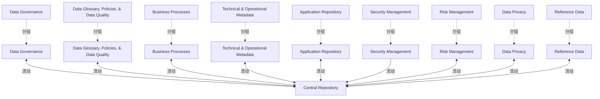

# G234/fig4-8 · 元数据集成：统一式模型

类型：`architecture-concept-or-system-model`。表 4-1 的第三种集成模型，说明治理成熟后的目标形态：既统一元数据，也统一维护元数据的流程与校验工作流，从而消除多库同步与孤岛问题。

英文 PDF 物理页：[28]。本页为架构语义分析，原文与原图分别保留。

## 原图与可编辑图


[完整 JSON](fig4-8.json) · [可编辑 Mermaid](fig4-8.mmd) · [仅关系图](fig4-8.relations.mmd) · [层级分解图](fig4-8.hierarchy.mmd)

图形重建表达语义，不复制源图布局。虚线表示解释、矩阵映射或分组关系，不自动表示不确定性的概率。



## 架构分析

看中央圆柱 Central Repository，九个域社区（Data Governance、Data Glossary, Policies, & Data Quality、Business Processes、Technical & Operational Metadata、Application Repository、Security Management、Risk Management、Data Privacy、Reference Data）以人物图标直接环绕。除 Security Management 只有一条箭头指向中央库外，其余八个域都用双向箭头与中央库相连。图中没有灰色存储库图标，表示不存在外部主副本。

- 本图有 19 个具名或隐含元素、9 条关系和 9 条包含/分组记录。
- 包含/分组树最大深度为 1；根节点为 中央存储库、数据治理、数据术语表、政策与数据质量、业务流程、技术与运营元数据、应用存储库、安全管理、风险管理、数据隐私、参考数据。
- 本图没有可直接确认为人员直属汇报的关系；视觉上下位置、能力分解和治理职责分别读取。
- 核对中央库、所有领域文字、9个人物图标及0个独立来源库圆柱。
- 核对全部9条连接：统一式Security Management仍是单向，不能以统一式总述把它改为双向。
- 将来源库与领域人员分开建模；无箭头连接人物与其旁边来源库时，不新增关系。

### 如何用于项目

- 围绕作者目的读取本图实体、分组与连线，并用对应原文限定其含义。
- 把参考模型与项目事实分开，实际范围、约束、值和责任须有项目证据。

### 结构所表达的逻辑

- 全范围统一：既统一元数据，也统一维护元数据的流程与校验工作流。
- 九个域社区全部直接连接中央库，没有中间存储库，表示所有主副本都在库内。
- 除 Security Management 外，所有域社区与中央库都是双向箭头；Security Management 只有一条单向箭头指向中央库。
- 正文补充：可进一步为不同用户社区提供专属用户体验，可能涉及专属用户界面。
- 该模型要求所有社区都改用中央库，是三种模型中最彻底的一种，代价是迁移与治理投入最大。
- 与图 4-6（只有副本）、图 4-7（部分主副本入库）构成治理深度递增的三种选择。

## 上下级与包含

中央统一存储库为中心；外围 9 个域社区平级环绕，无中间层、无存储库子节点。

|父项|子项|层级类型|依据与解释|
|---|---|---|---|
|数据治理|数据治理人员图标|visual_grouping|框、泳道、域或分类组的成员归属；没有额外证据不提升为业务组合或管理关系。|
|数据术语表、政策与数据质量|数据术语表、政策与数据质量人员图标|visual_grouping|框、泳道、域或分类组的成员归属；没有额外证据不提升为业务组合或管理关系。|
|业务流程|业务流程人员图标|visual_grouping|框、泳道、域或分类组的成员归属；没有额外证据不提升为业务组合或管理关系。|
|技术与运营元数据|技术与运营元数据人员图标|visual_grouping|框、泳道、域或分类组的成员归属；没有额外证据不提升为业务组合或管理关系。|
|应用存储库|应用存储库人员图标|visual_grouping|框、泳道、域或分类组的成员归属；没有额外证据不提升为业务组合或管理关系。|
|安全管理|安全管理人员图标|visual_grouping|框、泳道、域或分类组的成员归属；没有额外证据不提升为业务组合或管理关系。|
|风险管理|风险管理人员图标|visual_grouping|框、泳道、域或分类组的成员归属；没有额外证据不提升为业务组合或管理关系。|
|数据隐私|数据隐私人员图标|visual_grouping|框、泳道、域或分类组的成员归属；没有额外证据不提升为业务组合或管理关系。|
|参考数据|参考数据人员图标|visual_grouping|框、泳道、域或分类组的成员归属；没有额外证据不提升为业务组合或管理关系。|

## 全部元素与角色

|元素ID|原文名称|类型|含义|直接父项|深度|
|---|---|---|---|---|---|
|central_repository|Central Repository|artifact|统一式下唯一的元数据存储库。|—||
|data_governance|Data Governance|group|元数据领域或治理参与领域；人物与存储图标分为独立图形实例。|—||
|data_glossary|Data Glossary, Policies, & Data Quality|group|元数据领域或治理参与领域；人物与存储图标分为独立图形实例。|—||
|business_processes|Business Processes|group|元数据领域或治理参与领域；人物与存储图标分为独立图形实例。|—||
|technical_operational|Technical & Operational Metadata|group|元数据领域或治理参与领域；人物与存储图标分为独立图形实例。|—||
|application_repository|Application Repository|group|元数据领域或治理参与领域；人物与存储图标分为独立图形实例。|—||
|security_management|Security Management|group|元数据领域或治理参与领域；人物与存储图标分为独立图形实例。|—||
|risk_management|Risk Management|group|元数据领域或治理参与领域；人物与存储图标分为独立图形实例。|—||
|data_privacy|Data Privacy|group|元数据领域或治理参与领域；人物与存储图标分为独立图形实例。|—||
|reference_data|Reference Data|group|元数据领域或治理参与领域；人物与存储图标分为独立图形实例。|—||
|data_governance_actor|Data Governance|actor|源图该领域的彩色人物。未把领域名称假定为特定个人或职级。|数据治理|1|
|data_glossary_actor|Data Glossary, Policies, & Data Quality|actor|源图该领域的彩色人物。未把领域名称假定为特定个人或职级。|数据术语表、政策与数据质量|1|
|business_processes_actor|Business Processes|actor|源图该领域的彩色人物。未把领域名称假定为特定个人或职级。|业务流程|1|
|technical_operational_actor|Technical & Operational Metadata|actor|源图该领域的彩色人物。未把领域名称假定为特定个人或职级。|技术与运营元数据|1|
|application_repository_actor|Application Repository|actor|源图该领域的彩色人物。未把领域名称假定为特定个人或职级。|应用存储库|1|
|security_management_actor|Security Management|actor|源图该领域的彩色人物。未把领域名称假定为特定个人或职级。|安全管理|1|
|risk_management_actor|Risk Management|actor|源图该领域的彩色人物。未把领域名称假定为特定个人或职级。|风险管理|1|
|data_privacy_actor|Data Privacy|actor|源图该领域的彩色人物。未把领域名称假定为特定个人或职级。|数据隐私|1|
|reference_data_actor|Reference Data|actor|源图该领域的彩色人物。未把领域名称假定为特定个人或职级。|参考数据|1|

## 全部关系

双向箭头表示社区与中央库之间的读写；Security Management 的箭头为单向，只向中央库供数。图中没有灰色圆柱，说明没有外部主副本。

|主体|语义关系|客体|显式线/隐式|原文标签|依据|
|---|---|---|---|---|---|
|数据治理人员图标|流动|中央存储库|显式连线||把存储圆柱与旁边人物分开；连线端点为原图实际圆柱或人物。|
|数据术语表、政策与数据质量人员图标|流动|中央存储库|显式连线||把存储圆柱与旁边人物分开；连线端点为原图实际圆柱或人物。|
|业务流程人员图标|流动|中央存储库|显式连线||把存储圆柱与旁边人物分开；连线端点为原图实际圆柱或人物。|
|技术与运营元数据人员图标|流动|中央存储库|显式连线||把存储圆柱与旁边人物分开；连线端点为原图实际圆柱或人物。|
|应用存储库人员图标|流动|中央存储库|显式连线||把存储圆柱与旁边人物分开；连线端点为原图实际圆柱或人物。|
|安全管理人员图标|流动|中央存储库|显式连线||把存储圆柱与旁边人物分开；连线端点为原图实际圆柱或人物。|
|风险管理人员图标|流动|中央存储库|显式连线||把存储圆柱与旁边人物分开；连线端点为原图实际圆柱或人物。|
|数据隐私人员图标|流动|中央存储库|显式连线||把存储圆柱与旁边人物分开；连线端点为原图实际圆柱或人物。|
|参考数据人员图标|流动|中央存储库|显式连线||把存储圆柱与旁边人物分开；连线端点为原图实际圆柱或人物。|

## 本轮语义修正

- 把存储圆柱与旁边人物分开；连线端点为原图实际圆柱或人物。
- 把存储圆柱与旁边人物分开；连线端点为原图实际圆柱或人物。
- 把存储圆柱与旁边人物分开；连线端点为原图实际圆柱或人物。
- 把存储圆柱与旁边人物分开；连线端点为原图实际圆柱或人物。
- 把存储圆柱与旁边人物分开；连线端点为原图实际圆柱或人物。
- 把存储圆柱与旁边人物分开；连线端点为原图实际圆柱或人物。
- 把存储圆柱与旁边人物分开；连线端点为原图实际圆柱或人物。
- 把存储圆柱与旁边人物分开；连线端点为原图实际圆柱或人物。
- 把存储圆柱与旁边人物分开；连线端点为原图实际圆柱或人物。

## 误读检查

- 人物图标不代表个人，而是该元数据域的社区/角色。
- 不要以为所有箭头都是双向：Security Management 是单向供数，其余八个域为双向读写。
- 图中没有存储库图标，不等于没有存储；中央圆柱就是唯一存储库。
- 中文稿在图 4-8 后附的标签表其实是图 4-9 的，不能据它把本图读成三种集成模式。

## 原文证据

### [PDF 第 28 页](../../../documents/G234.md#page-28)

> • Manual ingestion: Each source exports the metadata in the agreed format and it is uploaded manually in the repository
> • Pushing metadata: Each source takes the responsibility to push to the metadata repository an agreed scope according to the collaboration contract (format, data structure, frequency, etc.)

## 来源与分析状态

所有元素/关系均有来源定位；未把历史解释重命名为本轮逐线视觉确认。源图与语义图是两种视图，布局不证明汇报或因果。

源 PDF SHA-256：`34a1c590f938bf915182fe5bbe00d1d68f9a3e948697b5500ce7c5a9494f77e7`。

源图记录：[原始解释与转录](../../../figures/G234/fig4-8.json)。

```json
{
  "quality": {
    "graph_integrity": "checked",
    "semantic_analysis": "typed-graph-and-context-analysis",
    "visual_review": "source-content-audited",
    "notice_zh": "所有元素/关系均有来源定位；未把历史解释重命名为本轮逐线视觉确认。源图与语义图是两种视图，布局不证明汇报或因果。"
  },
  "source_uncertainty": {
    "confidence": "high",
    "uncertainties_zh": [
      "图中没有文字说明九个域是否都等同对待；按全部直连、全部双向箭头理解为全范围统一。",
      "中文稿图 4-8 后附的标签表属于图 4-9，已在 asset_checks 中标注。"
    ],
    "analyzed_from": [
      "英文 PDF 第 28 页原图截图",
      "英文 PDF 第 28 页表 4-1 文字",
      "中文稿 G234e_信息架构_元数据管理.md 第 383–424 行",
      "figs/g234e_fig4-8_en.png、figs/zh/g234e_fig4-8_zh.png"
    ],
    "date": "2026-10-31"
  },
  "source_conflicts": []
}
```
