# G234/fig4-9 · 元数据集成模式

类型：`system-or-data-reference-architecture`。正文把元数据交换方式归纳为手工摄取、推送、拉取三类，并说明三者对运营效率、供应商支持、安全审计的影响；本图用同一套环境 A/B 场景并列画出三条路径，便于选型。

英文 PDF 物理页：[28]。本页为架构语义分析，原文与原图分别保留。

## 原图与可编辑图


[完整 JSON](fig4-9.json) · [可编辑 Mermaid](fig4-9.mmd) · [仅关系图](fig4-9.relations.mmd) · [层级分解图](fig4-9.hierarchy.mmd)

图形重建表达语义，不复制源图布局。虚线表示解释、矩阵映射或分组关系，不自动表示不确定性的概率。

```mermaid
flowchart TB
  %% Semantic reconstruction; see original source image for exact layout.
  n0["Pattern 1 – Manual Ingestion"]
  n1["Environment A"]
  n2["数据库（3 台，无标签）"]
  n3["Int"]
  n4["人工操作者（环境 A）"]
  n5["Environment B"]
  n6["数据库（3 台，无标签）"]
  n7["Int"]
  n8["人工操作者（环境 B）"]
  n9["Metadata Management Tool"]
  n10["Pattern 2 – Pushing Metadata"]
  n11["Environment A"]
  n12["数据库（3 台，无标签）"]
  n13["Int"]
  n14["Environment B"]
  n15["数据库（3 台，无标签）"]
  n16["Int"]
  n17["Metadata Management Tool"]
  n18["API"]
  n19["API"]
  n20["Pattern 3 – Pulling Metadata"]
  n21["Environment A"]
  n22["数据库（3 台，无标签）"]
  n23["Agent"]
  n24["Environment B"]
  n25["数据库（3 台，无标签）"]
  n26["Agent"]
  n27["Metadata Management Tool"]
  n28["未命名源数据库图标（左）"]
  n29["未命名源数据库图标（右上）"]
  n30["未命名源数据库图标（右下）"]
  n31["未命名源数据库图标（左）"]
  n32["未命名源数据库图标（右上）"]
  n33["未命名源数据库图标（右下）"]
  n34["未命名源数据库图标（左）"]
  n35["未命名源数据库图标（右上）"]
  n36["未命名源数据库图标（右下）"]
  n37["未命名源数据库图标（左）"]
  n38["未命名源数据库图标（右上）"]
  n39["未命名源数据库图标（右下）"]
  n40["未命名源数据库图标（左）"]
  n41["未命名源数据库图标（右上）"]
  n42["未命名源数据库图标（右下）"]
  n43["未命名源数据库图标（左）"]
  n44["未命名源数据库图标（右上）"]
  n45["未命名源数据库图标（右下）"]
  n29 -->|"流动"| n3
  n3 -->|"流动"| n9
  n4 -.->|"参与"| n9
  n32 -->|"流动"| n7
  n7 -->|"流动"| n9
  n8 -.->|"参与"| n9
  n35 -->|"流动"| n13
  n13 -->|"流动"| n17
  n18 -.-|"关联"| n17
  n38 -->|"流动"| n16
  n16 -->|"流动"| n17
  n19 -.-|"关联"| n17
  n23 -->|"访问"| n41
  n27 -->|"参与/分配"| n23
  n26 -->|"访问"| n44
  n27 -->|"参与/分配"| n26
  n30 -->|"流动"| n3
  n33 -->|"流动"| n7
  n36 -->|"流动"| n13
  n39 -->|"流动"| n16
  n23 -->|"访问"| n42
  n26 -->|"访问"| n45
  n1 -.->|"分组"| n2
  n1 -.->|"分组"| n3
  n5 -.->|"分组"| n6
  n5 -.->|"分组"| n7
  n11 -.->|"分组"| n12
  n11 -.->|"分组"| n13
  n14 -.->|"分组"| n15
  n14 -.->|"分组"| n16
  n21 -.->|"分组"| n22
  n21 -.->|"分组"| n23
  n24 -.->|"分组"| n25
  n24 -.->|"分组"| n26
  n2 -.->|"分组"| n28
  n2 -.->|"分组"| n29
  n2 -.->|"分组"| n30
  n6 -.->|"分组"| n31
  n6 -.->|"分组"| n32
  n6 -.->|"分组"| n33
  n12 -.->|"分组"| n34
  n12 -.->|"分组"| n35
  n12 -.->|"分组"| n36
  n15 -.->|"分组"| n37
  n15 -.->|"分组"| n38
  n15 -.->|"分组"| n39
  n22 -.->|"分组"| n40
  n22 -.->|"分组"| n41
  n22 -.->|"分组"| n42
  n25 -.->|"分组"| n43
  n25 -.->|"分组"| n44
  n25 -.->|"分组"| n45
```



## 架构分析

三个面板是可选交换模式。Manual与Pushing中显式箭头直接从各环境Int指向Metadata Management Tool，人物与API作为旁注说明人工或接口方式；不能把旁注改画成两段独立线。Pulling中工具发起采集，箭头朝源端Agent，Agent读取源库；控制/访问方向与元数据回传方向不同。

- 本图有 46 个具名或隐含元素、22 条关系和 30 条包含/分组记录。
- 包含/分组树最大深度为 2；根节点为 模式 1——手工摄取、环境 A、人工操作者（环境 A）、环境 B、人工操作者（环境 B）、元数据管理工具、模式 2——推送元数据、环境 A、环境 B、元数据管理工具、API、API、模式 3——拉取元数据、环境 A、环境 B、元数据管理工具。
- 本图没有可直接确认为人员直属汇报的关系；视觉上下位置、能力分解和治理职责分别读取。
- 包含分组后有 6 个连通分量；分离可能源于图例、并列分类或独立示例，未自动补边。
- 核对3个模式面板、6个环境、18个来源圆柱、4个Int、2个Agent、3个管理工具、2个人物及2个API旁注。
- 保留此前人物/API并非中转节点的修正；将三只来源集合拆为实例，每个环境只有右上/右下两只画了内部线，左侧圆柱没有连线。
- Pushing/Manual为Int→工具；Pulling为工具→Agent并向来源发起访问，不能据此推导元数据内容的反向流。

### 如何用于项目

- 先划定平台边界，登记应用、存储、数据来源及消费者，再逐条读取输入/输出流。
- 区分基线、过渡与目标架构，以及现有、保留与新增对象；范围包含不自动表示组件实现或组织管理。

### 结构所表达的逻辑

- 模式 1 手工摄取：各环境由 Int 导出，经人工上传到元数据管理工具；人物图标即人工环节，效率最低但供应商依赖最少。
- 模式 2 推送元数据：源端按协作契约（格式、数据结构、频率）主动把约定范围推给工具，经 API 传输，责任在源端。
- 模式 3 拉取元数据：工具把代理部署到源端，代理采集或推断后回传；通常用于技术与运营元数据。
- 三种模式都画了两个环境（A/B），说明同一组织内不同来源可采用不同模式，不必统一。
- 业务元数据仍需人工投入（正文），因此模式 1 不会被完全取代。
- Int 是源端集成组件，不是元数据存储库；API 是推送接口徽标，Agent 是部署在源端的采集代理。

## 上下级与包含

三个并列模式（Pattern 1/2/3）；每个模式下 Environment A 与 Environment B 两个并列环境，各环境内三台数据库 → Int/Agent；右侧工具为共同目标端。

|父项|子项|层级类型|依据与解释|
|---|---|---|---|
|环境 A|数据库（3 台，无标签）|visual_grouping|框、泳道、域或分类组的成员归属；没有额外证据不提升为业务组合或管理关系。|
|环境 A|集成组件（Int）|visual_grouping|框、泳道、域或分类组的成员归属；没有额外证据不提升为业务组合或管理关系。|
|环境 B|数据库（3 台，无标签）|visual_grouping|框、泳道、域或分类组的成员归属；没有额外证据不提升为业务组合或管理关系。|
|环境 B|集成组件（Int）|visual_grouping|框、泳道、域或分类组的成员归属；没有额外证据不提升为业务组合或管理关系。|
|环境 A|数据库（3 台，无标签）|visual_grouping|框、泳道、域或分类组的成员归属；没有额外证据不提升为业务组合或管理关系。|
|环境 A|集成组件（Int）|visual_grouping|框、泳道、域或分类组的成员归属；没有额外证据不提升为业务组合或管理关系。|
|环境 B|数据库（3 台，无标签）|visual_grouping|框、泳道、域或分类组的成员归属；没有额外证据不提升为业务组合或管理关系。|
|环境 B|集成组件（Int）|visual_grouping|框、泳道、域或分类组的成员归属；没有额外证据不提升为业务组合或管理关系。|
|环境 A|数据库（3 台，无标签）|visual_grouping|框、泳道、域或分类组的成员归属；没有额外证据不提升为业务组合或管理关系。|
|环境 A|代理|visual_grouping|框、泳道、域或分类组的成员归属；没有额外证据不提升为业务组合或管理关系。|
|环境 B|数据库（3 台，无标签）|visual_grouping|框、泳道、域或分类组的成员归属；没有额外证据不提升为业务组合或管理关系。|
|环境 B|代理|visual_grouping|框、泳道、域或分类组的成员归属；没有额外证据不提升为业务组合或管理关系。|
|数据库（3 台，无标签）|未命名源数据库图标（左）|visual_grouping|框、泳道、域或分类组的成员归属；没有额外证据不提升为业务组合或管理关系。|
|数据库（3 台，无标签）|未命名源数据库图标（右上）|visual_grouping|框、泳道、域或分类组的成员归属；没有额外证据不提升为业务组合或管理关系。|
|数据库（3 台，无标签）|未命名源数据库图标（右下）|visual_grouping|框、泳道、域或分类组的成员归属；没有额外证据不提升为业务组合或管理关系。|
|数据库（3 台，无标签）|未命名源数据库图标（左）|visual_grouping|框、泳道、域或分类组的成员归属；没有额外证据不提升为业务组合或管理关系。|
|数据库（3 台，无标签）|未命名源数据库图标（右上）|visual_grouping|框、泳道、域或分类组的成员归属；没有额外证据不提升为业务组合或管理关系。|
|数据库（3 台，无标签）|未命名源数据库图标（右下）|visual_grouping|框、泳道、域或分类组的成员归属；没有额外证据不提升为业务组合或管理关系。|
|数据库（3 台，无标签）|未命名源数据库图标（左）|visual_grouping|框、泳道、域或分类组的成员归属；没有额外证据不提升为业务组合或管理关系。|
|数据库（3 台，无标签）|未命名源数据库图标（右上）|visual_grouping|框、泳道、域或分类组的成员归属；没有额外证据不提升为业务组合或管理关系。|
|数据库（3 台，无标签）|未命名源数据库图标（右下）|visual_grouping|框、泳道、域或分类组的成员归属；没有额外证据不提升为业务组合或管理关系。|
|数据库（3 台，无标签）|未命名源数据库图标（左）|visual_grouping|框、泳道、域或分类组的成员归属；没有额外证据不提升为业务组合或管理关系。|
|数据库（3 台，无标签）|未命名源数据库图标（右上）|visual_grouping|框、泳道、域或分类组的成员归属；没有额外证据不提升为业务组合或管理关系。|
|数据库（3 台，无标签）|未命名源数据库图标（右下）|visual_grouping|框、泳道、域或分类组的成员归属；没有额外证据不提升为业务组合或管理关系。|
|数据库（3 台，无标签）|未命名源数据库图标（左）|visual_grouping|框、泳道、域或分类组的成员归属；没有额外证据不提升为业务组合或管理关系。|
|数据库（3 台，无标签）|未命名源数据库图标（右上）|visual_grouping|框、泳道、域或分类组的成员归属；没有额外证据不提升为业务组合或管理关系。|
|数据库（3 台，无标签）|未命名源数据库图标（右下）|visual_grouping|框、泳道、域或分类组的成员归属；没有额外证据不提升为业务组合或管理关系。|
|数据库（3 台，无标签）|未命名源数据库图标（左）|visual_grouping|框、泳道、域或分类组的成员归属；没有额外证据不提升为业务组合或管理关系。|
|数据库（3 台，无标签）|未命名源数据库图标（右上）|visual_grouping|框、泳道、域或分类组的成员归属；没有额外证据不提升为业务组合或管理关系。|
|数据库（3 台，无标签）|未命名源数据库图标（右下）|visual_grouping|框、泳道、域或分类组的成员归属；没有额外证据不提升为业务组合或管理关系。|

## 全部元素与角色

|元素ID|原文名称|类型|含义|直接父项|深度|
|---|---|---|---|---|---|
|p1_title|Pattern 1 – Manual Ingestion|note|说明：模式 1——手工摄取|—||
|p1_env_a|Environment A|group|分组：环境 A|—||
|p1_dbs_a|数据库（3 台，无标签）|group|原图三只未命名来源圆柱的集合，拆分为三个图形实例；仅右上和右下有显式连接。|环境 A|1|
|p1_int_a|Int|application|应用：集成组件（Int）|环境 A|1|
|p1_person_a|人工操作者（环境 A）|actor|原图仅人物图标，无文字标签；表示导出与上传的人工环节。|—||
|p1_env_b|Environment B|group|分组：环境 B|—||
|p1_dbs_b|数据库（3 台，无标签）|group|原图三只未命名来源圆柱的集合，拆分为三个图形实例；仅右上和右下有显式连接。|环境 B|1|
|p1_int_b|Int|application|应用：集成组件（Int）|环境 B|1|
|p1_person_b|人工操作者（环境 B）|actor|参与者：人工操作者（环境 B）|—||
|p1_tool|Metadata Management Tool|application|应用：元数据管理工具|—||
|p2_title|Pattern 2 – Pushing Metadata|note|说明：模式 2——推送元数据|—||
|p2_env_a|Environment A|group|分组：环境 A|—||
|p2_dbs_a|数据库（3 台，无标签）|group|原图三只未命名来源圆柱的集合，拆分为三个图形实例；仅右上和右下有显式连接。|环境 A|1|
|p2_int_a|Int|application|应用：集成组件（Int）|环境 A|1|
|p2_env_b|Environment B|group|分组：环境 B|—||
|p2_dbs_b|数据库（3 台，无标签）|group|原图三只未命名来源圆柱的集合，拆分为三个图形实例；仅右上和右下有显式连接。|环境 B|1|
|p2_int_b|Int|application|应用：集成组件（Int）|环境 B|1|
|p2_tool|Metadata Management Tool|application|应用：元数据管理工具|—||
|p2_api_a|API|service|服务：API|—||
|p2_api_b|API|service|服务：API|—||
|p3_title|Pattern 3 – Pulling Metadata|note|说明：模式 3——拉取元数据|—||
|p3_env_a|Environment A|group|分组：环境 A|—||
|p3_dbs_a|数据库（3 台，无标签）|group|原图三只未命名来源圆柱的集合，拆分为三个图形实例；仅右上和右下有显式连接。|环境 A|1|
|p3_agent_a|Agent|application|应用：代理|环境 A|1|
|p3_env_b|Environment B|group|分组：环境 B|—||
|p3_dbs_b|数据库（3 台，无标签）|group|原图三只未命名来源圆柱的集合，拆分为三个图形实例；仅右上和右下有显式连接。|环境 B|1|
|p3_agent_b|Agent|application|应用：代理|环境 B|1|
|p3_tool|Metadata Management Tool|application|应用：元数据管理工具|—||
|p1_dbs_a_left|未命名源数据库图标（左）|data|信息/数据：未命名源数据库图标（左）|数据库（3 台，无标签）|2|
|p1_dbs_a_upper_right|未命名源数据库图标（右上）|data|信息/数据：未命名源数据库图标（右上）|数据库（3 台，无标签）|2|
|p1_dbs_a_lower_right|未命名源数据库图标（右下）|data|信息/数据：未命名源数据库图标（右下）|数据库（3 台，无标签）|2|
|p1_dbs_b_left|未命名源数据库图标（左）|data|信息/数据：未命名源数据库图标（左）|数据库（3 台，无标签）|2|
|p1_dbs_b_upper_right|未命名源数据库图标（右上）|data|信息/数据：未命名源数据库图标（右上）|数据库（3 台，无标签）|2|
|p1_dbs_b_lower_right|未命名源数据库图标（右下）|data|信息/数据：未命名源数据库图标（右下）|数据库（3 台，无标签）|2|
|p2_dbs_a_left|未命名源数据库图标（左）|data|信息/数据：未命名源数据库图标（左）|数据库（3 台，无标签）|2|
|p2_dbs_a_upper_right|未命名源数据库图标（右上）|data|信息/数据：未命名源数据库图标（右上）|数据库（3 台，无标签）|2|
|p2_dbs_a_lower_right|未命名源数据库图标（右下）|data|信息/数据：未命名源数据库图标（右下）|数据库（3 台，无标签）|2|
|p2_dbs_b_left|未命名源数据库图标（左）|data|信息/数据：未命名源数据库图标（左）|数据库（3 台，无标签）|2|
|p2_dbs_b_upper_right|未命名源数据库图标（右上）|data|信息/数据：未命名源数据库图标（右上）|数据库（3 台，无标签）|2|
|p2_dbs_b_lower_right|未命名源数据库图标（右下）|data|信息/数据：未命名源数据库图标（右下）|数据库（3 台，无标签）|2|
|p3_dbs_a_left|未命名源数据库图标（左）|data|信息/数据：未命名源数据库图标（左）|数据库（3 台，无标签）|2|
|p3_dbs_a_upper_right|未命名源数据库图标（右上）|data|信息/数据：未命名源数据库图标（右上）|数据库（3 台，无标签）|2|
|p3_dbs_a_lower_right|未命名源数据库图标（右下）|data|信息/数据：未命名源数据库图标（右下）|数据库（3 台，无标签）|2|
|p3_dbs_b_left|未命名源数据库图标（左）|data|信息/数据：未命名源数据库图标（左）|数据库（3 台，无标签）|2|
|p3_dbs_b_upper_right|未命名源数据库图标（右上）|data|信息/数据：未命名源数据库图标（右上）|数据库（3 台，无标签）|2|
|p3_dbs_b_lower_right|未命名源数据库图标（右下）|data|信息/数据：未命名源数据库图标（右下）|数据库（3 台，无标签）|2|

## 全部关系

灰色虚线直连Int与工具，并以人物旁注说明人工上传；黑色虚线直连Int与工具，以API旁注说明推送；拉取的黑色实线从工具到Agent。内部细灰线是源集合的部分示意连接，不证明每个图标都存在一根线。

|主体|语义关系|客体|显式线/隐式|原文标签|依据|
|---|---|---|---|---|---|
|未命名源数据库图标（右上）|流动|集成组件（Int）|显式连线||原图仅右上与右下圆柱各有一条灰线；这条映射右上圆柱。|
|集成组件（Int）|流动|元数据管理工具|显式连线||原图线端点为Int与Metadata Management Tool，人物/API只是邻线注记。|
|人工操作者（环境 A）|参与|元数据管理工具|implicit||人物图标表达人工上传参与；原图没有人物图标作为端点的独立连线。|
|未命名源数据库图标（右上）|流动|集成组件（Int）|显式连线||原图仅右上与右下圆柱各有一条灰线；这条映射右上圆柱。|
|集成组件（Int）|流动|元数据管理工具|显式连线||原图线端点为Int与Metadata Management Tool，人物/API只是邻线注记。|
|人工操作者（环境 B）|参与|元数据管理工具|implicit||人物图标表达人工上传参与；原图没有人物图标作为端点的独立连线。|
|未命名源数据库图标（右上）|流动|集成组件（Int）|显式连线||原图仅右上与右下圆柱各有一条灰线；这条映射右上圆柱。|
|集成组件（Int）|流动|元数据管理工具|显式连线||原图线端点为Int与Metadata Management Tool，人物/API只是邻线注记。|
|API|关联|元数据管理工具|implicit||API是工具接口注记，与工具的关联来自位置及正文；没有从API徽标到工具的第二段独立箭头。|
|未命名源数据库图标（右上）|流动|集成组件（Int）|显式连线||原图仅右上与右下圆柱各有一条灰线；这条映射右上圆柱。|
|集成组件（Int）|流动|元数据管理工具|显式连线||原图线端点为Int与Metadata Management Tool，人物/API只是邻线注记。|
|API|关联|元数据管理工具|implicit||API是工具接口注记，与工具的关联来自位置及正文；没有从API徽标到工具的第二段独立箭头。|
|代理|访问|未命名源数据库图标（右上）|显式连线||原图仅右上与右下圆柱各有一条灰线；这条映射右上圆柱。|
|元数据管理工具|参与/分配|代理|显式连线||工具向源端部署/控制代理。|
|代理|访问|未命名源数据库图标（右上）|显式连线||原图仅右上与右下圆柱各有一条灰线；这条映射右上圆柱。|
|元数据管理工具|参与/分配|代理|显式连线||参与/分配|
|未命名源数据库图标（右下）|流动|集成组件（Int）|显式连线||对应右下来源圆柱的独立灰色连接；最左圆柱没有连线。|
|未命名源数据库图标（右下）|流动|集成组件（Int）|显式连线||对应右下来源圆柱的独立灰色连接；最左圆柱没有连线。|
|未命名源数据库图标（右下）|流动|集成组件（Int）|显式连线||对应右下来源圆柱的独立灰色连接；最左圆柱没有连线。|
|未命名源数据库图标（右下）|流动|集成组件（Int）|显式连线||对应右下来源圆柱的独立灰色连接；最左圆柱没有连线。|
|代理|访问|未命名源数据库图标（右下）|显式连线||对应右下来源圆柱的独立灰色连接；最左圆柱没有连线。|
|代理|访问|未命名源数据库图标（右下）|显式连线||对应右下来源圆柱的独立灰色连接；最左圆柱没有连线。|

## 本轮语义修正

- 原图仅右上与右下圆柱各有一条灰线；这条映射右上圆柱。
- 原图线端点为Int与Metadata Management Tool，人物/API只是邻线注记。
- 人物图标表达人工上传参与；原图没有人物图标作为端点的独立连线。
- 原图仅右上与右下圆柱各有一条灰线；这条映射右上圆柱。
- 原图线端点为Int与Metadata Management Tool，人物/API只是邻线注记。
- 人物图标表达人工上传参与；原图没有人物图标作为端点的独立连线。
- 原图仅右上与右下圆柱各有一条灰线；这条映射右上圆柱。
- 原图线端点为Int与Metadata Management Tool，人物/API只是邻线注记。
- API是工具接口注记，与工具的关联来自位置及正文；没有从API徽标到工具的第二段独立箭头。
- 原图仅右上与右下圆柱各有一条灰线；这条映射右上圆柱。
- 原图线端点为Int与Metadata Management Tool，人物/API只是邻线注记。
- API是工具接口注记，与工具的关联来自位置及正文；没有从API徽标到工具的第二段独立箭头。
- 原图仅右上与右下圆柱各有一条灰线；这条映射右上圆柱。
- 原图仅右上与右下圆柱各有一条灰线；这条映射右上圆柱。
- 对应右下来源圆柱的独立灰色连接；最左圆柱没有连线。
- 对应右下来源圆柱的独立灰色连接；最左圆柱没有连线。
- 对应右下来源圆柱的独立灰色连接；最左圆柱没有连线。
- 对应右下来源圆柱的独立灰色连接；最左圆柱没有连线。
- 对应右下来源圆柱的独立灰色连接；最左圆柱没有连线。
- 对应右下来源圆柱的独立灰色连接；最左圆柱没有连线。

## 误读检查

- 三个模式不是先后阶段。
- 人物与API旁注不是原图画出的独立中转节点；参与关系与接口注记应标为隐式。
- 拉取箭头是采集发起/访问方向，不代表元数据值写入源数据库。
- 每环境的数据库图标是来源集合示意，不能从图标数量生成实际数据库清单。

## 原文证据

### [PDF 第 28 页](../../../documents/G234.md#page-28)

> • Manual ingestion: Each source exports the metadata in the agreed format and it is uploaded manually in the repository
> • Pushing metadata: Each source takes the responsibility to push to the metadata repository an agreed scope according to the collaboration contract (format, data structure, frequency, etc.)
### [PDF 第 29 页](../../../documents/G234.md#page-29)

> ◦The metadata solution may have access to all the data; indeed, sometimes the tool will have
> ◦The metadata agent can be an intrusive component for critical applications

## 来源与分析状态

所有元素/关系均有来源定位；未把历史解释重命名为本轮逐线视觉确认。源图与语义图是两种视图，布局不证明汇报或因果。

源 PDF SHA-256：`34a1c590f938bf915182fe5bbe00d1d68f9a3e948697b5500ce7c5a9494f77e7`。

源图记录：[原始解释与转录](../../../figures/G234/fig4-9.json)。

```json
{
  "quality": {
    "graph_integrity": "checked",
    "semantic_analysis": "typed-graph-and-context-analysis",
    "visual_review": "source-content-audited",
    "notice_zh": "所有元素/关系均有来源定位；未把历史解释重命名为本轮逐线视觉确认。源图与语义图是两种视图，布局不证明汇报或因果。"
  },
  "source_uncertainty": {
    "confidence": "high",
    "uncertainties_zh": [
      "模式 1 中人物与工具之间的虚线在原图中不清晰，按“人工上传”语义记录为人物 → 工具。",
      "模式 3 的粗黑线两端均有箭头观感，按“工具部署代理、代理回传”语义记为工具 → 代理单向；正文的“拉取”描述支持这一方向。",
      "图中三台数据库均无文字标签，以“数据库（3 台）”分组元素代表。"
    ],
    "analyzed_from": [
      "英文 PDF 第 28 页原图截图（2x2 与 3x3 放大分块）",
      "英文 PDF 第 28–29 页正文与图例",
      "中文稿 G234e_信息架构_元数据管理.md 第 425–463 行",
      "figs/g234e_fig4-9_en.png、figs/zh/g234e_fig4-9_zh.png、figs/zh/g234e_fig4-9_zh.svg"
    ],
    "date": "2026-10-31"
  },
  "source_conflicts": []
}
```
