# G234/fig5-1 · 元数据管理详细业务功能

类型：`decomposition-or-organization-model`。第 5.1 节的详细业务参考模型，供 ADM 阶段 B 做基线—目标差距分析，也供阶段 E 用来挑战解决方案供应商：每一项二级功能都可以对应到具体的组织职责或交付物。

英文 PDF 物理页：[31]。本页为架构语义分析，原文与原图分别保留。

## 原图与可编辑图


[完整 JSON](fig5-1.json) · [可编辑 Mermaid](fig5-1.mmd) · [仅关系图](fig5-1.relations.mmd) · [层级分解图](fig5-1.hierarchy.mmd)

图形重建表达语义，不复制源图布局。虚线表示解释、矩阵映射或分组关系，不自动表示不确定性的概率。

```mermaid
flowchart TB
  %% Semantic reconstruction; see original source image for exact layout.
  n0["Metadata Management Team"]
  n1["Data Owner"]
  n2["Data Steward"]
  n3["Data Custodian"]
  n4["Data Protection Officer"]
  n5["Metadata Management Business Functions"]
  n6["Strategy &amp; Roadmaps Definition"]
  n7["Define Business Drivers &amp; Requirements"]
  n8["Define Roles &amp; Responsibilities"]
  n9["Build the Roadmap"]
  n10["Identify &amp; Develop Sponsorship"]
  n11["Define KPIs"]
  n12["Governance &amp; Measurement"]
  n13["Define Business Data Domain"]
  n14["Onboard &amp; Appoint Data Steward, Business Data Owner, Data Privacy Officer Per Data Domain"]
  n15["Measure Metadata Documentation Quality &amp; Usage"]
  n16["Business Glossary Documentation"]
  n17["Document Business Concepts"]
  n18["Classify Data Objects &amp; Data Elements (privacy, business criticality)"]
  n19["Data Dictionary Documentation"]
  n20["Document Application"]
  n21["Document Database"]
  n22["Document Data Set &amp; Data Field"]
  n23["Data Usage Documentation"]
  n24["Document Data Processing Activity"]
  n25["Document Data Transfer"]
  n26["Document DPIA Results"]
  n27["Rule &amp; Policy Documentation"]
  n28["Document Business Rules"]
  n29["Document Data Policies"]
  n30["Data Issue Documentation"]
  n31["Document Business Data Issues"]
  n32["Document Data Quality Issues"]
  n33["Business Assets &amp; Technical Assets Association"]
  n34["Document the link between the business glossary concepts and their implementation in the information systems"]
  n35["Document the link between the data usage and the systems that enable this usage"]
  n36["Link business rules to data processing activity"]
  n37["Link business rules to business data elements"]
  n38["Metadata Repository Design"]
  n39["Design Metadata Repository Model"]
  n40["Design Metadata Access Model"]
  n41["Design Workflow"]
  n42["Communications &amp; Training"]
  n43["Train End Users"]
  n44["Communicate about the metadata currently available in the repository"]
  n45["Communicate about the usage of the metadata available"]
  n0 -.->|"分组"| n1
  n0 -.->|"分组"| n2
  n0 -.->|"分组"| n3
  n0 -.->|"分组"| n4
  n5 -.->|"分组"| n6
  n6 -.->|"functional_decomposition"| n7
  n6 -.->|"functional_decomposition"| n8
  n6 -.->|"functional_decomposition"| n9
  n6 -.->|"functional_decomposition"| n10
  n6 -.->|"functional_decomposition"| n11
  n5 -.->|"分组"| n12
  n12 -.->|"functional_decomposition"| n13
  n12 -.->|"functional_decomposition"| n14
  n12 -.->|"functional_decomposition"| n15
  n5 -.->|"分组"| n16
  n16 -.->|"functional_decomposition"| n17
  n16 -.->|"functional_decomposition"| n18
  n5 -.->|"分组"| n19
  n19 -.->|"functional_decomposition"| n20
  n19 -.->|"functional_decomposition"| n21
  n19 -.->|"functional_decomposition"| n22
  n5 -.->|"分组"| n23
  n23 -.->|"functional_decomposition"| n24
  n23 -.->|"functional_decomposition"| n25
  n23 -.->|"functional_decomposition"| n26
  n5 -.->|"分组"| n27
  n27 -.->|"functional_decomposition"| n28
  n27 -.->|"functional_decomposition"| n29
  n5 -.->|"分组"| n30
  n30 -.->|"functional_decomposition"| n31
  n30 -.->|"functional_decomposition"| n32
  n5 -.->|"分组"| n33
  n33 -.->|"functional_decomposition"| n34
  n33 -.->|"functional_decomposition"| n35
  n33 -.->|"functional_decomposition"| n36
  n33 -.->|"functional_decomposition"| n37
  n5 -.->|"分组"| n38
  n38 -.->|"functional_decomposition"| n39
  n38 -.->|"functional_decomposition"| n40
  n38 -.->|"functional_decomposition"| n41
  n5 -.->|"分组"| n42
  n42 -.->|"functional_decomposition"| n43
  n42 -.->|"functional_decomposition"| n44
  n42 -.->|"functional_decomposition"| n45
```



## 架构分析

先看顶部灰色带 Metadata Management Team，里面是四类治理角色。再看下方黄色大组 Metadata Management Business Functions：它按 10 个功能组纵向排列，每个组框的标题是一级功能，组内小框是该功能的二级分解。全图没有连线，框的嵌套表示“属于”，组框的上下次序只是排版。

- 本图有 46 个具名或隐含元素、0 条关系和 44 条包含/分组记录。
- 包含/分组树最大深度为 2；根节点为 元数据管理团队、元数据管理业务功能。
- 本图没有可直接确认为人员直属汇报的关系；视觉上下位置、能力分解和治理职责分别读取。
- 原图靠嵌套表达结构，没有连线；新语义图将包含单独显式化，不补造流程、数据流或依赖。
- 包含分组后有 2 个连通分量；分离可能源于图例、并列分类或独立示例，未自动补边。
- 核对46个标签：团队与4角色、总业务功能、10组与30项细功能。所有功能名、括号说明与嵌套一致。
- 角色图例与功能图没有责任分配连线，不能从排列推断角色到功能的RACI。

### 如何用于项目

- 按父项展开所有直接子项，检查同层粒度、重叠和缺项。
- 保留组成、分类、能力分解与组织汇报的区别；将示例名称替换为已确认的项目对象。

### 结构所表达的逻辑

- 治理角色四类：Data Owner、Data Steward、Data Custodian、Data Protection Officer，全部隶属同一个 Metadata Management Team，说明治理职责由团队分担而非单一岗位。
- 战略与路线图定义下 5 项：定义业务驱动因素与需求、定义角色与职责、构建路线图、识别并培养赞助支持、定义 KPI。
- 治理与度量下 3 项构成闭环：定义业务数据域 → 按域任命数据管家/业务数据所有者/数据隐私官 → 度量元数据文档质量与使用。
- 五类文档化功能共 12 项二级功能：业务术语表 2 项、数据字典 3 项、数据使用 3 项、规则与政策 2 项、数据问题 2 项；数据字典细化到应用、数据库、数据集与字段。
- 业务资产与技术资产关联下 4 项，核心是把业务术语映射到系统实现、把数据使用映射到使能系统，并把业务规则链接到处理活动与数据元素。
- 元数据存储库设计下 3 项：存储库模型、访问模型、工作流；沟通与培训下 3 项：培训最终用户、沟通库内现有元数据、沟通元数据使用情况。
- 图 3-1 的一级功能在本图中同时充当分组容器（如 Strategy & Roadmaps Definition），因此组框标题不是纯标题，而是一项功能。

## 上下级与包含

三条线：① 团队带 → 4 个角色（两层）；② 业务功能大组 → 10 个一级功能组 → 30 个二级功能（三层）。两条线并列，团队不是业务功能的父节点。

|父项|子项|层级类型|依据与解释|
|---|---|---|---|
|元数据管理团队|数据所有者|visual_grouping|框、泳道、域或分类组的成员归属；没有额外证据不提升为业务组合或管理关系。|
|元数据管理团队|数据管家|visual_grouping|框、泳道、域或分类组的成员归属；没有额外证据不提升为业务组合或管理关系。|
|元数据管理团队|数据保管人|visual_grouping|框、泳道、域或分类组的成员归属；没有额外证据不提升为业务组合或管理关系。|
|元数据管理团队|数据保护官|visual_grouping|框、泳道、域或分类组的成员归属；没有额外证据不提升为业务组合或管理关系。|
|元数据管理业务功能|战略与路线图定义|visual_grouping|框、泳道、域或分类组的成员归属；没有额外证据不提升为业务组合或管理关系。|
|战略与路线图定义|定义业务驱动因素与需求|functional_decomposition|同类功能/过程/服务的嵌套分解；不推断执行顺序。|
|战略与路线图定义|定义角色与职责|functional_decomposition|同类功能/过程/服务的嵌套分解；不推断执行顺序。|
|战略与路线图定义|构建路线图|functional_decomposition|同类功能/过程/服务的嵌套分解；不推断执行顺序。|
|战略与路线图定义|识别并培养赞助支持|functional_decomposition|同类功能/过程/服务的嵌套分解；不推断执行顺序。|
|战略与路线图定义|定义 KPI|functional_decomposition|同类功能/过程/服务的嵌套分解；不推断执行顺序。|
|元数据管理业务功能|治理与度量|visual_grouping|框、泳道、域或分类组的成员归属；没有额外证据不提升为业务组合或管理关系。|
|治理与度量|定义业务数据域|functional_decomposition|同类功能/过程/服务的嵌套分解；不推断执行顺序。|
|治理与度量|按数据域吸纳并任命数据管家、业务数据所有者、数据隐私官|functional_decomposition|同类功能/过程/服务的嵌套分解；不推断执行顺序。|
|治理与度量|度量元数据文档质量与使用|functional_decomposition|同类功能/过程/服务的嵌套分解；不推断执行顺序。|
|元数据管理业务功能|业务术语表文档|visual_grouping|框、泳道、域或分类组的成员归属；没有额外证据不提升为业务组合或管理关系。|
|业务术语表文档|记录业务概念|functional_decomposition|同类功能/过程/服务的嵌套分解；不推断执行顺序。|
|业务术语表文档|对数据对象与数据元素分类（隐私、业务关键性）|functional_decomposition|同类功能/过程/服务的嵌套分解；不推断执行顺序。|
|元数据管理业务功能|数据字典文档|visual_grouping|框、泳道、域或分类组的成员归属；没有额外证据不提升为业务组合或管理关系。|
|数据字典文档|记录应用|functional_decomposition|同类功能/过程/服务的嵌套分解；不推断执行顺序。|
|数据字典文档|记录数据库|functional_decomposition|同类功能/过程/服务的嵌套分解；不推断执行顺序。|
|数据字典文档|记录数据集与数据字段|functional_decomposition|同类功能/过程/服务的嵌套分解；不推断执行顺序。|
|元数据管理业务功能|数据使用文档|visual_grouping|框、泳道、域或分类组的成员归属；没有额外证据不提升为业务组合或管理关系。|
|数据使用文档|记录数据处理活动|functional_decomposition|同类功能/过程/服务的嵌套分解；不推断执行顺序。|
|数据使用文档|记录数据传输|functional_decomposition|同类功能/过程/服务的嵌套分解；不推断执行顺序。|
|数据使用文档|记录 DPIA 结果|functional_decomposition|同类功能/过程/服务的嵌套分解；不推断执行顺序。|
|元数据管理业务功能|规则与政策文档|visual_grouping|框、泳道、域或分类组的成员归属；没有额外证据不提升为业务组合或管理关系。|
|规则与政策文档|记录业务规则|functional_decomposition|同类功能/过程/服务的嵌套分解；不推断执行顺序。|
|规则与政策文档|记录数据政策|functional_decomposition|同类功能/过程/服务的嵌套分解；不推断执行顺序。|
|元数据管理业务功能|数据问题文档|visual_grouping|框、泳道、域或分类组的成员归属；没有额外证据不提升为业务组合或管理关系。|
|数据问题文档|记录业务数据问题|functional_decomposition|同类功能/过程/服务的嵌套分解；不推断执行顺序。|
|数据问题文档|记录数据质量问题|functional_decomposition|同类功能/过程/服务的嵌套分解；不推断执行顺序。|
|元数据管理业务功能|业务资产与技术资产关联|visual_grouping|框、泳道、域或分类组的成员归属；没有额外证据不提升为业务组合或管理关系。|
|业务资产与技术资产关联|记录业务术语表概念与其在信息系统中实现之间的链接|functional_decomposition|同类功能/过程/服务的嵌套分解；不推断执行顺序。|
|业务资产与技术资产关联|记录数据使用与使能该使用的系统之间的链接|functional_decomposition|同类功能/过程/服务的嵌套分解；不推断执行顺序。|
|业务资产与技术资产关联|将业务规则链接到数据处理活动|functional_decomposition|同类功能/过程/服务的嵌套分解；不推断执行顺序。|
|业务资产与技术资产关联|将业务规则链接到业务数据元素|functional_decomposition|同类功能/过程/服务的嵌套分解；不推断执行顺序。|
|元数据管理业务功能|元数据存储库设计|visual_grouping|框、泳道、域或分类组的成员归属；没有额外证据不提升为业务组合或管理关系。|
|元数据存储库设计|设计元数据存储库模型|functional_decomposition|同类功能/过程/服务的嵌套分解；不推断执行顺序。|
|元数据存储库设计|设计元数据访问模型|functional_decomposition|同类功能/过程/服务的嵌套分解；不推断执行顺序。|
|元数据存储库设计|设计工作流|functional_decomposition|同类功能/过程/服务的嵌套分解；不推断执行顺序。|
|元数据管理业务功能|沟通与培训|visual_grouping|框、泳道、域或分类组的成员归属；没有额外证据不提升为业务组合或管理关系。|
|沟通与培训|培训最终用户|functional_decomposition|同类功能/过程/服务的嵌套分解；不推断执行顺序。|
|沟通与培训|沟通存储库中当前可用的元数据|functional_decomposition|同类功能/过程/服务的嵌套分解；不推断执行顺序。|
|沟通与培训|沟通可用元数据的使用情况|functional_decomposition|同类功能/过程/服务的嵌套分解；不推断执行顺序。|

## 全部元素与角色

|元素ID|原文名称|类型|含义|直接父项|深度|
|---|---|---|---|---|---|
|team|Metadata Management Team|group|分组：元数据管理团队|—||
|role_owner|Data Owner|role|角色：数据所有者|元数据管理团队|1|
|role_steward|Data Steward|role|角色：数据管家|元数据管理团队|1|
|role_custodian|Data Custodian|role|角色：数据保管人|元数据管理团队|1|
|role_dpo|Data Protection Officer|role|角色：数据保护官|元数据管理团队|1|
|bf_root|Metadata Management Business Functions|group|分组：元数据管理业务功能|—||
|g_strategy|Strategy & Roadmaps Definition|function|功能：战略与路线图定义|元数据管理业务功能|1|
|f_drivers|Define Business Drivers & Requirements|function|功能：定义业务驱动因素与需求|战略与路线图定义|2|
|f_roles|Define Roles & Responsibilities|function|功能：定义角色与职责|战略与路线图定义|2|
|f_roadmap|Build the Roadmap|function|功能：构建路线图|战略与路线图定义|2|
|f_sponsorship|Identify & Develop Sponsorship|function|功能：识别并培养赞助支持|战略与路线图定义|2|
|f_kpis|Define KPIs|function|功能：定义 KPI|战略与路线图定义|2|
|g_governance|Governance & Measurement|function|功能：治理与度量|元数据管理业务功能|1|
|f_domain|Define Business Data Domain|function|功能：定义业务数据域|治理与度量|2|
|f_appoint|Onboard & Appoint Data Steward, Business Data Owner, Data Privacy Officer Per Data Domain|function|功能：按数据域吸纳并任命数据管家、业务数据所有者、数据隐私官|治理与度量|2|
|f_measure|Measure Metadata Documentation Quality & Usage|function|功能：度量元数据文档质量与使用|治理与度量|2|
|g_glossary|Business Glossary Documentation|function|功能：业务术语表文档|元数据管理业务功能|1|
|f_concepts|Document Business Concepts|function|功能：记录业务概念|业务术语表文档|2|
|f_classify|Classify Data Objects & Data Elements (privacy, business criticality)|function|功能：对数据对象与数据元素分类（隐私、业务关键性）|业务术语表文档|2|
|g_dictionary|Data Dictionary Documentation|function|功能：数据字典文档|元数据管理业务功能|1|
|f_app|Document Application|function|功能：记录应用|数据字典文档|2|
|f_db|Document Database|function|功能：记录数据库|数据字典文档|2|
|f_dataset|Document Data Set & Data Field|function|功能：记录数据集与数据字段|数据字典文档|2|
|g_usage|Data Usage Documentation|function|功能：数据使用文档|元数据管理业务功能|1|
|f_processing|Document Data Processing Activity|function|功能：记录数据处理活动|数据使用文档|2|
|f_transfer|Document Data Transfer|function|功能：记录数据传输|数据使用文档|2|
|f_dpia|Document DPIA Results|function|功能：记录 DPIA 结果|数据使用文档|2|
|g_rules|Rule & Policy Documentation|function|功能：规则与政策文档|元数据管理业务功能|1|
|f_business_rules|Document Business Rules|function|功能：记录业务规则|规则与政策文档|2|
|f_policies|Document Data Policies|function|功能：记录数据政策|规则与政策文档|2|
|g_issues|Data Issue Documentation|function|功能：数据问题文档|元数据管理业务功能|1|
|f_business_issues|Document Business Data Issues|function|功能：记录业务数据问题|数据问题文档|2|
|f_quality_issues|Document Data Quality Issues|function|功能：记录数据质量问题|数据问题文档|2|
|g_assets|Business Assets & Technical Assets Association|function|功能：业务资产与技术资产关联|元数据管理业务功能|1|
|f_link_glossary|Document the link between the business glossary concepts and their implementation in the information systems|function|功能：记录业务术语表概念与其在信息系统中实现之间的链接|业务资产与技术资产关联|2|
|f_link_usage|Document the link between the data usage and the systems that enable this usage|function|功能：记录数据使用与使能该使用的系统之间的链接|业务资产与技术资产关联|2|
|f_rule_activity|Link business rules to data processing activity|function|功能：将业务规则链接到数据处理活动|业务资产与技术资产关联|2|
|f_rule_element|Link business rules to business data elements|function|功能：将业务规则链接到业务数据元素|业务资产与技术资产关联|2|
|g_repo_design|Metadata Repository Design|function|功能：元数据存储库设计|元数据管理业务功能|1|
|f_repo_model|Design Metadata Repository Model|function|功能：设计元数据存储库模型|元数据存储库设计|2|
|f_access_model|Design Metadata Access Model|function|功能：设计元数据访问模型|元数据存储库设计|2|
|f_workflow|Design Workflow|function|功能：设计工作流|元数据存储库设计|2|
|g_comms|Communications & Training|function|功能：沟通与培训|元数据管理业务功能|1|
|f_train|Train End Users|function|功能：培训最终用户|沟通与培训|2|
|f_comm_available|Communicate about the metadata currently available in the repository|function|功能：沟通存储库中当前可用的元数据|沟通与培训|2|
|f_comm_usage|Communicate about the usage of the metadata available|function|功能：沟通可用元数据的使用情况|沟通与培训|2|

## 全部关系

全图无连线。嵌套关系表示“二级功能属于该一级功能”，大组框表示“这些功能都属于元数据管理业务功能”；组框上下位置不表示流程先后。

|主体|语义关系|客体|显式线/隐式|原文标签|依据|
|---|---|---|---|---|---|

## 误读检查

- 不要把顶部四个角色当成四个部门或四个系统；它们是同一团队内的治理职责。
- 不要把组框标题只当标题：Strategy & Roadmaps Definition 等同时是一级业务功能，图 3-1 已把它们列为一级功能。
- 不要以为每个一级功能下的二级功能数量相同；从 2 项到 5 项不等。
- 中文 PNG 中大量二级功能字号极小，不能因为看不清就认为原图没有这些功能。

## 原文证据

### [PDF 第 31 页](../../../documents/G234.md#page-31)

> Figure 5-1 shows detailed business functions of the Metadata Management capability using ArchiMate notation [C226].
> Table 5-1 provides detailed descriptions of the business functions shown in Figure 5-1.

## 来源与分析状态

所有元素/关系均有来源定位；未把历史解释重命名为本轮逐线视觉确认。源图与语义图是两种视图，布局不证明汇报或因果。

源 PDF SHA-256：`34a1c590f938bf915182fe5bbe00d1d68f9a3e948697b5500ce7c5a9494f77e7`。

源图记录：[原始解释与转录](../../../figures/G234/fig5-1.json)。

```json
{
  "quality": {
    "graph_integrity": "checked",
    "semantic_analysis": "typed-graph-and-context-analysis",
    "visual_review": "source-content-audited",
    "notice_zh": "所有元素/关系均有来源定位；未把历史解释重命名为本轮逐线视觉确认。源图与语义图是两种视图，布局不证明汇报或因果。"
  },
  "source_uncertainty": {
    "confidence": "high",
    "uncertainties_zh": [
      "图中组框标题既是一级功能又是容器，原图没有额外说明；本分析按“功能 + 分组”双重角色处理。",
      "四个角色框之间没有连线，团队与角色、团队与业务功能之间的关系由版式表达。",
      "中文 PNG 多处文字过小，个别二级功能译名（如“识别并培养赞助支持”）以中文稿对照表为准。"
    ],
    "analyzed_from": [
      "英文 PDF 第 31 页原图截图",
      "英文 PDF 第 31–34 页表 5-1 文字",
      "中文稿 G234e_信息架构_元数据管理.md 第 509–553 行（图内标签对照）",
      "figs/g234e_fig5-1_en.png、figs/zh/g234e_fig5-1_zh.png"
    ],
    "date": "2026-10-31"
  },
  "source_conflicts": [
    {
      "id": "source-g234-fig5-1",
      "figure_id": "G234/fig5-1",
      "status": "observed-conflict",
      "description": "JSON摘要五类文档化功能共13项的分项相加为12；一级10组二级30项需按图逐组核对。",
      "evidence": [
        "G234 §5.1",
        "figs/g234e_fig5-1_en.png",
        "figs/ai/G234/fig5-1.json"
      ],
      "resolution": "使用实际分组与元素清单，不把错误摘要数量转为约束。"
    }
  ]
}
```
