# G234/fig5-2 · 元数据管理详细应用功能

类型：`decomposition-or-organization-model`。第 5.2 节的应用参考模型，用于 ADM 阶段 C/E：阶段 C 拿它做应用功能差距分析，阶段 E 拿它逐项挑战解决方案供应商的功能覆盖。

英文 PDF 物理页：[34]。本页为架构语义分析，原文与原图分别保留。

## 原图与可编辑图


[完整 JSON](fig5-2.json) · [可编辑 Mermaid](fig5-2.mmd) · [仅关系图](fig5-2.relations.mmd) · [层级分解图](fig5-2.hierarchy.mmd)

图形重建表达语义，不复制源图布局。虚线表示解释、矩阵映射或分组关系，不自动表示不确定性的概率。

```mermaid
flowchart TB
  %% Semantic reconstruction; see original source image for exact layout.
  n0["Metadata Management Application Functions"]
  n1["Acquisition"]
  n2["Metadata Creation, Revision, &amp; Deletion"]
  n3["Metadata Classification"]
  n4["Metadata Association"]
  n5["Metadata Inference"]
  n6["Data Quality Rules Execution"]
  n7["Governance"]
  n8["Workflow Validation"]
  n9["Impact Analysis"]
  n10["Task Assignment"]
  n11["Metadata Activity Monitoring"]
  n12["Reporting"]
  n13["Data Compliance Reporting"]
  n14["Data Documentation Reporting"]
  n15["Data Accountability Reporting"]
  n16["Data Quality Reporting"]
  n17["Metadata Searching"]
  n18["Reference Data Management"]
  n19["List of Values Management (category list, code list, etc.)"]
  n20["Metadata Integration"]
  n21["Metadata Querying"]
  n22["Bulk Import"]
  n23["Bulk Export"]
  n24["Events Subscription"]
  n25["Administration"]
  n26["Environment Management"]
  n27["Access Management"]
  n28["Internationalization &amp; Localization"]
  n29["Event Logging Management"]
  n30["Database Versioning"]
  n0 -.->|"分组"| n1
  n1 -.->|"functional_decomposition"| n2
  n1 -.->|"functional_decomposition"| n3
  n1 -.->|"functional_decomposition"| n4
  n1 -.->|"functional_decomposition"| n5
  n1 -.->|"functional_decomposition"| n6
  n0 -.->|"分组"| n7
  n7 -.->|"functional_decomposition"| n8
  n7 -.->|"functional_decomposition"| n9
  n7 -.->|"functional_decomposition"| n10
  n7 -.->|"functional_decomposition"| n11
  n0 -.->|"分组"| n12
  n12 -.->|"functional_decomposition"| n13
  n12 -.->|"functional_decomposition"| n14
  n12 -.->|"functional_decomposition"| n15
  n12 -.->|"functional_decomposition"| n16
  n12 -.->|"functional_decomposition"| n17
  n0 -.->|"分组"| n18
  n18 -.->|"functional_decomposition"| n19
  n0 -.->|"分组"| n20
  n20 -.->|"functional_decomposition"| n21
  n20 -.->|"functional_decomposition"| n22
  n20 -.->|"functional_decomposition"| n23
  n20 -.->|"functional_decomposition"| n24
  n0 -.->|"分组"| n25
  n25 -.->|"functional_decomposition"| n26
  n25 -.->|"functional_decomposition"| n27
  n25 -.->|"functional_decomposition"| n28
  n25 -.->|"functional_decomposition"| n29
  n25 -.->|"functional_decomposition"| n30
```



## 架构分析

从蓝色大组 Metadata Management Application Functions 进入，按 6 个组读：Acquisition（采集）、Governance（治理）、Reporting（报表）、Reference Data Management（参考数据管理）、Metadata Integration（元数据集成）、Administration（管理）。组框标题是一级应用功能，组内小框是二级功能；没有连线，嵌套表示归属。

- 本图有 31 个具名或隐含元素、0 条关系和 30 条包含/分组记录。
- 包含/分组树最大深度为 2；根节点为 元数据管理应用功能。
- 本图没有可直接确认为人员直属汇报的关系；视觉上下位置、能力分解和治理职责分别读取。
- 原图靠嵌套表达结构，没有连线；新语义图将包含单独显式化，不补造流程、数据流或依赖。
- 核对31个标签：总功能、6组与24项细功能，全部子组位置及功能名称正确。
- 无显式功能依赖线；Workflow Validation、Impact Analysis、Task Assignment与Metadata Activity Monitoring均属Governance。

### 如何用于项目

- 按父项展开所有直接子项，检查同层粒度、重叠和缺项。
- 保留组成、分类、能力分解与组织汇报的区别；将示例名称替换为已确认的项目对象。

### 结构所表达的逻辑

- 采集组 5 项：元数据创建/修订/删除、元数据分类、元数据关联、元数据推断、数据质量规则执行；覆盖元数据的产生与加工。
- 治理组 4 项：工作流校验、影响分析、任务分配、元数据活动监控；对应治理所需的审批、影响评估与运行监控。
- 报表组 5 项：数据合规报表、数据文档报表、数据问责报表、数据质量报表、元数据搜索；既面向监管也面向日常使用。
- 参考数据管理组只有 1 项：值列表管理（类别列表、代码列表等），说明它是独立但范围集中的能力。
- 元数据集成组 4 项：元数据查询、批量导入、批量导出、事件订阅；纯技术性交换能力，与图 4-9 的三种模式对应。
- 管理组 5 项：环境管理、访问管理、国际化与本地化、事件日志管理、数据库版本管理；是支撑前三类能力的运行底座。

## 上下级与包含

两层：应用功能大组（L1）→ 6 个一级功能组（L2）→ 24 个二级应用功能（L3）。组与组并列，无跨组连线。

|父项|子项|层级类型|依据与解释|
|---|---|---|---|
|元数据管理应用功能|采集|visual_grouping|框、泳道、域或分类组的成员归属；没有额外证据不提升为业务组合或管理关系。|
|采集|元数据创建、修订与删除|functional_decomposition|同类功能/过程/服务的嵌套分解；不推断执行顺序。|
|采集|元数据分类|functional_decomposition|同类功能/过程/服务的嵌套分解；不推断执行顺序。|
|采集|元数据关联|functional_decomposition|同类功能/过程/服务的嵌套分解；不推断执行顺序。|
|采集|元数据推断|functional_decomposition|同类功能/过程/服务的嵌套分解；不推断执行顺序。|
|采集|数据质量规则执行|functional_decomposition|同类功能/过程/服务的嵌套分解；不推断执行顺序。|
|元数据管理应用功能|治理|visual_grouping|框、泳道、域或分类组的成员归属；没有额外证据不提升为业务组合或管理关系。|
|治理|工作流校验|functional_decomposition|同类功能/过程/服务的嵌套分解；不推断执行顺序。|
|治理|影响分析|functional_decomposition|同类功能/过程/服务的嵌套分解；不推断执行顺序。|
|治理|任务分配|functional_decomposition|同类功能/过程/服务的嵌套分解；不推断执行顺序。|
|治理|元数据活动监控|functional_decomposition|同类功能/过程/服务的嵌套分解；不推断执行顺序。|
|元数据管理应用功能|报表|visual_grouping|框、泳道、域或分类组的成员归属；没有额外证据不提升为业务组合或管理关系。|
|报表|数据合规报表|functional_decomposition|同类功能/过程/服务的嵌套分解；不推断执行顺序。|
|报表|数据文档报表|functional_decomposition|同类功能/过程/服务的嵌套分解；不推断执行顺序。|
|报表|数据问责报表|functional_decomposition|同类功能/过程/服务的嵌套分解；不推断执行顺序。|
|报表|数据质量报表|functional_decomposition|同类功能/过程/服务的嵌套分解；不推断执行顺序。|
|报表|元数据搜索|functional_decomposition|同类功能/过程/服务的嵌套分解；不推断执行顺序。|
|元数据管理应用功能|参考数据管理|visual_grouping|框、泳道、域或分类组的成员归属；没有额外证据不提升为业务组合或管理关系。|
|参考数据管理|值列表管理（类别列表、代码列表等）|functional_decomposition|同类功能/过程/服务的嵌套分解；不推断执行顺序。|
|元数据管理应用功能|元数据集成|visual_grouping|框、泳道、域或分类组的成员归属；没有额外证据不提升为业务组合或管理关系。|
|元数据集成|元数据查询|functional_decomposition|同类功能/过程/服务的嵌套分解；不推断执行顺序。|
|元数据集成|批量导入|functional_decomposition|同类功能/过程/服务的嵌套分解；不推断执行顺序。|
|元数据集成|批量导出|functional_decomposition|同类功能/过程/服务的嵌套分解；不推断执行顺序。|
|元数据集成|事件订阅|functional_decomposition|同类功能/过程/服务的嵌套分解；不推断执行顺序。|
|元数据管理应用功能|管理|visual_grouping|框、泳道、域或分类组的成员归属；没有额外证据不提升为业务组合或管理关系。|
|管理|环境管理|functional_decomposition|同类功能/过程/服务的嵌套分解；不推断执行顺序。|
|管理|访问管理|functional_decomposition|同类功能/过程/服务的嵌套分解；不推断执行顺序。|
|管理|国际化与本地化|functional_decomposition|同类功能/过程/服务的嵌套分解；不推断执行顺序。|
|管理|事件日志管理|functional_decomposition|同类功能/过程/服务的嵌套分解；不推断执行顺序。|
|管理|数据库版本管理|functional_decomposition|同类功能/过程/服务的嵌套分解；不推断执行顺序。|

## 全部元素与角色

|元素ID|原文名称|类型|含义|直接父项|深度|
|---|---|---|---|---|---|
|af_root|Metadata Management Application Functions|group|分组：元数据管理应用功能|—||
|g_acquisition|Acquisition|function|功能：采集|元数据管理应用功能|1|
|f_create|Metadata Creation, Revision, & Deletion|function|功能：元数据创建、修订与删除|采集|2|
|f_classification|Metadata Classification|function|功能：元数据分类|采集|2|
|f_association|Metadata Association|function|功能：元数据关联|采集|2|
|f_inference|Metadata Inference|function|功能：元数据推断|采集|2|
|f_dq_rules|Data Quality Rules Execution|function|功能：数据质量规则执行|采集|2|
|g_governance|Governance|function|功能：治理|元数据管理应用功能|1|
|f_workflow|Workflow Validation|function|功能：工作流校验|治理|2|
|f_impact|Impact Analysis|function|功能：影响分析|治理|2|
|f_task|Task Assignment|function|功能：任务分配|治理|2|
|f_monitoring|Metadata Activity Monitoring|function|功能：元数据活动监控|治理|2|
|g_reporting|Reporting|function|功能：报表|元数据管理应用功能|1|
|f_compliance_report|Data Compliance Reporting|function|功能：数据合规报表|报表|2|
|f_doc_report|Data Documentation Reporting|function|功能：数据文档报表|报表|2|
|f_accountability_report|Data Accountability Reporting|function|功能：数据问责报表|报表|2|
|f_quality_report|Data Quality Reporting|function|功能：数据质量报表|报表|2|
|f_search|Metadata Searching|function|功能：元数据搜索|报表|2|
|g_reference|Reference Data Management|function|功能：参考数据管理|元数据管理应用功能|1|
|f_lov|List of Values Management (category list, code list, etc.)|function|功能：值列表管理（类别列表、代码列表等）|参考数据管理|2|
|g_integration|Metadata Integration|function|功能：元数据集成|元数据管理应用功能|1|
|f_querying|Metadata Querying|function|功能：元数据查询|元数据集成|2|
|f_bulk_import|Bulk Import|function|功能：批量导入|元数据集成|2|
|f_bulk_export|Bulk Export|function|功能：批量导出|元数据集成|2|
|f_events|Events Subscription|function|功能：事件订阅|元数据集成|2|
|g_admin|Administration|function|功能：管理|元数据管理应用功能|1|
|f_env|Environment Management|function|功能：环境管理|管理|2|
|f_access|Access Management|function|功能：访问管理|管理|2|
|f_i18n|Internationalization & Localization|function|功能：国际化与本地化|管理|2|
|f_logging|Event Logging Management|function|功能：事件日志管理|管理|2|
|f_db_version|Database Versioning|function|功能：数据库版本管理|管理|2|

## 全部关系

全图无连线；嵌套与框的位置表示“二级功能属于该组”，组框的排列次序不表示调用顺序。

|主体|语义关系|客体|显式线/隐式|原文标签|依据|
|---|---|---|---|---|---|

## 误读检查

- 不要把 Acquisition 只理解为“采集工具”；它还包含创建、修订、删除、分类、关联与推断。
- 不要把 Metadata Integration 当成跨组连接线；它是与其他组并列的一组应用功能。
- 不要以为 Reference Data Management 与 Reporting 有从属关系；它们是并列组。
- 中文 PNG 中部分二级功能字号极小，不能因看不清而认为原图没有这些功能。

## 原文证据

### [PDF 第 34 页](../../../documents/G234.md#page-34)

> Figure 5-2 shows detailed business applications of the Metadata Management capability using ArchiMate notation [C226].
> Table 5-2 provides detailed descriptions of the application functions shown in Figure 5-2.

## 来源与分析状态

所有元素/关系均有来源定位；未把历史解释重命名为本轮逐线视觉确认。源图与语义图是两种视图，布局不证明汇报或因果。

源 PDF SHA-256：`34a1c590f938bf915182fe5bbe00d1d68f9a3e948697b5500ce7c5a9494f77e7`。

源图记录：[原始解释与转录](../../../figures/G234/fig5-2.json)。

```json
{
  "quality": {
    "graph_integrity": "checked",
    "semantic_analysis": "typed-graph-and-context-analysis",
    "visual_review": "source-content-audited",
    "notice_zh": "所有元素/关系均有来源定位；未把历史解释重命名为本轮逐线视觉确认。源图与语义图是两种视图，布局不证明汇报或因果。"
  },
  "source_uncertainty": {
    "confidence": "high",
    "uncertainties_zh": [
      "组框标题同时是一级功能，原图未额外标注；按“功能 + 分组”双重角色处理。",
      "Metadata Inference 与 3.3 节“采集”定义中的“推断”一致，但中文稿有时写作“元数据推断”，术语已统一。",
      "中文 PNG 多处二级功能字号过小，译名以中文稿标签表为准。"
    ],
    "analyzed_from": [
      "英文 PDF 第 34 页原图截图",
      "英文 PDF 第 34–35 页表 5-2 文字",
      "中文稿 G234e_信息架构_元数据管理.md 第 595–634 行（图内标签对照）",
      "figs/g234e_fig5-2_en.png、figs/zh/g234e_fig5-2_zh.png"
    ],
    "date": "2026-10-31"
  },
  "source_conflicts": []
}
```
