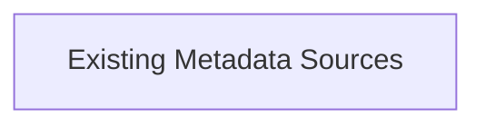

# G234/image-p0028-02 · 元数据集成图的图例：堆叠圆柱图标表示 Existing Metadata Sources（既有元数据来源），用于解释邻近集成模型里的来源符号。

类型：`notation-or-legend`。元数据集成图的图例：堆叠圆柱图标表示 Existing Metadata Sources（既有元数据来源），用于解释邻近集成模型里的来源符号。

英文 PDF 物理页：[28]。本页为架构语义分析，原文与原图分别保留。

## 原图与可编辑图


[完整 JSON](image-p0028-02.json) · [可编辑 Mermaid](image-p0028-02.mmd) · [仅关系图](image-p0028-02.relations.mmd) · [层级分解图](image-p0028-02.hierarchy.mmd)

图形重建表达语义，不复制源图布局。虚线表示解释、矩阵映射或分组关系，不自动表示不确定性的概率。



## 架构分析

- 本图有 1 个具名或隐含元素、0 条关系和 0 条包含/分组记录。
- 本图没有可直接确认为人员直属汇报的关系；视觉上下位置、能力分解和治理职责分别读取。

### 如何用于项目

- 先用图例解释记法与颜色，再读取使用该符号的图。
- 记法符号是类型说明，不是实际项目实体。

## 上下级与包含

本图没有另行明确的层级说明。

|父项|子项|层级类型|依据与解释|
|---|---|---|---|
|—|—|无视觉包含|关系中明确的组成/特化见 JSON semantic_hierarchy。|

## 全部元素与角色

|元素ID|原文名称|类型|含义|直接父项|深度|
|---|---|---|---|---|---|
|symbol|Existing Metadata Sources|concept|元数据集成图的图例：堆叠圆柱图标表示 Existing Metadata Sources（既有元数据来源），用于解释邻近集成模型里的来源符号。|—||

## 全部关系


|主体|语义关系|客体|显式线/隐式|原文标签|依据|
|---|---|---|---|---|---|

## 原文证据

### [PDF 第 28 页](../../../documents/G234.md#page-28)

> • Manual ingestion: Each source exports the metadata in the agreed format and it is uploaded manually in the repository
> • Pushing metadata: Each source takes the responsibility to push to the metadata repository an agreed scope according to the collaboration contract (format, data structure, frequency, etc.)

## 来源与分析状态

所有元素/关系均有来源定位；未把历史解释重命名为本轮逐线视觉确认。源图与语义图是两种视图，布局不证明汇报或因果。

源 PDF SHA-256：`34a1c590f938bf915182fe5bbe00d1d68f9a3e948697b5500ce7c5a9494f77e7`。

源图记录：[原始解释与转录](../../../figures/G234/image-p0028-02.json)。

```json
{
  "quality": {
    "graph_integrity": "checked",
    "semantic_analysis": "typed-graph-and-context-analysis",
    "visual_review": "source-symbol-or-table-transcribed",
    "notice_zh": "所有元素/关系均有来源定位；未把历史解释重命名为本轮逐线视觉确认。源图与语义图是两种视图，布局不证明汇报或因果。"
  },
  "source_uncertainty": null,
  "source_conflicts": []
}
```
