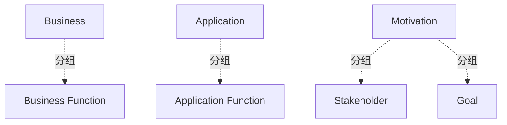

# G238/fig1-1 · 本文档使用的 ArchiMate 建模元素

类型：`notation-or-legend`。在进入参考模型前先固定记法：告诉读者后续所有模型都只用这四类元素，且业务/应用功能与动机方面的符号、颜色各不相同，避免把后面的方框图误读成流程或组织图。

英文 PDF 物理页：[11]。本页为架构语义分析，原文与原图分别保留。

## 原图与可编辑图


[完整 JSON](fig1-1.json) · [可编辑 Mermaid](fig1-1.mmd) · [仅关系图](fig1-1.relations.mmd) · [层级分解图](fig1-1.hierarchy.mmd)

图形重建表达语义，不复制源图布局。虚线表示解释、矩阵映射或分组关系，不自动表示不确定性的概率。



## 架构分析

先看左侧两条横向灰带：Business 带内是黄色圆角矩形“Business Function”，Application 带内是青色圆角矩形“Application Function”；两者右上角都带同一个功能（旗帜）图标，只能靠颜色和所在灰带区分。再看右侧 Motivation 带：上下两个淡紫色切角框分别是 Stakeholder（双圆图标）和 Goal（靶心图标）。图中没有箭头。

- 本图有 7 个具名或隐含元素、0 条关系和 4 条包含/分组记录。
- 包含/分组树最大深度为 1；根节点为 业务层、应用层、动机方面。
- 本图没有可直接确认为人员直属汇报的关系；视觉上下位置、能力分解和治理职责分别读取。
- 原图靠嵌套表达结构，没有连线；新语义图将包含单独显式化，不补造流程、数据流或依赖。
- 包含分组后有 3 个连通分量；分离可能源于图例、并列分类或独立示例，未自动补边。
- 核对3个层带与4个ArchiMate元素标签/形状；无关系连线，技术层未出现在本图。

### 如何用于项目

- 先用图例解释记法与颜色，再读取使用该符号的图。
- 记法符号是类型说明，不是实际项目实体。

### 结构所表达的逻辑

- 全图只有四个元素：Business Function、Application Function、Stakeholder、Goal；没有流程、服务、数据、应用组件等元素，所以后文参考模型只做功能分解。
- 颜色即方面：业务层用黄色、应用层用青色、动机方面用淡紫色；形状本身不区分元素类型，功能与应用功能都是圆角矩形。
- 每个元素右上角的小图标才是 ArchiMate 类型标记：功能为旗帜状图标，Stakeholder 为双圆，Goal 为同心圆靶心。
- Stakeholder 与 Goal 属于动机方面，回答能力“为何存在、为谁服务”，与业务/应用功能不在同一分类维度。
- 该图是记法图例而非架构模型：没有连线、没有层级关系，后续图 2-1、4-1、4-2、4-3 复用这里的符号。
- 图 1-1 只声明了文档使用的元素子集，不代表 ArchiMate 标准的全部元素。

## 上下级与包含

两层：外层是三个方面的分组带（Business、Application、Motivation），带内是元素符号示例。元素示例之间没有上下级；方面带只是分类容器，不是架构层级。

|父项|子项|层级类型|依据与解释|
|---|---|---|---|
|业务层|业务功能|visual_grouping|框、泳道、域或分类组的成员归属；没有额外证据不提升为业务组合或管理关系。|
|应用层|应用功能|visual_grouping|框、泳道、域或分类组的成员归属；没有额外证据不提升为业务组合或管理关系。|
|动机方面|利益相关者|visual_grouping|框、泳道、域或分类组的成员归属；没有额外证据不提升为业务组合或管理关系。|
|动机方面|目标|visual_grouping|框、泳道、域或分类组的成员归属；没有额外证据不提升为业务组合或管理关系。|

## 全部元素与角色

|元素ID|原文名称|类型|含义|直接父项|深度|
|---|---|---|---|---|---|
|band_business|Business|group|ArchiMate 业务方面的分组带。|—||
|band_application|Application|group|ArchiMate 应用方面的分组带。|—||
|band_motivation|Motivation|group|ArchiMate 动机方面的分组带。|—||
|business_function|Business Function|function|记法示例；正文定义：基于选定标准（通常是所需业务资源/胜任力）的业务行为集合。|业务层|1|
|application_function|Application Function|function|记法示例；正文定义：可由应用组件执行的自动化行为。|应用层|1|
|stakeholder|Stakeholder|stakeholder|记法示例；代表个人、团队或组织在架构影响方面的利益角色。|动机方面|1|
|goal|Goal|goal|记法示例；对组织及其利益相关者而言关于意图、方向或期望终态的高层陈述。|动机方面|1|

## 全部关系

图中没有任何连线或箭头。业务功能/应用功能与动机元素之间的关系、以及功能之间的组成关系都不在本图表达。

|主体|语义关系|客体|显式线/隐式|原文标签|依据|
|---|---|---|---|---|---|

## 误读检查

- 不要把 Business / Application / Motivation 三条带读成自下而上的架构分层或成熟度等级，它们只是 ArchiMate 的方面分类。
- 不要因为业务功能和应用功能形状相同就认为二者可互换：区别在颜色与所在方面带，后续模型里也沿用这一约定。
- 不要把这四类当成文档涉及的全部 ArchiMate 元素；正文只声明“本文档使用的元素”。
- 中文稿引用的 figs/g238_archimate_legend.svg 丢掉了方面带、图标和正确配色，不能据此理解原图的分类逻辑。

## 原文证据

### [PDF 第 11 页](../../../documents/G238.md#page-11)

> Figure 1-1: The ArchiMate Modeling Notation Elements Used in this Document

## 来源与分析状态

所有元素/关系均有来源定位；未把历史解释重命名为本轮逐线视觉确认。源图与语义图是两种视图，布局不证明汇报或因果。

源 PDF SHA-256：`87e00e009377a887627417ceffc28b1f480bfaf57c9c84ee6f8757cc5c1c9444`。

源图记录：[原始解释与转录](../../../figures/G238/fig1-1.json)。

```json
{
  "quality": {
    "graph_integrity": "checked",
    "semantic_analysis": "typed-graph-and-context-analysis",
    "visual_review": "source-content-audited",
    "notice_zh": "所有元素/关系均有来源定位；未把历史解释重命名为本轮逐线视觉确认。源图与语义图是两种视图，布局不证明汇报或因果。"
  },
  "source_uncertainty": {
    "confidence": "high",
    "uncertainties_zh": [
      "原图未画出元素之间的连线，因此 relationships 为空；四类元素只是记法示例，不是某个具体架构的实例。",
      "原图右下角没有可见的版权行，attribution 留空。"
    ],
    "analyzed_from": [
      "英文 PDF 第 11 页图 1-1 截图与 2×2 放大分块",
      "英文 PDF 第 11 页 1.1 节正文",
      "中文稿 G238e_信息架构_商业智能与分析.md 第 94–112 行",
      "figs/g238_archimate_legend.svg 源码"
    ],
    "date": "2026-10-31"
  },
  "source_conflicts": []
}
```
