# G238/fig2-1 · BI 与分析能力——高层功能

类型：`decomposition-or-organization-model`。作为第 2 章的总览参考模型：先把 BI 与分析能力拆成业务侧与应用侧各 9 项高层功能，为 2.2/2.3 节的逐项定义提供索引，也为 4.2/4.3 节的详细功能模型提供上层框架。

英文 PDF 物理页：[13]。本页为架构语义分析，原文与原图分别保留。

## 原图与可编辑图


[完整 JSON](fig2-1.json) · [可编辑 Mermaid](fig2-1.mmd) · [仅关系图](fig2-1.relations.mmd) · [层级分解图](fig2-1.hierarchy.mmd)

图形重建表达语义，不复制源图布局。虚线表示解释、矩阵映射或分组关系，不自动表示不确定性的概率。

```mermaid
flowchart TB
  %% Semantic reconstruction; see original source image for exact layout.
  n0["BI &amp; Analytics Business Functions"]
  n1["BI &amp; Analytics Application Functions"]
  n2["Define the Strategy &amp; Roadmaps"]
  n3["Provide Necessary Data Sources for BI &amp; Analytics Purposes"]
  n4["Design &amp; Develop BI &amp; Analytics Value Chain"]
  n5["Protect Data &amp; Ensure Compliance"]
  n6["Define &amp; Apply a Data Quality Framework"]
  n7["Leverage Metadata Management for BI &amp; Analytics"]
  n8["Operate Platforms"]
  n9["Communicate &amp; Train"]
  n10["Govern &amp; Measure"]
  n11["Data Integration"]
  n12["Data Storage"]
  n13["Information Reporting &amp; Dashboarding"]
  n14["Data Processing"]
  n15["Decision Support Analysis &amp; Visualization"]
  n16["Administration"]
  n17["Data Access for Engineering &amp; Data Management Use"]
  n18["Development"]
  n19["Monitoring"]
  n0 -.->|"functional_decomposition"| n2
  n0 -.->|"functional_decomposition"| n3
  n0 -.->|"functional_decomposition"| n4
  n0 -.->|"functional_decomposition"| n5
  n0 -.->|"functional_decomposition"| n6
  n0 -.->|"functional_decomposition"| n7
  n0 -.->|"functional_decomposition"| n8
  n0 -.->|"functional_decomposition"| n9
  n0 -.->|"functional_decomposition"| n10
  n1 -.->|"functional_decomposition"| n11
  n1 -.->|"functional_decomposition"| n12
  n1 -.->|"functional_decomposition"| n13
  n1 -.->|"functional_decomposition"| n14
  n1 -.->|"functional_decomposition"| n15
  n1 -.->|"functional_decomposition"| n16
  n1 -.->|"functional_decomposition"| n17
  n1 -.->|"functional_decomposition"| n18
  n1 -.->|"functional_decomposition"| n19
```



## 架构分析

左栏黄色大容器是业务功能，右栏青色大容器是应用功能。容器内每个圆角框是一项功能，右上角的旗帜图标表示它是 ArchiMate 功能元素；同一容器内的框是并列关系，位置只反映版式分组（横贯整行的功能画在上/下，纵向长条画在侧边），不表示先后或调用。图中没有箭头。

- 本图有 20 个具名或隐含元素、0 条关系和 18 条包含/分组记录。
- 包含/分组树最大深度为 1；根节点为 BI 与分析业务功能、BI 与分析应用功能。
- 本图没有可直接确认为人员直属汇报的关系；视觉上下位置、能力分解和治理职责分别读取。
- 原图靠嵌套表达结构，没有连线；新语义图将包含单独显式化，不补造流程、数据流或依赖。
- 包含分组后有 2 个连通分量；分离可能源于图例、并列分类或独立示例，未自动补边。
- 核对两大组、9个业务功能与9个应用功能；Govern & Measure的纵向大框是同级功能，不是其他功能的父节点。
- 全部20个标签及嵌套位置核对完成；没有功能执行顺序或依赖箭头。

### 如何用于项目

- 按父项展开所有直接子项，检查同层粒度、重叠和缺项。
- 保留组成、分类、能力分解与组织汇报的区别；将示例名称替换为已确认的项目对象。

### 结构所表达的逻辑

- 业务侧 9 项：定义战略与路线图、提供必要数据源、设计与开发价值链条、保护数据与确保合规、定义并应用数据质量框架、利用元数据管理、运营平台、治理与度量、沟通与培训。
- 应用侧 9 项：数据集成、数据存储、数据处理、信息报表与仪表盘、决策支持分析与可视化、管理、面向工程与数据管理的数据访问、开发、监控。
- 两侧的 9 项与表 2-1、表 2-2 的 9 行一一对应；正文对每一项给出定义，图本身不写定义。
- 版式暗示两类横切功能：业务侧的 Govern & Measure 纵贯整列，应用侧的 Data Integration 纵贯左列；但原图没有箭头，不能据此断言它们“治理/集成”了其他功能。
- 业务功能与应用功能是两套并列的参考清单，不是“业务调用应用”的映射图；正文只说能力建立在这两类参考功能之上。
- 这是高层（宏观）视图：4.2 节把左侧展开为详细业务功能，4.3 节把右侧展开为详细应用功能。

## 上下级与包含

三层：L0 为 BI & Analytics 能力（图中未单独画框，由两个容器整体表示）；L1 为业务功能域与应用功能域两个容器；L2 为 9+9 项功能。功能之间的进一步分解不在本图，见 4-2 与 4-3。

|父项|子项|层级类型|依据与解释|
|---|---|---|---|
|BI 与分析业务功能|定义战略与路线图|functional_decomposition|同类功能/过程/服务的嵌套分解；不推断执行顺序。|
|BI 与分析业务功能|为 BI 与分析提供必要数据源|functional_decomposition|同类功能/过程/服务的嵌套分解；不推断执行顺序。|
|BI 与分析业务功能|设计与开发 BI 与分析价值链条|functional_decomposition|同类功能/过程/服务的嵌套分解；不推断执行顺序。|
|BI 与分析业务功能|保护数据并确保合规|functional_decomposition|同类功能/过程/服务的嵌套分解；不推断执行顺序。|
|BI 与分析业务功能|定义并应用数据质量框架|functional_decomposition|同类功能/过程/服务的嵌套分解；不推断执行顺序。|
|BI 与分析业务功能|为 BI 与分析利用元数据管理|functional_decomposition|同类功能/过程/服务的嵌套分解；不推断执行顺序。|
|BI 与分析业务功能|运营平台|functional_decomposition|同类功能/过程/服务的嵌套分解；不推断执行顺序。|
|BI 与分析业务功能|沟通与培训|functional_decomposition|同类功能/过程/服务的嵌套分解；不推断执行顺序。|
|BI 与分析业务功能|治理与度量|functional_decomposition|同类功能/过程/服务的嵌套分解；不推断执行顺序。|
|BI 与分析应用功能|数据集成|functional_decomposition|同类功能/过程/服务的嵌套分解；不推断执行顺序。|
|BI 与分析应用功能|数据存储|functional_decomposition|同类功能/过程/服务的嵌套分解；不推断执行顺序。|
|BI 与分析应用功能|信息报表与仪表盘|functional_decomposition|同类功能/过程/服务的嵌套分解；不推断执行顺序。|
|BI 与分析应用功能|数据处理|functional_decomposition|同类功能/过程/服务的嵌套分解；不推断执行顺序。|
|BI 与分析应用功能|决策支持分析与可视化|functional_decomposition|同类功能/过程/服务的嵌套分解；不推断执行顺序。|
|BI 与分析应用功能|管理|functional_decomposition|同类功能/过程/服务的嵌套分解；不推断执行顺序。|
|BI 与分析应用功能|面向工程与数据管理的数据访问|functional_decomposition|同类功能/过程/服务的嵌套分解；不推断执行顺序。|
|BI 与分析应用功能|开发|functional_decomposition|同类功能/过程/服务的嵌套分解；不推断执行顺序。|
|BI 与分析应用功能|监控|functional_decomposition|同类功能/过程/服务的嵌套分解；不推断执行顺序。|

## 全部元素与角色

|元素ID|原文名称|类型|含义|直接父项|深度|
|---|---|---|---|---|---|
|business_functions|BI & Analytics Business Functions|function|业务功能域的容器，本身也是 ArchiMate 功能（右上角带功能图标）。|—||
|application_functions|BI & Analytics Application Functions|function|应用功能域的容器，本身也是 ArchiMate 功能（右上角带功能图标）。|—||
|bf_strategy|Define the Strategy & Roadmaps|function|功能：定义战略与路线图|BI 与分析业务功能|1|
|bf_data_sources|Provide Necessary Data Sources for BI & Analytics Purposes|function|功能：为 BI 与分析提供必要数据源|BI 与分析业务功能|1|
|bf_value_chain|Design & Develop BI & Analytics Value Chain|function|功能：设计与开发 BI 与分析价值链条|BI 与分析业务功能|1|
|bf_protect|Protect Data & Ensure Compliance|function|功能：保护数据并确保合规|BI 与分析业务功能|1|
|bf_quality|Define & Apply a Data Quality Framework|function|功能：定义并应用数据质量框架|BI 与分析业务功能|1|
|bf_metadata|Leverage Metadata Management for BI & Analytics|function|功能：为 BI 与分析利用元数据管理|BI 与分析业务功能|1|
|bf_operate|Operate Platforms|function|功能：运营平台|BI 与分析业务功能|1|
|bf_communicate|Communicate & Train|function|功能：沟通与培训|BI 与分析业务功能|1|
|bf_govern|Govern & Measure|function|纵向贯穿多行，版式上暗示横切其他业务功能。|BI 与分析业务功能|1|
|af_integration|Data Integration|function|功能：数据集成|BI 与分析应用功能|1|
|af_storage|Data Storage|function|功能：数据存储|BI 与分析应用功能|1|
|af_reporting|Information Reporting & Dashboarding|function|功能：信息报表与仪表盘|BI 与分析应用功能|1|
|af_processing|Data Processing|function|功能：数据处理|BI 与分析应用功能|1|
|af_decision_support|Decision Support Analysis & Visualization|function|功能：决策支持分析与可视化|BI 与分析应用功能|1|
|af_administration|Administration|function|功能：管理|BI 与分析应用功能|1|
|af_data_access|Data Access for Engineering & Data Management Use|function|功能：面向工程与数据管理的数据访问|BI 与分析应用功能|1|
|af_development|Development|function|功能：开发|BI 与分析应用功能|1|
|af_monitoring|Monitoring|function|功能：监控|BI 与分析应用功能|1|

## 全部关系

图中没有任何连线或箭头。容器包住功能框表示“由……组成/归入该域”；同层功能并排只表示同属一个域，不表示依赖、顺序或数据流。

|主体|语义关系|客体|显式线/隐式|原文标签|依据|
|---|---|---|---|---|---|

## 误读检查

- 不要把左右两栏读成流程的先后（业务在前、应用在后）；两栏是同一能力的两个视角，阅读顺序没有语义。
- 不要把 Govern & Measure 的纵向长条理解为它“治理”了左侧所有功能——原图只靠版式暗示横切，没有画治理关系。
- 不要把左侧业务功能当成右侧应用功能的输入输出；图中没有业务→应用的箭头。
- 右侧的 Administration、Development、Monitoring 是 BI 与分析平台自身的应用功能，不要误读为通用的 ITIL/DevOps 流程清单。
- 中文稿引用的 figs/g238_fig2-1.svg 把应用侧压成一句文字、并给业务功能乱配颜色，不能替代原图。

## 原文证据

### [PDF 第 13 页](../../../documents/G238.md#page-13)

> The BI & Analytics capability refers to the people, processes, organizations, and systems put together to create value-added information from relevant decision-making data of the organization. This capability breaks applicative data siloes and allows the structuring and leveraging of data according to decision-making and analytics use cases. It includes business value, data quality, availability, and security to deliver the required common data to relevant reporting or analytics use cases.
> This capability is founded on reference business functions and reference application functions. This chapter covers the high-level functions reference model, and their definitions. More detailed functions are available in the dedicated reference model part of this document; see Section 4.2 and Section 4.3.

## 来源与分析状态

所有元素/关系均有来源定位；未把历史解释重命名为本轮逐线视觉确认。源图与语义图是两种视图，布局不证明汇报或因果。

源 PDF SHA-256：`87e00e009377a887627417ceffc28b1f480bfaf57c9c84ee6f8757cc5c1c9444`。

源图记录：[原始解释与转录](../../../figures/G238/fig2-1.json)。

```json
{
  "quality": {
    "graph_integrity": "checked",
    "semantic_analysis": "typed-graph-and-context-analysis",
    "visual_review": "source-content-audited",
    "notice_zh": "所有元素/关系均有来源定位；未把历史解释重命名为本轮逐线视觉确认。源图与语义图是两种视图，布局不证明汇报或因果。"
  },
  "source_uncertainty": {
    "confidence": "high",
    "uncertainties_zh": [
      "Govern & Measure 与 Data Integration 的纵向长条只是版式上的横切暗示，原图没有画出它们与其他功能的关系。",
      "英文图题用 en dash（BI & Analytics Capability – High-Level Functions），中文稿标题为“BI 与分析能力——高层功能”。"
    ],
    "analyzed_from": [
      "英文 PDF 第 13 页图 2-1 截图与 2×2 放大分块",
      "英文 PDF 第 13 页 2.1 节正文",
      "中文稿 G238e_信息架构_商业智能与分析.md 第 118–154 行",
      "figs/g238_fig2-1.svg 源码"
    ],
    "date": "2026-10-31"
  },
  "source_conflicts": []
}
```
